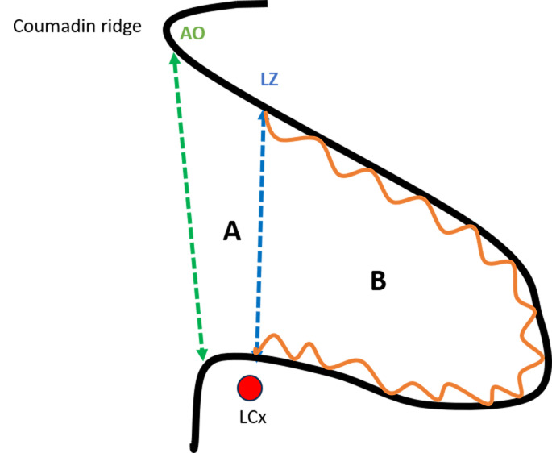
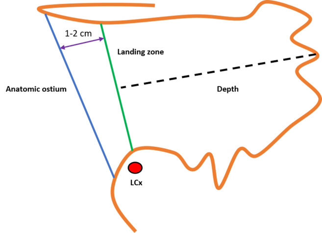
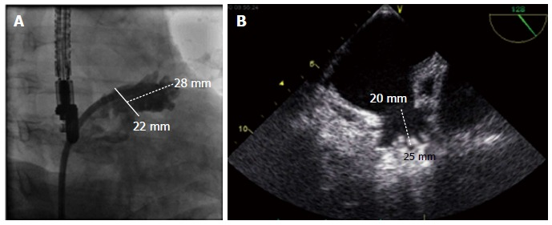
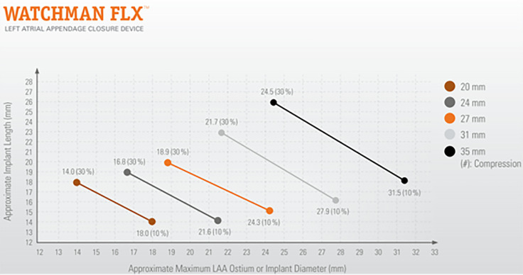
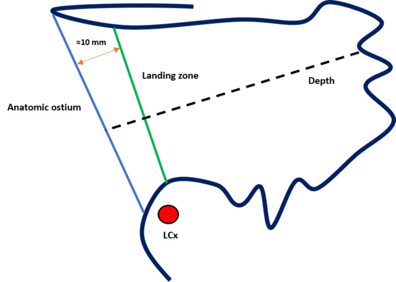
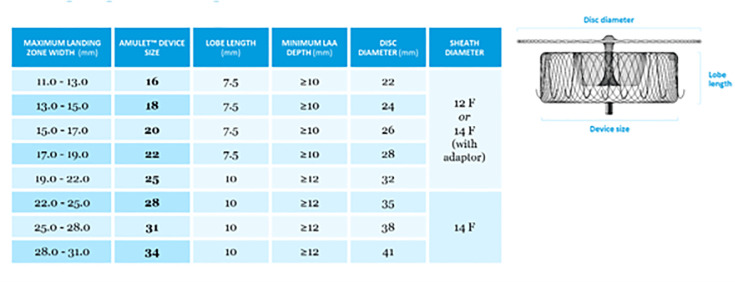

# LAAO TEE Sizing: Amulet vs Watchman FLX / 左心耳封堵器 TEE 量測方法

**整理：謝慕揚 MD, PhD, FESC**
**日期：2026-10-11**
**原文連結：[Rev Cardiovasc Med 2025 — Percutaneous LAA Closure: Current Evidence and Procedural Insights](https://doi.org/10.31083/RCM46003)**

圖片資料夾：`figures/laao-tee-sizing/`（全部取自 open-access 文獻或原廠公開資料）

---

## 1. 共通原則

- TEE 中段食道 (mid-esophageal) 由 **0° → 45° → 90° → 135°** 掃描，每個角度各量一次 ostium / landing zone 與 depth，取**最大值**選尺寸。
- 量測時機：**end-systole**（LAA 最大），且需有足夠容積負荷（mean LAP > 10 mmHg；脫水會低估）。
- 0° 與 135° 通常得到最寬的 ostium；45° 與 90° 通常得到最深的 depth。
- 解剖口 (anatomic ostium) = **LCx (左迴旋支) ↔ Coumadin ridge (LUPV 嵴) 尖端** 的連線。

---

## 2. Watchman FLX（Boston Scientific）

### 量什麼
| 項目 | 定義 |
|---|---|
| Ostium（landing zone）寬 | 下緣：**LCx** 位置（0° 以冠狀動脈為標記；45°/90°/135° 以 **mitral annulus 上緣**為起點）；上緣：**距 limbus/ridge 尖端約 1–2 cm (IFU: ~2 cm)** 的 LAA 壁 |
| Depth | 由 ostium 連線的中點**垂直**量到 LAA 最深處 (apex) |

### 選尺寸（FDA 標示 Table 78，依最大 ostium 寬）
| 最大 ostium 寬 (mm) | 裝置 (mm) |
|---|---|
| 14.0–18.0 | 20 |
| 16.8–21.6 | 24 |
| 18.9–24.3 | 27 |
| 21.7–27.9 | 31 |
| 24.5–31.5 | 35 |

- 可治療範圍 ostium **14.0–31.5 mm**。
- **Depth 要求：≥ 裝置標示直徑的一半**（20 mm → ≥ 10 mm；35 mm → ≥ 17.5 mm）。
- 目標壓縮率 **10–30%**；重疊區間時偏向大一號（compression 偏 20%）。
- 釋放前 PASS：Position（最大徑平面在 ostium 或略遠端）、Anchor（tug test）、Size（壓縮 10–30%）、Seal（leak ≤ 5 mm）。

---

## 3. Amplatzer Amulet（Abbott）

### 量什麼
| 項目 | 定義 |
|---|---|
| Ostium（解剖口） | LCx ↔ Coumadin ridge 尖端連線（disc 要蓋住它） |
| **Landing zone（決定尺寸）** | 由 ostium 往 LAA 內**約 10 mm**（大尺寸 25–34 mm 約 10–12 mm）處，**垂直於 LAA neck 長軸**量寬度；lobe 落在此處 |
| Depth | 從 ostium 平面沿預期裝置軸線垂直量到 LAA 壁 |

### 選尺寸（Abbott 原廠 sizing chart，依最大 landing zone 寬）
| 最大 landing zone 寬 (mm) | 裝置 (mm) | Lobe 長 (mm) | 最小 depth (mm) | Disc (mm) | Sheath |
|---|---|---|---|---|---|
| 11.0–13.0 | 16 | 7.5 | ≥ 10 | 22 | 12 F / 14 F |
| 13.0–15.0 | 18 | 7.5 | ≥ 10 | 24 | 12 F / 14 F |
| 15.0–17.0 | 20 | 7.5 | ≥ 10 | 26 | 12 F / 14 F |
| 17.0–19.0 | 22 | 7.5 | ≥ 10 | 28 | 12 F / 14 F |
| 19.0–22.0 | 25 | 10 | ≥ 12 | 32 | 14 F |
| 22.0–25.0 | 28 | 10 | ≥ 12 | 35 | 14 F |
| 25.0–28.0 | 31 | 10 | ≥ 12 | 38 | 14 F |
| 28.0–31.0 | 34 | 10 | ≥ 12 | 41 | 14 F |

- 可治療 landing zone **11–31 mm**；chart 本身已內建 **2–5 mm oversizing**（lobe 比 LZ 大）。
- LZ 很橢圓時，用最大徑會過度 oversize 短軸（> 5 mm 要小心）；可改用 mean / perimeter-derived 直徑。
- 小尺寸 Amulet 可比 chart 再多 1–2 mm oversize；ostium/neck 比值高時考慮較大 disc。
- 釋放前 CLOSE：**C**ompression 2/3 lobe 在 LCx 遠端、**L**obe 壓縮適當、**O**rientation 與 neck 軸一致、**S**eparation lobe 與 disc 分離、**E**lliptical/concave disc。

---

## 4. 兩者關鍵差異（一句話）

> **Watchman FLX 量「ostium 寬」選尺寸（LCx → ridge 下 1–2 cm），depth ≥ 裝置一半；Amulet 量「ostium 內 ~10 mm 的 landing zone 寬」選尺寸，depth ≥ 10（16–22 mm）或 ≥ 12 mm（25–34 mm）。**

---

## 參考文獻

1. Mohandes M, Anmad Shihadeh L, Pernigotti A, et al. Percutaneous Left Atrial Appendage Closure: Current Evidence and Procedural Insights. [*Rev Cardiovasc Med*. 2025;26(12):46003.](https://doi.org/10.31083/RCM46003) PMID 41524070 — 圖 1、11、12、18、19
2. Boston Scientific. WATCHMAN FLX Left Atrial Appendage Closure Device — Instructions for Use (FDA P130013/S074 labeling). [accessdata.fda.gov](https://www.accessdata.fda.gov/cdrh_docs/pdf13/P130013S074D.pdf) — TEE 角度地標與 Table 78
3. Abbott. AMPLATZER Amulet Left Atrial Appendage Occluder — Device Dimensions and Sizing Chart. [csi-congress.org PDF](https://www.csi-congress.org/sites/default/files/AMPLATZER_AMULET.pdf)
4. Saw J, Tzikas A, Shakir S, et al. Left atrial appendage occlusion with the AMPLATZER Amulet device: an expert consensus step-by-step approach. [*EuroIntervention*. 2017.](https://eurointervention.pcronline.com/article/left-atrial-appendage-occlusion-with-the-amplatzer-amulet-device-an-expert-consensus-step-by-step-approach)
5. Möbius-Winkler S, Majunke N, Sandri M, et al. Percutaneous left atrial appendage closure: Technical aspects and prevention of periprocedural complications with the Watchman device. [*World J Cardiol*. 2015;7(2):65-75.](https://doi.org/10.4330/wjc.v7.i2.65) — 圖 4、6
6. Optimizing Imaging Techniques for Left Atrial Appendage Closure: Insights and Emerging Directions. [*J Clin Med*. 2025;14:3607.](https://pmc.ncbi.nlm.nih.gov/articles/PMC12112684/) — 圖 2（CT）、3（TEE）
