<!-- _class: cover -->
<!-- _paginate: false -->

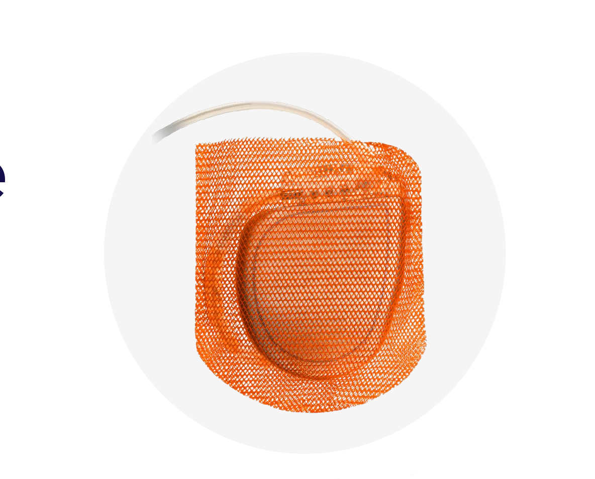

# TYRX 可吸收抗菌包膜

## The TYRX Absorbable Antibacterial Envelope

**TY**: Tyrosine 酪胺酸聚合物
**Rx**: Minocycline + Rifampin 兩種抗生素

**謝慕揚 MD, PhD, FESC**
譯自 Medtronic「TYRX 2026 Overview Deck」| 2026-10-17

---

# 大綱

1. 產品原理：裝置穩定與囊袋癒合 (pocket healing)
2. 問題的範圍：CIED 感染有多嚴重
3. 藥理：為什麼是 minocycline 加 rifampin
4. 禁忌症與注意事項
5. 臨床證據：WRAP-IT 隨機試驗
6. 真實世界資料：REINFORCE、台灣經驗與指引共識

> 本講義為教學翻譯整理；原始投影片屬 Medtronic 行銷素材，數據請以原始文獻為準。每頁註解與標題中的試驗名稱都是可點選的全文連結。

---

<!-- _class: divider -->

# 一、產品原理
## 裝置穩定 (stabilization) 與囊袋癒合 (pocket healing)

---

# TYRX 包膜：三個核心設計

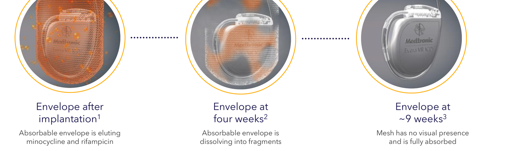

- **聚合物控制釋放**：抗生素由 tyrosine 聚合物控制溶出，至少維持 7 天
- **局部給藥**：minocycline 與 rifampin 直接釋放到囊袋組織
- **可吸收網布**：多股編織網布，約 9 週吸收

*右圖：植入後、4 週、約 9 週的包膜外觀變化。*
*來源：Medtronic 臨床前研究 (Huntingdon Life Sciences TR-2013-001；Sinclair Labs D13599)，為 data on file，無公開連結。*

---

# 兩種抗生素的化學結構

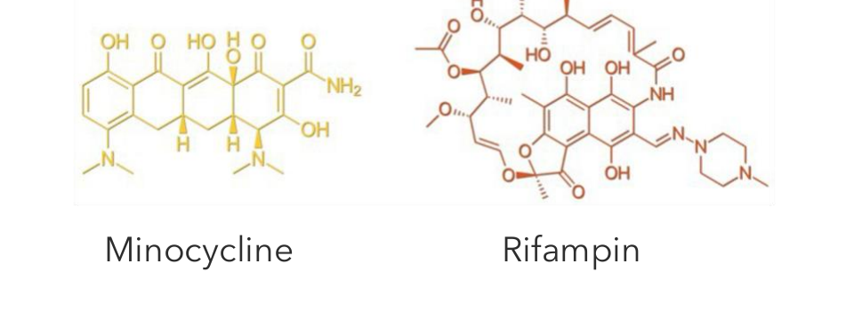

- **Minocycline**：tetracycline 類，抑菌 (bacteriostatic)，抑制蛋白質合成
- **Rifampin**：殺菌 (bactericidal)，抑制 DNA-dependent RNA polymerase
- 兩者合用對 coagulase (-) staphylococci 與 S. aureus 有互補作用

*體外協同作用：[Zinner SH, et al. J Infect Dis 1981;144:365-371](https://doi.org/10.1093/infdis/144.4.365)；[Segreti J, et al. Diagn Microbiol Infect Dis 1989;12:253-255](https://doi.org/10.1016/0732-8893%2889%2990022-9)。*

---

# 四個理由：T‑I‑M‑E

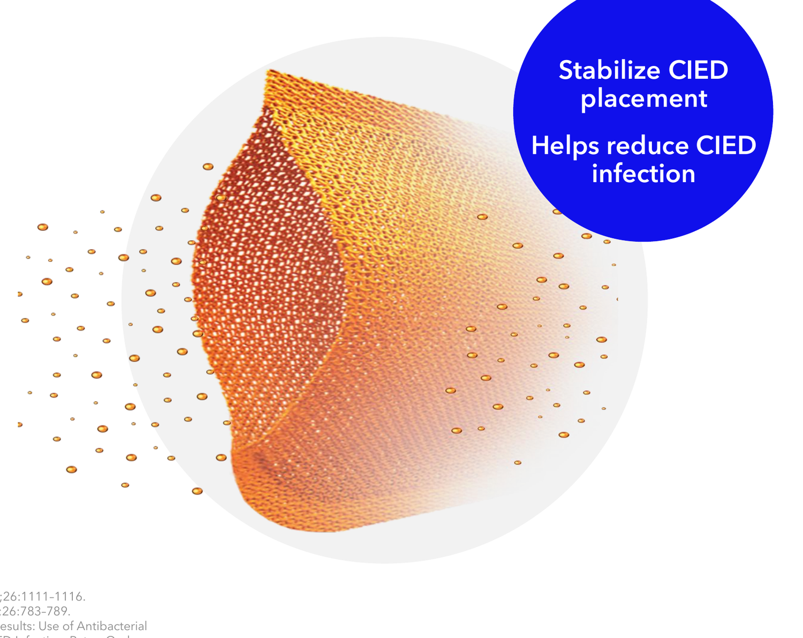

- **T**widdler syndrome：減少裝置被纏繞
- **I**nfection：降低 CIED 感染
- **M**igration：減少裝置移位
- **E**rosion：減少裝置磨穿皮膚

總結一句：先固定裝置，再壓低感染風險。

*Twiddler 病例系列：[Osoro M, et al. Pacing Clin Electrophysiol 2018;41:136-142](https://doi.org/10.1111/pace.13259)。感染：見第五章 [WRAP-IT](https://doi.org/10.1056/NEJMoa1901111)。*

---

# 裝置穩定：動物實驗的組織反應

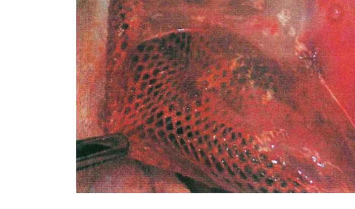 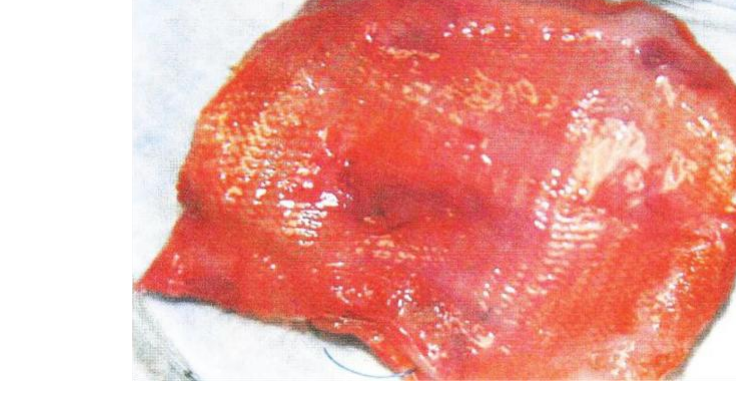 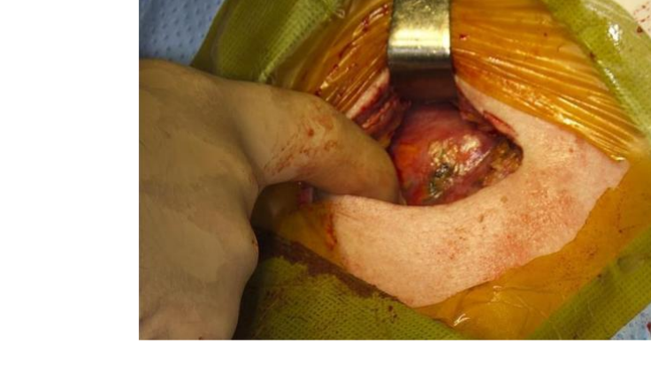

| 植入後 1 天 | 植入後 7 天 | 植入後 5 週 |
|---|---|---|
| 纖維結締組織反應開始 | 組織立即長入網布，固定裝置 | 網布已吸收，囊袋成形 |

*左、中：Huntingdon Life Sciences TR-2011-054 (Medtronic data on file)。右：Francois Philippon, MD (Laval University) 提供。同類已發表的動物資料見 [Virmani R, et al. Heart Rhythm 2024](https://doi.org/10.1016/j.hrthm.2024.02.054)。*

---

# 裝置穩定：為什麼網布有用

- 植入物（CIED、神經刺激器）會引發宿主反應，約 30 天形成纖維囊 (fibrous capsule)
- 活體模型顯示，TYRX 多孔網布讓緻密纖維結締組織**立即長入**，7 到 14 天內固定裝置
- 網布存在約 9 週 (63 天)，遠長於組織長入所需的時間

> 說穿了，網布只是暫時的鷹架。組織長好了，鷹架就自行消失。

*囊袋組織學的人體資料：[Massaro G, et al. Heart Rhythm 2023;20:198-206](https://doi.org/10.1016/j.hrthm.2022.10.017)。*

---

# [TYRX Pocket Health Study](https://doi.org/10.1111/jce.16766)：Philippon, JCE 2025

## 可吸收抗菌包膜促進健康的 CIED 囊袋形成

- **目的**：評估曾用 TYRX 的病人，回來做二次手術時囊袋的組織學與形態特徵
- **設計**：前瞻性觀察研究 (NCT05356546)，2022-06 至 2023-07，9 個中心
- 27 個囊袋，兩次手術平均相隔 6.8 年；與歷史對照比較

> 結果：沾黏顯著較少 (p < 0.05)；囊膜顯著較薄 (**0.33 ± 0.16 mm** vs 對照 0.8 ± 0.3 mm，p < 0.0001)，以 type I 膠原為主；96% 的囊袋發炎為無到輕度；無臨床上顯著的鈣化。

*[Philippon F, Ladich E, Virmani R, et al. J Cardiovasc Electrophysiol 2025;36(8)](https://doi.org/10.1111/jce.16766)。初步結果曾於 [HRS 2024 發表 (PO-04-162)](https://doi.org/10.1016/j.hrthm.2024.03.1193)。*

---

# [Pocket Health Study](https://doi.org/10.1111/jce.16766)：組織學所見

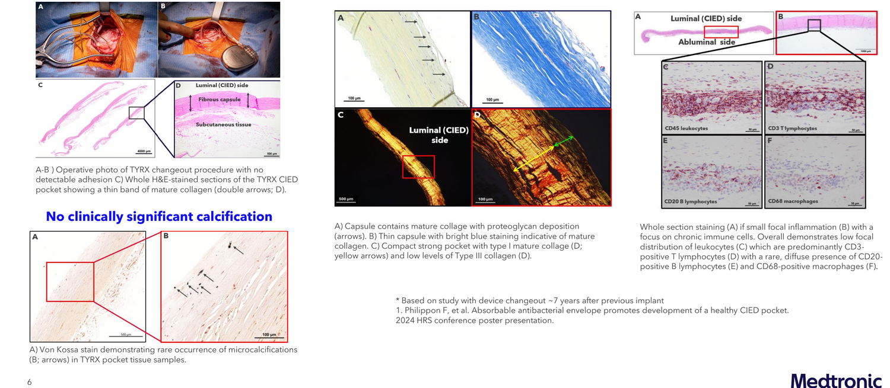

*左上：手術照片無沾黏，H&E 見薄層成熟膠原。中：成熟 type I 膠原。右：發炎細胞少，以 CD3 T 細胞為主。左下：Von Kossa 僅見罕見微鈣化。圖取自原簡報；全文見 [Philippon F, et al. JCE 2025](https://doi.org/10.1111/jce.16766)。*

---

# 包膜對囊袋癒合的影響：[Virmani, Heart Rhythm 2024](https://doi.org/10.1016/j.hrthm.2024.02.054)

## 頭對頭的臨床前比較 (TYRX vs CanGaroo ECM vs 無包膜)

- **設計**：羊隻模型 (n=21)，共 110 個 CIED 囊袋
- 時間序列組織病理與形態分析，獨立盲性判讀，採 ISO 10993-6:2016 評分
- **結果**（與 CanGaroo 相比，TYRX 上市版）：
  - 組織整合更快，早期即穩定
  - 發炎更低、囊膜更薄
  - 可吸收進入自體組織

> 結論：TYRX 囊袋的發炎程度與對照組相當，provisional matrix 沉積與組織貼合更快，形成癒合良好的囊袋。

*[Virmani R, Philippon F, Mittal S, et al. Heart Rhythm 2024;21(8)](https://doi.org/10.1016/j.hrthm.2024.02.054)。臨床前資料不代表臨床表現。*

---

# [12 週時間序列比較](https://doi.org/10.1016/j.hrthm.2024.02.054)

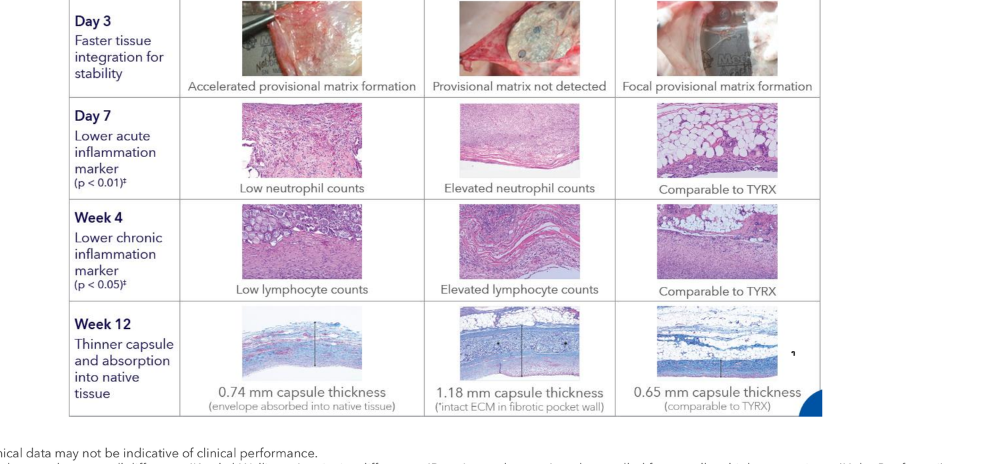

*第 3 天：TYRX 加速 provisional matrix 形成。第 7 天與第 4 週：急性與慢性發炎指標較 ECM 低。第 12 週囊膜厚度：TYRX 0.74 mm、ECM 1.18 mm、無包膜 0.65 mm。[Virmani R, et al. Heart Rhythm 2024](https://doi.org/10.1016/j.hrthm.2024.02.054)。*

---

<!-- _class: divider -->

# 二、問題的範圍
## CIED 感染：發生率、後果與現行預防方式

---

# CIED 包膜市場競爭者漸增

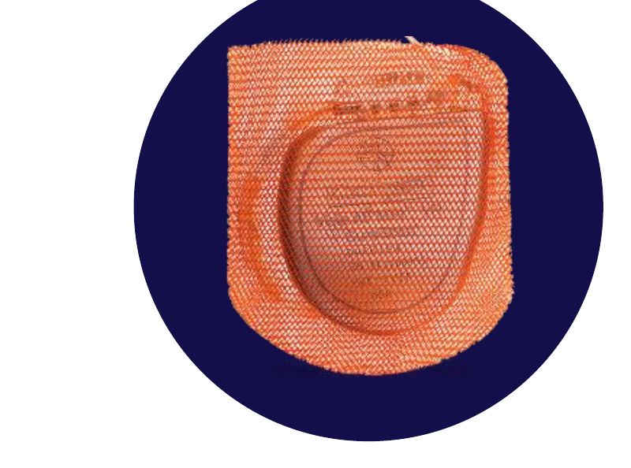 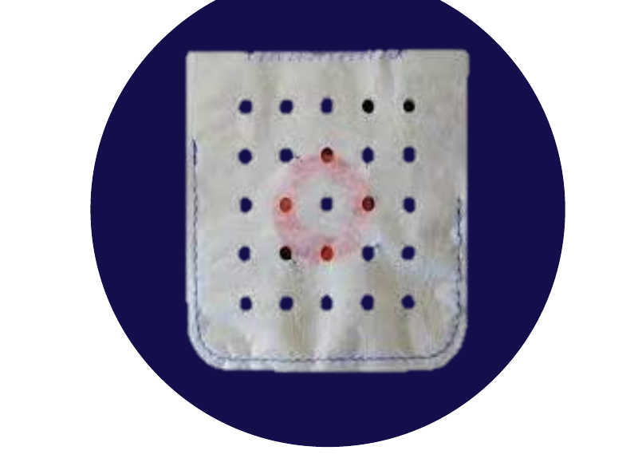 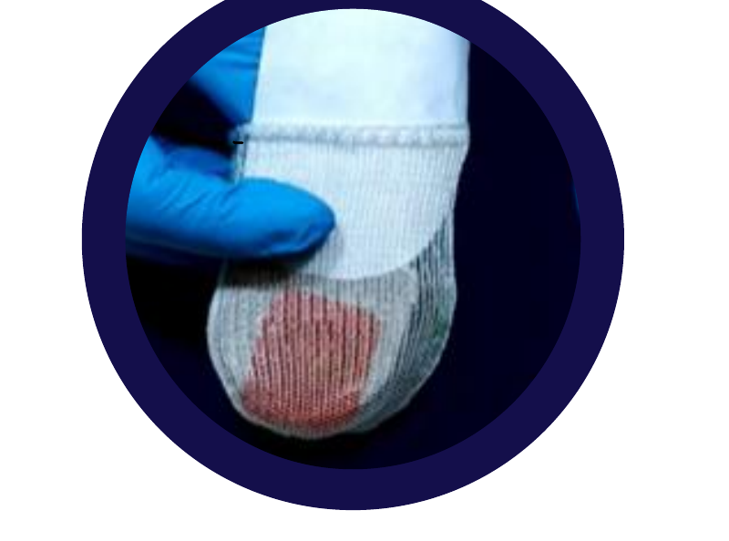

| TYRX (Medtronic) | EluPro (Boston Scientific) | Vesta (Hylomorph) |
|---|---|---|
| 臨床證據最完整 | 強調易用性與「生物性益處」 | 強調易用性 |
| 獲學會共識背書 | 搭配 BSX 合約綑綁 | 可吸收網布、製造成本低 |

*另有多種低成本非包膜選項：Tauropace、Irrisept、Collatamp、Surgicel。本頁為原簡報的市場觀點，非文獻資料。*

---

# 問題的範圍

## CIED 感染發生率 1 到 4%，高風險病人可達 3 到 7%

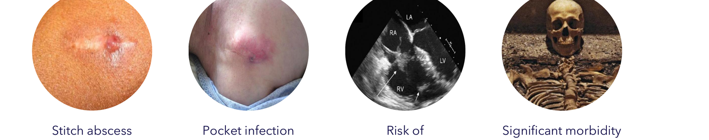

由左至右：縫線膿瘍 (stitch abscess)、囊袋感染 (pocket infection)、心內膜炎風險、顯著的併發症與死亡。

*[Sohail MR, et al. Pacing Clin Electrophysiol 2015;38:231-239](https://doi.org/10.1111/pace.12518)。*

---

<!-- _class: stats -->

# 挑戰與衝擊：CIED 感染

全球每年約 150 萬人接受 CIED 植入。感染是嚴重的手術相關併發症。

| 1 到 4% | 7 到 21 天 | 10 億美元 |
|---|---|---|
| CIED 病人發生感染 | 平均住院天數 (美國資料) | 全球 CIED 感染的估計花費 |

| 22 到 56% | > 3 倍 | 48 到 83K |
|---|---|---|
| 病人屬感染風險增加族群 | 一年死亡風險 | 美元，每例感染的平均住院費 |

*[Mond HG 2011](https://doi.org/10.1111/j.1540-8159.2011.03150.x)；[Tarakji KG 2016](https://doi.org/10.15420/aer.2015.27.2)；[Tarakji KG 2019](https://doi.org/10.1056/NEJMoa1901111)；[Mittal S 2014](https://doi.org/10.1016/j.hrthm.2013.12.013)；[Sohail MR 2011](https://doi.org/10.1001/archinternmed.2011.441)；[Wilkoff BL 2020](https://doi.org/10.1161/CIRCEP.119.008280)；[Shariff N 2015](https://doi.org/10.1111/jce.12684)。*

---

# 現行 CIED 感染預防方式

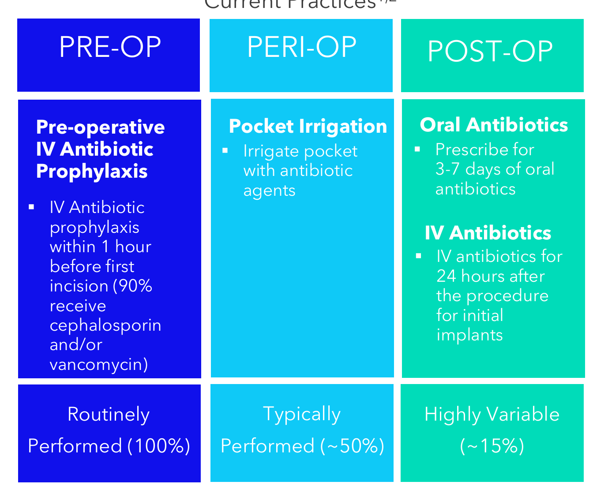

- 預防方式因醫師而異，且不分風險高低，多數病人用同一套
- **術前**：切皮前 1 小時內靜脈抗生素，幾乎 100% 執行，90% 用 cephalosporin 或 vancomycin
- **術中**：囊袋抗生素沖洗，約 50% 執行
- **術後**：口服 3 到 7 天或靜脈 24 小時，差異極大，約 15%
- Cefazolin 與 vancomycin 都有缺口：**七成感染由 coagulase (-) staphylococci 與 S. aureus 造成**

*執行率來自 TYRX 委託調查 (MEDACorp 2007；Easton 2008)，無公開連結。術前抗生素的 RCT 證據：[de Oliveira JC, et al. Circ Arrhythm Electrophysiol 2009;2:29-34](https://doi.org/10.1161/CIRCEP.108.795906)。*

---

# [PADIT 試驗](https://doi.org/10.1016/j.jacc.2018.09.068)：加強抗生素有沒有用

## Prevention of Arrhythmia Device Infection Trial

- **設計**：叢集隨機交叉試驗，4 個隨機分派的 6 個月期間
- **傳統組**：術前單劑靜脈 cefazolin
- **加強組**：術前 cefazolin 加 vancomycin、術中 bacitracin 囊袋沖洗、術後 2 天 cephalosporin
- **規模**：19,559 位病人，28 個中心，2 個國家

> 結果：傳統組感染率 1.23%，加強組 1.01%。差異不顯著。也就是，單靠全身性抗生素加碼，壓不下感染率。

*[Krahn AD, Longtin Y, Philippon F, et al. J Am Coll Cardiol 2018;72:3098-3109](https://doi.org/10.1016/j.jacc.2018.09.068)。*

---

# [PADIT 感染風險分數](https://doi.org/10.1016/j.jacc.2019.09.060)

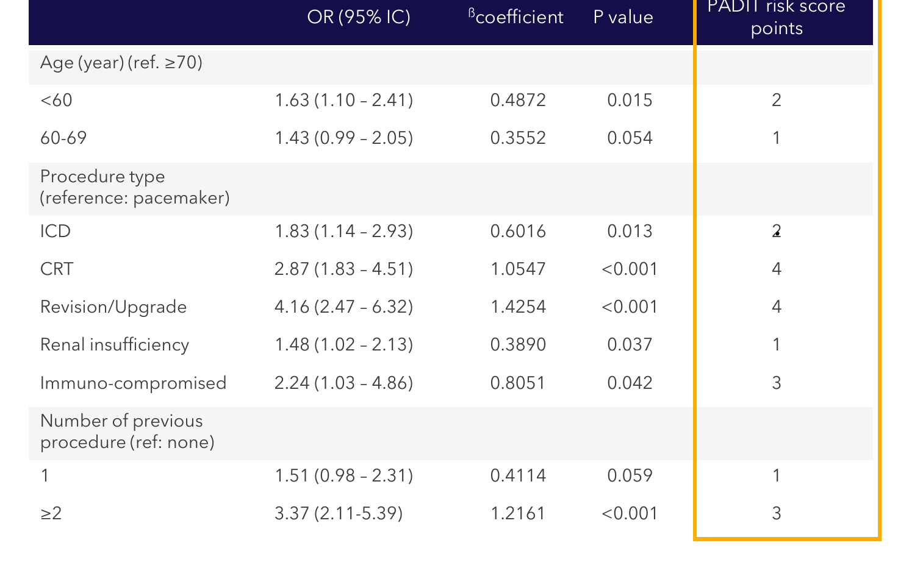

| 項目 | 分數 |
|---|---|
| 年齡 < 60 歲 / 60 到 69 歲 | 2 / 1 |
| ICD / CRT / 更換或升級 | 2 / 4 / 4 |
| 腎功能不全 / 免疫低下 | 1 / 3 |
| 先前手術 1 次 / ≥ 2 次 | 1 / 3 |

- 分數 < 4：感染率 < 1%
- 分數 4 到 6：< 1.9%
- 分數 ≥ 7：< 3.5%

*[Birnie DH, Wang J, Alings M, et al. J Am Coll Cardiol 2019;74:2845-2854](https://doi.org/10.1016/j.jacc.2019.09.060)。*

---

# 「不是醫護人員傳給我的，是我自己的 Staph」

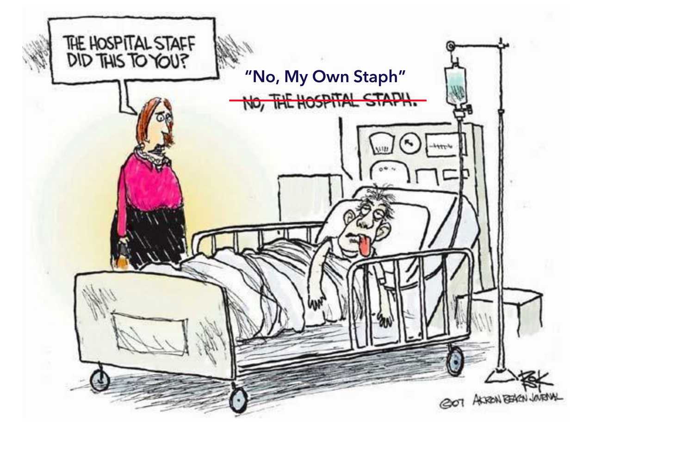

*漫畫原意：病人自身的皮膚菌叢，才是 CIED 感染最主要的來源。前瞻性證據：[Da Costa A, et al. Circulation 1998;97:1791-1795](https://doi.org/10.1161/01.cir.97.18.1791)。*

---

# 兩種細菌占約七成 CIED 感染

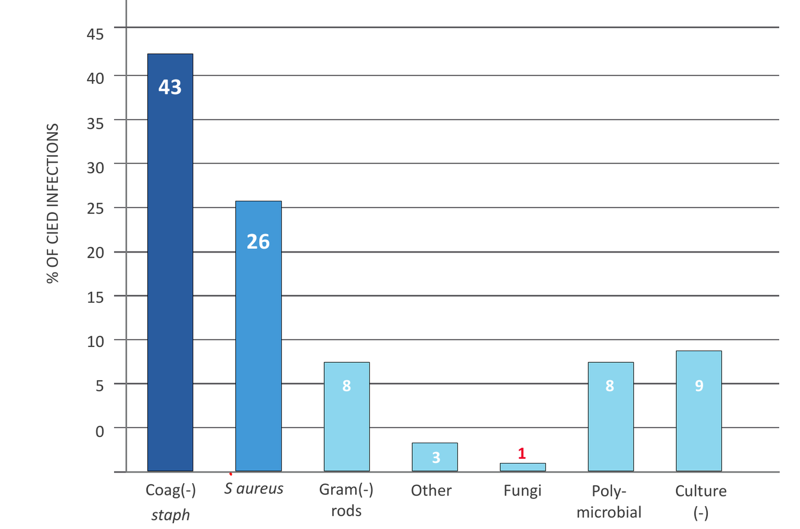

- Coagulase (-) staphylococci：**43%**
- S. aureus：**26%**
- Gram (-) rods：8%、多重菌 8%
- 培養陰性 9%、其他 3%、黴菌 1%

Minocycline 加 rifampin 的組合，正是針對這兩種主要致病菌。

*七篇文獻彙整：[Wisplinghoff 2004](https://doi.org/10.1086/421946)；[Klug 2007](https://doi.org/10.1161/CIRCULATIONAHA.106.678664)；[Da Costa 1998](https://doi.org/10.1161/01.cir.97.18.1791)；[de Oliveira 2009](https://doi.org/10.1161/CIRCEP.108.795906)；[NNIS 2004](https://pubmed.ncbi.nlm.nih.gov/15573054/)；[Lekkerkerker 2009](https://doi.org/10.1136/hrt.2008.151985)；[Chua 2000](https://doi.org/10.7326/0003-4819-133-8-200010170-00011)。*

---

# 為什麼是葡萄球菌 (staphylococci)

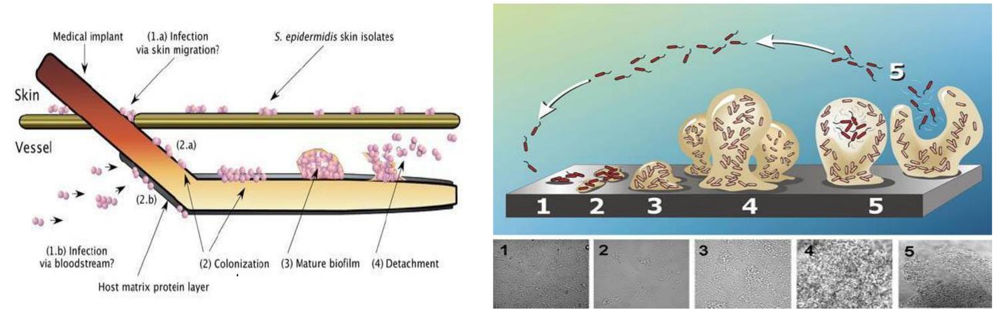

- 無所不在的**皮膚共生菌**；表現多種**黏附因子** (adherence factors)
- 會形成**生物膜** (biofilm)
- 因此是裝置相關血流感染的最主要原因

*[Sohail MR, et al. J Am Coll Cardiol 2007;49:1851-1859](https://doi.org/10.1016/j.jacc.2007.01.072)。*

---

# 囊袋細菌定殖 (colonization) 是常態

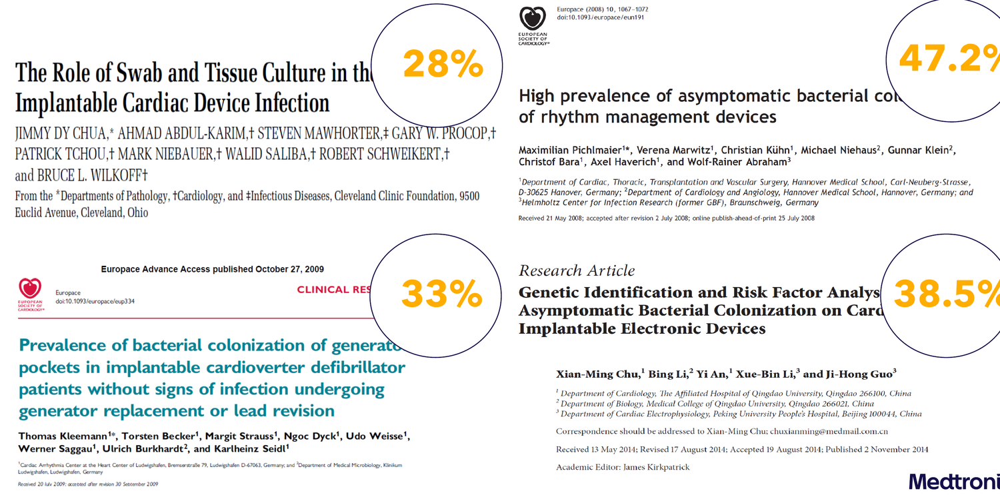

*無感染徵象的病人在更換電池或導線時，囊袋培養或分子檢測陽性率：[28% (Chua 2005)](https://doi.org/10.1111/j.1540-8159.2005.00268.x)、[33% (Kleemann 2010)](https://doi.org/10.1093/europace/eup334)、[38.5% (Chu 2014)](https://doi.org/10.1155/2014/725163)、[47.2% (Pichlmaier 2008)](https://doi.org/10.1093/europace/eun191)。*

---

# 打破生物膜：蟻窩的比喻

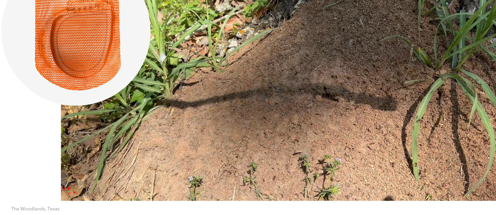

- 生物膜就像蟻窩，表面看不出來，裡面卻密密麻麻
- 全身性抗生素只能在蟻窩外灑藥
- 局部高濃度、持續釋放的抗生素，才能在細菌剛附著、還沒築窩時處理掉

> 為什麼 TYRX 重要？因為它在頭 7 天把藥直接送到細菌築窩處。

*動物模型中 TYRX 消除生物膜：[Hansen LK, et al. Pacing Clin Electrophysiol 2009;32:898-907](https://doi.org/10.1111/j.1540-8159.2009.02406.x)。*

---

<!-- _class: divider -->

# 三、藥理
## 為什麼是 minocycline 加 rifampin

---

# 輔助性抗生素預防：各藥物對 CIED 致病菌的涵蓋

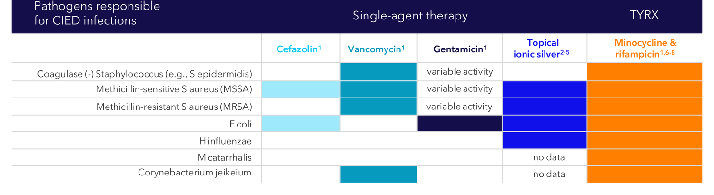

*深色格代表有活性；淺色格代表活性不一；空白代表無活性或無資料。TYRX 的 minocycline 加 rifampin 對表列所有菌種皆有涵蓋。*
*[Sanford Guide](https://www.sanfordguide.com/)；[Percival SL 2011](https://doi.org/10.1111/j.1524-475X.2011.00739.x)；[Zinner SH 1981](https://doi.org/10.1093/infdis/144.4.365)；[Darouiche RO 1995](https://doi.org/10.1016/0924-8579%2895%2900017-3)；[Segreti J 1989](https://doi.org/10.1016/0732-8893%2889%2990022-9)。*

---

# 單一藥物的缺口

- **Cefazolin 與 vancomycin** 很少合併使用，單獨用來預防 CIED 感染有明顯不足
  - 兩者涵蓋範圍大量重疊，都針對 gram (+)
  - 對 gram (-) 都不強
- **Gentamicin** 對 coagulase (-) staphylococci、MSSA、MRSA 活性不一，不可靠
- **外用離子銀** 對 coagulase (-) staphylococci 沒有活性，對 M. catarrhalis 與 Corynebacterium jeikeium 沒有資料

> 簡單來說，現行預防用藥沒有一種同時穩定涵蓋最常見的兩種致病菌。

*抗菌譜依據 [Sanford Guide](https://www.sanfordguide.com/)；離子銀資料 [Percival SL, et al. Wound Repair Regen 2011;19:767-774](https://doi.org/10.1111/j.1524-475X.2011.00739.x)。*

---

# Minocycline 加 rifampin 顯著降低感染：5 篇 RCT

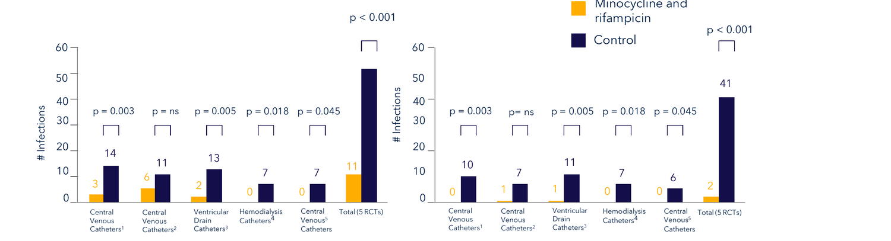

- 左：整體感染，合併 5 篇 RCT 後**風險降為 1/4.8** (relative risk 0.2)
- 右：coagulase (-) staphylococci 與 S. aureus 感染，**風險降為 1/20.6** (relative risk 0.05)

*導管相關感染試驗：[Hanna 2004](https://doi.org/10.1200/JCO.2004.04.124)；[León 2004](https://doi.org/10.1007/s00134-004-2378-2)；[Zabramski 2003](https://doi.org/10.3171/jns.2003.98.4.0725)；[Chatzinikolaou 2003](https://doi.org/10.1016/s0002-9343%2803%2900367-x)；[Raad 1997](https://doi.org/10.7326/0003-4819-127-4-199708150-00002)。*

---

# 局部給藥：用 10% 的劑量達到殺菌濃度

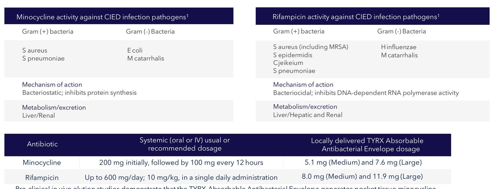

*局部釋放讓囊袋組織在植入 2 小時內達到主要致病菌的 MIC，並維持至少 7 天。抗菌譜：[Sanford Guide](https://www.sanfordguide.com/)；溶出資料：Huntingdon TR-2013-001 (data on file)。*

---

# 劑量比較：全身給藥 vs TYRX 包膜

| 抗生素 | 全身性 (口服或靜脈) 常用劑量 | TYRX 包膜含量 |
|---|---|---|
| Minocycline | 首劑 200 mg，之後每 12 小時 100 mg | 5.1 mg (Medium)、7.6 mg (Large) |
| Rifampin | 每日最多 600 mg (10 mg/kg)，單次給予 | 8.0 mg (Medium)、11.9 mg (Large) |

- 劑量只有全身給藥的約 **10%**，卻能在囊袋組織達到超過 MIC 的濃度
- 臨床前活體溶出研究：植入 2 小時內超過 MIC，至少維持 7 天
- 全身暴露極低，理論上藥物交互作用與全身副作用也低

*全身劑量：[Sanford Guide](https://www.sanfordguide.com/)。包膜含量：[TYRX 產品頁 (Medtronic)](https://www.medtronic.com/en-us/healthcare-professionals/products/cardiac-rhythm/cardiac-infection-prevention/tyrx-absorbable-antibacterial-envelope.html)。*

---

# TYRX 可吸收抗菌包膜：一頁總結

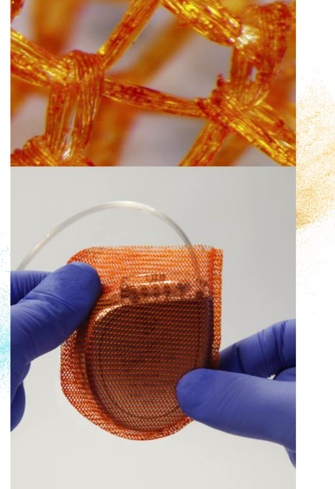

- 經證實的 **CIED 穩定**作用
- 局部釋放的輔助性抗菌保護，**降低 CIED 感染**
- 兩種抗生素在囊袋組織內溶出，**2 小時**達 MIC，維持至少 **7 天**
- 多股網布約 **9 週**吸收；更換或修正手術時，手術技巧不需改變
- 吸收後**不留異物**，不會成為日後感染的病灶 (nidus)

*感染降低的證據：[WRAP-IT, NEJM 2019](https://doi.org/10.1056/NEJMoa1901111)。穩定作用：[Osoro M, et al. PACE 2018](https://doi.org/10.1111/pace.13259)。*

---

# Tyrosine：「聚合物才是關鍵科學」

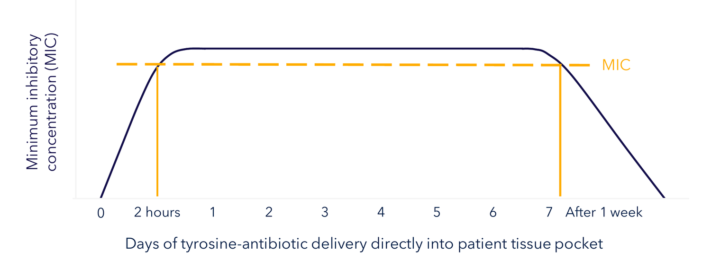

- Tyrosine 聚合物控制藥物釋放：**2 小時**內達 MIC，持續至少 **7 天**，之後逐漸下降
- 不是「一次倒進去」的 bolus，而是在最需要的時間窗維持有效濃度

*示意圖取自原簡報；溶出動力學為 Medtronic data on file。動物感染模型中的實際效果：[Hansen LK, et al. PACE 2009](https://doi.org/10.1111/j.1540-8159.2009.02406.x)。*

---

# 溶出與吸收的時間序列

| 植入後 | 4 週 | 約 9 週 |
|---|---|---|
| 包膜持續釋放 minocycline 與 rifampin | 包膜溶解成碎片 | 網布已無肉眼可見的殘留，完全吸收 |

*Medtronic 臨床前資料，無公開連結。羊隻模型的吸收過程見 [Virmani R, et al. Heart Rhythm 2024](https://doi.org/10.1016/j.hrthm.2024.02.054)。*

---

<!-- _class: divider -->

# 四、禁忌症與注意事項
## 仿單 (IFU) 規範

---

# 禁忌症：下列情況不應使用

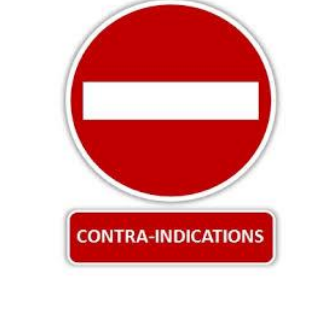

- **全身性紅斑狼瘡 (SLE)**：minocycline 曾被報告會使病情惡化
- 對下列物質過敏或有過敏史：
  - Tetracyclines (minocycline)
  - Rifampin
  - 可吸收網布材質 (glycoprene II)
- **已污染或已感染的傷口**

*依據 TYRX 仿單；[Medtronic 產品頁](https://www.medtronic.com/en-us/healthcare-professionals/products/cardiac-rhythm/cardiac-infection-prevention/tyrx-absorbable-antibacterial-envelope.html)。*

---

# 注意事項

- 只有具備植入 pulse generator 或 defibrillator 資格的醫師才可使用
- Rifampin 與 minocycline 之間沒有已知的交互作用
- 與許多藥物一樣，minocycline 與 rifampin 若直接接觸**含碘溶液**，效果可能降低
- **不要改變**原本術前、術中、術後局部或全身抗生素的常規做法

> 一句話：TYRX 是輔助 (adjunctive)，不是取代。該給的靜脈抗生素還是要給。

*依據 TYRX 仿單；[Medtronic 產品頁](https://www.medtronic.com/en-us/healthcare-professionals/products/cardiac-rhythm/cardiac-infection-prevention/tyrx-absorbable-antibacterial-envelope.html)。*

---

# 對抗生素的過敏反應

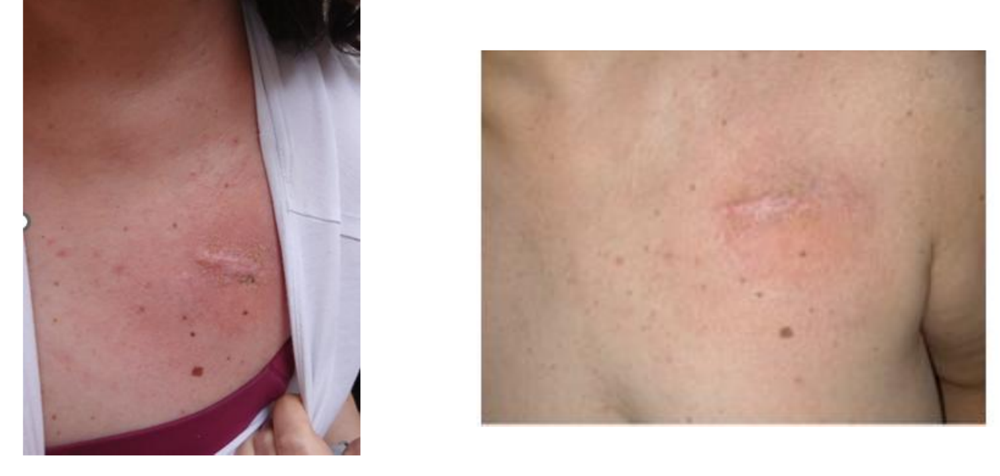

*植入後胸前瀰漫性紅疹。要同時考慮 minocycline、rifampin 與網布材質三種可能。台灣資料亦有 2 例包膜過敏：[Chang CF, et al. Acta Cardiol Sin 2025](https://doi.org/10.6515/ACS.202505_41%283%29.20250107A)。*

---

# 對網布材質的過敏反應

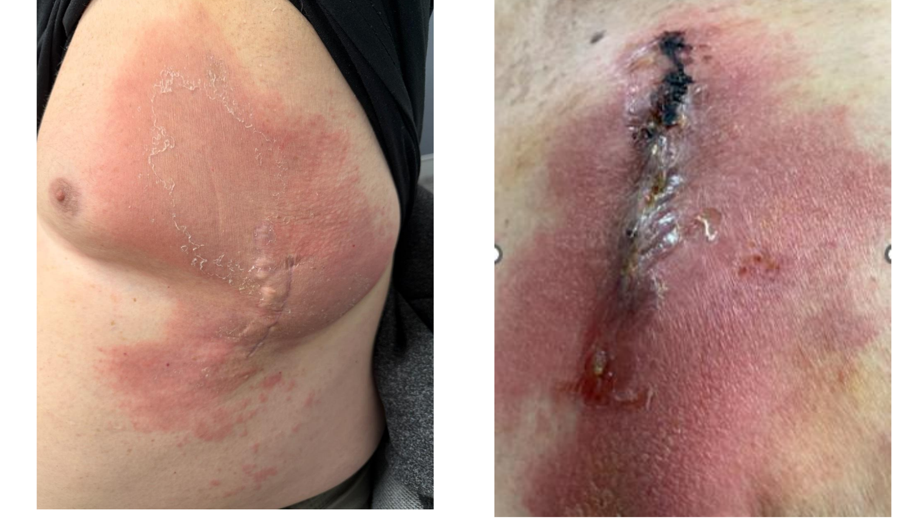

*左：切口周圍大範圍紅斑。右：切口紅腫與滲出。需與早期囊袋感染鑑別。照片為原簡報病例，未發表。*

---

<!-- _class: divider -->

# 五、臨床證據
## WRAP-IT 隨機對照試驗

---

# CIED 感染顯著降低：TYRX 臨床證據總覽

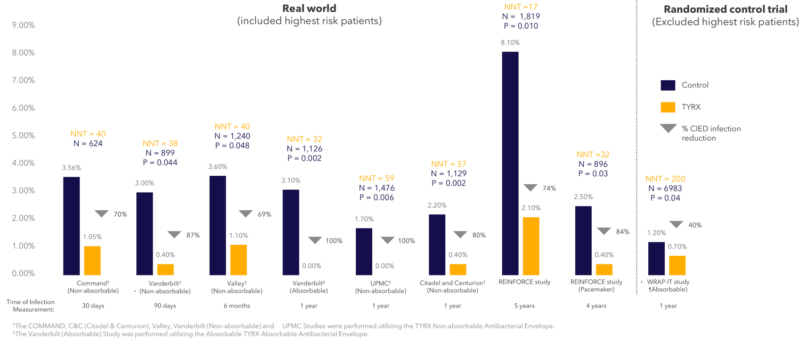

*左：真實世界 (含最高風險病人)；右：WRAP-IT RCT。深色對照、淺色 TYRX。[COMMAND (Henrikson 2017)](https://doi.org/10.1016/j.jacep.2017.02.016)、[Vanderbilt (Kolek 2013)](https://doi.org/10.1111/pace.12063)、[Valley (Mittal 2014)](https://doi.org/10.1016/j.hrthm.2013.12.013)、[Vanderbilt abs. (Kolek 2015)](https://doi.org/10.1111/jce.12768)、[UPMC (Shariff 2015)](https://doi.org/10.1111/jce.12684)、[Citadel/Centurion (Bloom 2011)](https://doi.org/10.1111/j.1540-8159.2010.02931.x)、[REINFORCE (Ziacchi 2023)](https://doi.org/10.1093/europace/euad224)、[REINFORCE PM (2025)](https://doi.org/10.1016/j.hroo.2025.06.012)、[WRAP-IT (Tarakji 2019)](https://doi.org/10.1056/NEJMoa1901111)。*

---

<!-- _class: stats -->

# [WRAP-IT](https://doi.org/10.1056/NEJMoa1901111)：全球最大 CIED RCT

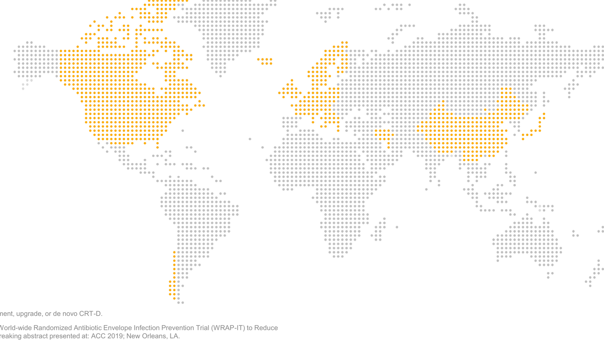

| 6,983 | 776 |
|---|---|
| 高囊袋感染風險病人 | 植入醫師 |

| 181 | 25 |
|---|---|
| 中心 | 國家 |

*納入條件：CIED 修正、電池更換、升級，或 de novo CRT-D。*
*[Tarakji KG, Mittal S, Kennergren C, et al. N Engl J Med 2019;380:1895-1905](https://doi.org/10.1056/NEJMoa1901111)。*

---

# [WRAP-IT](https://doi.org/10.1056/NEJMoa1901111)：研究目的

> 評估在標準感染預防措施之外，加用 TYRX 包膜降低 CIED 感染的**安全性**與**有效性**。

### 試驗定義的 CIED 感染

- 表淺蜂窩性組織炎合併傷口裂開、磨穿或膿性分泌物，或
- 深部切口或 generator 囊袋感染，或
- 持續性菌血症，或
- 心內膜炎

*[Tarakji KG, et al. N Engl J Med 2019;380:1895-1905](https://doi.org/10.1056/NEJMoa1901111)。*

---

# [WRAP-IT](https://doi.org/10.1056/NEJMoa1901111)：主要感染 (major infection) 的定義

符合下列一項以上，即定義為主要 CIED 感染：

- CIED 系統**移除**
- 任何**侵入性處置**（例如打開囊袋）但未移除系統
- 病人不適合移除系統時，給予**延長抗生素治療**
- **死亡**

*主要終點：12 個月內需系統拔除或修正、長期抗生素治療且感染復發，或死亡。[Tarakji KG, et al. NEJM 2019](https://doi.org/10.1056/NEJMoa1901111)。*

---

# [WRAP-IT](https://doi.org/10.1056/NEJMoa1901111)：試驗設計

- 前瞻性、隨機、對照、多中心、全球試驗
- 1:1 隨機分派至 TYRX 包膜組與對照組（不用 TYRX）
- 獨立臨床事件委員會：心臟電生理與感染科專家
- 獨立資料監測委員會
- 結果由 Cleveland Clinic Coordinating Center for Clinical Research 獨立驗證

### 納入：囊袋感染風險增加者

- 任何 CIED generator 更換、系統升級或修正
- 初次 CRT-D 植入

---

# [WRAP-IT](https://doi.org/10.1056/NEJMoa1901111)：排除最高風險的病人

> 排除全身性感染風險最高的族群：
> - de novo pacemaker 與 de novo ICD
> - 血液透析或腹膜透析
> - 免疫抑制劑（長期口服，或 prednisone ≥ 20 mg）
> - 近 12 個月內或現存的感染

總結一句：WRAP-IT 證明的是中高風險族群的效益；最高風險族群要看真實世界資料。

*[Tarakji KG, et al. N Engl J Med 2019;380:1895-1905](https://doi.org/10.1056/NEJMoa1901111)。*

---

<!-- _class: stats -->

# [WRAP-IT](https://doi.org/10.1056/NEJMoa1901111)：主要結果

| 40% | 61% | 安全達標 |
|---|---|---|
| 主要 CIED 感染降低 (主要終點) | 囊袋 CIED 感染降低 | 12 個月內未增加併發症風險 |

這些結果為 TYRX 包膜提供了目前最完整的 CIED 感染預防證據。

*[Tarakji KG, Mittal S, Kennergren C, et al. N Engl J Med 2019;380:1895-1905](https://doi.org/10.1056/NEJMoa1901111)。*

---

# [WRAP-IT](https://doi.org/10.1056/NEJMoa1901111)：Kaplan-Meier 曲線

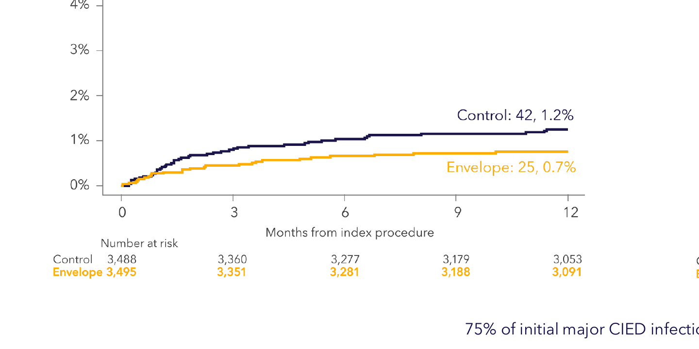 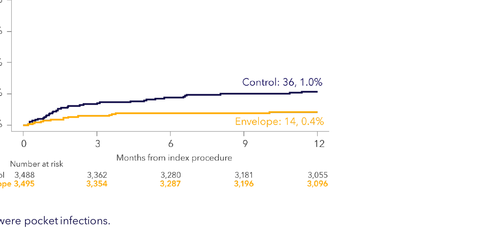

- **左、主要感染**：HR 0.60 (95% CI 0.36-0.98)，p = 0.04。12 個月 0.7% vs 1.2%
- **右、囊袋感染**：HR 0.39 (95% CI 0.21-0.72)，p < 0.01。0.4% vs 1.0%
- 初次主要 CIED 感染中，**75%** 是囊袋感染

*[Tarakji KG, et al. N Engl J Med 2019;380:1895-1905](https://doi.org/10.1056/NEJMoa1901111)。*

---

# [WRAP-IT](https://doi.org/10.1056/NEJMoa1901111)：併發症未增加

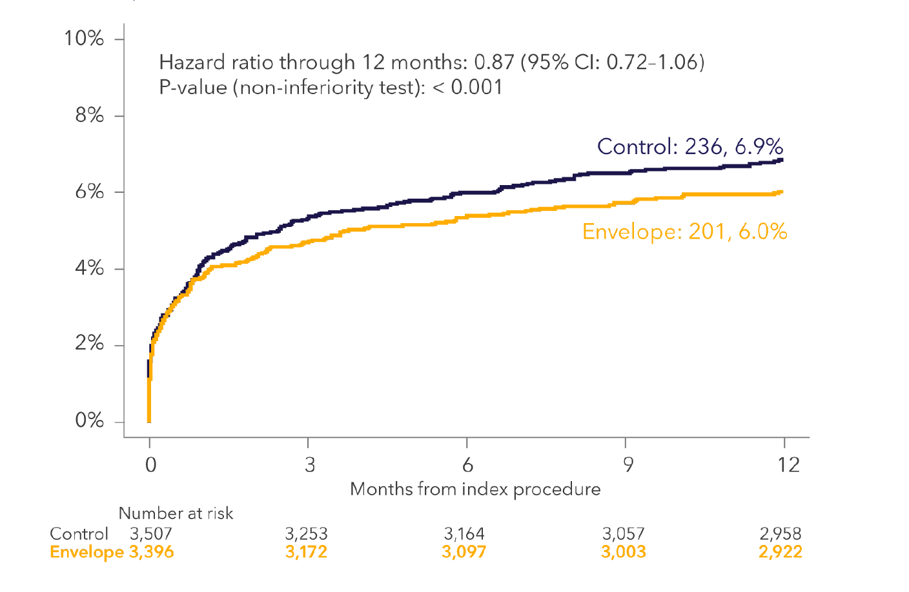

- 預先設定的次要分析 (as-treated, 非劣性)
- 12 個月併發症：包膜組 **6.0%** vs 對照組 **6.9%**
- HR 0.87 (95% CI 0.72-1.06)，非劣性 p < 0.001
- 排除主要感染後，12 個月 KM 併發症率 5.7% vs 5.9%

*[Tarakji KG, et al. N Engl J Med 2019;380:1895-1905](https://doi.org/10.1056/NEJMoa1901111)。*

---

# [WRAP-IT](https://doi.org/10.1056/NEJMoa1901111)：長期追蹤效果持續

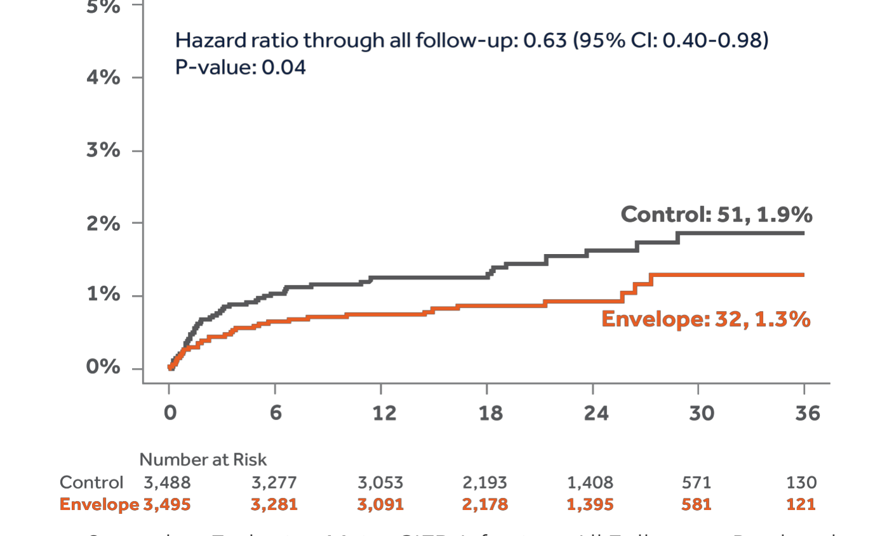

- 次要終點：全追蹤期間的主要 CIED 感染
- 平均追蹤 20.7 ± 8.5 個月
- 包膜組 32 例 (1.3%) vs 對照組 51 例 (1.9%)
- HR 0.63 (95% CI 0.40-0.98)，p = 0.04
- 注意：此 p 值未經多重比較校正；預先設定的校正後，**未達顯著**

*[Tarakji KG, et al. N Engl J Med 2019;380:1895-1905](https://doi.org/10.1056/NEJMoa1901111)。*

---

# [主要 CIED 感染後，一年死亡風險超過 3 倍](https://doi.org/10.1161/CIRCEP.119.008280)

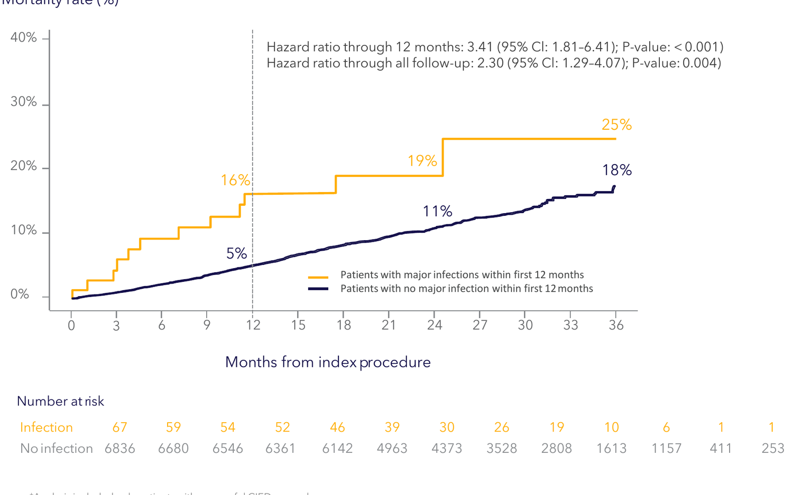

- WRAP-IT 預先設定分析，n = 6,903
- 12 個月：HR **3.41** (95% CI 1.81-6.41)，p < 0.001
- 全追蹤期：HR **2.30** (95% CI 1.29-4.07)，p = 0.004
- 感染者生活品質下降達 6 個月；36% 治療中斷，中位 184 天

*[Wilkoff BL, Boriani G, Mittal S, et al. Circ Arrhythm Electrophysiol 2020;13:e008280](https://doi.org/10.1161/CIRCEP.119.008280)。*

---

# [對 Staph 囊袋感染的顯著效果：微生物學分析](https://doi.org/10.1093/ofid/ofz359.034)

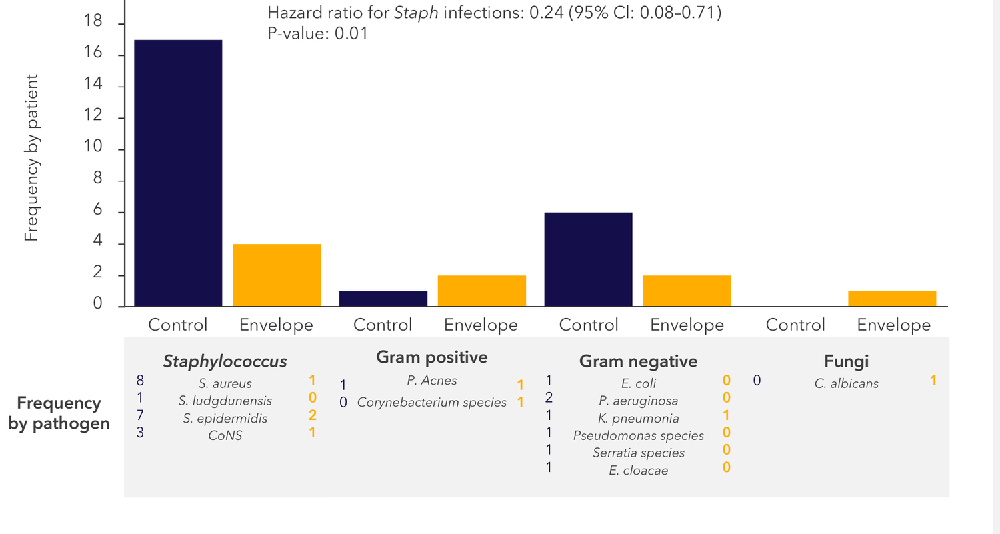

- Per-protocol 分析，n = 6,800
- **Staphylococcus 感染 HR 0.24** (95% CI 0.08-0.71)，p = 0.01
- 對照組 17 例 vs 包膜組 4 例
- Gram (+) 其他菌、gram (-) 與黴菌的例數都少，看不出差異

*[Sohail MR, Corey GR, Wilkoff BL, et al. IDWeek 2019 摘要 849. Open Forum Infect Dis 2019;6(Suppl 2)](https://doi.org/10.1093/ofid/ofz359.034)。*

---

# [血腫 (hematoma) 時，TYRX 降低 82% 囊袋感染](https://doi.org/10.1016/j.hrthm.2021.07.011)

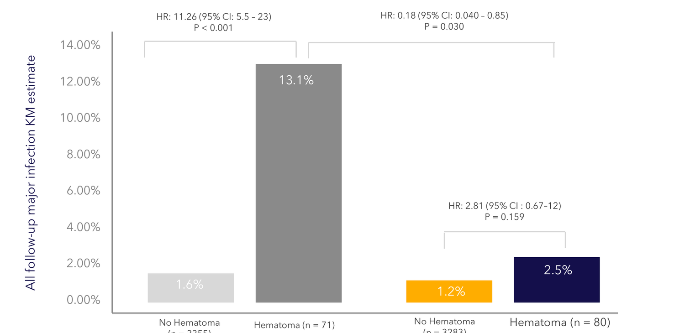

- 30 天血腫率 2.22%，兩組無差異 (p = 0.39)
- **對照組**：有血腫者感染 13.1% vs 無血腫 1.6%，HR 11.26，p < 0.001
- **包膜組**：有血腫者 2.5% vs 無血腫 1.2%，HR 2.81，p = 0.159
- 血腫病人：包膜 vs 對照 HR **0.18** (95% CI 0.04-0.85)，p = 0.030
- 血腫者的主要感染全是囊袋感染，沒有菌血症或心內膜炎

*[Tarakji KG, et al. Heart Rhythm 2021;18:2080-2086](https://doi.org/10.1016/j.hrthm.2021.07.011)。*

---

# CIED 感染的風險因子與死亡率

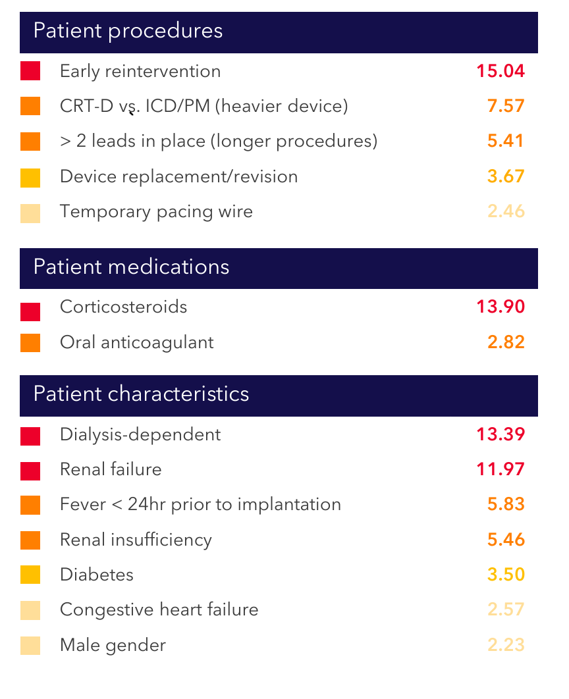 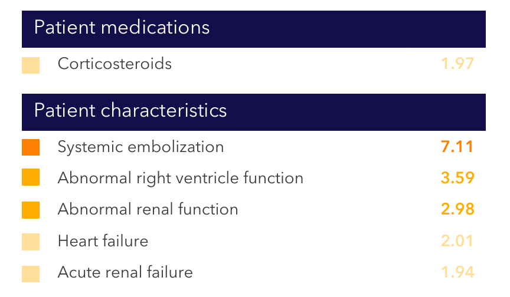

- **左、感染的 odds ratio**：早期再介入 15.0、類固醇 13.9、透析 13.4、腎衰竭 12.0
- **右、感染後死亡的 hazard ratio**：全身性栓塞 7.1、右心室功能異常 3.6

*[Klug 2007](https://doi.org/10.1161/CIRCULATIONAHA.106.678664)；[Lekkerkerker 2009](https://doi.org/10.1136/hrt.2008.151985)；[Margey 2010](https://doi.org/10.1093/europace/eup362)；[Sohail 2007](https://doi.org/10.1086/518889)；[Bloom 2006](https://doi.org/10.1111/j.1540-8159.2006.00307.x)；[Hercé 2013](https://doi.org/10.1093/europace/eus284)；[Romeyer-Bouchard 2010](https://doi.org/10.1093/eurheartj/ehp421)；[Habib 2013](https://doi.org/10.1016/j.amjcard.2012.11.052)；[Baman 2009](https://doi.org/10.1161/CIRCEP.108.816868)。*

---

# 風險因子與病人選擇

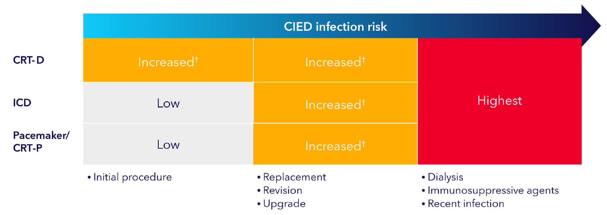

- **風險增加 (RCT 資料)**：12 個月主要感染 1.0%；TYRX 降低 40% 主要感染、61% 囊袋感染
- **最高風險 (真實世界)**：12 個月主要感染 1 到 4%；TYRX 降低 70 到 100% 主要感染
- 選擇病人時，也要把「固定裝置、提供穩定環境」的效益考慮進去

*[Tarakji 2019](https://doi.org/10.1056/NEJMoa1901111)；[Bloom 2011](https://doi.org/10.1111/j.1540-8159.2010.02931.x)；[Mittal 2014](https://doi.org/10.1016/j.hrthm.2013.12.013)；[Kolek 2013](https://doi.org/10.1111/pace.12063)；[Kolek 2015](https://doi.org/10.1111/jce.12768)；[Shariff 2015](https://doi.org/10.1111/jce.12684)；[Henrikson 2017](https://doi.org/10.1016/j.jacep.2017.02.016)；另引 Medtronic data on file。*

---

<!-- _class: divider -->

# 六、真實世界資料
## REINFORCE、台灣經驗、指引與共識

---

# [REINFORCE](https://doi.org/10.1093/europace/euad224)：義大利真實世界

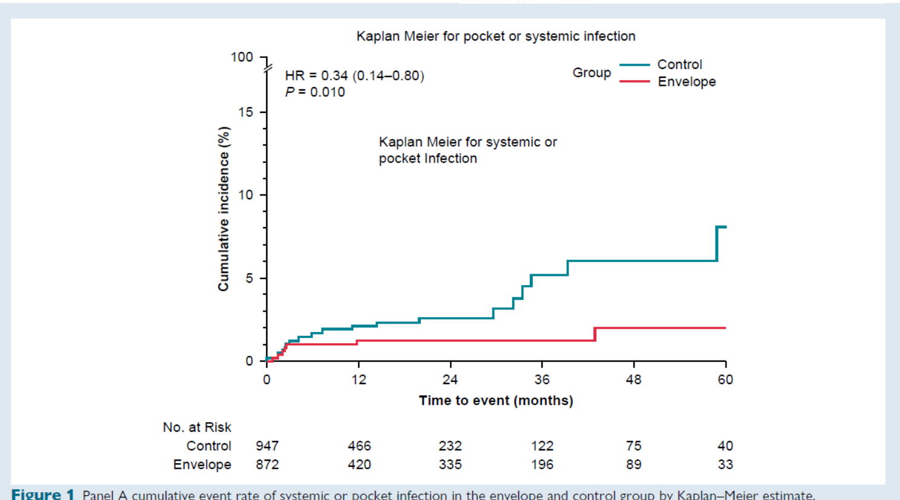

- 24 個義大利中心，1,819 位連續病人
- TYRX 872 人 (47.9%)、對照 947 人
- PADIT ≥ 7：TYRX 組 37.3%，對照組 11.4%
- 平均追蹤 1.4 年：感染相關事件 **0.8% vs 2.4%**，p = 0.007
- 5 年累積發生率 **2.1% vs 8.1%**，HR 0.34，p = 0.010
- **NNT = 17**

*[Ziacchi M, Biffi M, Iacopino S, et al. Europace 2023;25:euad224](https://doi.org/10.1093/europace/euad224)。*

---

# [REINFORCE](https://doi.org/10.1093/europace/euad224)：各風險層都有效

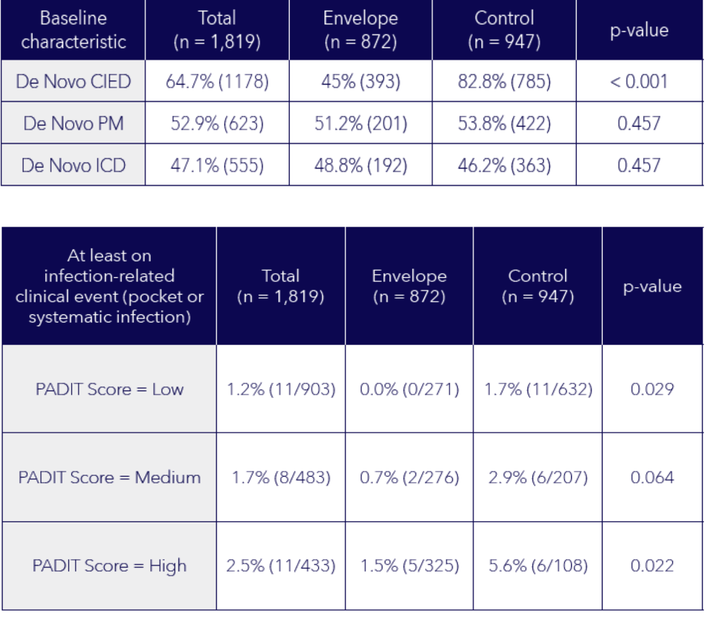

| PADIT 分層 | TYRX | 對照 | p |
|---|---|---|---|
| 低 | 0.0% | 1.7% | 0.029 |
| 中 | 0.7% | 2.9% | 0.064 |
| 高 | 1.5% | 5.6% | 0.022 |

> Suneet Mittal：「低風險組的感染率仍有臨床意義，而包膜在所有風險組都降低感染。看來不能只靠風險分數決定不用包膜。」

*[Ziacchi M, et al. Europace 2023](https://doi.org/10.1093/europace/euad224)。*

---

# [REINFORCE](https://doi.org/10.1093/europace/euad224)：追蹤 5 年的額外觀察

- 對照組的感染率偏高：1.4 年 2.4%，5 年 8.1%
- De novo CIED：TYRX 0.8% vs 對照 1.9%，p = 0.130，趨勢向好但未達顯著
- 不分病人風險類型，1.4 年時 TYRX 都與較低感染相關
- 傾向分數配對 (propensity score matching) 585 對，PADIT 分數平衡後結論相同

> 包膜在高、中、低風險族群都降低逾 60% 的感染相關事件，效果長期維持。

*[Ziacchi M, et al. Europace 2023](https://doi.org/10.1093/europace/euad224)。成本效益：[Wilkoff BL, et al. Circ AE 2020](https://doi.org/10.1161/CIRCEP.120.008503)；[Boriani G, et al. Value Health 2021;24:930-938](https://doi.org/10.1016/j.jval.2020.12.021)。*

---

# [REINFORCE Brady](https://doi.org/10.1016/j.hroo.2025.06.012)：只看 pacemaker 與 CRT-P

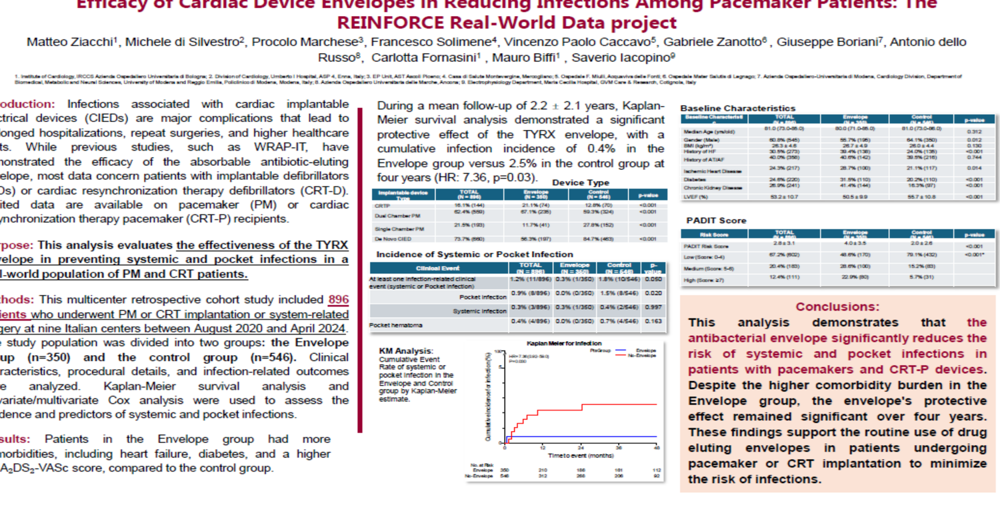

- 多中心回溯分析，2020-08 至 2024-04
- TYRX 組 350 人 vs 對照組 546 人，中位追蹤 2.2 年
- PADIT ≥ 7：TYRX 組 22.9% vs 對照組 5.7%
- 感染發生 0.3% vs 1.8%；incidence rate ratio 0.11

*[Ziacchi M, di Silvestro M, Marchese P, et al. Heart Rhythm O2 2025;6:1356-1363](https://doi.org/10.1016/j.hroo.2025.06.012)。*

---

# [REINFORCE Brady](https://doi.org/10.1016/j.hroo.2025.06.012)：4 年 Kaplan-Meier

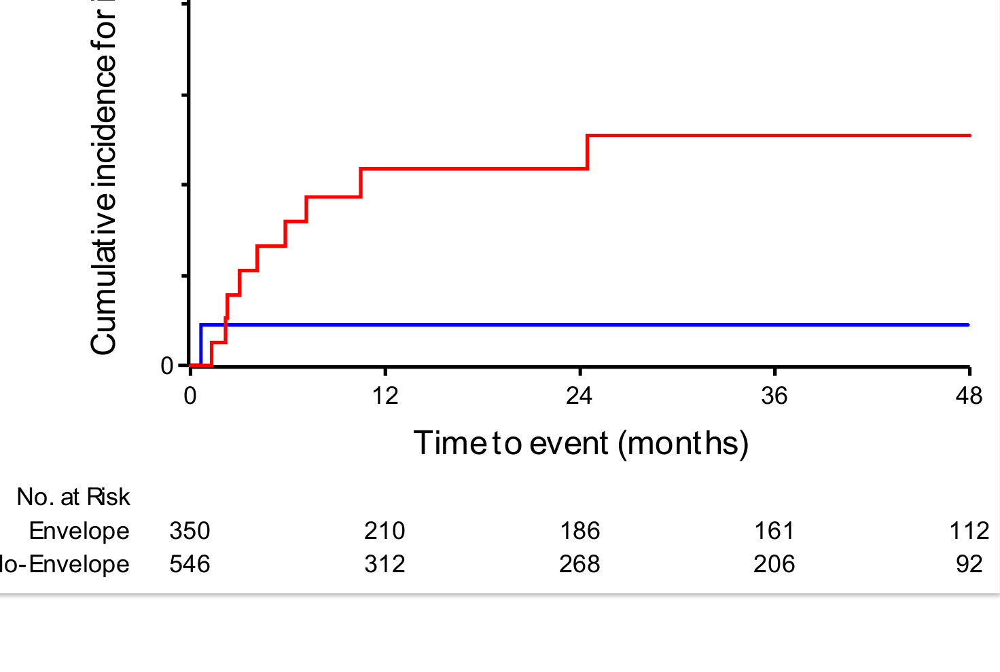

- 4 年累積感染：TYRX **0.4%** vs 對照 **2.5%**
- HR 7.36 (95% CI 0.92-59.0)，p = 0.03
- **NNT = 32**
- 比較特別的是，這群人過去被認為風險較低，包膜仍有效果

*EHRA 2025 發表；正式論文 [Ziacchi M, et al. Heart Rhythm O2 2025](https://doi.org/10.1016/j.hroo.2025.06.012)。*

---

# [台灣資料：中國醫藥大學附設醫院](https://doi.org/10.6515/ACS.202505_41%283%29.20250107A)

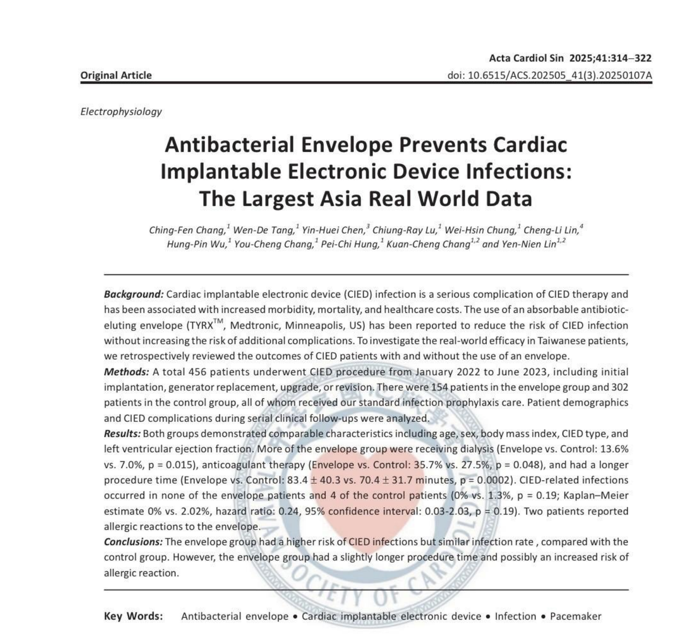

- 回溯分析，2022-01 至 2023-06，456 位病人
- 包膜組 154 人、對照組 302 人，皆接受標準預防
- 包膜組透析比例較高 (13.6% vs 7.0%)、抗凝比例較高、手術時間較長 (83 vs 70 分鐘)
- CIED 感染：**0 例 vs 4 例** (0% vs 1.3%，p = 0.19)
- KM 估計 0% vs 2.02%，HR 0.24 (95% CI 0.03-2.03)，**未達統計顯著**
- 2 位病人出現包膜過敏反應

*[Chang CF, Tang WD, Chen YH, et al. Acta Cardiol Sin 2025;41:314-322](https://doi.org/10.6515/ACS.202505_41%283%29.20250107A) (DOI 直接開啟全文 PDF)；[PMC 全文](https://pmc.ncbi.nlm.nih.gov/articles/PMC12099244/)。*

---

# [台灣資料](https://doi.org/10.6515/ACS.202505_41%283%29.20250107A)：Kaplan-Meier

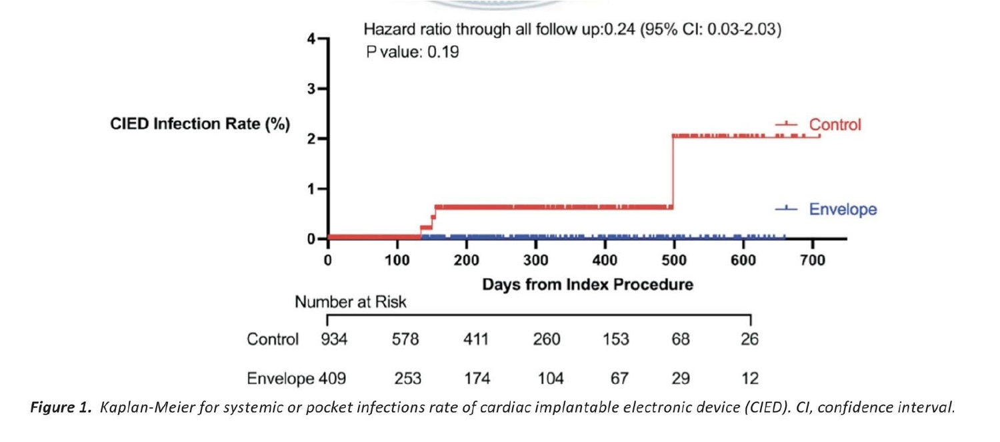

> 樣本數小、事件數少，是這篇無法達到顯著的主因。不過，風險較高的包膜組感染率為零，方向與國外資料一致。過敏反應則是亞洲資料中值得留意的訊號。

*[Chang CF, et al. Acta Cardiol Sin 2025;41:314-322](https://doi.org/10.6515/ACS.202505_41%283%29.20250107A)。*

---

# [ESC/EHRA 國際共識文件 (2020)](https://doi.org/10.1093/europace/euz246)

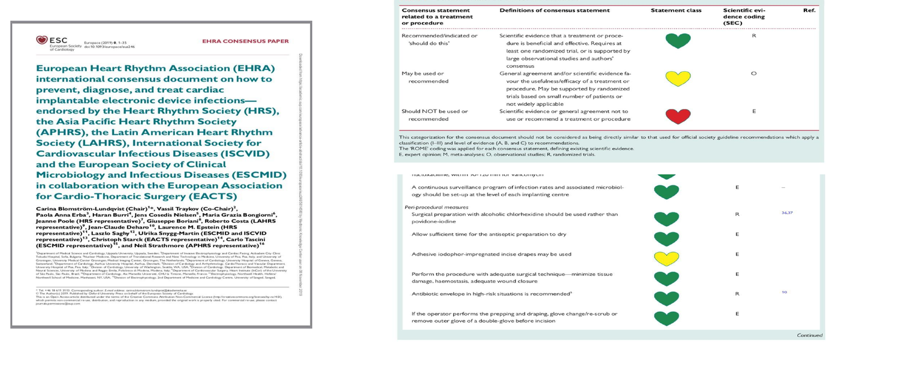

- 抗菌包膜在高風險病人**可考慮使用** (may be used or recommended)
- 同一文件亦涵蓋術前靜脈抗生素、皮膚準備與血腫的預防處理

*[Blomström-Lundqvist C, Traykov V, Erba PA, et al. Europace 2020;22:515-549](https://doi.org/10.1093/europace/euz246)。*

---

# [AHA 科學聲明 (2024)](https://doi.org/10.1161/CIR.0000000000001187)：CIED 感染的預防、診斷與處置

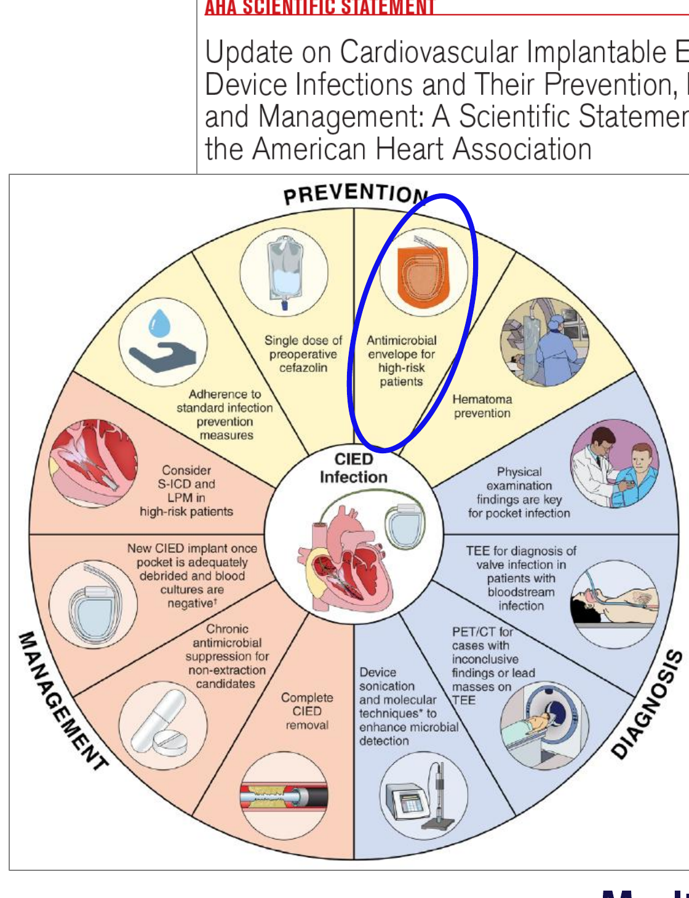

- 回顧 2010 年以來的證據與重大進展
- 確診 CIED 感染需**完整移除裝置**；早期移除與較好預後相關
- **血腫**是顯著且獨立的感染風險因子
- 高風險病人**可考慮抗菌包膜**
- 文件引用 WRAP-IT 的 61% 囊袋感染降低，以及血腫時 82% 的降低

*[Baddour LM, Esquer Garrigos Z, Sohail MR, et al. Circulation 2024;149:e201-e216](https://doi.org/10.1161/CIR.0000000000001187)。*

---

# 證據鏈已經完整

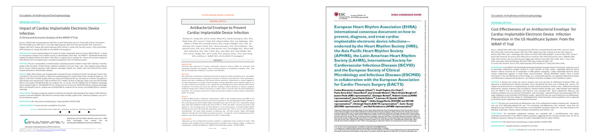

| [CIED 感染的後果](https://doi.org/10.1161/CIRCEP.119.008280) | [TYRX 的療效](https://doi.org/10.1056/NEJMoa1901111) | [國際共識建議](https://doi.org/10.1093/europace/euz246) | [成本效益](https://doi.org/10.1161/CIRCEP.120.008503) |
|---|---|---|---|
| 一年死亡風險 > 3 倍；治療一次感染 5.6 到 8.3 萬美元 | 主要感染降 40%、囊袋感染降 61%；併發症未增加 | EHRA 共識對 WRAP-IT 族群與高風險因子給予正向建議 | WRAP-IT 族群 ICER 112,603 美元/QALY，符合 ACC/AHA 門檻 |

*[Wilkoff 2020 (e008280)](https://doi.org/10.1161/CIRCEP.119.008280)；[Tarakji 2019](https://doi.org/10.1056/NEJMoa1901111)；[Blomström-Lundqvist 2020](https://doi.org/10.1093/europace/euz246)；[Wilkoff 2020 (e008503)](https://doi.org/10.1161/CIRCEP.120.008503)。表頭可直接點選。*

---

# 囊袋健康：TYRX 的全程價值

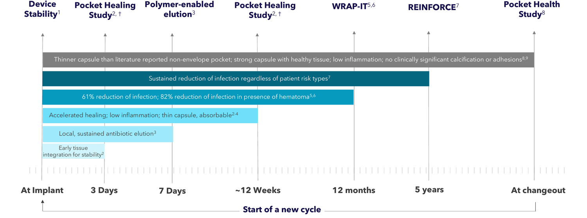

*從植入當下的穩定、3 到 7 天的局部溶出、12 週的癒合 ([Virmani 2024](https://doi.org/10.1016/j.hrthm.2024.02.054))，到 12 個月 ([WRAP-IT](https://doi.org/10.1056/NEJMoa1901111))、5 年 ([REINFORCE](https://doi.org/10.1093/europace/euad224))，再到下次更換時的囊袋狀態 ([Pocket Health Study](https://doi.org/10.1111/jce.16766))。*

---

# Take Home Message

> 1. CIED 感染不常見，但一旦發生，**一年死亡風險超過 3 倍**，花費極高。
> 2. 七成感染來自 staphylococci，現行全身性抗生素加碼 (PADIT) 壓不下來。
> 3. TYRX 把兩種抗生素直接送進囊袋：2 小時達 MIC，維持 7 天，9 週吸收。
> 4. WRAP-IT：主要感染降 **40%**、囊袋感染降 **61%**，併發症不增加；血腫時降 **82%**。
> 5. 真實世界 (REINFORCE) 在各風險層都有效，NNT 17 到 32。
> 6. 記得禁忌症：SLE、tetracycline 或 rifampin 過敏、網布過敏、已感染傷口。

*關鍵文獻：[WRAP-IT](https://doi.org/10.1056/NEJMoa1901111)、[血腫分析](https://doi.org/10.1016/j.hrthm.2021.07.011)、[PADIT](https://doi.org/10.1016/j.jacc.2018.09.068)、[REINFORCE](https://doi.org/10.1093/europace/euad224)、[REINFORCE Brady](https://doi.org/10.1016/j.hroo.2025.06.012)。*

---

# 附錄：Micra 無導線心律調節器 (原簡報夾帶)

| Micra VR | Micra AV |
|---|---|
| 全球最小的心律調節器 | 具自動 AV 同步功能 |
| 臨床研究植入成功率 > 99% | 靜態 85.4%、活動 82.6% AV 同步 |
| 併發症較傳統 pacemaker 少 63% | 三個月內無需升級 |
| 中位電池壽命 13.7 年 | 中位電池壽命 10.5 年 |

*發表論文 250 篇以上；受訓醫師 9,000 位以上；全球植入 200,000 例以上。原簡報 EMEA Summit 2024，為 Medtronic 行銷數據，本頁未逐一查證。*

---

# [備用：兔子感染模型](https://doi.org/10.1111/j.1540-8159.2009.02406.x)

- 兔子雙側皮下植入 PPM generator，一側加第一代 TYRX
- 囊袋分別接種 S. capitis、E. coli、S. epidermidis、Acinetobacter baumannii
- 關閉囊袋 7 天
- **對照側全部感染**，TYRX 側乾淨無生物膜

*[Hansen LK, Brown M, Johnson D, Palme DF, Love C, Darouiche R. Pacing Clin Electrophysiol 2009;32:898-907](https://doi.org/10.1111/j.1540-8159.2009.02406.x)。*

---

<!-- _class: refs -->

# 參考文獻 (1/6)：WRAP-IT 試驗與其分析

1. Tarakji KG, Mittal S, Kennergren C, et al. Antibacterial envelope to prevent cardiac implantable device infection (WRAP-IT). [*N Engl J Med*. 2019;380(20):1895-1905.](https://doi.org/10.1056/NEJMoa1901111)
2. Wilkoff BL, Boriani G, Mittal S, et al. Impact of cardiac implantable electronic device infection: a clinical and economic analysis of the WRAP-IT trial. [*Circ Arrhythm Electrophysiol*. 2020;13(5):e008280.](https://doi.org/10.1161/CIRCEP.119.008280)
3. Wilkoff BL, Boriani G, Mittal S, et al. Cost-effectiveness of an antibacterial envelope for CIED infection prevention in the US healthcare system from the WRAP-IT trial. [*Circ Arrhythm Electrophysiol*. 2020;13(10):e008503.](https://doi.org/10.1161/CIRCEP.120.008503)
4. Tarakji KG, Korantzopoulos P, Philippon F, et al. Infectious consequences of hematoma from CIED procedures and the role of the antibiotic envelope: a WRAP-IT trial analysis. [*Heart Rhythm*. 2021;18(12):2080-2086.](https://doi.org/10.1016/j.hrthm.2021.07.011)
5. Sohail MR, Corey GR, Wilkoff BL, et al. Reduced CIED infections with an antibacterial envelope: microbiologic analysis of the WRAP-IT study (IDWeek 2019, abstract 849). [*Open Forum Infect Dis*. 2019;6(Suppl 2):S16.](https://doi.org/10.1093/ofid/ofz359.034)
6. Boriani G, Kennergren C, Tarakji KG, et al. Cost-effectiveness analyses of an absorbable antibacterial envelope in Germany, Italy, and England. [*Value Health*. 2021;24(7):930-938.](https://doi.org/10.1016/j.jval.2020.12.021)
7. Krahn AD, Longtin Y, Philippon F, et al. Prevention of Arrhythmia Device Infection Trial: the PADIT trial. [*J Am Coll Cardiol*. 2018;72(24):3098-3109.](https://doi.org/10.1016/j.jacc.2018.09.068)
8. Birnie DH, Wang J, Alings M, et al. Risk factors for infections involving cardiac implanted electronic devices (PADIT risk score). [*J Am Coll Cardiol*. 2019;74(23):2845-2854.](https://doi.org/10.1016/j.jacc.2019.09.060)

---

<!-- _class: refs -->

# 參考文獻 (2/6)：真實世界、囊袋癒合與指引

9. Ziacchi M, Biffi M, Iacopino S, et al. REducing INFectiOns thRough Cardiac device Envelope: insight from real world data. The REINFORCE project. [*Europace*. 2023;25(11):euad224.](https://doi.org/10.1093/europace/euad224)
10. Ziacchi M, di Silvestro M, Marchese P, et al. Effectiveness of cardiac device envelopes in preventing infections among pacemaker patients: the REINFORCE Brady real-world project. [*Heart Rhythm O2*. 2025;6(9):1356-1363.](https://doi.org/10.1016/j.hroo.2025.06.012)
11. Chang CF, Tang WD, Chen YH, et al. Antibacterial envelope prevents cardiac implantable electronic device infections: the largest Asia real world data. [*Acta Cardiol Sin*. 2025;41(3):314-322.](https://doi.org/10.6515/ACS.202505_41%283%29.20250107A) [PMC 全文](https://pmc.ncbi.nlm.nih.gov/articles/PMC12099244/)
12. Philippon F, Ladich E, Virmani R, et al. An absorbable antibacterial envelope promotes development of a healthy device pocket: results of the TYRX Pocket Health Study. [*J Cardiovasc Electrophysiol*. 2025;36(8).](https://doi.org/10.1111/jce.16766)
13. Virmani R, Philippon F, Mittal S, et al. Effects of envelopes on CIED pocket healing: a head-to-head preclinical evaluation. [*Heart Rhythm*. 2024;21(8).](https://doi.org/10.1016/j.hrthm.2024.02.054)
14. Massaro G, Leone O, Valzania C, et al. Pocket histology at cardiac implantable electronic device replacement: what's new? [*Heart Rhythm*. 2023;20(2):198-206.](https://doi.org/10.1016/j.hrthm.2022.10.017)
15. Hansen LK, Brown M, Johnson D, et al. In vivo model of human pathogen infection and demonstration of efficacy by an antimicrobial pouch for pacing devices. [*Pacing Clin Electrophysiol*. 2009;32(7):898-907.](https://doi.org/10.1111/j.1540-8159.2009.02406.x)
16. Blomström-Lundqvist C, Traykov V, Erba PA, et al. EHRA international consensus document on how to prevent, diagnose, and treat cardiac implantable electronic device infections. [*Europace*. 2020;22(4):515-549.](https://doi.org/10.1093/europace/euz246)
17. Baddour LM, Esquer Garrigos Z, Sohail MR, et al. Update on cardiovascular implantable electronic device infections and their prevention, diagnosis, and management: a scientific statement from the AHA. [*Circulation*. 2024;149(2):e201-e216.](https://doi.org/10.1161/CIR.0000000000001187)

---

<!-- _class: refs -->

# 參考文獻 (3/6)：早期包膜研究

18. Bloom HL, Constantin L, Dan D, et al. Implantation success and infection in CIED procedures utilizing an antibacterial envelope (Citadel/Centurion). [*Pacing Clin Electrophysiol*. 2011;34(2):133-142.](https://doi.org/10.1111/j.1540-8159.2010.02931.x)
19. Mittal S, Shaw RE, Michel K, et al. CIED infections: incidence, risk factors, and the effect of the AigisRx antibacterial envelope. [*Heart Rhythm*. 2014;11(4):595-601.](https://doi.org/10.1016/j.hrthm.2013.12.013)
20. Kolek MJ, Dresen WF, Wells QS, Ellis CR. Use of an antibacterial envelope is associated with reduced CIED infections in high-risk patients. [*Pacing Clin Electrophysiol*. 2013;36(3):354-361.](https://doi.org/10.1111/pace.12063)
21. Kolek MJ, Patel NJ, Clair WK, et al. Efficacy of a bio-absorbable antibacterial envelope to prevent CIED infections in high-risk subjects. [*J Cardiovasc Electrophysiol*. 2015;26(10):1111-1116.](https://doi.org/10.1111/jce.12768)
22. Shariff N, Eby E, Adelstein E, et al. Health and economic outcomes associated with use of an antimicrobial envelope as a standard of care for CIED implantation. [*J Cardiovasc Electrophysiol*. 2015;26(7):783-789.](https://doi.org/10.1111/jce.12684)
23. Henrikson CA, Sohail MR, Acosta H, et al. Antibacterial envelope is associated with low infection rates after ICD and CRT implantation (COMMAND). [*JACC Clin Electrophysiol*. 2017;3(10):1158-1167.](https://doi.org/10.1016/j.jacep.2017.02.016)
24. Osoro M, Lorson W, Hirsh JB, Mahlow WJ. Use of an antimicrobial pouch/envelope in the treatment of Twiddler's syndrome. [*Pacing Clin Electrophysiol*. 2018;41(2):136-142.](https://doi.org/10.1111/pace.13259)

---

<!-- _class: refs -->

# 參考文獻 (4/6)：流行病學與風險因子

25. Mond HG, Proclemer A. The 11th world survey of cardiac pacing and ICDs: calendar year 2009. [*Pacing Clin Electrophysiol*. 2011;34(8):1013-1027.](https://doi.org/10.1111/j.1540-8159.2011.03150.x)
26. Tarakji KG, Ellis CR, Defaye P, Kennergren C. Cardiac implantable electronic device infection in patients at risk. [*Arrhythm Electrophysiol Rev*. 2016;5(1):65-71.](https://doi.org/10.15420/aer.2015.27.2)
27. Sohail MR, Henrikson CA, Braid-Forbes MJ, Forbes KF, Lerner DJ. Mortality and cost associated with CIED infections. [*Arch Intern Med*. 2011;171(20):1821-1828.](https://doi.org/10.1001/archinternmed.2011.441)
28. Sohail MR, Henrikson CA, Braid-Forbes MJ, Forbes KF, Lerner DJ. Increased long-term mortality in patients with CIED infections. [*Pacing Clin Electrophysiol*. 2015;38(2):231-239.](https://doi.org/10.1111/pace.12518)
29. Klug D, Balde M, Pavin D, et al. Risk factors related to infections of implanted pacemakers and cardioverter-defibrillators. [*Circulation*. 2007;116(12):1349-1355.](https://doi.org/10.1161/CIRCULATIONAHA.106.678664)
30. Lekkerkerker JC, van Nieuwkoop C, Trines SA, et al. Risk factors and time delay associated with cardiac device infections: Leiden device registry. [*Heart*. 2009;95(9):715-720.](https://doi.org/10.1136/hrt.2008.151985)
31. Margey R, McCann H, Blake G, et al. Contemporary management of and outcomes from cardiac device related infections. [*Europace*. 2010;12(1):64-70.](https://doi.org/10.1093/europace/eup362)
32. Sohail MR, Uslan DZ, Khan AH, et al. Risk factor analysis of permanent pacemaker infection. [*Clin Infect Dis*. 2007;45(2):166-173.](https://doi.org/10.1086/518889)
33. Sohail MR, Uslan DZ, Khan AH, et al. Management and outcome of permanent pacemaker and ICD infections. [*J Am Coll Cardiol*. 2007;49(18):1851-1859.](https://doi.org/10.1016/j.jacc.2007.01.072)

---

<!-- _class: refs -->

# 參考文獻 (5/6)：風險因子與微生物學

34. Bloom H, Heeke B, Leon A, et al. Renal insufficiency and the risk of infection from pacemaker or defibrillator surgery. [*Pacing Clin Electrophysiol*. 2006;29(2):142-145.](https://doi.org/10.1111/j.1540-8159.2006.00307.x)
35. Hercé B, Nazeyrollas P, Lesaffre F, et al. Risk factors for infection of implantable cardiac devices: data from a registry of 2496 patients. [*Europace*. 2013;15(1):66-70.](https://doi.org/10.1093/europace/eus284)
36. Romeyer-Bouchard C, Da Costa A, Dauphinot V, et al. Prevalence and risk factors related to infections of CRT devices. [*Eur Heart J*. 2010;31(2):203-210.](https://doi.org/10.1093/eurheartj/ehp421)
37. Habib A, Le KY, Baddour LM, et al. Predictors of mortality in patients with CIED infections. [*Am J Cardiol*. 2013;111(6):874-879.](https://doi.org/10.1016/j.amjcard.2012.11.052)
38. Baman TS, Gupta SK, Valle JA, Yamada E. Risk factors for mortality in patients with cardiac device-related infection. [*Circ Arrhythm Electrophysiol*. 2009;2(2):129-134.](https://doi.org/10.1161/CIRCEP.108.816868)
39. Wisplinghoff H, Bischoff T, Tallent SM, et al. Nosocomial bloodstream infections in US hospitals: analysis of 24,179 cases. [*Clin Infect Dis*. 2004;39(3):309-317.](https://doi.org/10.1086/421946)
40. Da Costa A, Lelièvre H, Kirkorian G, et al. Role of the preaxillary flora in pacemaker infections: a prospective study. [*Circulation*. 1998;97(18):1791-1795.](https://doi.org/10.1161/01.cir.97.18.1791)

---

<!-- _class: refs -->

# 參考文獻 (6/6)：藥理與無公開連結資料

41. de Oliveira JC, Martinelli M, Nishioka SA, et al. Efficacy of antibiotic prophylaxis before the implantation of pacemakers and ICDs: a randomized, double-blinded, placebo-controlled trial. [*Circ Arrhythm Electrophysiol*. 2009;2(1):29-34.](https://doi.org/10.1161/CIRCEP.108.795906)
42. Chua JD, Wilkoff BL, Lee I, et al. Diagnosis and management of infections involving implantable electrophysiologic cardiac devices. [*Ann Intern Med*. 2000;133(8):604-608.](https://doi.org/10.7326/0003-4819-133-8-200010170-00011)
43. NNIS System Report, data summary from January 1992 through June 2004. [*Am J Infect Control*. 2004;32(8):470-485.](https://pubmed.ncbi.nlm.nih.gov/15573054/)
44. 囊袋定殖：Chua JD, et al. [*PACE*. 2005;28(12):1276-1281.](https://doi.org/10.1111/j.1540-8159.2005.00268.x) Pichlmaier M, et al. [*Europace*. 2008;10(9):1067-1072.](https://doi.org/10.1093/europace/eun191) Kleemann T, et al. [*Europace*. 2010;12(1):58-63.](https://doi.org/10.1093/europace/eup334) Chu XM, et al. [*Biomed Res Int*. 2014:725163.](https://doi.org/10.1155/2014/725163)
45. Minocycline/rifampin 導管 RCT：Raad I, et al. [*Ann Intern Med*. 1997;127:267-274.](https://doi.org/10.7326/0003-4819-127-4-199708150-00002) Hanna H, et al. [*J Clin Oncol*. 2004;22:3163-3171.](https://doi.org/10.1200/JCO.2004.04.124) León C, et al. [*Intensive Care Med*. 2004;30:1891-1899.](https://doi.org/10.1007/s00134-004-2378-2) Zabramski JM, et al. [*J Neurosurg*. 2003;98:725-730.](https://doi.org/10.3171/jns.2003.98.4.0725) Chatzinikolaou I, et al. [*Am J Med*. 2003;115:352-357.](https://doi.org/10.1016/s0002-9343%2803%2900367-x)
46. 體外抗菌譜：Zinner SH, et al. [*J Infect Dis*. 1981;144:365-371.](https://doi.org/10.1093/infdis/144.4.365) Darouiche RO, et al. [*Int J Antimicrob Agents*. 1995;6:31-36.](https://doi.org/10.1016/0924-8579%2895%2900017-3) Segreti J, et al. [*Diagn Microbiol Infect Dis*. 1989;12:253-255.](https://doi.org/10.1016/0732-8893%2889%2990022-9) Percival SL, et al. [*Wound Repair Regen*. 2011;19:767-774.](https://doi.org/10.1111/j.1524-475X.2011.00739.x) [Sanford Guide](https://www.sanfordguide.com/)；[TYRX 產品頁](https://www.medtronic.com/en-us/healthcare-professionals/products/cardiac-rhythm/cardiac-infection-prevention/tyrx-absorbable-antibacterial-envelope.html)
47. **無公開連結** (Medtronic data on file)：Huntingdon Life Sciences TR-2011-054 與 TR-2013-001、Sinclair Labs D13599、Data on file 093013-1、Mansfield R (2019)、MEDACorp 2007 與 Easton 2008 調查。原簡報中的 Eby 2018 Europace 摘要與 Hirsh 2012 EP Lab Digest 本版未引用。

---

<!-- _class: small -->

# 縮寫對照表

| 縮寫 | 全名 | 中文 |
|---|---|---|
| CIED | Cardiac Implantable Electronic Device | 心臟植入式電子裝置 |
| CRT-D / CRT-P | Cardiac Resynchronization Therapy Defibrillator / Pacemaker | 心臟再同步治療去顫器 / 節律器 |
| ICD | Implantable Cardioverter Defibrillator | 植入式去顫器 |
| MIC | Minimum Inhibitory Concentration | 最低抑菌濃度 |
| NNT | Number Needed to Treat | 需治療人數 |
| PADIT | Prevention of Arrhythmia Device Infection Trial | 心律裝置感染預防試驗 |
| WRAP-IT | Worldwide Randomized Antibiotic Envelope Infection Prevention Trial | 全球隨機抗生素包膜感染預防試驗 |
| ECM | Extracellular Matrix | 細胞外基質 |

---

<!-- _class: end -->
<!-- _paginate: false -->

# 謝謝聆聽
## Q & A

謝慕揚 MD, PhD, FESC
