<!-- _class: lead -->
<!-- _paginate: false -->

# 肢體導程接錯
## Limb Lead Reversal：辨識、機轉與陷阱

**整理：謝慕揚 MD, PhD, FESC** | 2026-10-13

核心文獻：Batchvarov VN, Malik M, Camm AJ. Incorrect electrode cable connection during electrocardiographic recording. [*Europace* 2007;9:1081-90](https://doi.org/10.1093/europace/eum198)

---

# 為什麼要懂這個？

- 約 **0.4–4%** 的 12 導程心電圖接線錯誤，加護病房最高 (Batchvarov 2007)
- 門診 0.4%，加護病房 **4.0%**，差異顯著 (Rudiger 2007)
- 三級醫院 1,000 張：肢體導程接錯 1.1%，其中 LA–LL 0.8%、RA–LA 0.3% (Ramadurai 2025)
- 後果：**假性梗塞、假性軸偏、假性心律**，甚至把真病變「變正常」

> 接錯不是罕見事件，是每天都在發生的 pitfall。

---

# 本次內容

1. 電極、導程與 Wilson 中樞端的基本機轉
2. 兩大類接錯：**不含右腳** vs **含右腳 (neutral)**
3. 五種 RA／LA／LL 互換：Table 與臨床辨識
4. 右腳 (RL) 互換：**flat line** 規則
5. 案例：RA–LA、LA–LL、RA–LL
6. 容易混淆的真病變、電腦判讀、預防

---

<!-- _class: divider -->

# Part 1
## 機轉：先懂導程，才懂接錯

---

# 十個電極，十二個導程

| 電極 | 英文 | IEC 顏色 |
|------|------|---------|
| 右手 | RA | 紅 |
| 左手 | LA | 黃 |
| 左腳 | LL | 綠 |
| 右腳 (neutral) | RL | 黑 |

- 胸前 V1–V6 各一個電極，共 10 條線
- 右腳只是接地，**位置在身上哪裡都不影響波形**

---

# 導程的定義

```text
I   = LA − RA
II  = LL − RA
III = LL − LA        (I + III = II)

aVR = RA − (LA + LL)/2
aVL = LA − (RA + LL)/2
aVF = LL − (RA + LA)/2

V1–V6 = 胸前電極 − Wilson 中樞端
Wilson 中樞端 = (RA + LA + LL)/3
```

- 兩個肢體導程加六個胸前導程 = **8 個獨立導程**
- 其餘 4 個可由它們算出

---

# 關鍵觀念：兩大類接錯

| | 不含右腳 | 含右腳或胸前線 |
|---|---|---|
| 例子 | RA／LA／LL 互換 | RA–RL、LA–RL、肢體–胸前 |
| Wilson 中樞端 | **不變** | **被扭曲** |
| 胸前導程 | 不變 | 失真 |
| 波形 | 重排或上下翻轉 | 多數導程失真 |
| 間期 | 不變 | 不可信 |

---

# 為什麼不含右腳時胸前導程不變？

- RA、LA、LL 三者互換，**三者平均值不變**
- 所以 Wilson 中樞端不變，V1–V6 原封不動
- 只有肢體導程被「重新命名」或「上下翻轉」
- 波形、振幅、間期 (QT 等) 都沒變

> 實戰線索：**胸前導程正常，肢體導程怪**，先想 RA／LA／LL 互換。

---

<!-- _class: fig -->

# Wilson 中樞端被移位的樣子

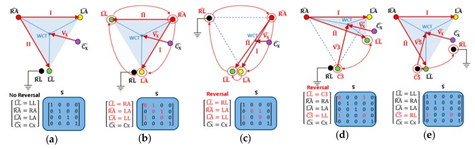

右腳或胸前電極參與互換時，中樞端位置改變，多數導程失真

*圖：Krasteva V et al. Sensors 2019;19:2920 (PMC6651562), CC BY 4.0*

---

<!-- _class: divider -->

# Part 2
## 五種 RA／LA／LL 互換

---

# Table 1：標示的導程實際顯示什麼

| 互換 | I | II | III | aVR | aVL | aVF | V1–6 |
|------|---|----|-----|-----|-----|-----|------|
| LA/RA | −I | III | II | aVL | aVR | aVF | 不變 |
| LA/LL | II | I | −III | aVR | aVF | aVL | 不變 |
| RA/LL | −III | −II | −I | aVF | aVL | aVR | 不變 |
| 順轉 | III | −I | −II | aVL | aVF | aVR | 不變 |
| 逆轉 | −II | −III | I | aVF | aVR | aVL | 不變 |

順轉：RA→LA→LL→RA。逆轉：RA→LL→LA→RA。負號代表上下翻轉

*表：Batchvarov 2007 Table 1 重新整理*

---

# 一張速查：看哪一條導程被翻轉

| 翻轉的導程 | 最可能的接錯 |
|-----------|-------------|
| I 與 aVL | RA–LA |
| III | LA–LL |
| II、III、aVF | RA–LL |
| I、II、aVL | 逆轉 (RA→LL→LA→RA) |

- 共同線索：**aVR 的 P、QRS、T 全部直立**，除了 LA–LL 之外
- 這個組合在正常心臟幾乎不會出現

*依據：Ramadurai 2025 (Cureus) 與 Batchvarov 2007*

---

# 一眼可疑的 ECG 線索

- I 或 II 導程的 **P–QRS 為負**
- aVR 的 **P 波為正**
- I 與 V6 的 P–QRS **方向相反**
- 肢體導程軸與胸前導程軸不相容
- 某一條肢體導程幾乎是 **flat line**
- 前後兩張 ECG 的軸向、極性無法解釋

---

<!-- _class: divider -->

# Part 3
## RA–LA：最常見也最容易認

---

# RA–LA 互換

- **I 導程 P、QRS、T 全部倒置**，aVR 與 aVL 互換
- 外觀像 **mirror-image dextrocardia**
- 鑑別：RA–LA 的胸前導程 **不變**，真的右位心的 V3–V6 R 波會越來越小
- 先天矯正型大血管轉位的特徵是胸前 Q 波左右相反，與 RA–LA 不同
- 若無 P 波：I 導程 QRS 為負，但 V5、V6 為正，生理上極不可能

---

<!-- _class: fig -->

# 實例：I 導程 P 波倒置

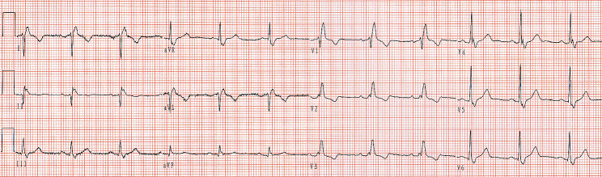
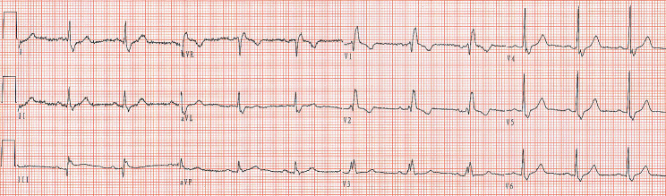

上：接錯時的 ECG。下：重新接線後為 sinus rhythm 合併 complete RBBB

*圖：Li C et al. BMC Cardiovasc Disord 2024;24:217 (PMC11031905), CC BY 4.0*

---

<!-- _class: fig -->

# 電腦判成「手導程接反」的案例

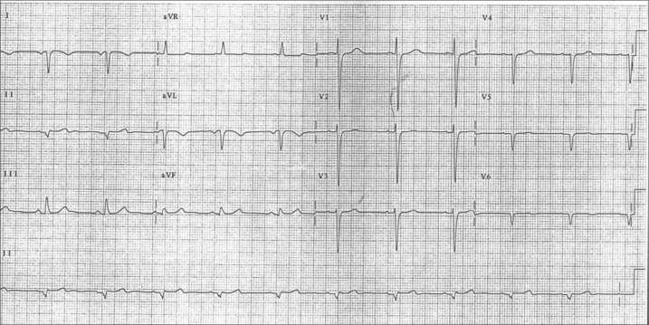 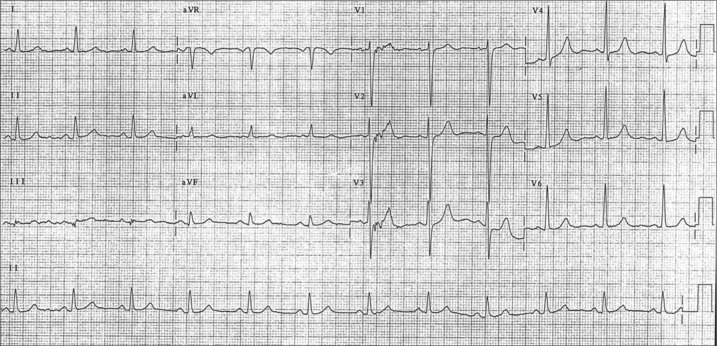

左：導程在標準位置。右：肢體導程互換，胸前導程放在右胸

*圖：Glancy DL et al. Proc (Bayl Univ Med Cent) 2016;29:85-6 (PMC4677869)，授權條款請查原刊*

---

# 不是接錯、但長得像

- **自發性氣胸**：ECG 出現右軸偏與 I 導程 P 倒置，氣胸處理後消失 (Wieters 2014)
- **左心房節律**、右位心：靠胸前導程與 P 波極性區分 (Li 2024)
- **慢性阻塞性肺病等肺部疾病、先天心臟病**：真的可能出現 I 導程 P 倒置

> 當機器一直報「疑似肢體導程接反」，但你確定接對了，請想氣胸。

---

<!-- _class: divider -->

# Part 4
## LA–LL：最難認的一種

---

# LA–LL 互換為什麼難？

- I 變成 II，aVL 與 aVF 互換，**III 倒置**
- 整張 ECG 看起來甚至「更正常」
- 可製造假性 **高側壁梗塞**，也可能使真正的下壁梗塞 Q 波與 T 倒置消失
- 一項三級醫院資料中，LA–LL (0.8%) 比 RA–LA (0.3%) 更常見 (Ramadurai 2025)
- 電腦演算法也最容易漏掉 (Kors 2001；Rjoob 2020)

---

# 辨識 LA–LL：看 P 波

Abdollah 與 Milliken (1997) 兩條線索：

1. **I 導程 P 波高於 II 導程 P 波** (正常 P 軸不會偏過 30° 的左側)
2. **III 導程 P 波終末為正向** (正常不會)

- 任一條成立，原研究敏感度約 **90%**
- 但後來用 8,000 多張電腦模擬的 LA–LL 檢驗，在 90% 敏感度下**特異度只有 38%** (Hedén 2001，引自 Batchvarov 2007)

---

# 進階：P 環方向 (Ho 與 Ho)

- 正常額面 P 環幾乎一律 **逆時針 (CCW)**
- 任一種肢體接錯都會改變 P 環方向或 P 軸

| 互換 | 典型額面 P 軸 | P 環方向 |
|------|--------------|---------|
| 正確 | 45° 到 65° | CCW |
| RA/LA | 115° 到 135° | CW |
| RA/LL | −105° 到 −125° | CW |
| LA/LL | −5° 到 −15° | CW |

*表：Batchvarov 2007 Table 2 節錄。需要看得到 P 波*

---

<!-- _class: fig -->

# 案例：LA–LL 造成假性高側壁梗塞

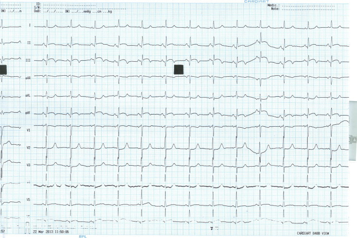 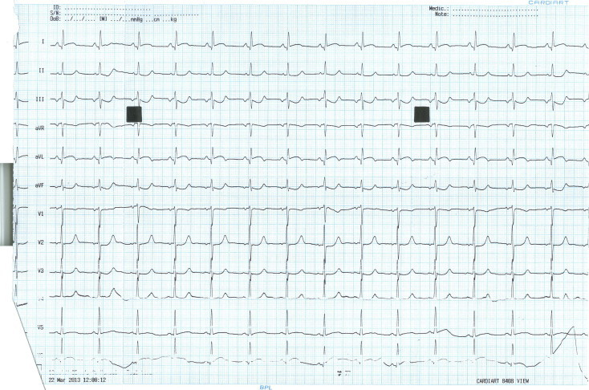

左：已演變的下壁梗塞。右：隔天 I、aVL 的 ST 上升與下壁 ST 下降，實為 LA–LL 接反

*圖：Karur S et al. J Cardiovasc Dis Res 2013;4:201-3 (PMC3849288)，授權條款請查原刊*

---

<!-- _class: divider -->

# Part 5
## RA–LL：假下壁梗塞的陷阱

---

# RA–LL 互換

- **II 導程 P–QRS 倒置**，aVF 與 aVR 互換
- 外觀：假性 **下壁梗塞** 加上看似非竇性的心房節律
- 與真正下壁梗塞的差別：真的下壁梗塞 **P 波在 II、aVF 仍然直立**
- 額面 QRS 軸：**300° − n** (n 為真實軸)
- 容易被誤判為 **左前分支阻滯** 或極端軸偏

> 經典描述：Peberdy 與 Ornato (1993)，在正常人也會做出這個圖形。

---

<!-- _class: fig -->

# 案例 ECG：肢體導程怪、胸前導程正常

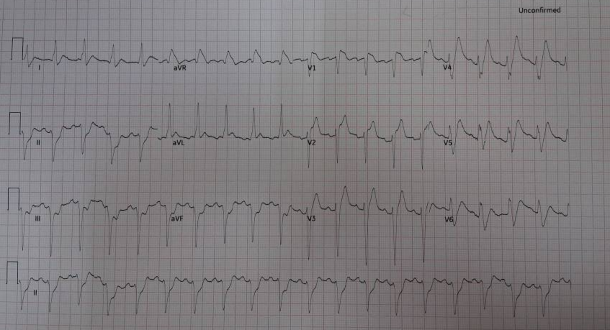

*案例 ECG，已無個資。診斷需重錄後確認*

---

# 案例解讀：疑似 RA–LL

- **aVR** 的 P、QRS、T 全部直立，**II、III、aVF** QRS 深負
- **aVL** 高 R 波，**胸前導程** R 波進展正常
- 觀察軸約 −80°
- 反推真實軸：n = 300° − (−80°) = 380°，即約 **+20°**，是一個正常軸

結論：先重新接線再重錄，**重錄之前不要用這張的下壁導程判斷 ST**。

---

<!-- _class: divider -->

# Part 6
## 含右腳的互換：Flat line 規則

---

# 右腳 (RL) 互換的特徵

- 右腳電極位置本來不影響波形，但**線被換走**就會影響
- 與 LA 或 RA 互換：Wilson 中樞端被扭曲，**所有胸前與增壓導程變形**
- 標誌訊號：**I、II、III 其中一條幾乎是 flat line**
- 因為那條導程量的是「兩條腿之間」的電位差，約為零
- LL 與 RL 互換：兩腿電位相等，**幾乎看不出來**

---

# Table 3：右腳參與的互換

| 互換 | I | II | III |
|------|---|----|-----|
| RA/RL | ≅ −III | **≅ 0** | III |
| LA/RL | ≅ II | II | **≅ 0** |
| LL/RL | I | II | III |
| RA/RL 加 LA/LL | **≅ 0** | −II | −I |

- ≅ 為視覺上近似，0 為 flat line
- 胸前導程失真，但肉眼變化不大

*表：Batchvarov 2007 Table 3 節錄。RA/RL 加 LA/LL 是雙側接反*

---

# 為什麼 RA–RL 時 II 是一條線？

- II = LL − RA。RA 線接到腳上後，變成 **LL − RL**
- 兩腿電位接近，差值約為 0
- 此時 I ≈ −III，aVR 與 aVF 看起來相同
- **只有 III 導程不受影響**，12 導程中唯一沒變的一條

> 速記：flat line 在哪條導程，就是兩個電極都在腿上的那條。

---

# 例外：Mason–Likar 電極位置

- 運動心電圖或監視器常把腳電極放在**軀幹**
- 只有在**腳踝**時，兩腿電位差才接近零
- 放在髂嵴或肋下，電位差變大，flat line 會消失
- 軀幹放置本身也會讓 QRS 軸右偏、改變胸前 R 波

> 在加護病房看到「沒有 flat line」，不能排除右腳互換。

*依據：Batchvarov 2007 Figure 5 說明*

---

<!-- _class: fig -->

# 速查表：12 種肢體導程接錯

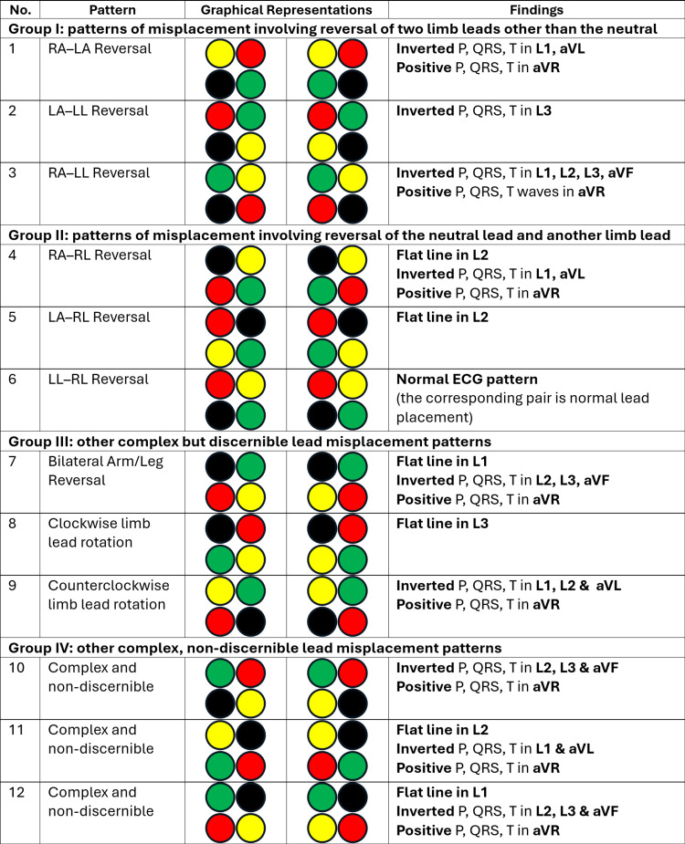

*圖：Ramadurai S et al. Cureus 2025;17:e92345 (PMC12522010), CC BY 4.0。顏色為 IEC 標準*

---

<!-- _class: fig -->

# 判讀流程圖

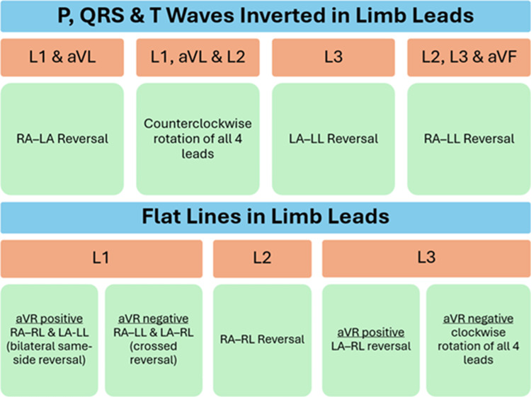

*圖：Ramadurai S et al. Cureus 2025 (PMC12522010), CC BY 4.0*

---

<!-- _class: fig -->

# 實例：RA–LA 與 LA–LL

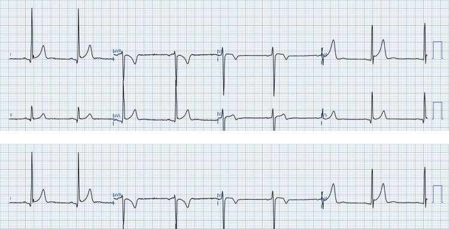

*圖：Ramadurai S et al. Cureus 2025 (PMC12522010), CC BY 4.0*

---

<!-- _class: divider -->

# Part 7
## 進階與臨床意涵

---

# QRS 軸變換公式

| 互換 | 額面 QRS 軸 |
|------|------------|
| RA/LA | 180° − n |
| RA/LL | 300° − n |
| LA/LL | 60° − n |
| 順轉 | n − 120° |
| 逆轉 | n + 120° |

- n 為正確接線時的軸，需要有舊 ECG 才能比對
- 例外：垂直軸的人做 RA–LA 互換，軸幾乎不變

*表：Batchvarov 2007 Table 4 節錄 (Ho 2006)*

---

# 接錯會騙你的三個方向

- **製造假病變**：健康人可產生下壁缺血的 ECG 徵象
- **隱藏真病變**：下壁梗塞疤痕的病人把 LL 與 LA 互換，ECG 變成正常
- **假性軸偏**：像左前分支阻滯，或像右軸偏

自動判讀**不可靠**，I、II 或 III 其中一條 QRS 振幅極低，在一半的情況是接錯的標誌。

*依據：Rudiger 2003, Am J Emerg Med (健康志願者 2 位、病人 3 位的互換實驗)*

---

<!-- _class: fig -->

# 案例：接錯被當成 NSTEMI

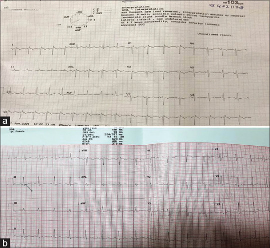

左 (a)：肢體導程接錯，疑似 NSTEMI。右 (b)：正常 ECG

*圖：Ravi R et al. J Anaesthesiol Clin Pharmacol 2021;37:311-2 (PMC8289645)，授權條款請查原刊*

---

<!-- _class: fig -->

# 複雜案例：多條電極同時錯位

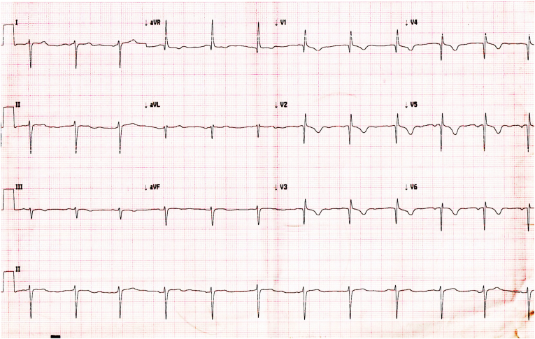 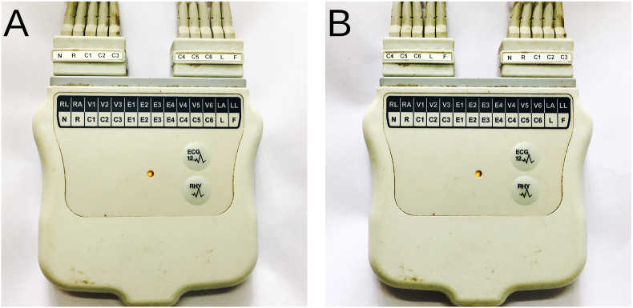

左：P 波小，額面 P 軸約 +120°。右：接頭盒兩種接法 (A、B)，電纜互換造成多條導程錯位

*圖：Sukumaran SK, Selvaraj RJ. Indian Pacing Electrophysiol J 2024;24:119-21 (PMC11010442), CC BY-NC-ND 4.0，未修改*

---

# 電腦偵測：進步但仍有盲點

- **Hedén 1995**：11,009 張。神經網路偵測 RA/LA，有 P 波時敏感度 99.1%，無 P 波 94.5%，規則式為 93.9% 與 39.3%
- **Kors 2001**：3,305 張、14 種互換，特異度 ≥99.5%，11 種敏感度 ≥93%，**LA–LL 最低**
- **Rjoob 2020** 系統性回顧 (14 篇)：機器學習整體良好，**例外仍是 LA–LL**
- 離開訓練資料庫後，準確度可掉到 36% 到 78% (Xia 2012)

---

# 助記法：Blips and Flips

- **Blips**：低電壓型。雙側手腿互換、RA–RL、LA–RL
- **Flips**：翻轉型。LA–RA、RA–LL、LA–LL，與順逆時針旋轉
- 6 位第一年心臟科 fellow：基線僅 2 位認得 LA–RA
- 每月 2 次提醒、持續 6 個月後，所有人都能辨認 **Blips**；仍困難的是 III 倒置 (LA–LL)，常被當成缺血

*Bravo F, Moukabary T. Am J Med 2026。僅讀到摘要*

---

# 實務流程：五步驟

1. **看 P–QRS–T 極性**：I、II 是否倒置？aVR 是否直立？
2. **找 flat line**：有，想右腳互換 (注意軀幹放置例外)
3. **看被翻轉的導程**：對照速查表，定位互換組合
4. **看胸前導程**：R 波進展正常？決定是否含胸前或右腳
5. **重新接線再錄一張**，並與舊 ECG 比對軸與 P 波

---

# 預防

- 技師訓練：接線前核對**顏色與位置**
- 同一台機器的接頭盒標示要清楚 (如 Sukumaran 2024)
- 加護病房、急診高風險：**每次**都與前一張比對
- 懷疑時直接重錄，比在 12 導程上推理更快
- 胸前電極位置錯誤是另一個大宗，需以肋間標誌定位 (Derkenne 2017)

---

# Take Home Messages

1. 肢體導程接錯盛行率 **0.4–4%**，加護病房最高
2. **不含右腳**：胸前導程不變，肢體導程重排或翻轉
3. **含右腳**：**flat line** 是標誌，但軀幹電極會破壞它
4. **LA–LL 最難認**：看 I 與 II 的 P 波與 III 的終末 P 波
5. **RA–LL** 假下壁梗塞：II 與 aVF 的 P 波同樣倒置
6. 有疑問就**重新接線再錄**

---

<!-- _class: small-text -->

# 參考文獻 (1/2)

1. Batchvarov VN, Malik M, Camm AJ. [*Europace* 2007;9:1081-90](https://doi.org/10.1093/europace/eum198)
2. Peberdy MA, Ornato JP. [*Am J Emerg Med* 1993;11:403-5](https://doi.org/10.1016/0735-6757(93)90177-d)
3. Harrigan RA, Chan TC, Brady WJ. [*J Emerg Med* 2012;43:1038-44](https://doi.org/10.1016/j.jemermed.2012.02.024)
4. Abdollah H, Milliken JA. [*Am J Cardiol* 1997;80:1247-9](https://doi.org/10.1016/s0002-9149(97)00656-5)
5. Rudiger A, et al. [*Am J Emerg Med* 2003;21:574-7](https://doi.org/10.1016/j.ajem.2003.08.007)
6. Rudiger A, et al. [*Am J Emerg Med* 2007;25:174-8](https://doi.org/10.1016/j.ajem.2006.06.018)
7. Ramadurai S, et al. [*Cureus* 2025;17:e92345](https://doi.org/10.7759/cureus.92345)
8. Bravo F, Moukabary T. [*Am J Med* 2026](https://doi.org/10.1016/j.amjmed.2026.08.007)
9. Wieters JS, et al. [*J Emerg Med* 2014;46:620-3](https://doi.org/10.1016/j.jemermed.2013.09.016)

---

<!-- _class: small-text -->

# 參考文獻 (2/2)

10. Karur S, et al. [*J Cardiovasc Dis Res* 2013;4:201-3](https://doi.org/10.1016/j.jcdr.2013.06.001)
11. Li C, et al. [*BMC Cardiovasc Disord* 2024;24:217](https://doi.org/10.1186/s12872-024-03875-2)
12. Sukumaran SK, Selvaraj RJ. [*Indian Pacing Electrophysiol J* 2024;24:119-21](https://doi.org/10.1016/j.ipej.2023.11.007)
13. Glancy DL, et al. [*Proc (Bayl Univ Med Cent)* 2016;29:85-6](https://doi.org/10.1080/08998280.2016.11929375)
14. Ravi R, et al. [*J Anaesthesiol Clin Pharmacol* 2021;37:311-2](https://doi.org/10.4103/joacp.JOACP_363_18)
15. Krasteva V, et al. [*Sensors* 2019;19:2920](https://doi.org/10.3390/s19132920)
16. Hedén B, et al. [*Am J Cardiol* 1995;75:929-33](https://doi.org/10.1016/s0002-9149(99)80689-4)
17. Kors JA, van Herpen G. [*Am J Cardiol* 2001;88:396-9](https://doi.org/10.1016/s0002-9149(01)01686-1)
18. Rjoob K, et al. [*J Electrocardiol* 2020;62:116-23](https://doi.org/10.1016/j.jelectrocard.2020.08.013)
19. Derkenne C, et al. [*BMJ Case Rep* 2017](https://doi.org/10.1136/bcr-2017-221429)

---

<!-- _class: lead -->
<!-- _paginate: false -->

# 謝謝聆聽
## Q & A
