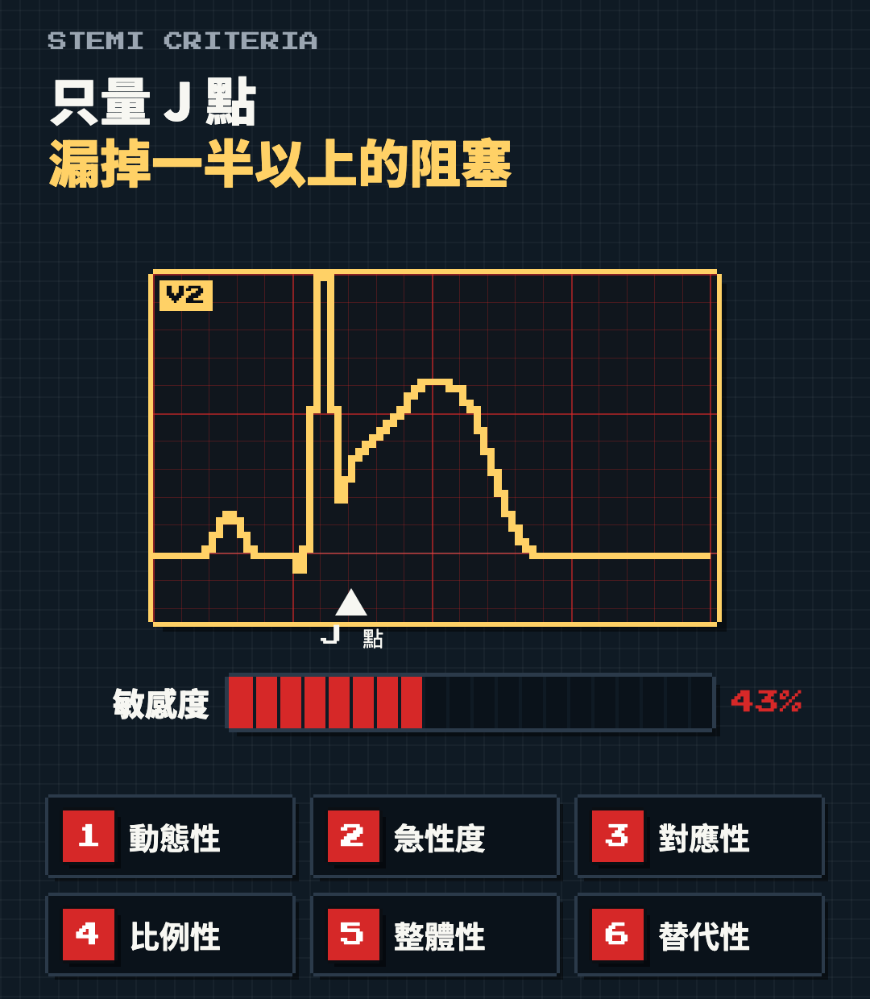
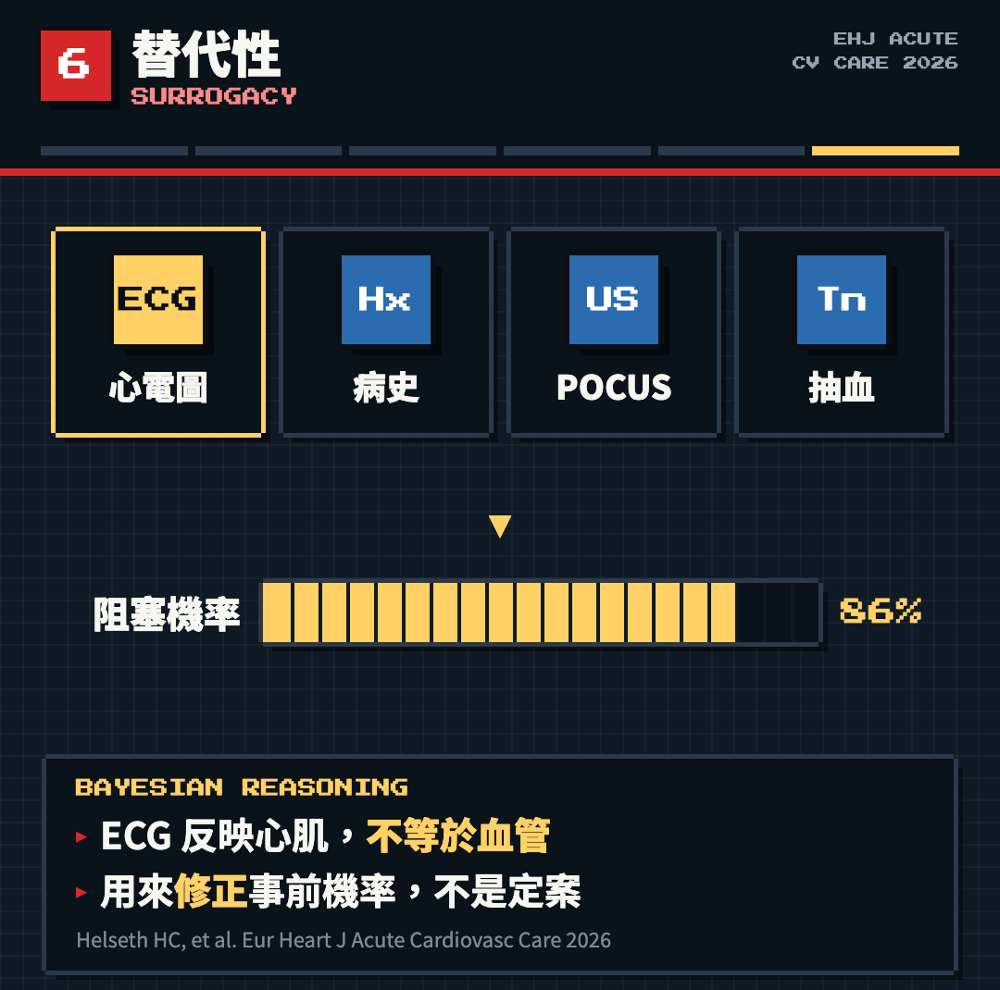
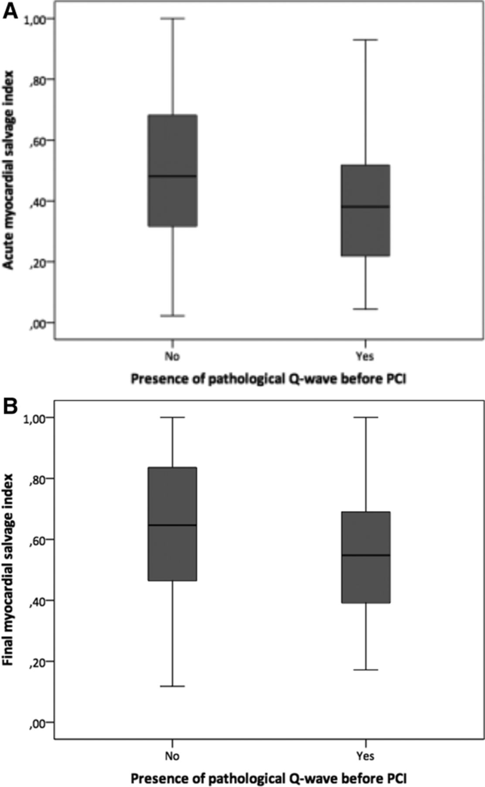
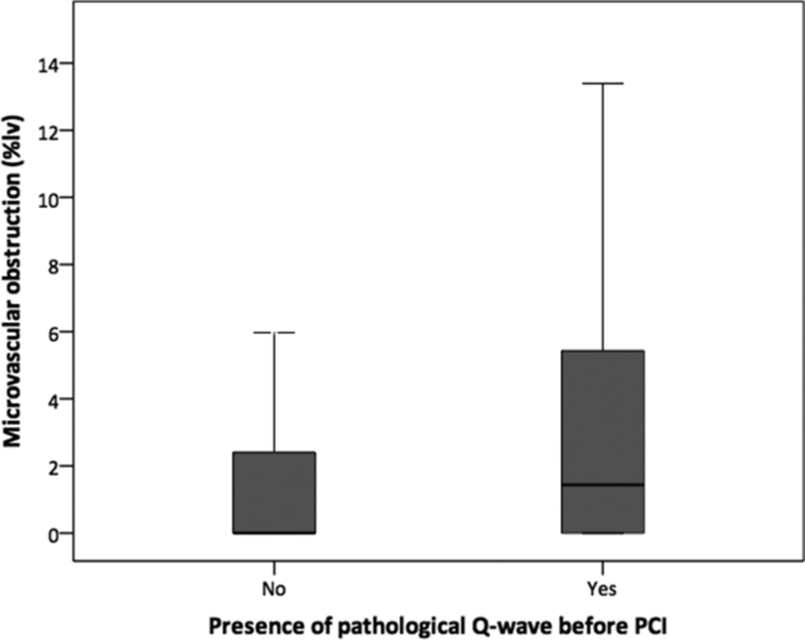
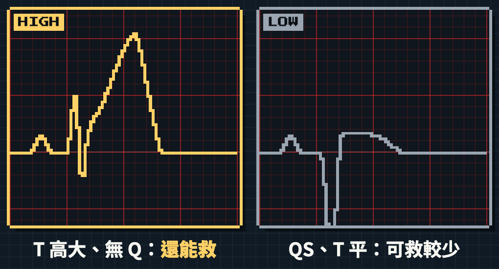
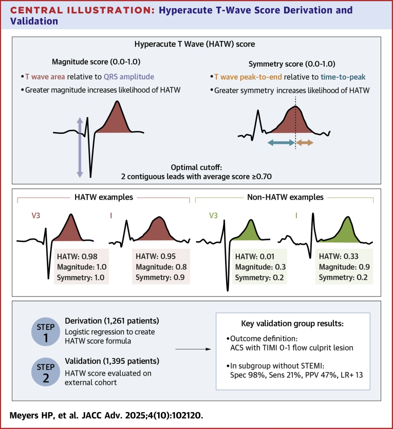
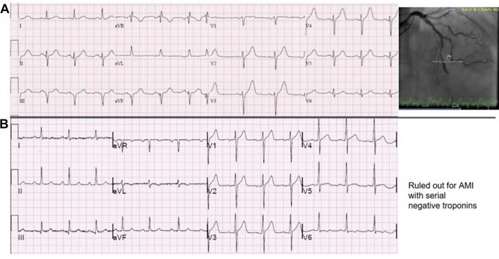

<!-- _class: lead -->
<!-- _paginate: false -->

# OMI 心電圖六原則：我的心得
## 延伸問題：Q 波出現了，還有得救嗎？

**整理：謝慕揚 MD, PhD, FESC** | 2026-10-27

延伸自：Helseth HC, ..., Smith SW. Electrocardiographic Principles for the Diagnosis of Occlusion Myocardial Infarction. [*Eur Heart J Acute Cardiovasc Care* 2026](https://doi.org/10.1093/ehjacc/zuag114)

---

# 為什麼這篇文章重要

- 將近 15 年來，我一直覺得教 STEMI 判讀很難
- 標準常常不統一；即使是專家，同一張 ECG 也可能判讀不同
- 電腦越來越聰明，但這篇才讓我發現：**很多隱形條件，我們平常沒有講出來**
- 這篇把專家腦中的潛規則，整理成六個原則

> 心電圖不是一張就可以完全準確判定。

---

# 六個原則一覽

| 原則 | 一句話 |
|---|---|
| 1 動態性 Dynamicity | 血栓會變大、會溶；症狀一變就重做 ECG |
| 2 急性度 Acuteness | T 波高大、沒有 Q 波，代表還有心肌可救 |
| 3 對應性 Reciprocity | 先看對側：下壁梗塞，aVL 幾乎都有 ST 壓低 |
| 4 比例性 Proportionality | ST、T 波要對照 QRS 的大小 |
| 5 整體性 Totality | 節律、傳導、Q 波，12 導程一起看 |
| 6 替代性 Surrogacy | ECG 只是機率，要加上病史、超音波、抽血 |

*Helseth HC, Mansur P, El-Baba M, McLaren JTT, de Alencar JN, Smith SW. [Eur Heart J Acute Cardiovasc Care 2026](https://doi.org/10.1093/ehjacc/zuag114)*

---

# 第六原則：心電圖之外的隱形條件

- 專家腦中綜合的不只是 ECG
- 還有：**過去有沒有冠心病**、**有沒有放過支架**、症狀
- 不會只看一張：**與前幾張比對**，症狀一變就重做
- POCUS、troponin 用來修正事前機率

> 每次在急診用一張心電圖拯救的，常常不只是病人一個人，而是一整個家庭。

---

# 給第一線同事

- ACS 團隊用群組即時評估心電圖：**避免單一人員在疲勞下認知疲乏**
- 六原則，就是心臟專科醫師判定時的依據與準則
- 請理解：我們會看前面幾張、前後比對，也重視症狀
- 文章很長，先看 1 分鐘影片：《OMI 心電圖六原則》

> 接下來的延伸問題，來自第二原則「急性度」：Q 波出現了，還有得救嗎？

---

# 臨床問題

- 胸痛病人，第一張 ECG 已經有 **Q 波，甚至 QS**
- 傳統想法：Q 波＝壞死完成 → 晚到、沒得救、不急
- 但同一個導程 **T 波仍然高大**，該怎麼解讀？

> 今天的結論先講：Q 波代表「梗塞大、風險高」，不代表「沒得救」。還能救多少，要看 T 波。

---

# 本次內容

1. Q 波可能只是缺血，不一定是壞死
2. Q 波是預後指標，不是放棄再灌流的理由
3. 急性度看 T 波：Anderson-Wilkins acuteness score
4. QS＋高大 T 波：急性 LAD 阻塞 vs 室壁瘤
5. 反面證據與限制
6. 臨床整理

---

<!-- _class: divider -->
# 一、Q 波不一定是壞死

---

# Raitt 1995：早期 Q 波很常見

## [J Am Coll Cardiol 1995;25:1084–8](https://doi.org/10.1016/0735-1097(94)00514-q)

- 四個血栓溶解試驗合併：**695 位**首次心肌梗塞
- 症狀 **1 小時內**到院，已有 **53%** 出現異常 Q 波
- 有 Q 波者梗塞較大，但 **血栓溶解縮小梗塞的效果並未消失** (p < 0.0001)
- 機轉：嚴重缺血本身就會讓 QRS 改變（缺血性 Q 波）

> Q 波不能當作「心肌已經不可逆壞死」的可靠指標。

---

# Topal 2017：CMR 直接量救回多少

## [Circ Cardiovasc Interv 2017;10:e004467](https://doi.org/10.1161/CIRCINTERVENTIONS.116.004467)（DANAMI-3 CMR 次研究）

| | 有早期 Q 波 (n=108) | 無 Q 波 (n=407) |
|---|---|---|
| Myocardial salvage index（中位數） | 0.59 | 0.65 |
| MVO（中位數） | 1.4 | 0.0 |

- 有 Q 波：救回較少、MVO 較多（校正後仍顯著）
- 但 **仍救回約六成危險區心肌**
- 作者結論：有 Q 波的病人 **仍能從 primary PCI 獲益**

---

<!-- _class: fig -->
# Topal 2017：有 Q 波，salvage 仍然可觀

 

左：salvage index；右：MVO。有 Q 波者 final salvage 仍約 0.55–0.6

*Figure 2、3 取自 Topal DG, et al. [Circ Cardiovasc Interv 2017;10:e004467](https://doi.org/10.1161/CIRCINTERVENTIONS.116.004467)。© American Heart Association，僅供教學引用*

---

<!-- _class: divider -->
# 二、Q 波是風險，不是放棄的理由

---

# HERO-2 與 APEX-AMI

| 研究 | 病人數 | 有 Q 波 | 結果 |
|---|---|---|---|
| HERO-2 (Lancet 2006) | 15,222 | 67% | 30 天死亡 10% vs 7%；aOR 1.31–1.44 |
| APEX-AMI (JACC 2009) | 4,530 | 56% | 90 天死亡 5.3% vs 2.1% |

- 兩者都發現：**Q 波比症狀時間更能預測預後**
- HERO-2 作者的建議是 **更積極再灌流**，不是放棄

*Wong CK, et al. [Lancet 2006;367:2061–7](https://doi.org/10.1016/S0140-6736(06)68929-0)；Armstrong PW, et al. [J Am Coll Cardiol 2009;53:1503–9](https://doi.org/10.1016/j.jacc.2009.01.046)*

---

<!-- _class: divider -->
# 三、急性度要看 T 波

---

<!-- _class: fig -->
# 同樣有 ST 上升，急性度可以差很多

左：T 高大、無 Q＝高急性度；右：QS、T 變平＝可救較少，但不等於零

*示意圖：謝慕揚 OMI 心電圖六原則像素影片（自繪，非原文圖）*

---

# Anderson-Wilkins acuteness score

- 概念：**T 波高度 vs Q 波** 互相比較，估計阻塞「新」或「舊」
- 高大 T 波＝急性；T 波變平、倒置＋Q 波＝亞急性
- 修正版：1 分（最不急）到 4 分（最急），前壁、下壁分開算
- 補足病人自述時間的不準

*Corey KE, et al. [Am J Cardiol 1999;83:826–31](https://doi.org/10.1016/s0002-9149(98)01042-x)；Hedén B, et al. [Am Heart J 2003;146:797–803](https://doi.org/10.1016/S0002-8703(03)00404-6)*

---

# 急性度與心肌救回量

| 研究 | 病人數 | 主要發現 |
|---|---|---|
| Schoos 2013 | 150 (CMR) | AW ≥ 3 預測 salvage；**只有急性組，救回量隨延遲下降** |
| Engblom 2011 | 38 (SPECT/CMR) | RCA：r = −0.57；LAD：無相關 |
| 症狀時間 | — | 兩研究中都與 salvage 相關性弱 |

> 急性度高的 ECG，就是最不能等的 ECG。

*Schoos MM, et al. [Cardiology 2013;126:97–106](https://doi.org/10.1159/000351226)；Engblom H, et al. [J Electrocardiol 2011;44:525–32](https://doi.org/10.1016/j.jelectrocard.2011.03.008)*

---

<!-- _class: divider -->
# 四、QS＋高大 T 波

---

# 急性 LAD 阻塞 vs 左心室室壁瘤

- 前壁 QS＋ST 上升：可能是 **急性 OMI**，也可能是 **舊梗塞室壁瘤**
- 判讀規則（V1–V4）：
  1. 任一導程 **T/QRS ≥ 0.36** → 傾向急性
  2. ΣT ÷ ΣQRS **> 0.22** → 傾向急性
- 驗證：59 位急性 MI vs 16 位室壁瘤，rule 1 敏感度 91.5%、特異度 68.8%

> QS 不是終點；T 波相對 QRS 仍然很大，就仍屬急性。

*Smith SW. [Am J Emerg Med 2005;23:279–87](https://doi.org/10.1016/j.ajem.2005.01.003)；Klein LR, et al. [Am J Emerg Med 2015;33:786–90](https://doi.org/10.1016/j.ajem.2015.03.044)*

---

# 超急性 T 波的客觀定義

## [JACC Adv 2025;4:102120](https://doi.org/10.1016/j.jacadv.2025.102120)（Meyers HP, ..., Smith SW）

- HATW score：T 波面積相對 QRS 大小＋T 波對稱性
- 推導＋驗證共 **2,656 位**，五家 PCI 中心
- 不符 STEMI 標準者：**特異度 98.4%**、敏感度 20.7%
- 陽性者 84% 有造成急性 MI 的責任病灶
- 利益衝突：Meyers、Smith 與 Powerful Medical 有關

*右圖：Central Illustration，Meyers HP, et al. JACC Adv 2025，CC BY 4.0*

---

<!-- _class: fig -->
# HATW 實例：ST 幾乎沒升，T 波卻很大

(A) V2–V5 ST 上升很少，但 T 波面積相對 QRS 大且對稱 → 急性 LAD OMI，血管攝影證實；(B) 正常 T 波，連續 troponin 陰性

*Figure 3 取自 Meyers HP, et al. [JACC Adv 2025;4:102120](https://doi.org/10.1016/j.jacadv.2025.102120)，CC BY 4.0*

---

<!-- _class: divider -->
# 五、反面證據與限制

---

# 不要過度解讀

| 研究 | 族群 | 發現 |
|---|---|---|
| Topal 2020 | 晚到 12–72 h，n=66 | Q 波、AW 分數與 salvage 關聯弱 |
| Fakhri 2018 | STEMI，n=85 | 急性度＋嚴重度只在 **前壁** 有鑑別力 |

- 證據多為 **小型、回溯、單中心** CMR 研究
- 晚到病人：ECG 分數 **不能單獨決定** 要不要 PCI

*Topal DG, et al. [J Electrocardiol 2020;59:74–80](https://doi.org/10.1016/j.jelectrocard.2020.01.008)；Fakhri Y, et al. [J Electrocardiol 2018;51:195–202](https://doi.org/10.1016/j.jelectrocard.2017.11.002)*

---

# 臨床整理

1. **Q 波／QS ≠ 沒得救**：梗塞大、風險高，更要積極（證據一致）
2. **還能救多少，看 T 波**：急性度比症狀時間準（證據中等，前壁較明顯）
3. **QS＋T/QRS 高**：先當急性 OMI 處理，再排除室壁瘤
4. **晚到病人**：ECG＋持續症狀＋超音波＋troponin 一起判斷

> 總結一句：看到 Q 波，先看 T 波，再決定。

---

<!-- _class: small-text -->
# 參考文獻

1. Raitt MH, et al. Appearance of abnormal Q waves early in the course of acute myocardial infarction. [*J Am Coll Cardiol*. 1995;25(5):1084-8.](https://doi.org/10.1016/0735-1097(94)00514-q)
2. Topal DG, et al. Association between early Q waves and reperfusion success in STEMI treated with primary PCI: a CMR study. [*Circ Cardiovasc Interv*. 2017;10(3):e004467.](https://doi.org/10.1161/CIRCINTERVENTIONS.116.004467)
3. Wong CK, et al. Initial Q waves accompanying ST-segment elevation at presentation of acute MI and 30-day mortality (HERO-2). [*Lancet*. 2006;367:2061-7.](https://doi.org/10.1016/S0140-6736(06)68929-0)
4. Armstrong PW, et al. Baseline Q-wave surpasses time from symptom onset as a prognostic marker in STEMI (APEX-AMI). [*J Am Coll Cardiol*. 2009;53(17):1503-9.](https://doi.org/10.1016/j.jacc.2009.01.046)
5. Corey KE, et al. Combined historical and electrocardiographic timing of acute anterior and inferior MI. [*Am J Cardiol*. 1999;83(6):826-31.](https://doi.org/10.1016/s0002-9149(98)01042-x)
6. Hedén B, et al. A modified Anderson-Wilkins electrocardiographic acuteness score. [*Am Heart J*. 2003;146(5):797-803.](https://doi.org/10.1016/S0002-8703(03)00404-6)
7. Schoos MM, et al. A novel prehospital ECG score predicts myocardial salvage evaluated by CMR. [*Cardiology*. 2013;126(2):97-106.](https://doi.org/10.1159/000351226)

---

<!-- _class: small-text -->
# 參考文獻（續）

8. Engblom H, et al. ECG acuteness score to predict myocardial salvage by early PCI. [*J Electrocardiol*. 2011;44(5):525-32.](https://doi.org/10.1016/j.jelectrocard.2011.03.008)
9. Smith SW. T/QRS ratio best distinguishes ventricular aneurysm from anterior MI. [*Am J Emerg Med*. 2005;23(3):279-87.](https://doi.org/10.1016/j.ajem.2005.01.003)
10. Klein LR, ..., Smith SW. ECG criteria to differentiate acute anterior STEMI from LV aneurysm. [*Am J Emerg Med*. 2015;33(6):786-90.](https://doi.org/10.1016/j.ajem.2015.03.044)
11. Meyers HP, ..., Smith SW. Hyperacute T waves are specific for occlusion MI, even without diagnostic ST-segment elevation. [*JACC Adv*. 2025;4(10 Pt 2):102120.](https://doi.org/10.1016/j.jacadv.2025.102120)
12. Topal DG, et al. ECG to predict reperfusion success in late presenters with STEMI. [*J Electrocardiol*. 2020;59:74-80.](https://doi.org/10.1016/j.jelectrocard.2020.01.008)
13. Fakhri Y, et al. ECG scores of severity and acuteness predict salvage in anterior STEMI. [*J Electrocardiol*. 2018;51(2):195-202.](https://doi.org/10.1016/j.jelectrocard.2017.11.002)
14. Helseth HC, ..., Smith SW. Electrocardiographic principles for the diagnosis of OMI. [*Eur Heart J Acute Cardiovasc Care*. 2026.](https://doi.org/10.1093/ehjacc/zuag114)

---

<!-- _class: lead -->
<!-- _paginate: false -->

# 謝謝聆聽
## Q & A

本講義為教學用途，非個別病人醫療建議
