<!-- _class: title -->
<!-- _paginate: false -->

# 3D Wiring 入門

## 岡村篤徳（Atsunori Okamura）的 CTO wiring 方法

 

**謝慕揚 MD, PhD, FESC**｜新竹臺大分院 心血管中心｜2026-10

原文連結：[Okamura A, et al. *Cardiovasc Interv Ther*. 2026;41(4):889–911.](https://doi.org/10.1007/s12928-026-01282-2)

<!--
本份投影片的圖全部取自 Okamura A, et al. Cardiovasc Interv Ther 2026;41:889-911（PMID 42050062），該文為 CC BY 4.0 開放授權，部分圖片經裁切。
-->

---

# 先講「為什麼？」

- 冠狀動脈是 3D 結構，我們卻在 140 cm 外看 2D 影像操控 wire
- 以往的對策：parallel wire、retrograde
  - reverse CART 讓術者「不必精準打到 3D target」
- 岡村醫師的主張：**直接把 3D wiring 練起來**，讓 CTO wiring 可以標準化

說穿了，3D wiring 不是多看一個 view，而是改掉「邊轉邊推」的習慣。

---

# 15 年的演進路線

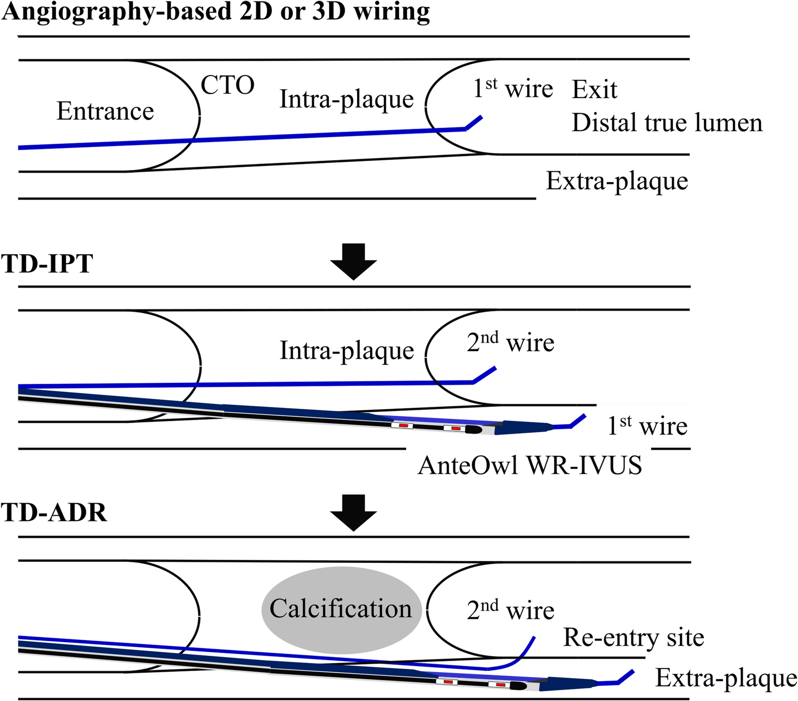

1. 2010–2013：IVUS-guided wiring（ViewIT、Navifocus WR）
2. 2014–2015：只看透視的 3D wiring，加上 3D imaging rule
3. 2017–2019：tip detection（TD）法、AnteOwl WR
4. 2020–2021：意外發現 TD-ADR

<a href="https://doi.org/10.1007/s12928-026-01282-2">Okamura A, et al. Cardiovasc Interv Ther 2026</a>, Fig. 1（CC BY 4.0）

---

# 核心一：shaft 固定、tip 做 pivot

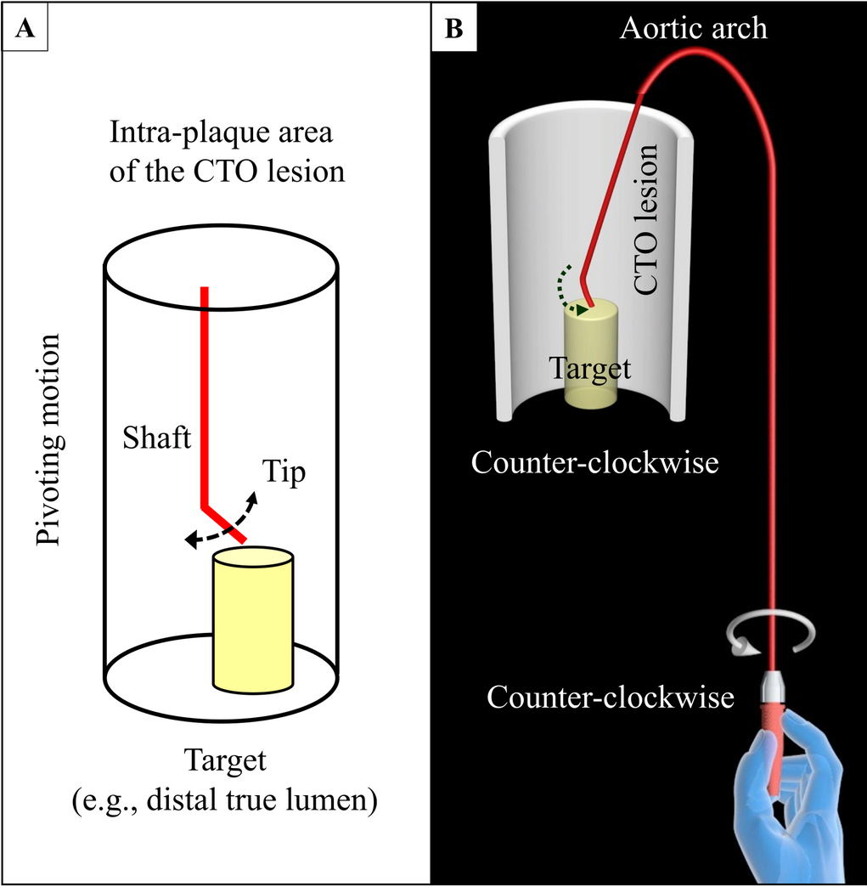

- wire 只做 **1 mm、45°** 的 first curve
- 在 CTO 組織內，shaft 被組織固定當軸心，只有 tip 旋轉
- 組織一旦被弄碎，shaft 跟著動，精準度就沒了
- 所以「**第一次就要走對**」

<a href="https://doi.org/10.1007/s12928-026-01282-2">Okamura 2026</a>, Fig. 3A–B（裁切，CC BY 4.0）

---

# 核心二：torquer 和 tip 1:1 同步

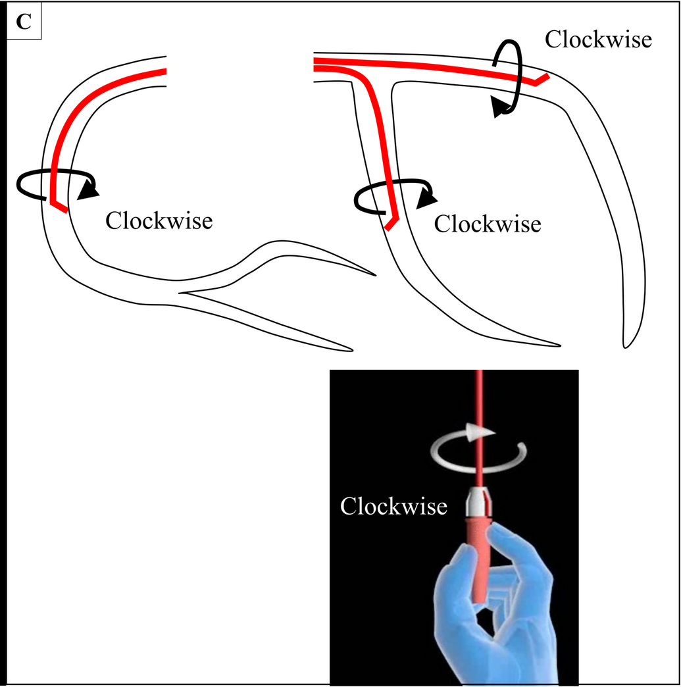

- torquer 和 tip 轉向其實相同，但 wire 在 aortic arch 反折，**螢幕上看起來是反的**
- 兩個口訣（順時針＝從 torquer 後方看）：
  - mid-RCA：tip 朝右，順時針 → tip 朝向術者
  - proximal LAD：tip 朝上，順時針 → tip 朝向術者
- 平常做 non-CTO 就刻意練

<a href="https://doi.org/10.1007/s12928-026-01282-2">Okamura 2026</a>, Fig. 3C（裁切，CC BY 4.0）

<!--
這是初學者的第一道坎。建議每一台 open vessel PCI 都先在心裡預測：「我順時針轉，tip 會往哪裡？」再看螢幕驗證。
-->

---

# 核心三：轉和推完全分開

**2D wiring**：~3 g wire 邊轉邊推
**3D wiring**：先把 tip 轉向 target → 停 → 再推

- 只有兩個動作：rotate 和 push
- 建立 3D 影像需要三樣東西：**shaft、tip、target**
  - 透視：shaft 和 tip 很可靠，target 不一定看得到
  - IVUS（有 pullback）：三者都看得到

---

# Angio 3D wiring：兩個正交 view

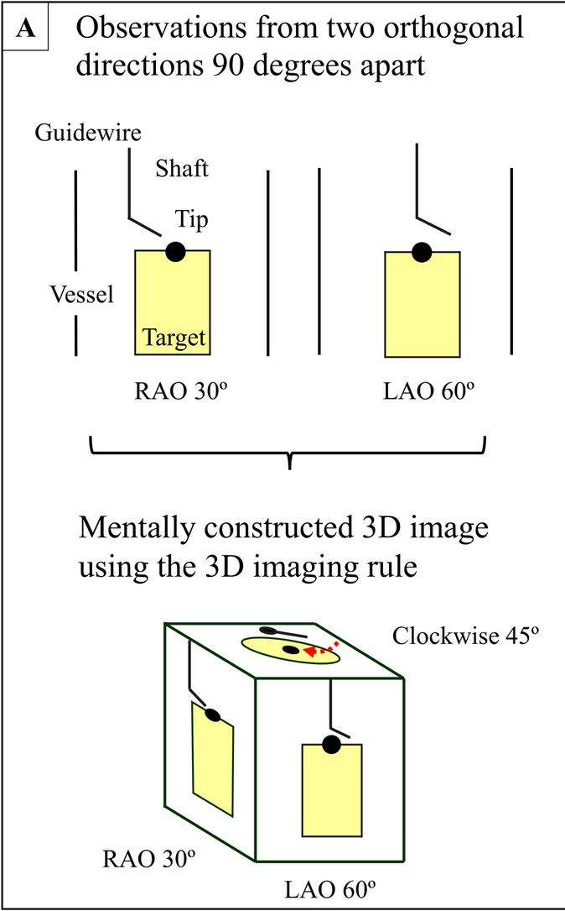

- 兩個 view 盡量相差 **90°**
- 用 3D imaging rule 即時判斷 tip 該往哪轉、轉多少：

**「same is front, opposite is back」**

- 圖例：RAO 30° 加 LAO 60°，在腦中組出立體影像，得到「順時針 45°」

<a href="https://doi.org/10.1007/s12928-026-01282-2">Okamura 2026</a>, Fig. 4A（裁切，CC BY 4.0）

<!--
規則的幾何定義在 2015 年的原始論文（Okamura, Cardiovasc Interv Ther 2015, PMID 26113196）的圖裡，這次沒有取得該篇全文，所以投影片只引規則名稱，細節請以原文為準。
-->

---

# Sequential targets：從 1 cm 外逐步收斂

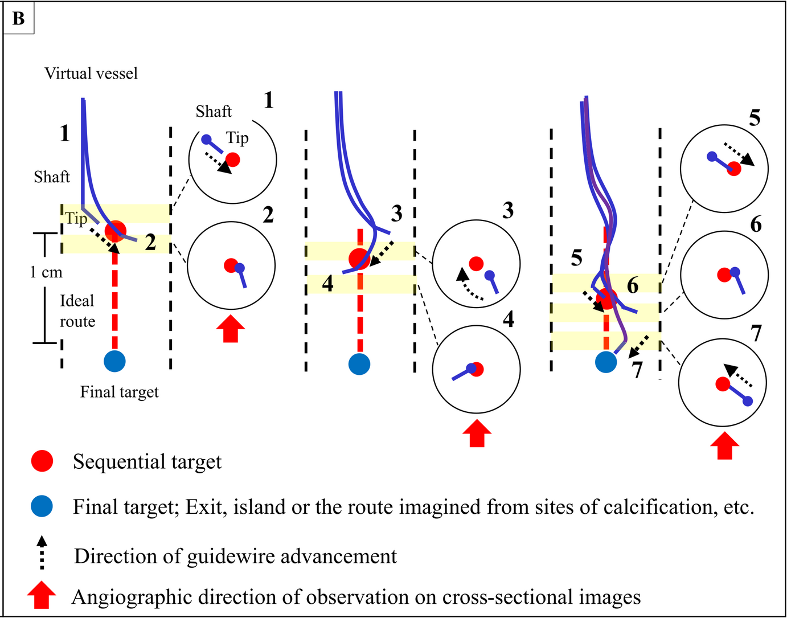

- 適應症：target 要在 **1 cm 內**看得到
  - CTO 內的 island、distal exit
  - 鈣化或 stent strut 勾勒出的路徑（ISR CTO）
- 一段一段重建 3D 影像，把 tip 收斂到 final target

<a href="https://doi.org/10.1007/s12928-026-01282-2">Okamura 2026</a>, Fig. 4B（裁切，CC BY 4.0）

---

# 正交 view 怎麼轉 C-arm

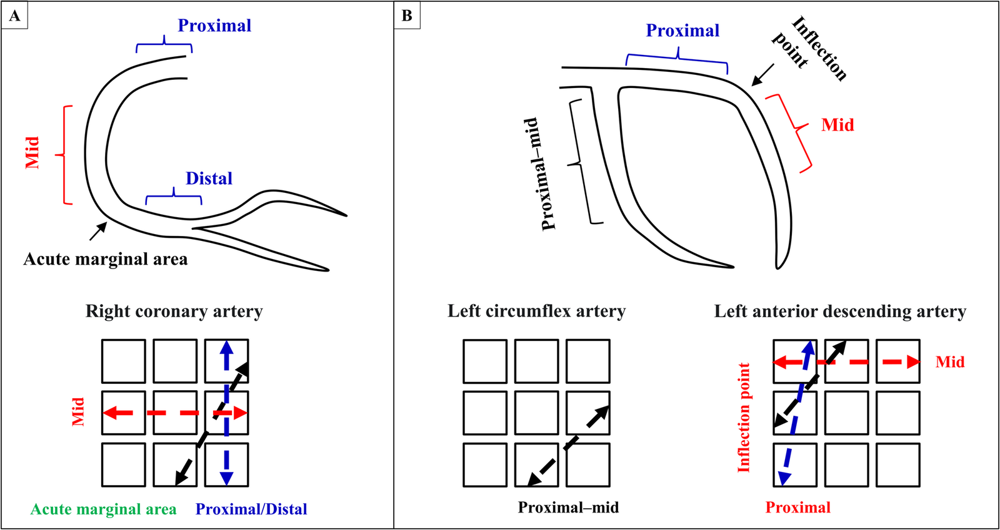

- 3×3 格：橫軸 RAO 45° 到 LAO 45°，縱軸 cranial 45° 到 caudal 45°
- 箭頭＝各 segment 要轉的方向
- 作者以 CT TrueView 分析，**個體差異不大**

<a href="https://doi.org/10.1007/s12928-026-01282-2">Okamura 2026</a>, Fig. 5（CC BY 4.0）

---

# Angio 3D wiring 的器材

- Wire（作者經驗）：
  - Conquest Pro 9 g：手塑 0.8 mm／45°，適合小血管
  - Conquest Pro 12 g／20 g：預塑 1 mm／45°
  - XT-R 推不動、距 target 1 cm 內 → 直接升到 Conquest
- Microcatheter：Corsair（原文稱「必要」）
- Guide：7–8 Fr，必要時 side-branch anchor

---

# 為什麼一開始就用高 tip load？

- tip load 不夠 → 推不動 → 術者退回 2D 邊轉邊推
- 結果：CTO body 被弄出脆弱通道或 subintimal space
- 之後再換 Conquest，wire 已經無法有效 deflect

退路：血管走向不明時，先用 intermediate wire（Gladius EX）保住血管內路徑，方便轉 IVUS-guided TD
限制：wire 一旦進 subintimal space，angio 3D wiring 就無效

---

# IVUS 3D wiring：為什麼要看 tip？

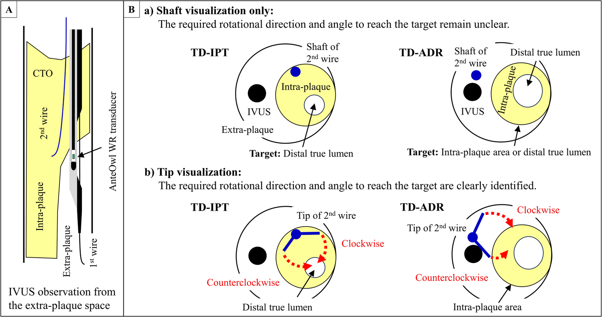

- 只看 **shaft**：不知道 torquer 該往哪轉、轉幾度
- 看到 **tip**：轉的方向和角度一清二楚
- 這就是 tip detection（TD）法的命名由來
- 和「推完再用 IVUS 確認」不同，TD 是 **real-time** 引導

<a href="https://doi.org/10.1007/s12928-026-01282-2">Okamura 2026</a>, Fig. 8（CC BY 4.0）

---

# Tip-kiri：確認看到的是 tip 頂點

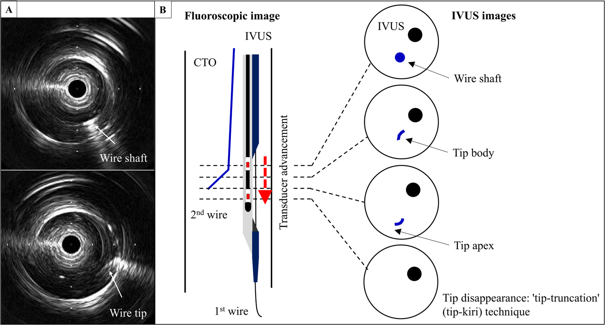

- transducer 從 tip 根部往遠端推，直到 tip 從影像上消失
- 消失前最後一格＝tip apex
- 要和 wire 動作同步反覆做
- **主要由第二術者負責，需要專門訓練**

<a href="https://doi.org/10.1007/s12928-026-01282-2">Okamura 2026</a>, Fig. 9（CC BY 4.0）

---

# IVUS 和透視的 co-registration

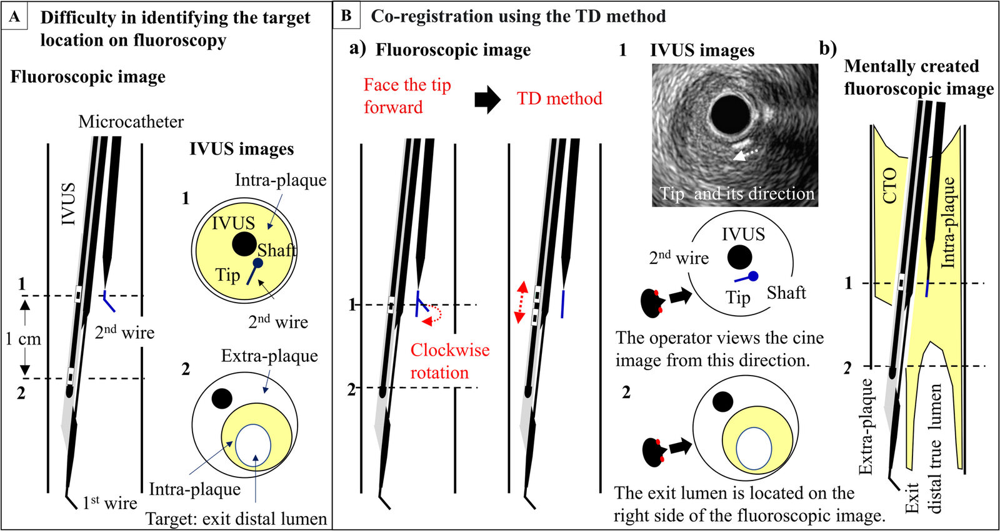

1. 在 target 近端 1–2 cm，把 second wire tip 轉向術者
2. 用 TD 在 IVUS 上找到這個 tip
3. 就知道透視的觀看方向對應 IVUS 幾點鐘
4. 推出 target 在透視上的方位

<a href="https://doi.org/10.1007/s12928-026-01282-2">Okamura 2026</a>, Fig. 10（CC BY 4.0）

---

# 進入 TD 之前的流程

1. AWE → 懷疑 first wire 在 extra-plaque
2. Corsair bougie → 換 intermediate wire（Gladius EX 等）
3. 用 dual-lumen catheter 送 second wire
   - DLC 放在 CTO entry 近端約 5 mm，避免對 CTO 加壓
4. AnteOwl 沿 first wire 前進，pullback 後決定 TD-IPT 或 TD-ADR
5. Corsair 推不動 → 先用 1.5–2.0 mm balloon 擴張

---

# TD-IPT 與 TD-ADR 的操作差異

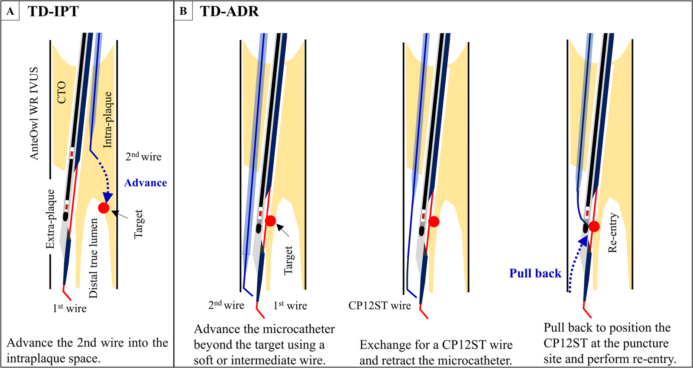

- **TD-IPT**：second wire 走 plaque 內（pivot）
- **TD-ADR**：microcatheter 越過 target → 換 CP12ST → 回拉到穿刺點 → 垂直穿刺
- 作者順序：沒有嚴重鈣化或極度彎曲時先做 TD-IPT

<a href="https://doi.org/10.1007/s12928-026-01282-2">Okamura 2026</a>, Fig. 12（CC BY 4.0）

---

# TD-IPT：兩位術者分工

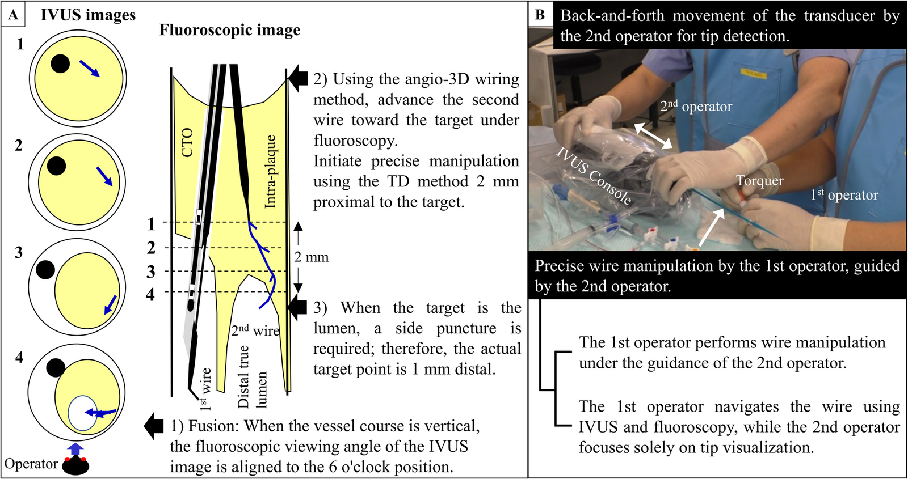

- 第二術者：IVUS tip-kiri，即時找 tip、指揮旋轉
- 第一術者：透視看長軸，**每次轉 5–10°** 再推
- target 是 lumen 時要側面穿刺，實際 target 往遠端 1 mm

<a href="https://doi.org/10.1007/s12928-026-01282-2">Okamura 2026</a>, Fig. 13（CC BY 4.0）

---

# Detour theory 與利用障礙物

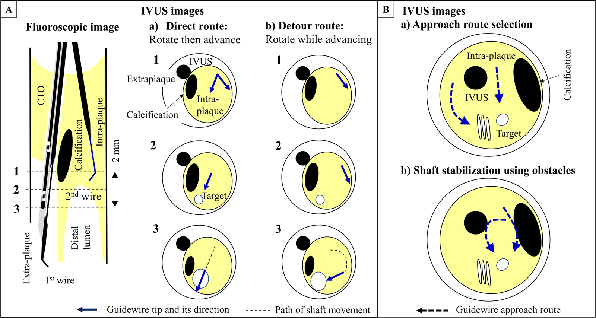

- 先對準再直推 → tip **飛過** target
- 邊推邊帶一點旋轉，走弧線才刺得到（像飛機降落）
- IVUS catheter 把腔隙分兩半，先決定從哪側接近
- IVUS 或鈣化可以撐住 shaft，增加穿刺力

<a href="https://doi.org/10.1007/s12928-026-01282-2">Okamura 2026</a>, Fig. 14（CC BY 4.0）

---

# Stingray-ADR vs TD-ADR

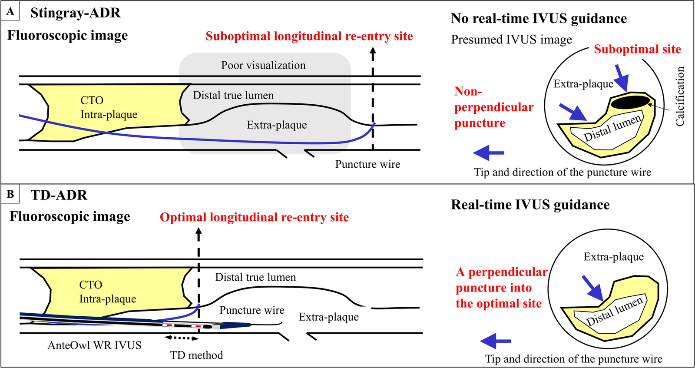

- TD-ADR：看得到穿刺點、可以**垂直穿刺**，還能進 CTO body

<a href="https://doi.org/10.1007/s12928-026-01282-2">Okamura 2026</a>, Fig. 16（CC BY 4.0）

---

# 長軸：在哪裡穿刺？

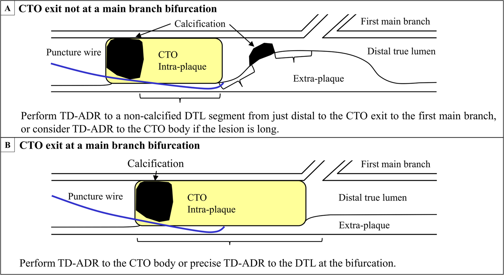

- exit 不在 bifurcation：CTO exit 到第一條大 side branch 之間、**非鈣化**的 DTL
- 病灶長：考慮 TD-ADR to CTO body
- exit 在 bifurcation：TD-ADR to CTO body，或精準穿刺 bifurcation 的 DTL

<a href="https://doi.org/10.1007/s12928-026-01282-2">Okamura 2026</a>, Fig. 17（CC BY 4.0）

---

# Bias 與 5° secondary curve

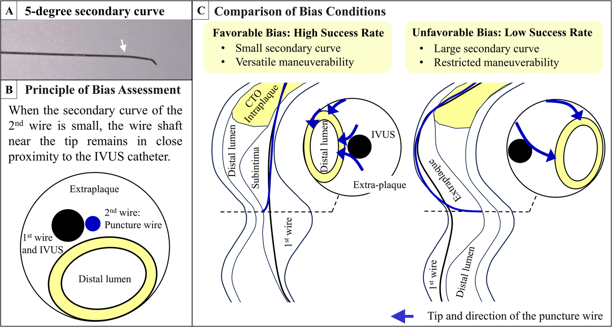

- CP12ST 預塑 1.3 mm／45°
- tip 近端約 8 mm 加 **5° secondary curve**
- 選 transducer 靠近 target 的平面（good bias，經驗值 < 1 mm）
- good bias → curve 可以小 → 好操控

<a href="https://doi.org/10.1007/s12928-026-01282-2">Okamura 2026</a>, Fig. 18（CC BY 4.0）

---

# 短軸：六點穿刺（six-point approach）

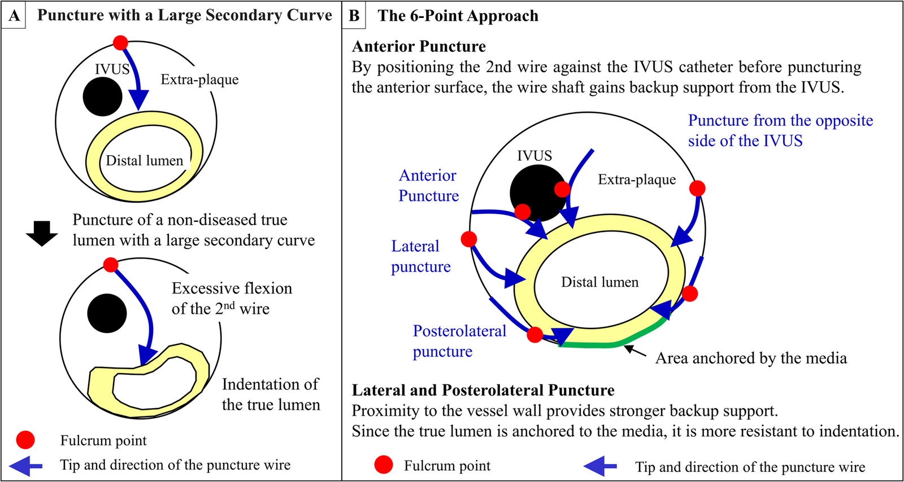

- secondary curve 太大 → 正常 DTL 被壓扁
- Anterior：靠 IVUS shaft 當支撐
- Lateral、posterolateral：靠血管壁撐，media 固定住 → **比較不會凹陷**
- 也可以從 IVUS 對側穿刺

<a href="https://doi.org/10.1007/s12928-026-01282-2">Okamura 2026</a>, Fig. 19（CC BY 4.0）

---

# 哪裡比較好刺？

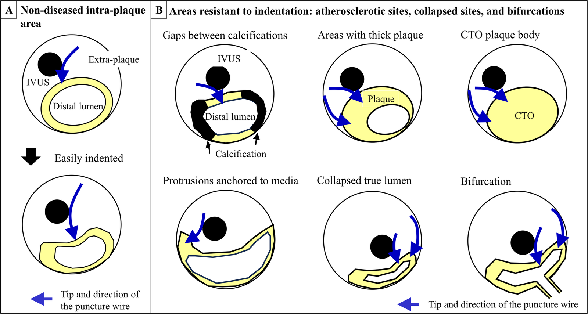

- 正常的 DTL 彈性大，容易被壓扁
- 好刺的地方：
  - 鈣化之間的縫隙
  - 厚 plaque、CTO body
  - 已塌陷的 lumen、bifurcation
- 進 DTL 後，繼續用 TD 再前進 **5–10 mm**

<a href="https://doi.org/10.1007/s12928-026-01282-2">Okamura 2026</a>, Fig. 20（CC BY 4.0）

---

# 作者的策略位置：Hybrid TD–RWE

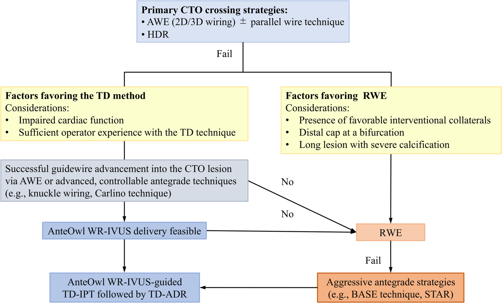

- 這是**作者團隊提出的策略圖**，不是學會共識

<a href="https://doi.org/10.1007/s12928-026-01282-2">Okamura 2026</a>, Fig. 2（CC BY 4.0）

---

# 成效數字

| 研究 | 設計 | 結果 |
|---|---|---|
| [Tanaka 2019](https://doi.org/10.1016/j.jcin.2018.12.014) | 單中心前後期，n=137 | 成功 98% vs 90% |
| [Okamura 2020](https://doi.org/10.1016/j.jcin.2019.07.041) | Beating-heart model | crossing 80.5 vs 333 s |
| [Suzuki 2023](https://doi.org/10.1016/j.jacasi.2023.03.003) | AnteOwl TD vs Navifocus | 93% vs 59% |
| [Tanaka 2024](https://doi.org/10.1016/j.jacasi.2023.11.017) | TD-ADR vs Stingray | 27/27 vs 18/27 |
| [Kashiyama 2024](https://doi.org/10.1007/s12928-024-01061-x) | TD vs retrograde（策略為單位） | 82% vs 48% |
| [Yamaji 2026](https://doi.org/10.1016/j.jacadv.2026.103274) | TD-IPT vs TD-ADR，n=73 | 兩組都約 97% |

數字依 PubMed 摘要；Tanaka 2019 摘要中 antegrade 時間的兩組數字疑似寫反，引用前請對原文

---

# 證據強度與指引

- **沒有 RCT**；全部是單中心或少數中心回溯研究，多用歷史對照
- 作者就是器材共同開發者，應假設有利益關係

- ACC／AHA／ESC／JCS 正式指引：都沒有提到 3D wiring
- 最高層級背書：[**APCTO Club 2025**](https://doi.org/10.1016/j.jacasi.2024.12.009) 專家 algorithm（高憲立教授為共同作者）
  - 有清楚路徑的 CTO → 3D wiring
  - ISR CTO：由 CrossBoss 改為 3D wiring
  - TD-ADR 列為 ADR 的新方向
- 證據等級大約 LOE C

---

# 在台灣能怎麼做？

- **AnteOwl 只在日本和香港上市**，台灣沒有
- 文中提到 OptiCross 前端剪掉約 1 cm 的「tip-cut」改法
  - <strong>屬 off-label 器材改造</strong>，原文只是報告作法，不是背書
- 現在就能練的：
  - open vessel PCI 時練 torquer–tip 同步
  - 練「轉和推分開」
  - Angio 3D wiring：先挑 target 在 1 cm 內看得到的病灶
  - Rotation ETOSS 或 Cubic Vessel Model 模型訓練

---

# 總結一句

1. 轉和推分開
2. torquer 和 tip 1:1 同步
3. 兩個正交 view，從 1 cm 外逐步收斂

- IVUS 看得到 tip，3D wiring 就從「想像」變成「看見」
- 不過證據仍屬專家意見等級，技術門檻高、器材受限

先把基本功練起來，CTO 才有標準化的可能。

---

<!-- _class: refs -->

# 參考文獻（PMID 皆經 PubMed 查證）

- 圖片來源：Okamura A, Yoshikawa R, Tanaka K, et al. Angiography- and IVUS-tip-detection-guided 3D wiring for CTO and non-CTO percutaneous coronary interventions. [*Cardiovasc Interv Ther. 2026;41(4):889–911.*](https://doi.org/10.1007/s12928-026-01282-2) ｜ [PMID 42050062](https://pubmed.ncbi.nlm.nih.gov/42050062/)（CC BY 4.0，部分裁切）
- Okamura A, Iwakura K, Nagai H, et al. Chronic total occlusion treated with coronary intervention by three-dimensional guidewire manipulation: an experimental study and clinical experience. [*Cardiovasc Interv Ther. 2016;31(3):238–44.*](https://doi.org/10.1007/s12928-015-0339-z) ｜ [PMID 26113196](https://pubmed.ncbi.nlm.nih.gov/26113196/)
- Tanaka T, Okamura A, Iwakura K, et al. Efficacy and feasibility of the 3-dimensional wiring technique for chronic total occlusion PCI. [*JACC Cardiovasc Interv. 2019;12(6):545–55.*](https://doi.org/10.1016/j.jcin.2018.12.014) ｜ [PMID 30898251](https://pubmed.ncbi.nlm.nih.gov/30898251/)
- Okamura A, Iwakura K, Iwamoto M, et al. Tip detection method using the new IVUS facilitates the 3-dimensional wiring technique for CTO intervention. [*JACC Cardiovasc Interv. 2020;13(1):74–82.*](https://doi.org/10.1016/j.jcin.2019.07.041) ｜ [PMID 31838108](https://pubmed.ncbi.nlm.nih.gov/31838108/)
- Tanaka K, Okamura A, Iwakura K, et al. Visualization of accurate guidewire movement during tip detection in the new IVUS-based 3D wiring in CTO. [*JACC Cardiovasc Interv. 2020;13(8):e69–e70.*](https://doi.org/10.1016/j.jcin.2020.02.026) ｜ [PMID 32222439](https://pubmed.ncbi.nlm.nih.gov/32222439/)
- Okamura A, Nagai H, Tanaka K, et al. A case and video presentation using rotational ETOSS of intentional route tracing by angiography-based 3D wiring in CTO-PCI. [*Cardiovasc Interv Ther. 2022;37(4):743–4.*](https://doi.org/10.1007/s12928-022-00861-3) ｜ [PMID 35503166](https://pubmed.ncbi.nlm.nih.gov/35503166/)
- Suzuki S, Okamura A, Nagai H, et al. Efficacy of intravascular ultrasound-based 3D wiring using the tip detection method for CTO intervention. [*JACC Asia. 2023;3(3):526–30.*](https://doi.org/10.1016/j.jacasi.2023.03.003) ｜ [PMID 37396423](https://pubmed.ncbi.nlm.nih.gov/37396423/)
- Tanaka K, Okamura A, Yoshikawa R, et al. Tip detection-antegrade dissection and re-entry with new puncture wire in CTO intervention: revolution through 3D-wiring. [*JACC Asia. 2024;4(5):359–72.*](https://doi.org/10.1016/j.jacasi.2023.11.017) ｜ [PMID 38765666](https://pubmed.ncbi.nlm.nih.gov/38765666/)
- Kashiyama T, Okamura A, Koyama Y, et al. Comparison between tip-detection method and retrograde approach for CTO PCI. [*Cardiovasc Interv Ther. 2025;40(1):68–78.*](https://doi.org/10.1007/s12928-024-01061-x) ｜ [PMID 39453534](https://pubmed.ncbi.nlm.nih.gov/39453534/)
- Wu EB, Matsuno S, Nagamatsu W, et al. New frontiers in antegrade wiring from the Asia Pacific Chronic Total Occlusion Club. [*JACC Asia. 2025;5(2):219–30.*](https://doi.org/10.1016/j.jacasi.2024.12.009) ｜ [PMID 39967211](https://pubmed.ncbi.nlm.nih.gov/39967211/)
- Tanaka K, Okamura A, Yoshikawa R, et al. Keys to successful TD-ADR: long-axis bias view selection and 6 approaches. [*JACC Case Rep. 2026;31(21):107951.*](https://doi.org/10.1016/j.jaccas.2026.107951) ｜ [PMID 42007934](https://pubmed.ncbi.nlm.nih.gov/42007934/)
- Yamaji K, Tanaka K, Yamasaki T, et al. Strategy selection and outcomes of tip-detection in CTO-PCI: intraplaque tracking vs antegrade dissection and re-entry. [*JACC Adv. 2026;5(10 Pt 2):103274.*](https://doi.org/10.1016/j.jacadv.2026.103274) ｜ [PMID 42771904](https://pubmed.ncbi.nlm.nih.gov/42771904/)
