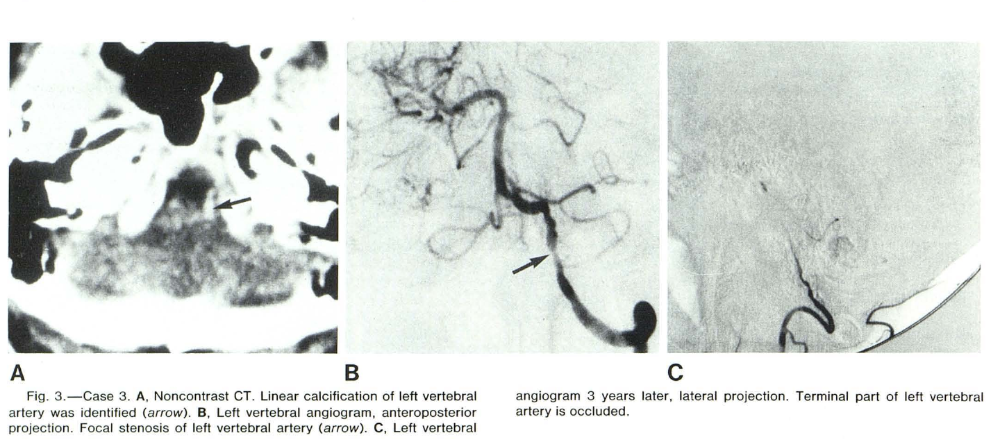
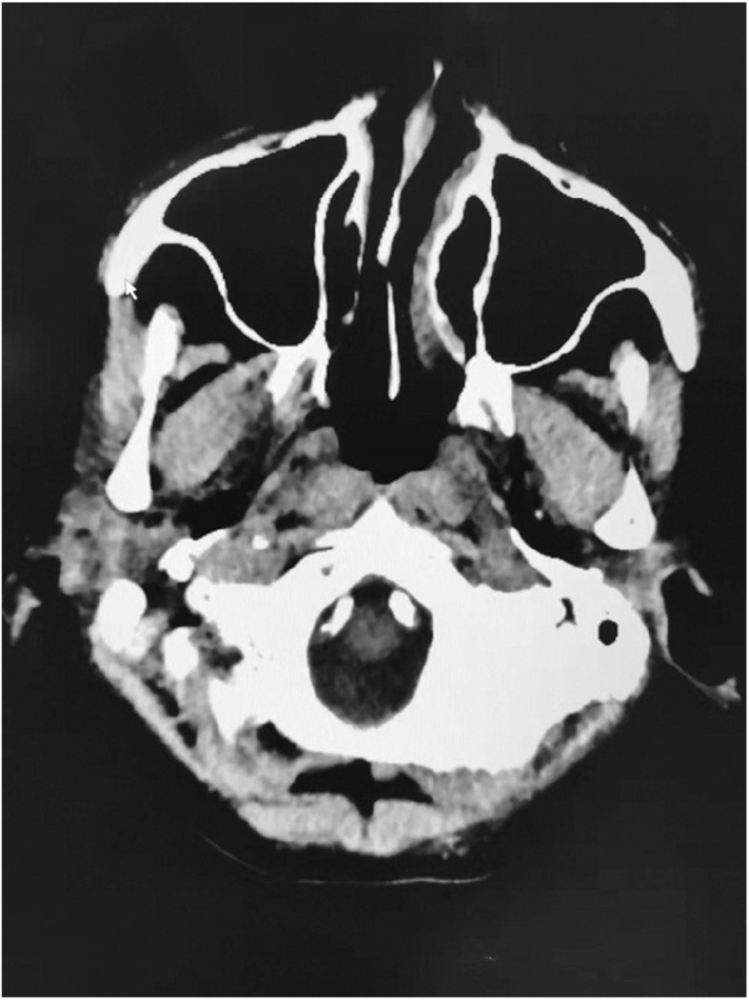
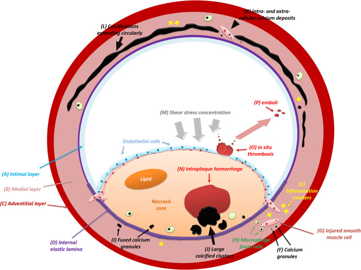
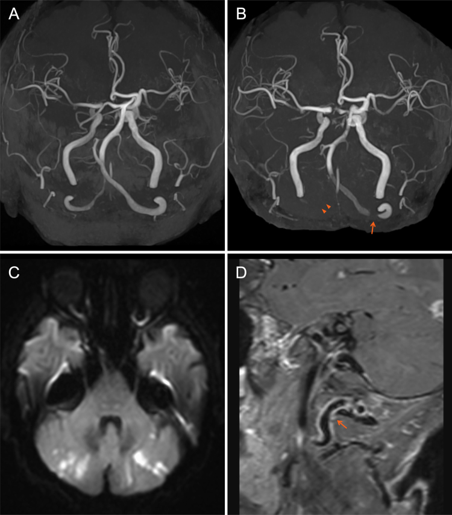
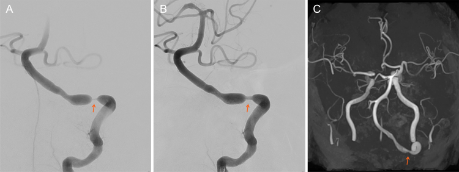
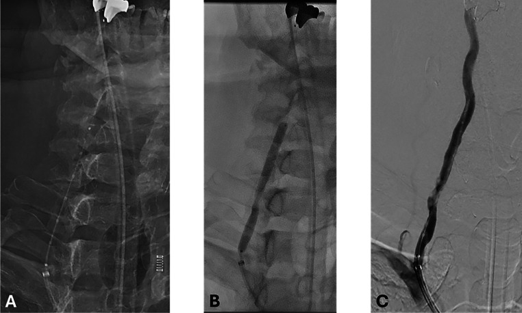
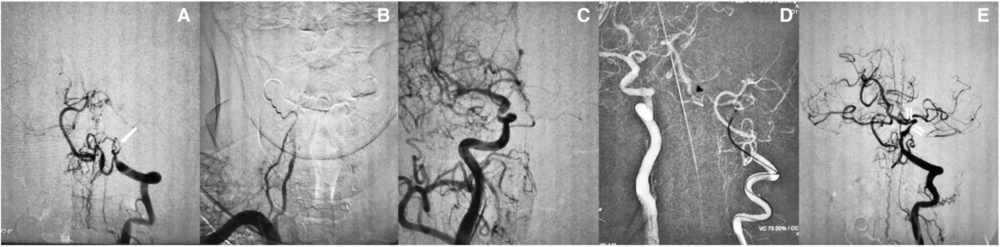

<!-- _class: lead -->
<!-- _footer: '' -->

# Focal Concentric Calcification of the Vertebral Artery (V3–V4)

## 雙側椎動脈 V3–V4 局部環形鈣化狹窄：病因、鑑別診斷與治療文獻整理

**謝慕揚 MD, PhD, FESC**　|　2026-10-14
個案討論（神經部會診）

---

# 個案摘要

- 50 多歲女性，不抽菸；**年輕時即有嚴重高血壓**
- 雙側 VA 在 **C1–C2（V3→V4 交界、穿硬腦膜處）**：整圈、厚、短段（< 2–3 cm）鈣化
- **左 VA total occlusion**；**右 VA 90% 狹窄**
- ICA、ECA、冠狀動脈、腎動脈皆乾淨，無瀰漫性 atherosclerosis
- 推測：左 VA 閉塞 → 血流停滯形成血栓 → 栓塞造成 **basilar artery occlusion**；目前中風後 7–10 天

---

# 三個問題

1. 為什麼鈣化會集中在 **V3–V4**，而且是**環形 (concentric)**、**短段**合併狹窄？
2. 有沒有**特殊病名**可以解釋？
3. 機轉是否與**血管炎**或**運動／機械應力**有關？

另外整理：**治療時機與方式**（右 VA 是否處理、如何處理）

---

<!-- _class: divider -->

# Q1　為什麼是 V3–V4？

---

# 顱內 VA 是最常鈣化的顱內動脈

- 屍檢研究：顱內動脈鈣化中 **VA 最常見（51% 的節段）**
- **內彈性層 (IEL) 鈣化幾乎只出現在 VA（7/8，88%）**；IEL 型與進展型斑塊無固定關係
- ICA 研究：IEL 鈣化佔 71%，與 intimal atherosclerosis 無關 → **非動脈粥狀硬化型鈣化**
- CT 研究：**左 VA 鈣化（76%）多於右 VA（63%）**

Yang WJ, et al. Stroke 2018;49:2767 ｜ Vos A, et al. Stroke 2016;47:221 ｜ Pikija S, et al. Biomed Res Int 2013:918970

---

# 1983 年的經典觀察：Katada (AJNR)

- 3,648 例 CT：VA 鈣化 3.4%，**40 歲以下 0 例**；**多在枕骨大孔高度**
- 血管攝影 19 條中 **18 條狹窄或閉塞**；上圖：局部鈣化狹窄 **3 年後閉塞**

Katada K, et al. AJNR 1983;4:450-3 (PMID 6410769)

---

# 與本個案幾乎一樣的影像

- Non-contrast CT，枕骨大孔高度
- **雙側顱內 VA 環形重度鈣化**
- 該病人雙側 VA 均閉塞，後來做 CTO 再通
- 結論：此型態**不罕見，但多見於高齡、CKD、糖尿病**；50 多歲且他處乾淨才是特殊之處

Zhang YY. J Neuroendovasc Ther 2020;14:81 (CC BY-NC-ND 4.0)

---

# 為什麼偏偏在穿硬腦膜處？（解剖與力學）

- 穿過硬腦膜後，**外彈性層 (EEL) 消失**、media 與 adventitia 變薄；彈性纖維在**入硬膜前 0.5 cm 最快流失**
- 硬腦膜環是**固定點 (tethering point)**：上方 V4 固定、下方 V3 隨 atlas–axis 旋轉 → 應力集中
- 管壁結構突變 + 剪力變化 → 鈣化與狹窄都容易在**短短 1–2 cm** 內發生
- ⚠️ 「機械應力造成鈣化」目前**沒有直接研究證實**，屬合理假說

Wilkinson IM. Arch Neurol 1972;27:392 ｜ Johnson CP, et al. J Clin Pathol 2001;54:139 ｜ Johnson CP, et al. J Clin Pathol 1993;46:1000

---

# Intimal vs Medial (IEL) 鈣化

- **Medial / IEL 型**：沿管壁**環形延伸**、管壁變硬，通常**不造成狹窄**
- **Intimal 型**：伴隨斑塊、狹窄、斑塊內出血、血栓栓塞
- 本個案：**環形（像 medial）＋重度狹窄（像 intimal）** → 很可能兩者並存
- 建議：thin-slice non-contrast CT 看鈣化在管壁的位置；必要時 vessel-wall MRI

Du H, et al. Front Neurol 2022;12:789035 (CC BY)

---

# 危險因子：高血壓是關鍵

| 研究 | 族群 | 重點 |
|------|------|------|
| Rotterdam (van der Toorn 2019) | 2,483 人 | VBA 鈣化 21%；**女性：HTN OR 1.51**、DM 1.56、抽菸 1.53 |
| Rotterdam 同研究 | — | 與冠脈／主動脈／頸動脈鈣化**只弱相關**（rho ≈ 0.24–0.36） |
| Bugnicourt 2009 | 中風病人 | 顱內動脈鈣化與 **低 GFR**、高血壓獨立相關 |
| Katada 1983 | 3,648 CT | 隨年齡上升，< 40 歲無 |

> **VA 鈣化與全身其他血管床的鈣化關聯性低** → 「其他血管都乾淨」本身並不排除這個診斷

---

<!-- _class: divider -->

# Q2　有沒有特殊病名？

---

# 結論先講

- 文獻中**沒有一個專屬病名**；最貼切的描述性診斷是：
  **Intracranial vertebral artery calcification（IVAC）with focal calcific stenosis at the dural entry**
- 病理型態：**IEL / medial calcification（類 Mönckeberg 型）合併 intimal calcified plaque**
- 長期嚴重高血壓是最一致的危險因子
- 但下列**可治療或有遺傳意義**的病因，值得逐一排除 →

---

# 鑑別診斷一覽

| 疾病 | 機轉 / 基因 | 與本例相符程度 |
|------|------------|---------------|
| **IEL / medial calcification + HTN** | 非粥狀硬化型 | **最符合** |
| **Giant cell arteritis (GCA)** | 肉芽腫性血管炎，**好發 V3–V4 硬膜入口** | 部分（必須排除） |
| Pseudoxanthoma elasticum | ABCC6 | 部分：顱內 ICA 鈣化↑，VA 資料少 |
| CKD-MBD / 副甲狀腺亢進 | Ca-P 代謝 | 部分（便宜易排除） |
| Primary aldosteronism | 可解釋年輕高血壓 | 部分（主動脈鈣化相關） |
| ACDC / GACI (ENPP1) / Keutel / Singleton–Merten | NT5E / ENPP1 / MGP / IFIH1 | 差：分布或年齡不符 |
| FMD | 非鈣化、串珠狀 | 差 |

---

# 建議補做的檢查

- **發炎**：ESR、CRP；temporal / axillary / VA 超音波（halo sign）；**vessel-wall MRI**（V3–V4 是否顯影增強）；必要時 FDG-PET
- **礦物質代謝**：eGFR、Ca、P、**PTH**、25-OH vitamin D
- **續發性高血壓**：**aldosterone / renin ratio**（年輕即嚴重 HTN）
- **PXE**：頸部／屈側皮膚黃色丘疹、眼底 **angioid streaks** → 陽性再做 ABCC6
- **影像**：thin-slice non-contrast CT 判斷鈣化在 intima 或 media

---

<!-- _class: divider -->

# Q3　血管炎？運動？

---

# GCA：其他血管正常 ≠ 排除

- GCA 侵犯彈性動脈，**到硬膜入口即停止**
- **典型正是雙側 V3–V4 狹窄**，腦內動脈不受影響
- VA 受侵犯 34–38%；GCA 中風**以後循環為主**
- 反對點：**重度鈣化不是活動性 GCA 的表現**
- 本例 ≥ 50 歲 → 值得做 vessel-wall MRI

Wilkinson 1972 ｜ Bonnan 2023 ｜ Prünte 2023 ｜ Mizuta 2024 (圖, CC BY-NC-ND)

---

# GCA 的 V3–V4 影像特徵

- 左 V3–V4 交界重度狹窄（箭頭），angioplasty 前後
- 外觀為**平滑、長度短的狹窄**，與本例位置相同 → 位置相同不能區分，**要靠 vessel-wall MRI 與發炎指數**

Mizuta R, et al. J Neurosurg Case Lessons 2024;8:CASE24404 (CC BY-NC-ND 4.0)

---

# 運動／機械因素：Bow hunter 生理

- Bow hunter syndrome：頭部旋轉時 VA 受壓，**C1–C2 最常見（44%）**，女性為男性 3 倍
- 一例 IVUS 顯示：反覆受壓處形成**半圈鈣化病灶**，轉頭時狹窄加劇
- 推論：反覆旋轉應力可能加速局部內皮損傷與鈣化，但**證據等級低**
- 臨床意義：治療前做**頭部左右旋轉的動態血管攝影**，避免把動態壓迫誤判為固定狹窄

Elizondo-Ramirez 2024, Surg Neurol Int 15:404 ｜ Sasaki T, et al. Eur Heart J Case Rep 2024;8:ytad639

---

<!-- _class: divider -->

# 治療考量

---

# 自然病程：不處理的風險高

- 後循環 TIA／中風合併 **顱內 VA 狹窄：90 天中風率 33%**（無狹窄 7.2%）
- 本例更危險：**左 VA 已閉塞**，後循環幾乎**只靠右 VA** 與 PComm
- 但早期介入的風險也高：
  - SAMMPRIS：30 天中風／死亡 **14.7% vs 5.8%**（stent vs medical）
  - VIST / VAST：顱內 VA 介入圍術期中風 **15–22%**（顱外 0–2%）

Gulli G, et al. Stroke 2013;44:598 ｜ Chimowitz 2011 NEJM ｜ Drazyk & Markus, Curr Opin Neurol 2018

---

# 時機：7–10 天可能太早

| 試驗 | 收案時機 | 結果 |
|------|---------|------|
| WEAVE (Wingspan, on-label) | **≥ 8 天** | 72 h 併發症 2.6% |
| BASIS (submaximal balloon) | **14–90 天** | 4.4% vs 13.5%（HR 0.32）；dissection 14.5% |
| CASSISS (stent) | **> 3 週** | 8.0% vs 7.2%，無差異；**排除 perforator 區中風** |
| VISSIT (balloon-expandable stent) | — | 30 天 24.1% vs 9.4%，**有害** |

> 若病情穩定，**先積極內科治療（DAPT、statin），等 2–3 週後再評估**；若反覆發作或 hemodynamic 不穩再提早介入

---

# 重度鈣化的器械選擇

- **Submaximal angioplasty**（BASIS）：鈣化病灶目標不追求完全擴張
- **Drug-coated balloon**：RCT（n=209）6 個月再狹窄 11% vs 29%（vs BMS）
- **IVL (Shockwave)**：VA 僅有 V2 個案，**V3/V4 無報告**，屬 off-label
- 對側閉塞 → 球囊擴張時 basilar 血流中斷，**先確認 PComm**
- 外科：OA–VA bypass 17 例（含 4 例「一側閉塞＋對側重度狹窄」）

Sun X, et al. JAMA 2024 ｜ Guan S, et al. Radiology 2026 ｜ Diaz O, et al. Radiol Case Rep 2025 (CC BY) ｜ Wang X, et al. Oper Neurosurg 2019

---

# 左 VA 閉塞：CTO 再通可行嗎？

- 小型系列：技術成功 12/14（86%），併發症 14%；合併文獻 34 例成功 94%、併發症 18%、死亡 3%
- 建議：全身麻醉、**雙側同時 roadmap**、無側枝循環則不做

Gao P, et al. J Neuroradiol 2018;45:295 ｜ Zhang YY. J Neuroendovasc Ther 2020;14:81 (CC BY-NC-ND)

---

# Take Home

1. 顱內 VA 是**最常鈣化**的顱內動脈，且好發在**枕骨大孔／穿硬膜處**；**IEL（非粥狀硬化型）鈣化幾乎只見於 VA**
2. 穿硬膜處**失去外彈性層＋固定點應力**，可解釋「短段、局部」
3. **沒有專屬病名**；長期嚴重高血壓是最一致的危險因子
4. **GCA 的好發位置正是 V3–V4** → 用 vessel-wall MRI 與發炎指數排除；另查 PTH、ARR、PXE
5. 右 VA 介入：**等 2–3 週、動態攝影、確認 PComm、submaximal / DCB**

---

<!-- _class: ref -->

# 參考文獻（1/2）

1. Katada K, et al. Calcification of the vertebral artery. [*AJNR*. 1983;4:450-3.](https://pubmed.ncbi.nlm.nih.gov/6410769/)
2. Yang WJ, et al. Postmortem study exploring distribution and patterns of intracranial artery calcification. [*Stroke*. 2018;49:2767-9.](https://doi.org/10.1161/STROKEAHA.118.022591)
3. Vos A, et al. Predominance of nonatherosclerotic IEL calcification in the intracranial ICA. [*Stroke*. 2016;47:221-3.](https://doi.org/10.1161/STROKEAHA.115.011196)
4. Pikija S, et al. Calcifications of vertebrobasilar arteries on CT. [*Biomed Res Int*. 2013;2013:918970.](https://doi.org/10.1155/2013/918970)
5. Du H, Yang W, Chen X. Histology-verified intracranial artery calcification. [*Front Neurol*. 2022;12:789035.](https://doi.org/10.3389/fneur.2021.789035)
6. Du H, et al. Intracranial arterial calcification and intracranial atherosclerosis: close but different. [*Front Neurol*. 2022;13:799429.](https://doi.org/10.3389/fneur.2022.799429)
7. van der Toorn JE, et al. Vertebrobasilar artery calcification: prevalence and risk factors. [*Atherosclerosis*. 2019;286:46-52.](https://doi.org/10.1016/j.atherosclerosis.2019.05.001)
8. Wilkinson IM. The vertebral artery. Extracranial and intracranial structure. [*Arch Neurol*. 1972;27:392-6.](https://doi.org/10.1001/archneur.1972.00490170024004)
9. Johnson CP, et al. Age related changes in the tunica media of the vertebral artery. [*J Clin Pathol*. 2001;54:139-45.](https://doi.org/10.1136/jcp.54.2.139)
10. Bugnicourt JM, et al. High prevalence of intracranial artery calcification in stroke patients with CKD. [*CJASN*. 2009;4:284-90.](https://doi.org/10.2215/CJN.02140508)
11. Wilkinson IM, Russell RW. Arteries of the head and neck in giant cell arteritis. [*Arch Neurol*. 1972;27:378-91.](https://doi.org/10.1001/archneur.1972.00490170010003)
12. Bonnan M, Debeugny S. Giant-cell arteritis related strokes: scoping review of mechanisms and rethinking treatment strategy? [*Front Neurol*. 2023;14:1305093.](https://doi.org/10.3389/fneur.2023.1305093)
13. Prünte MKR, et al. Giant cell arteritis with vertebral artery involvement: baseline characteristics and follow-up. [*Front Neurol*. 2023;14:1188073.](https://doi.org/10.3389/fneur.2023.1188073)
14. Mizuta R, et al. Endovascular treatment for vertebrobasilar stenosis due to GCA. [*J Neurosurg Case Lessons*. 2024;8:CASE24404.](https://doi.org/10.3171/CASE24404)

---

<!-- _class: ref -->

# 參考文獻（2/2）

15. Kranenburg G, et al. Prevalence and severity of arterial calcifications in pseudoxanthoma elasticum. [*Atherosclerosis*. 2017;256:7-14.](https://doi.org/10.1016/j.atherosclerosis.2016.11.012)
16. St Hilaire C, et al. NT5E mutations and arterial calcifications (ACDC). [*N Engl J Med*. 2011;364:432-42.](https://doi.org/10.1056/NEJMoa0912923)
17. Buffolo F, et al. Aldosterone as a mediator of cardiovascular damage. [*Hypertension*. 2022;79:1899-911.](https://doi.org/10.1161/HYPERTENSIONAHA.122.17964)
18. Elizondo-Ramirez J, et al. Bow Hunter's syndrome surgical approach and outcome: two new cases and literature review. [*Surg Neurol Int*. 2024;15:404.](https://doi.org/10.25259/SNI_633_2024)
19. Sasaki T, et al. Bow hunter's syndrome with IVUS. [*Eur Heart J Case Rep*. 2024;8:ytad639.](https://doi.org/10.1093/ehjcr/ytad639)
20. Gulli G, et al. Stroke risk after posterior circulation stroke/TIA and its relationship to site of vertebrobasilar stenosis. [*Stroke*. 2013;44:598-604.](https://doi.org/10.1161/STROKEAHA.112.669929)
21. Chimowitz MI, et al. Stenting versus aggressive medical therapy for intracranial arterial stenosis (SAMMPRIS). [*N Engl J Med*. 2011;365:993-1003.](https://doi.org/10.1056/NEJMoa1105335)
22. Zaidat OO, et al. VISSIT randomized clinical trial. [*JAMA*. 2015;313:1240-8.](https://doi.org/10.1001/jama.2015.1693)
23. Drazyk AM, Markus HS. Recent advances in the management of symptomatic vertebral artery stenosis. [*Curr Opin Neurol*. 2018;31(1):1-7.](https://doi.org/10.1097/WCO.0000000000000515)
24. Alexander MJ, et al. WEAVE trial: final results in 152 on-label patients. [*Stroke*. 2019;50:889-94.](https://doi.org/10.1161/STROKEAHA.118.023996)
25. Gao P, et al. CASSISS randomized clinical trial. [*JAMA*. 2022;328:534-42.](https://doi.org/10.1001/jama.2022.12000)
26. Sun X, et al. BASIS randomized clinical trial. [*JAMA*. 2024;332:1059-69.](https://doi.org/10.1001/jama.2024.12829)
27. Guan S, et al. Drug-coated balloon for intracranial stenosis RCT. [*Radiology*. 2026;318:e250893.](https://doi.org/10.1148/radiol.250893)
28. Diaz O, et al. IVL for vertebral artery stenosis. [*Radiol Case Rep*. 2025;20:4712.](https://doi.org/10.1016/j.radcr.2025.06.018)
29. Wang X, et al. Occipital artery to extradural vertebral artery bypass for posterior circulation ischemia. [*Oper Neurosurg*. 2019;16(5):527-38.](https://pubmed.ncbi.nlm.nih.gov/30982906/)
30. Gao P, et al. Endovascular recanalization for chronic symptomatic intracranial vertebral artery total occlusion. [*J Neuroradiol*. 2018;45(5):295-304.](https://doi.org/10.1016/j.neurad.2017.12.023)
31. Zhang YY. Endovascular recanalization for chronic total occlusion of intracranial vertebral artery: a mini review. [*J Neuroendovasc Ther*. 2020;14(3):81-4.](https://doi.org/10.5797/jnet.ra.2019-0112)

---

<!-- _class: lead -->
<!-- _footer: '' -->

# 謝謝

## 本資料僅供醫療專業人員教學與臨床討論參考
