<!-- _class: cover -->
<!-- _paginate: false -->

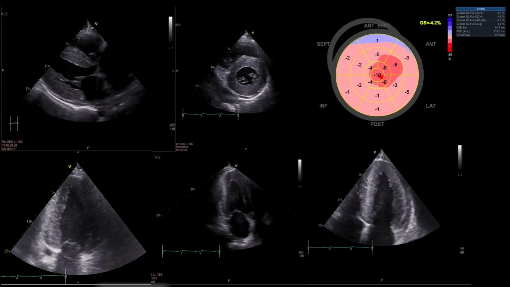

# ESC 2024 Grand Quiz Spectacular

## 十題心臟科臨床案例測驗（附解答）

**整理：謝慕揚 MD, PhD, FESC**
來源：ESC Congress 2024, London, 2024-08-30
Session 45707「The ESC Grand Quiz Spectacular」
主持：Mark Westwood、John-Paul Carpenter；特別來賓 Rohin Francis
[ESC 365 原始影片](https://esc365.escardio.org/session/45707)

---

# 玩法說明

- 共 **10 題**，每題一個真實病例，由歐洲各中心年輕醫師投稿
- 每題先看病史與影像，再從 A 到 E 選一個最可能的答案
- 先不要翻到後半部的解答頁。答完再對
- 解答附當天現場（Mentimeter）的答對比例，可以和全場聽眾比一比
- 影像截自 ESC TV 轉播畫面，只取投影片本身

> 說穿了，這十題考的不是罕見知識，而是「看到不尋常的組合時，願不願意多想一步」。

---

# 題目總覽

| 題 | 主題 | 投稿者 |
|---|---|---|
| 1 | 心房顫動電燒後的呼吸困難 | M. Boussoussou（Budapest） |
| 2 | COPD 病人的 T 波倒置 | R. Morawiec（Lodz） |
| 3 | 偶然發現的心內腫塊 | M. F. Orsino（Pisa） |
| 4 | SAVR 後的寬 QRS 心搏過速 | P. P. Jordán Marchite（Barcelona） |
| 5 | 哪一項不存在 | F. Gerardo（Amadora） |
| 6 | 又一個心衰竭，找原因 | A. Misiewicz（Lodz） |
| 7 | 心肌病變拼圖 | I. Miranda（Amadora） |
| 8 | TAVR 瓣膜脫出 | A. V. Monastyrski（Barcelona） |
| 9 | 節律器的抉擇 | S. Howell（London） |
| 10 | LVAD 術後心衰竭 | E. Ródenas-Alesina（Barcelona） |

---

<!-- _class: qhead -->

# 第 1 題
## 心房顫動：惱人的疾病，併發症一堆

---

# 第 1 題：病史

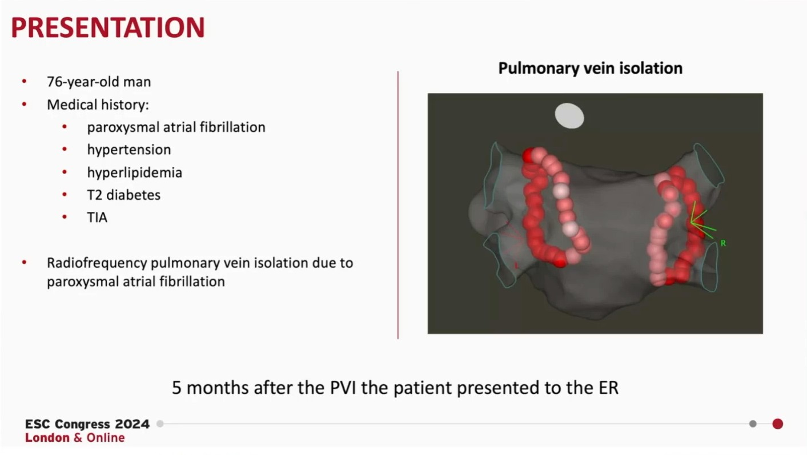

- 76 歲男性
- 陣發性心房顫動、高血壓、高血脂、第 2 型糖尿病、曾有 TIA
- 接受射頻**肺靜脈隔離術** (pulmonary vein isolation, PVI)
- **PVI 後 5 個月**到急診

---

# 第 1 題：檢查

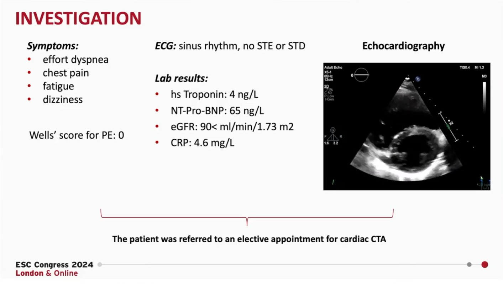

- 症狀：活動喘、胸痛、疲倦、頭暈
- ECG：竇性節律，無 ST 上升或下降
- hs-Troponin 4 ng/L、NT-proBNP 65 ng/L
- eGFR > 90、CRP 4.6 mg/L
- Wells' score for PE = 0
- 心臟超音波如右圖，安排擇期 cardiac CTA

---

<!-- _class: fig -->

# 第 1 題：Cardiac CTA

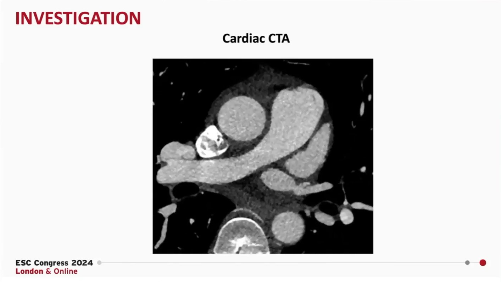

---

<!-- _class: opts -->

# 第 1 題：最可能的診斷是？

1. TIA due to left atrial appendage thrombus
2. Recurrent atrial fibrillation
3. Pulmonary vein stenosis due to pulmonary vein isolation
4. A 90% stenosis on the left main coronary artery
5. Atrial septal injury due to pulmonary vein isolation

---

<!-- _class: qhead -->

# 第 2 題
## 新出現的缺血性 ST 變化：要不要做心導管？

---

# 第 2 題：病史

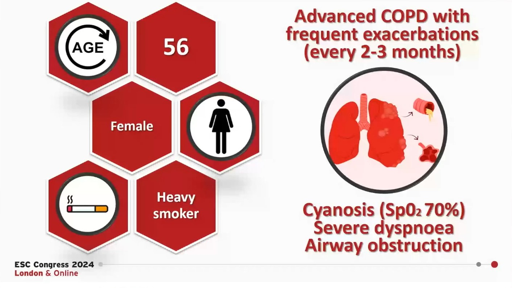

- 56 歲女性，重度吸菸者
- 晚期 COPD，每 2 到 3 個月急性惡化一次
- 此次入院：發紺 (SpO2 70%)、嚴重呼吸困難、氣道阻塞

---

# 第 2 題：入院 ECG

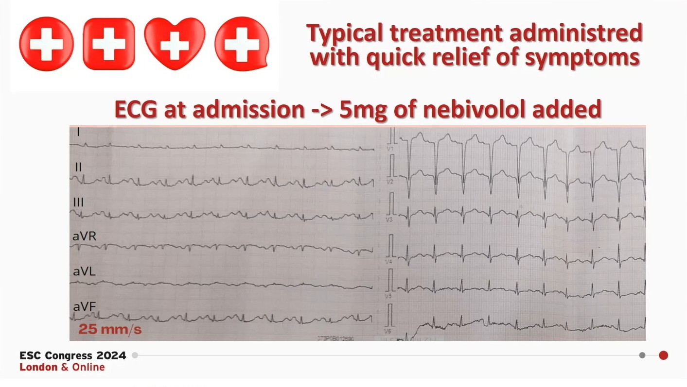

- 給予典型治療後，症狀迅速緩解
- 入院 ECG 如右圖
- 之後**加上 nebivolol 5 mg**

---

# 第 2 題：隔天的 ECG

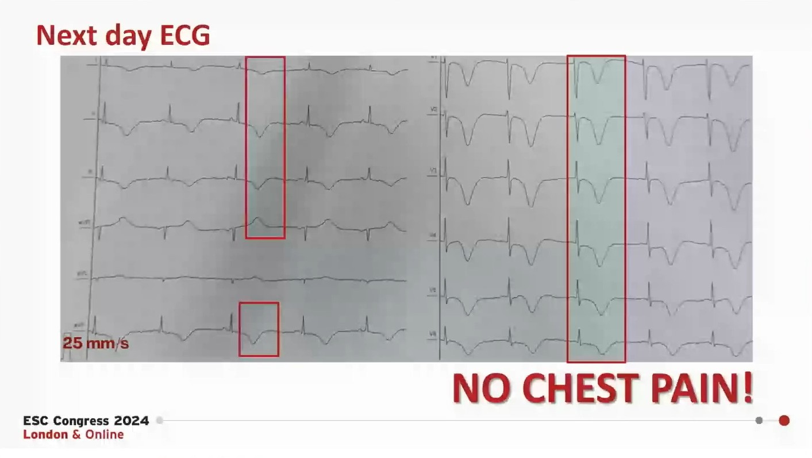

- 胸前導程出現**深而對稱的 T 波倒置**
- 病人**完全沒有胸痛**
- 懷疑 Wellens' syndrome type B

---

# 第 2 題：後續檢查

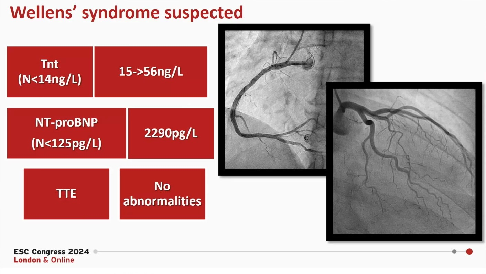

- TnT：15 → 56 ng/L (正常 < 14)
- NT-proBNP：2290 pg/L (正常 < 125)
- TTE：無異常
- 因 troponin 上升，安排冠狀動脈攝影（右圖）

---

<!-- _class: opts -->

# 第 2 題：Wellens' type B syndrome 是……

1. Long QT syndrome (LQTS) variant
2. Adverse event due to beta-blocker
3. NSTEMI with ischemic ECG changes
4. STEMI equivalent always associated with chest pain
5. STEMI equivalent not always associated with chest pain

---

<!-- _class: qhead -->

# 第 3 題
## 真巧！一個心內腫塊

---

# 第 3 題：病史

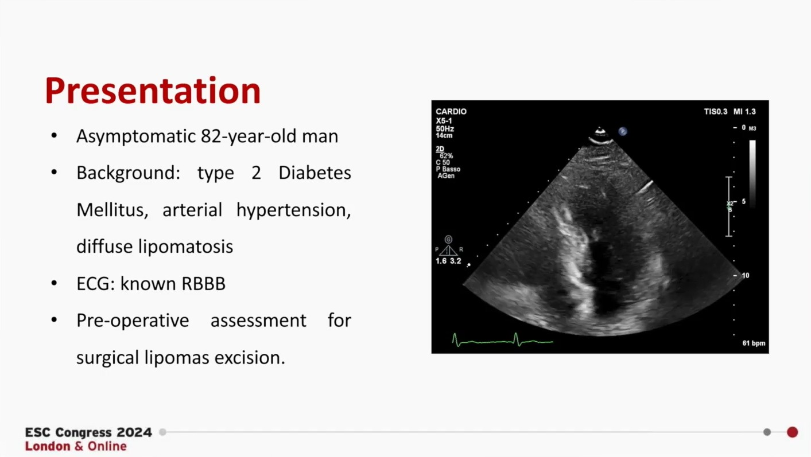

- 82 歲男性，無症狀
- 第 2 型糖尿病、高血壓、瀰漫性脂肪瘤病 (diffuse lipomatosis)
- ECG：已知 RBBB
- 因要手術切除脂肪瘤，接受術前評估

---

# 第 3 題：心臟超音波

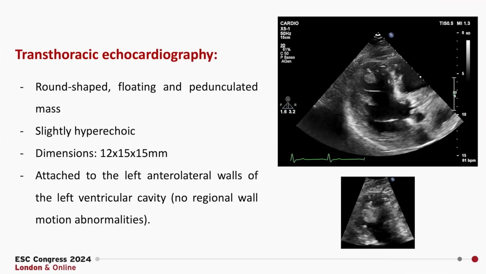

- 圓形、漂動、有蒂的腫塊
- 稍高回音，12 × 15 × 15 mm
- 附著於左心室前外側壁
- 無局部室壁運動異常

---

# 第 3 題：Cardiac MRI

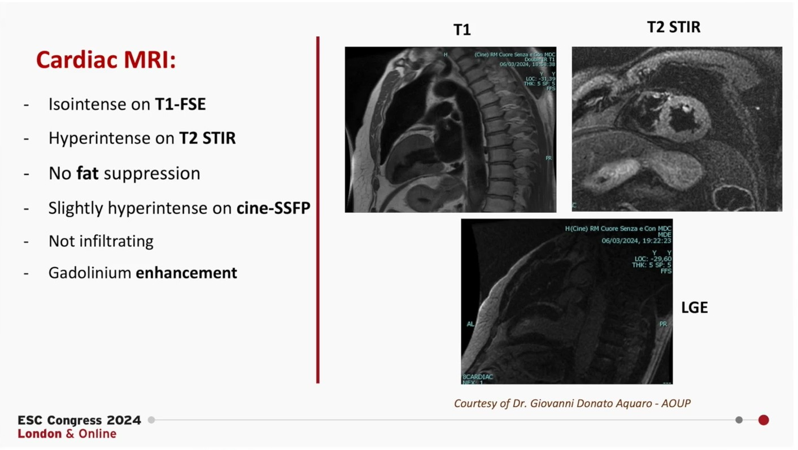

- T1-FSE 等訊號
- T2 STIR 高訊號
- 脂肪抑制序列**無**訊號抑制
- cine-SSFP 稍高訊號
- 無浸潤
- 有 gadolinium 顯影 (LGE)

---

<!-- _class: opts -->

# 第 3 題：最可能的診斷是？

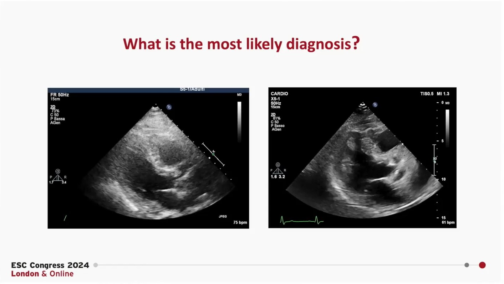

1. Thrombus
2. Myxoma
3. Fibroelastoma
4. Lipoma
5. Metastatic mass

---

<!-- _class: qhead -->

# 第 4 題
## SAVR 之後的寬 QRS 心搏過速

---

# 第 4 題：病史

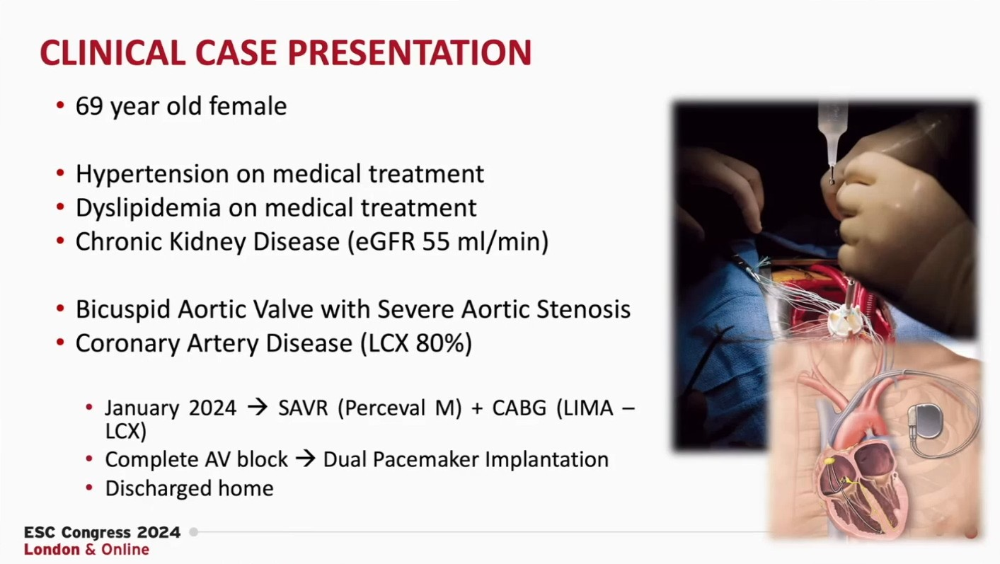

- 69 歲女性；高血壓、血脂異常、CKD (eGFR 55)
- 二葉式主動脈瓣合併嚴重狹窄；冠心病 (LCX 80%)
- 2024 年 1 月：SAVR (Perceval M) + CABG (LIMA 到 LCX)
- 術後完全房室阻斷，植入雙腔節律器，出院

---

# 第 4 題：7 天後回診

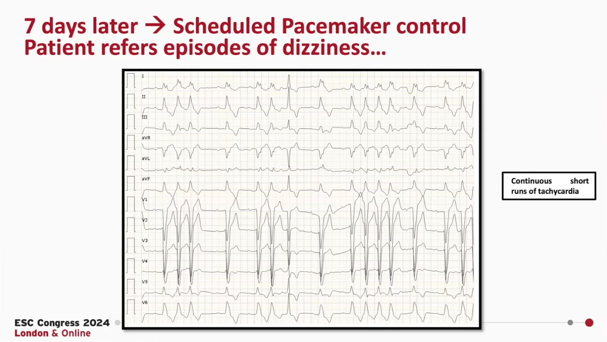

- 預定的節律器回診
- 主訴陣發性頭暈
- ECG：**連續出現的短陣心搏過速**

---

# 第 4 題：節律器詢問

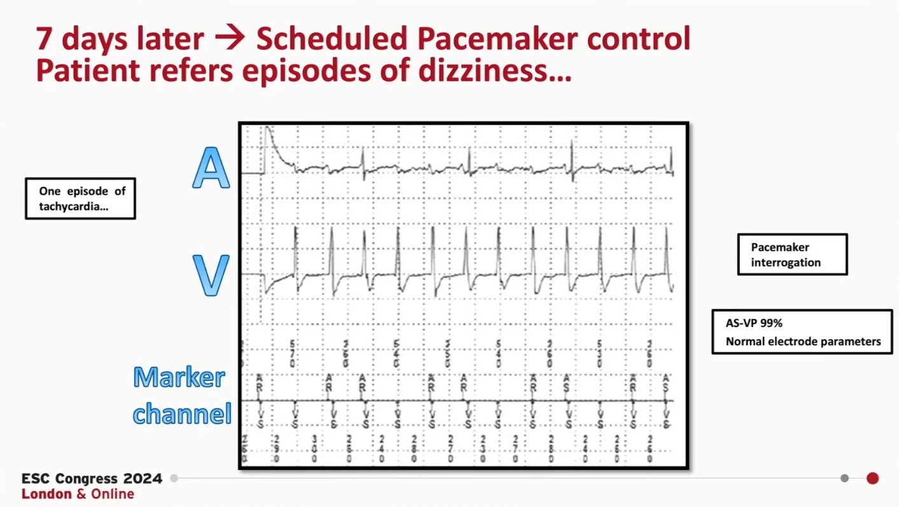

- 記錄到一次心搏過速
- 上排 A、下排 V，加上 marker channel
- AS-VP 99%
- 導線參數正常

---

<!-- _class: opts -->

# 第 4 題：最可能的診斷是？

1. Sinus tachycardia tracked by pacemaker
2. Atrial tachycardia tracked by pacemaker
3. Pacemaker mediated tachycardia (endless loop PMT)
4. Bundle branch re-entrant ventricular tachycardia (BBRVT)
5. Ventricular tachycardia (myocardial re-entry)

---

<!-- _class: qhead -->

# 第 5 題
## 不幸的三葉幸運草

---

# 第 5 題：病史與檢查

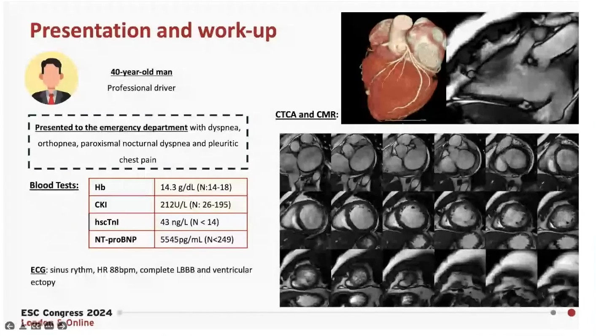

- 40 歲男性，職業駕駛
- 急診主訴：呼吸困難、orthopnea、PND、肋膜性胸痛
- Hb 14.3、CK 212、hs-TnI 43 (正常 < 14)、NT-proBNP 5545
- ECG：竇性 88 bpm，完全 LBBB，心室早期收縮
- 接受 CTCA 與 CMR

---

<!-- _class: fig -->

# 第 5 題：Cardiac MRI（一）

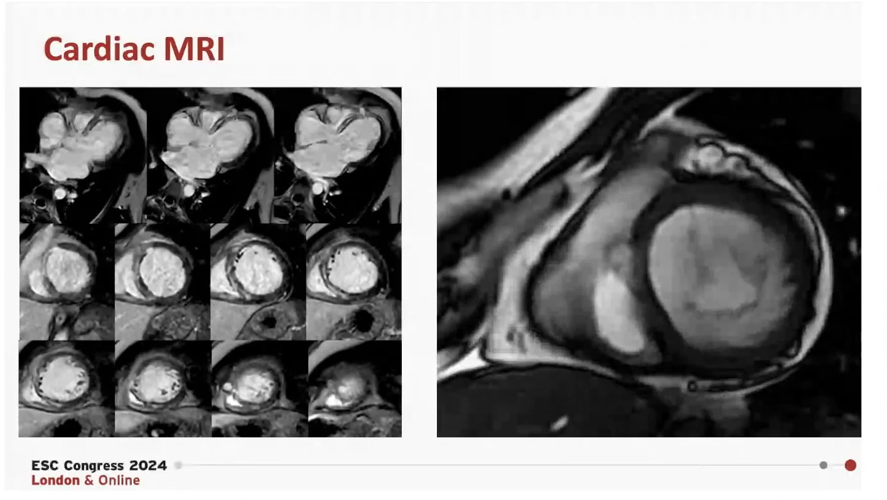

---

<!-- _class: fig -->

# 第 5 題：Cardiac MRI（二）

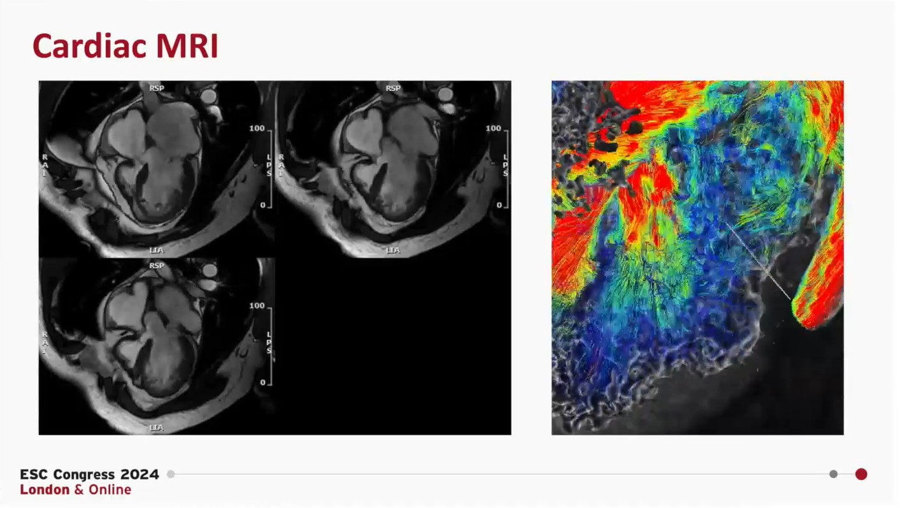

---

<!-- _class: opts -->

# 第 5 題：下列何者**不存在**於本病例？

1. Dilated cardiomyopathy with septal fibrosis
2. Intact atrioventricular septal defect
3. Ventricular septal defect
4. Microaneurysm of the apical septum
5. Trileaflet mitral valve

---

<!-- _class: qhead -->

# 第 6 題
## 又一個心衰竭？找出原因

---

# 第 6 題：病史

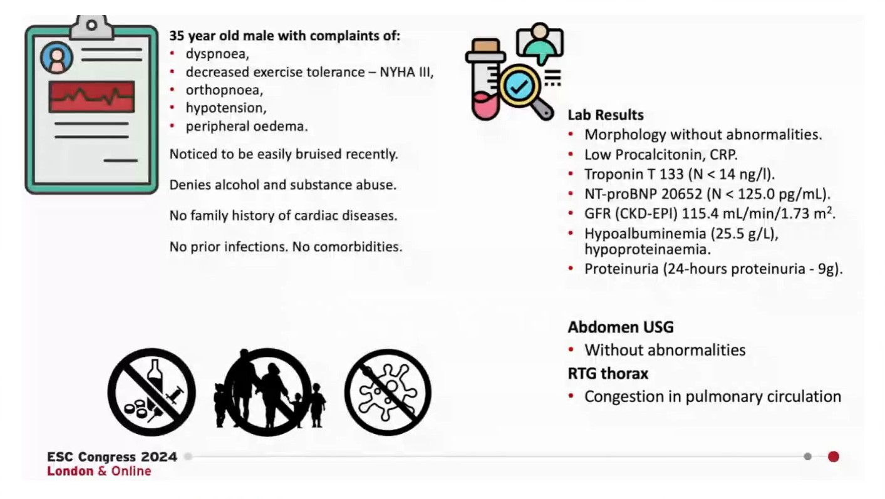

- 35 歲男性：喘、運動耐受下降 (NYHA III)、端坐呼吸、低血壓、周邊水腫
- 最近**容易瘀青**
- 無飲酒、無家族史、無感染、無共病
- TnT 133、NT-proBNP 20652、GFR 115
- **低白蛋白** 25.5 g/L，**24 小時蛋白尿 9 g**
- 腹部超音波正常；胸部 X 光肺充血

---

<!-- _class: fig -->

# 第 6 題：心臟超音波

*注意右上角的 GLS 牛眼圖。*

---

# 第 6 題：TTE 重點整理

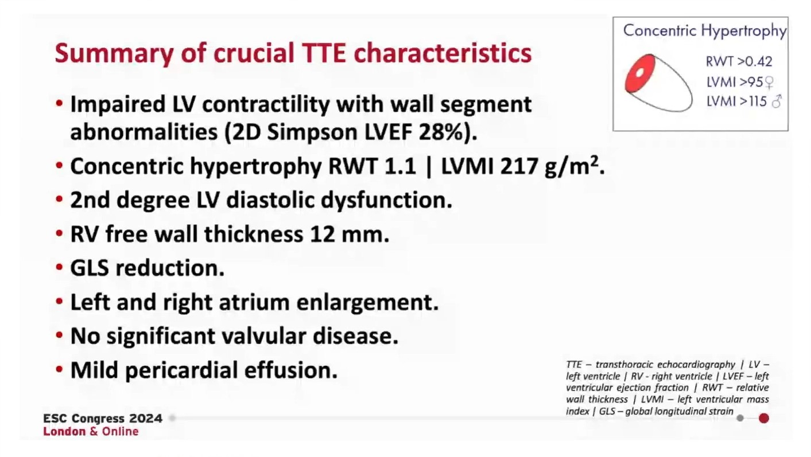

- LV 收縮功能下降伴室壁運動異常，LVEF 28%
- 同心性肥厚：RWT 1.1，LVMI 217 g/m²
- 第 2 度舒張功能障礙
- RV 游離壁厚度 12 mm
- GLS 下降；左右心房擴大
- 無明顯瓣膜疾病；少量心包積液

---

<!-- _class: opts -->

# 第 6 題：最可能的診斷是？

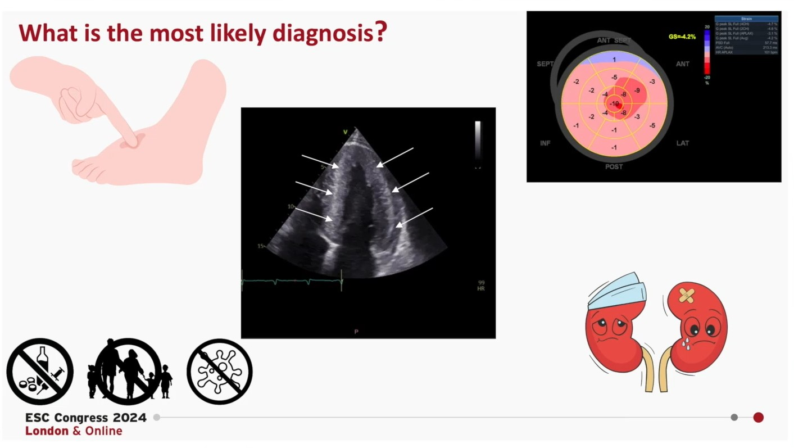

1. Myocarditis
2. Hypertrophic cardiomyopathy
3. Ischemic heart disease
4. Amyloidosis
5. Glomerulopathy of unknown origin

---

<!-- _class: qhead -->

# 第 7 題
## 心肌病變拼圖：哪些是重點，哪些是巧合？

---

# 第 7 題：病史與檢驗

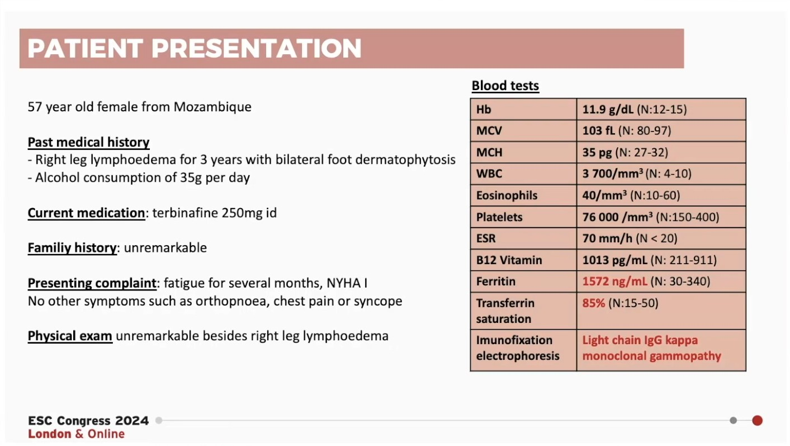

- 57 歲女性，來自**莫三比克**
- 右腳淋巴水腫 3 年，雙足皮癬；每天飲酒 35 g
- 疲倦數月 (NYHA I)，無端坐呼吸、胸痛、暈厥
- MCV 103、WBC 3700、**嗜酸性球 40**、PLT 76K
- **Ferritin 1572**、transferrin 飽和度 85%
- 免疫固定電泳：IgG kappa 單株丙球蛋白病

---

# 第 7 題：初步檢查

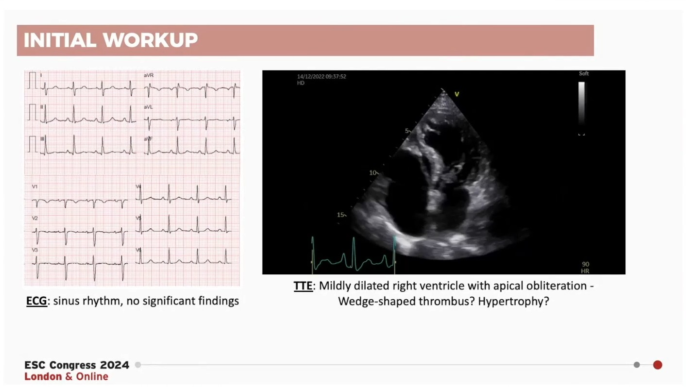

- ECG：竇性節律，無明顯異常
- TTE：右心室輕度擴大，**心尖部閉塞** (apical obliteration)
- 楔形血栓？還是肥厚？

---

# 第 7 題：CMR 與 Cardiac CT

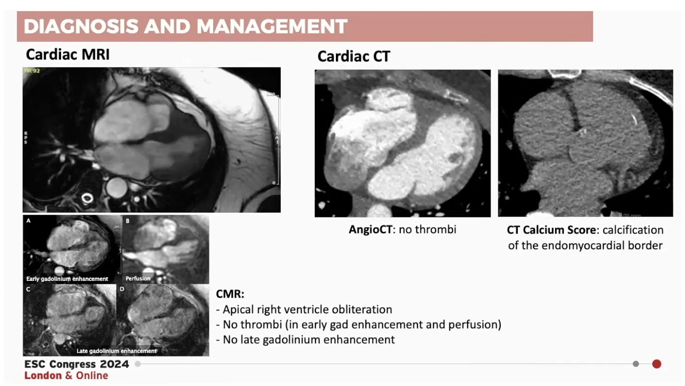

- CMR：RV 心尖閉塞；early gadolinium 與灌注影像**無血栓**；**無 LGE**
- Angio-CT：無血栓
- CT 鈣化積分：**心內膜邊緣鈣化**

---

<!-- _class: opts -->

# 第 7 題：最可能的診斷是？

1. Amyloidosis
2. Iron overload
3. Endomyocardial fibrosis
4. RV apical hypertrophic cardiomyopathy
5. Fabry disease

---

<!-- _class: qhead -->

# 第 8 題
## 教科書之外：處理 TAVR 的意外狀況

---

# 第 8 題：病史

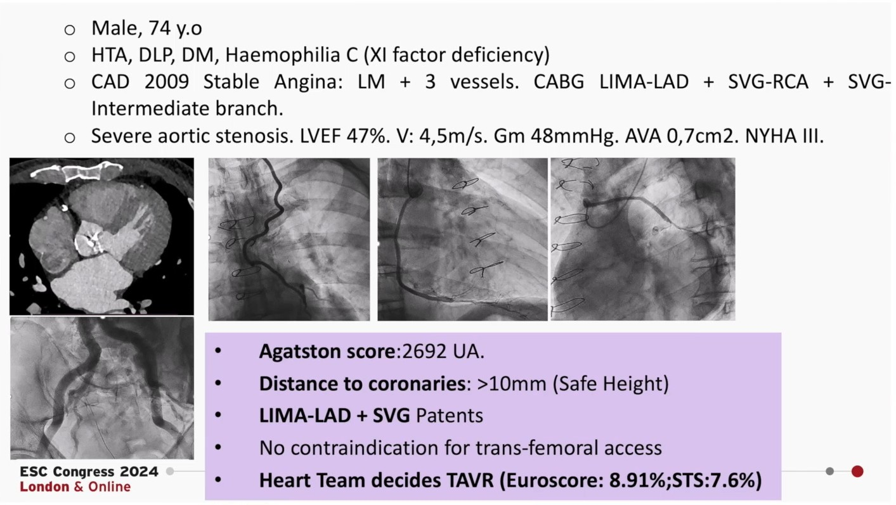

- 74 歲男性；高血壓、血脂異常、糖尿病、血友病 C (factor XI 缺乏)
- 2009 年 CABG：LIMA-LAD、SVG-RCA、SVG-intermediate
- 嚴重 AS：LVEF 47%，Vmax 4.5 m/s，mean PG 48 mmHg，AVA 0.7 cm²，NYHA III
- Agatston 2692；冠脈高度 > 10 mm；繞道血管暢通；可經股動脈
- Heart team 決定 TAVR (EuroSCORE 8.91%，STS 7.6%)

---

# 第 8 題：手術經過

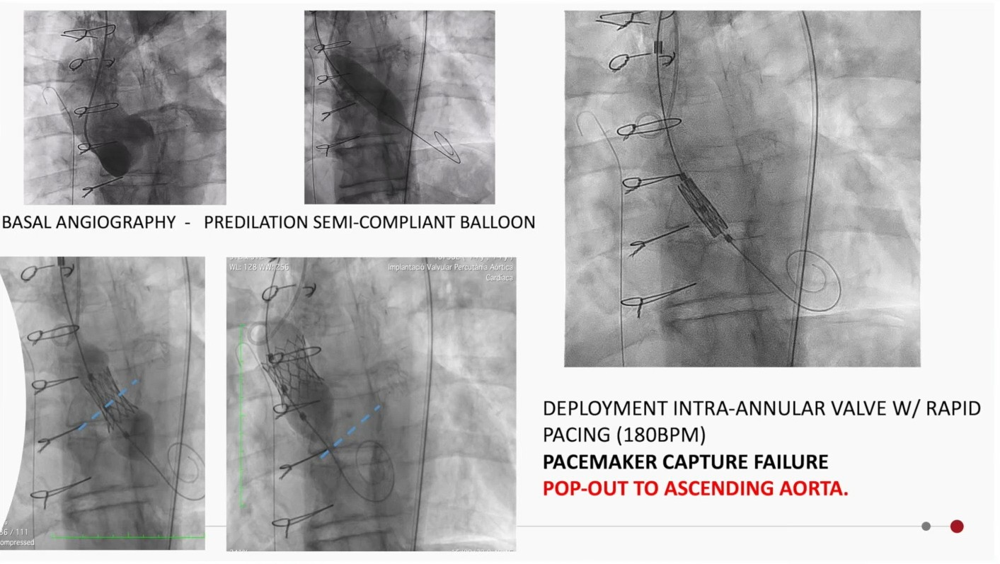

- 基礎攝影，半順應性球囊預擴
- 以 180 bpm 快速起搏釋放瓣膜
- **節律器失去奪獲** (capture failure)
- 瓣膜**彈出至升主動脈**

---

# 第 8 題：事態惡化

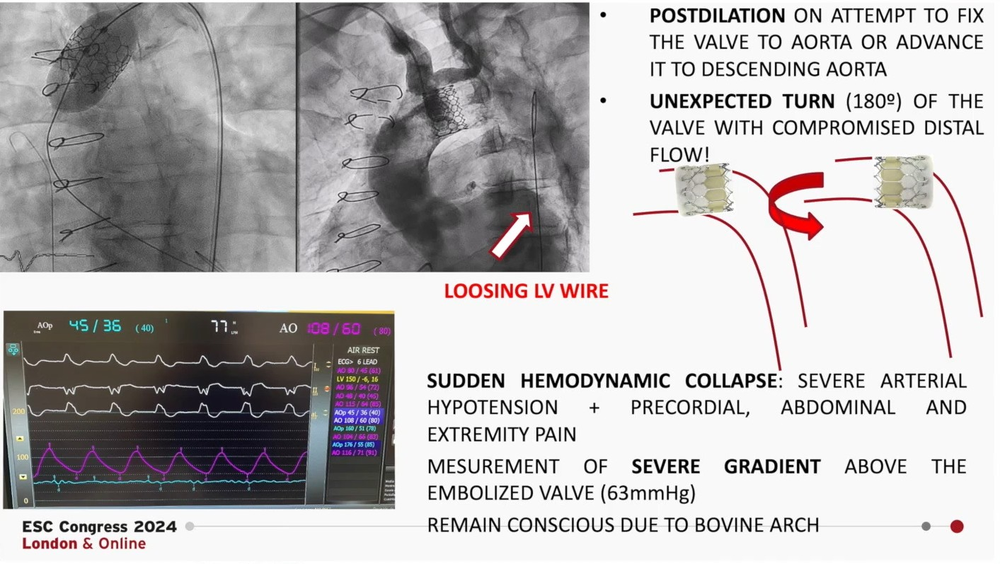

- 後擴張試圖把瓣膜固定在主動脈，或推到降主動脈
- 瓣膜意外**翻轉 180 度**，遠端血流受阻，LV 導絲脫出
- 血行動力崩潰：嚴重低血壓、胸前、腹部與四肢疼痛
- 脫出瓣膜上方壓差 63 mmHg
- 病人仍清醒（bovine arch）

---

<!-- _class: fig -->

# 第 8 題：現況整理

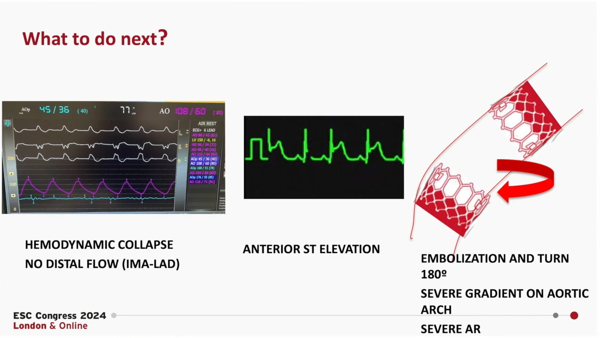

---

<!-- _class: opts -->

# 第 8 題：你會怎麼做？

1. New TAVR to solve the AR, then plain balloon dilatation of the migrated valve
2. Attempt removal of migrated valve with snare or other bail-out device
3. New TAVR to solve the AR, then surgical removal of migrated valve
4. Emergency surgery
5. New TAVR to solve the AR, then cover the migrated valve with a stent

---

<!-- _class: qhead -->

# 第 9 題
## 節律器的抉擇

---

# 第 9 題：病史

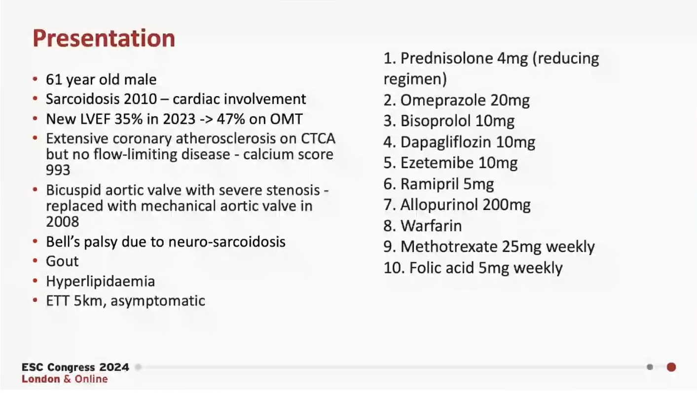

- 61 歲男性；2010 年類肉瘤病，**心臟侵犯**
- 2023 年新發 LVEF 35%，最佳藥物治療後 47%
- CTCA：廣泛冠狀動脈硬化但無血流限制，鈣化積分 993
- 二葉式主動脈瓣嚴重狹窄，2008 年換**機械瓣**
- 神經類肉瘤病致 Bell's palsy；痛風、高血脂
- 運動測試 5 km 無症狀
- 用藥含 **bisoprolol 10 mg**、prednisolone、methotrexate、warfarin

---

# 第 9 題：CMR 與 PET

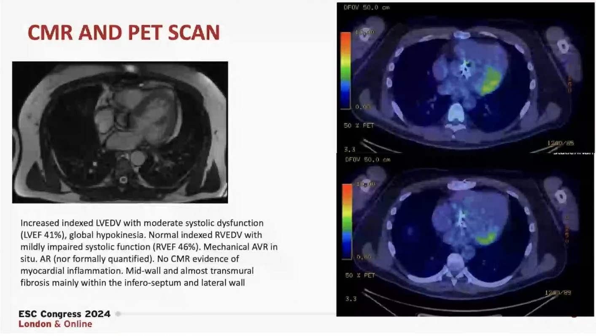

- LVEDV 指數上升，中度收縮功能下降 (LVEF 41%)，整體運動低下
- RVEDV 正常，RVEF 46%
- 機械主動脈瓣在位，有 AR
- CMR 無心肌發炎證據
- 下壁中隔與側壁有**近乎穿壁**的纖維化
- PET：FDG 攝取如圖

---

<!-- _class: fig -->

# 第 9 題：24 小時 Holter（bisoprolol 10 mg）

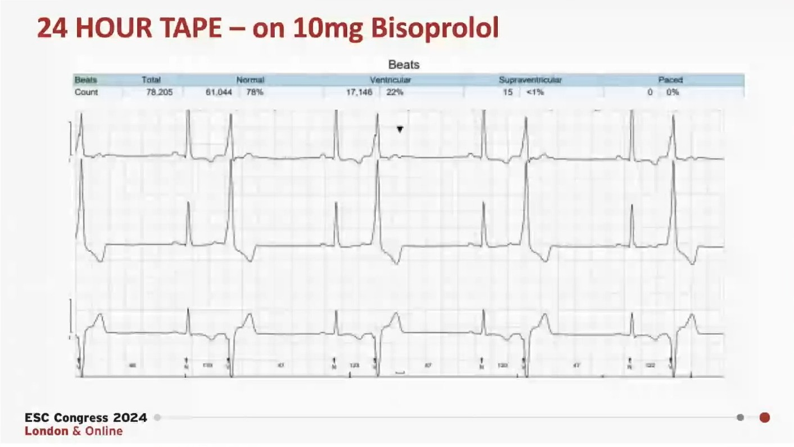

*總心跳 78,205；正常 78%；心室性 17,146 (22%)；上心室性 < 1%；起搏 0%。*

---

<!-- _class: fig -->

# 第 9 題：Holter（續）

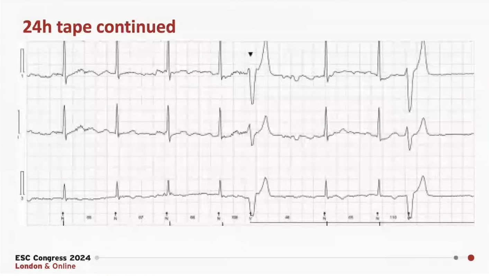

---

<!-- _class: fig -->

# 第 9 題：12 導程 ECG

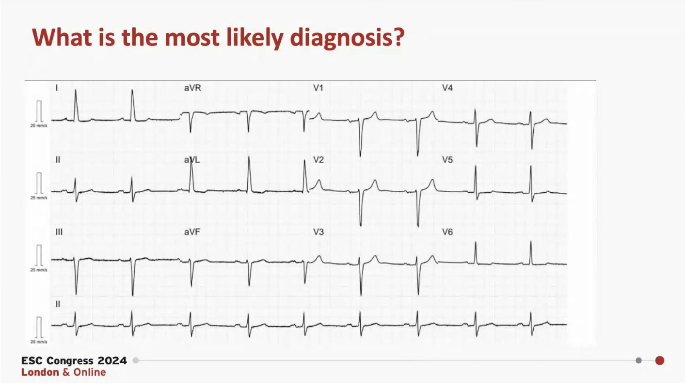

---

<!-- _class: opts -->

# 第 9 題：最可能的診斷與處置？

1. Iatrogenic bradycardia with 1st degree heart block requiring dual chamber pacemaker
2. Iatrogenic bradycardia with 1st degree heart block requiring ICD
3. Iatrogenic bradycardia with 1st degree heart block requiring CRT-P
4. Iatrogenic bradycardia with 1st degree heart block requiring CRT-D
5. Iatrogenic bradycardia with 1st degree heart block, stop bisoprolol

---

<!-- _class: qhead -->

# 第 10 題
## LVAD 手術後的心衰竭

---

# 第 10 題：過去病史

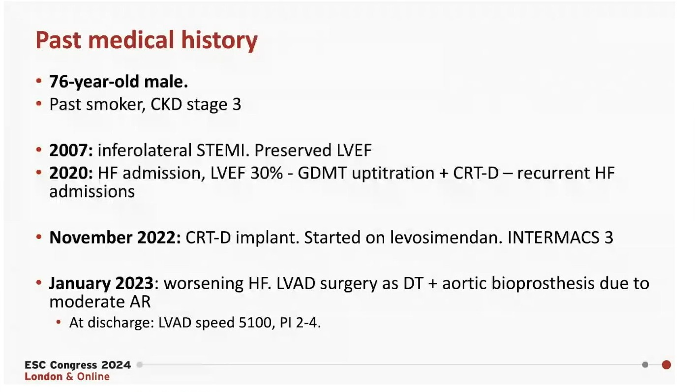

- 76 歲男性；已戒菸，CKD stage 3
- 2007 年下側壁 STEMI，LVEF 保留
- 2020 年心衰竭住院，LVEF 30%，GDMT 調升加 CRT-D，仍反覆住院
- 2022 年 11 月：開始 levosimendan，INTERMACS 3
- 2023 年 1 月：LVAD (destination therapy) 合併**主動脈生物瓣置換**（術前中度 AR）
- 出院時 LVAD 轉速 5100 rpm，PI 2 到 4

---

# 第 10 題：近期病程

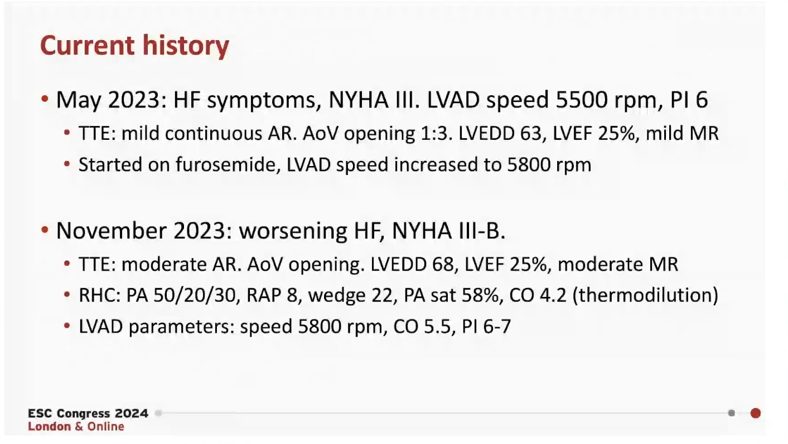

- 2023 年 5 月：NYHA III，轉速 5500 rpm
  - TTE：輕度連續性 AR，AoV 1:3 開啟，LVEDD 63，LVEF 25%
  - 加 furosemide，轉速**調高到 5800**
- 2023 年 11 月：惡化至 NYHA III-B
  - TTE：**中度 AR**，LVEDD **68**，中度 MR
  - RHC：PA 50/20/30，RAP 8，**wedge 22**，PA sat 58%
  - LVAD：5800 rpm，CO 5.5，PI 6 到 7

---

<!-- _class: fig -->

# 第 10 題：檢查

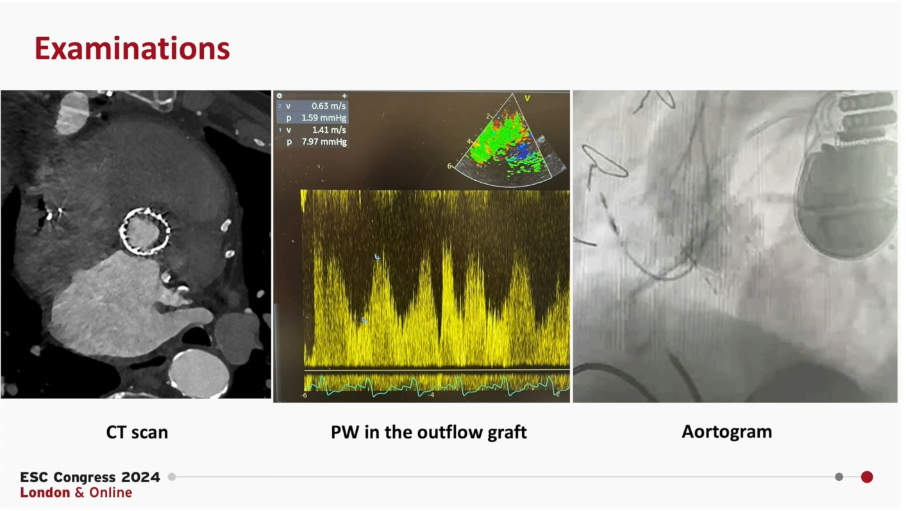

*左：CT。中：outflow graft 的 PW Doppler（壓差很低）。右：主動脈攝影。*

---

<!-- _class: opts -->

# 第 10 題：最可能的診斷與適當治療？

1. Insufficient LV unloading, increase LVAD speed
2. Volume overload, restrict sodium and water intake, increase diuretic
3. Severe aortic regurgitation, TAVR
4. Inflow or outflow cannula obstruction, surgical repair
5. Elevated MAP, increase vasodilators

---

<!-- _class: divider -->

# 解答與說明
## 先答完再翻頁

---

<!-- _class: opts -->

# 第 1 題解答：C

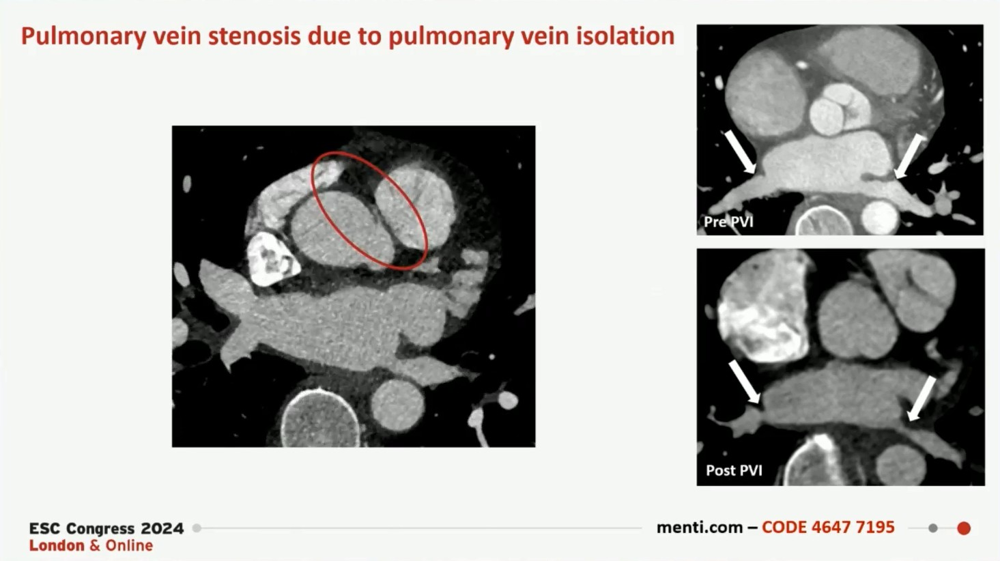

1. TIA due to LAA thrombus
2. Recurrent AF
3. **Pulmonary vein stenosis due to PVI**
4. 90% LM stenosis
5. Atrial septal injury due to PVI

現場答對率 **56%**（A 8%、B 9%、D 7%、E 13%）

---

# 第 1 題說明：PVI 後的肺靜脈狹窄

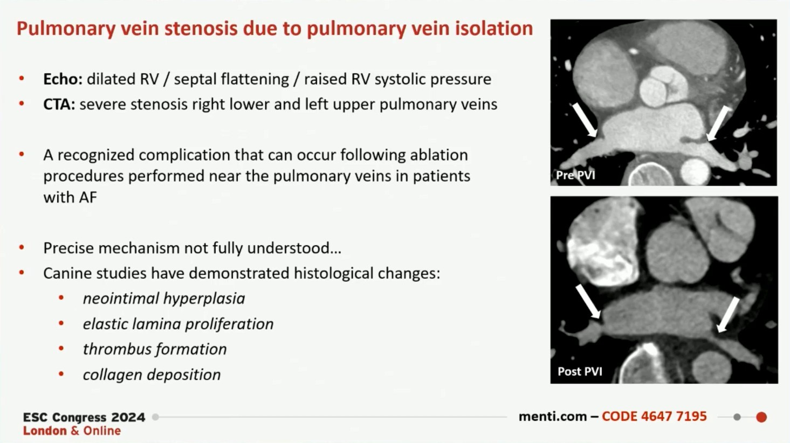

- Echo：RV 擴大、中隔扁平、RV 收縮壓上升，這是**右心壓力負荷**的訊號
- CTA：右下與左上肺靜脈嚴重狹窄
- 電燒靠近肺靜脈的已知併發症，機轉未明
- 犬隻研究：新生內膜增生、彈性板增生、血栓形成、膠原沉積

> 電燒後出現呼吸困難加胸痛、troponin 與 BNP 都正常、Wells 為 0，就要想到肺靜脈。

---

# 第 1 題說明：球囊擴張後緩解

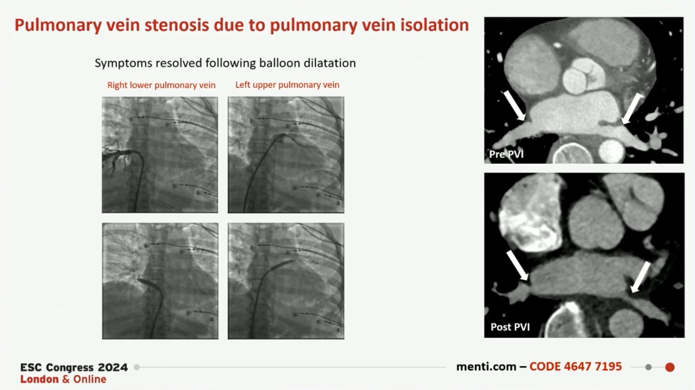

- 右下與左上肺靜脈各做球囊擴張
- 擴張後症狀緩解
- 右側為 PVI 前後的 CTA 對照

---

<!-- _class: opts -->

# 第 2 題解答：E

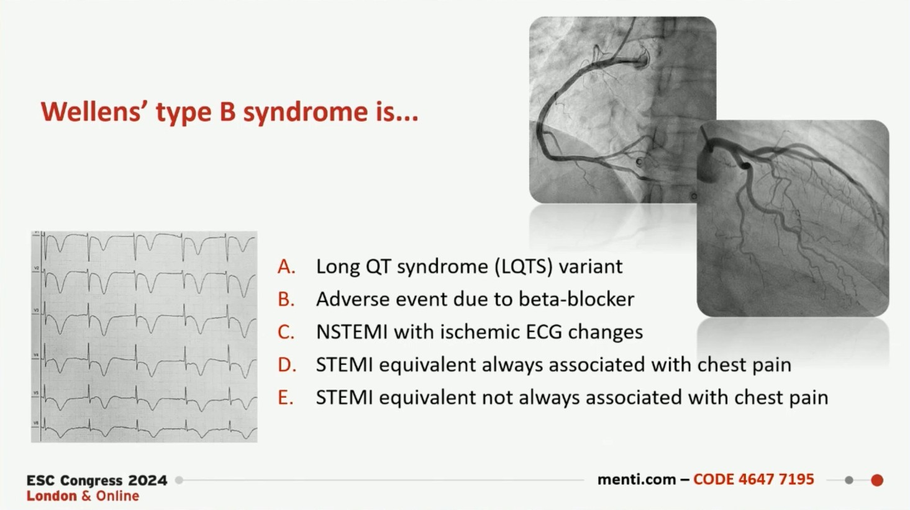

1. LQTS variant
2. Adverse event due to beta-blocker
3. NSTEMI with ischemic ECG changes
4. STEMI equivalent always with chest pain
5. **STEMI equivalent not always associated with chest pain**

現場答對率 **58%**（A 25%、B 24%、C 20%、D 14%）

---

# 第 2 題說明：Wellens' syndrome

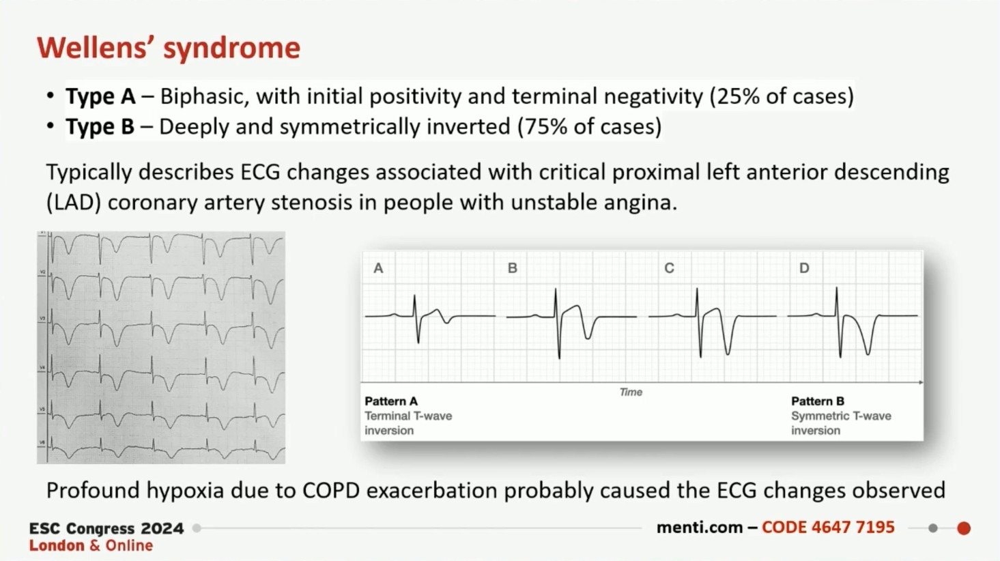

- **Type A**：雙相 T 波，先正後負（25%）
- **Type B**：深而對稱的 T 波倒置（75%）
- 典型代表：不穩定心絞痛病人的**近端 LAD 嚴重狹窄**
- 判準：V2 到 V3 深倒或雙相 T 波；**變化出現在無痛期**；ST 等電位或微升；無 Q 波；心肌酵素正常或輕微上升
- 本例冠狀動脈攝影正常；COPD 急性惡化的**嚴重缺氧**才是原因

> Wellens 的重點是「無痛期也要警覺」，但缺氧也可以模仿它。

---

<!-- _class: opts -->

# 第 3 題解答：C

1. Thrombus
2. Myxoma
3. **Fibroelastoma**
4. Lipoma
5. Metastatic mass

現場答對率 **54%**（A 11%、B 25%、D 30%、E 17%）

---

# 第 3 題說明：LV papillary fibroelastoma

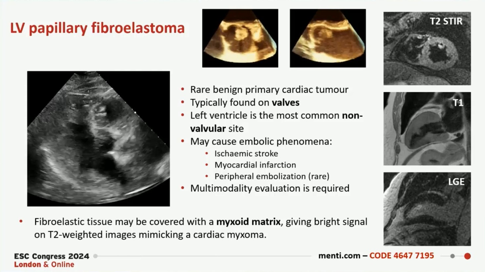

- 罕見的良性原發性心臟腫瘤，典型長在**瓣膜**上
- 非瓣膜部位中，**左心室**最常見
- 可造成栓塞：缺血性中風、心肌梗塞、周邊栓塞（罕見）
- 纖維彈性組織可能包覆**黏液基質** (myxoid matrix)，T2 呈亮訊號，會**模仿 myxoma**
- 本例 CMR 無脂肪抑制，排除 lipoma；有顯影且有蒂，不像血栓

---

<!-- _class: opts -->

# 第 4 題解答：D

1. Sinus tachycardia tracked by pacemaker
2. Atrial tachycardia tracked by pacemaker
3. Pacemaker mediated tachycardia (PMT)
4. **Bundle branch re-entrant VT (BBRVT)**
5. VT (myocardial re-entry)

現場答對率 **31%**（A 7%、B 26%、**C 38%**、E 26%）

---

# 第 4 題說明：Bundle branch re-entrant VT

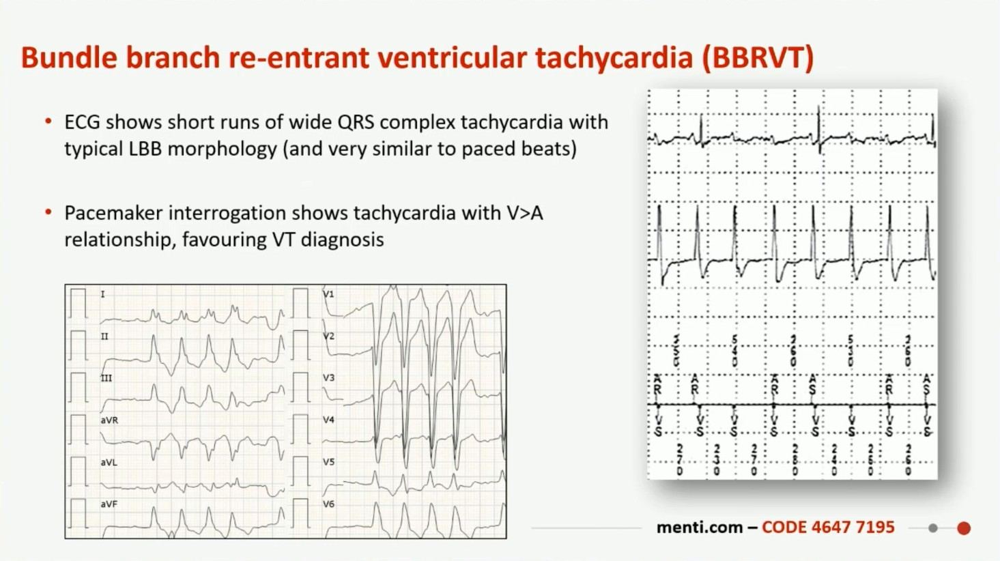

- ECG：短陣寬 QRS 心搏過速，**典型 LBBB 型態**，且與起搏心跳非常相似
- 節律器詢問：心搏過速時 **V > A**，支持 VT，而非節律器追蹤的上心室性心律
- 多數聽眾選 PMT；但 PMT 是 VP 驅動，本例 marker 上 V 比 A 多

---

# 第 4 題說明：為什麼是束支折返

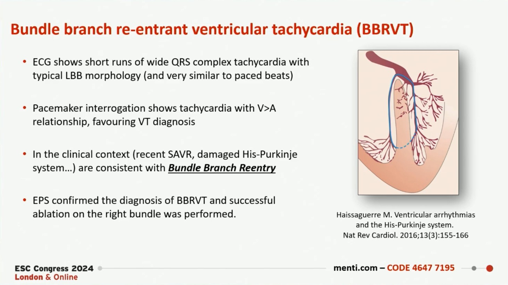

- 剛做完 SAVR，His-Purkinje 系統受損，正是 **bundle branch reentry** 的典型背景
- 電生理檢查證實 BBRVT
- **右束支電燒**成功

> 看到「像起搏的寬 QRS」卻與起搏無關，先想 BBRVT。

---

<!-- _class: opts -->

# 第 5 題解答：C

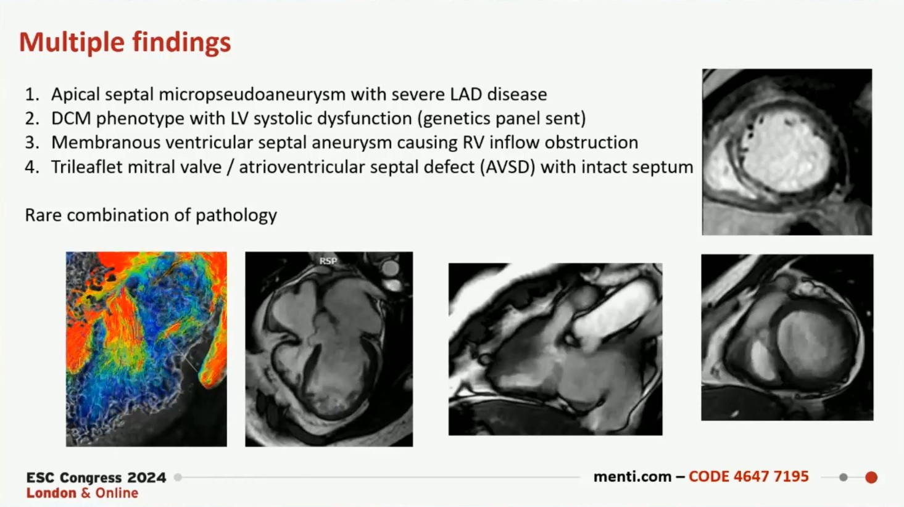

1. Dilated cardiomyopathy with septal fibrosis
2. Intact atrioventricular septal defect
3. **Ventricular septal defect**
4. Microaneurysm of the apical septum
5. Trileaflet mitral valve

現場答對率 **21%**（A 12%、**B 35%**、D 20%、E 20%）

---

# 第 5 題說明：罕見的病理組合

- 心尖中隔**微小假性動脈瘤**，合併嚴重 LAD 病變（D 存在）
- DCM 表現型，LV 收縮功能下降，已送基因檢測（A 存在）
- **膜性心室中隔動脈瘤** (aneurysm) 造成 RV 流入道阻塞：是瘤，**不是缺損**（C 不存在）
- **三葉式二尖瓣**，屬於中隔完整的 AVSD（B、E 存在）

> 多數人被「intact ... defect」這個拗口的措辭騙去選 B。先把題目讀兩遍。

---

<!-- _class: opts -->

# 第 6 題解答：D

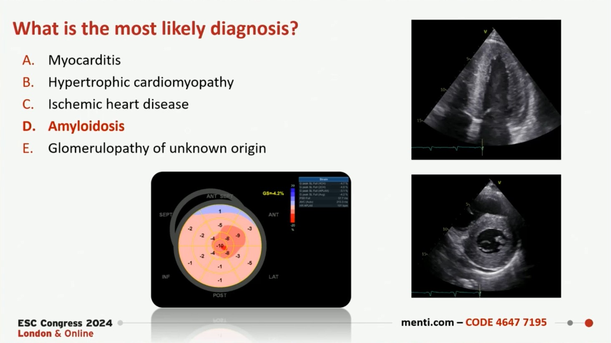

1. Myocarditis
2. Hypertrophic cardiomyopathy
3. Ischemic heart disease
4. **Amyloidosis**
5. Glomerulopathy of unknown origin

現場幾乎全數答對（D 108 票，其餘各 ≤ 5 票）

---

# 第 6 題說明：類澱粉的線索

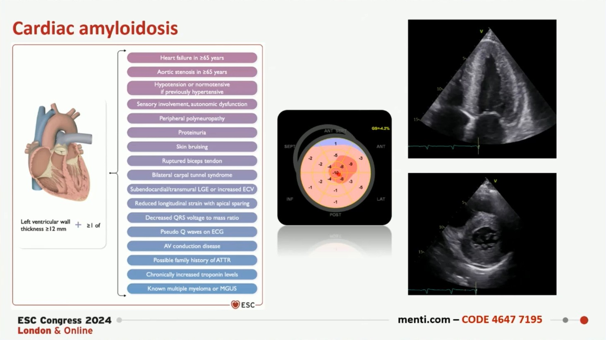

- 同心性 LVH 加 **RV 游離壁增厚** (12 mm)
- GLS 下降但**心尖保留** (apical sparing)
- 雙心房擴大、少量心包積液
- 心外線索：**腎病症候群**（蛋白尿 9 g）、容易瘀青
- 右圖為 ESC 的「LV 壁厚 ≥ 12 mm 加任一紅旗」篩檢清單

---

# 第 6 題說明：超音波特徵對照

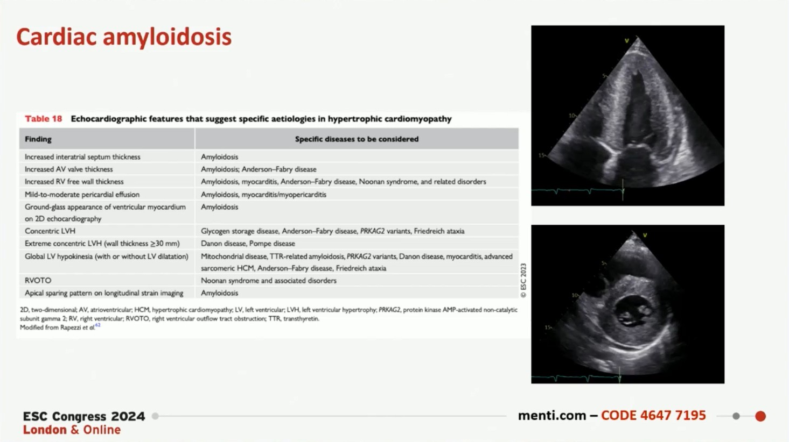

- ESC 2023 心肌病變指引表 18：提示特定病因的超音波特徵
- 類澱粉占了表中大半
- 低電壓 ECG 配上厚心肌，是另一個不該錯過的組合

---

<!-- _class: opts -->

# 第 7 題解答：C

1. Amyloidosis
2. Iron overload
3. **Endomyocardial fibrosis**
4. RV apical hypertrophic cardiomyopathy
5. Fabry disease

現場答對率 **42%**（**B 37%**、D 14%、E 15%）

---

# 第 7 題說明：Endomyocardial fibrosis

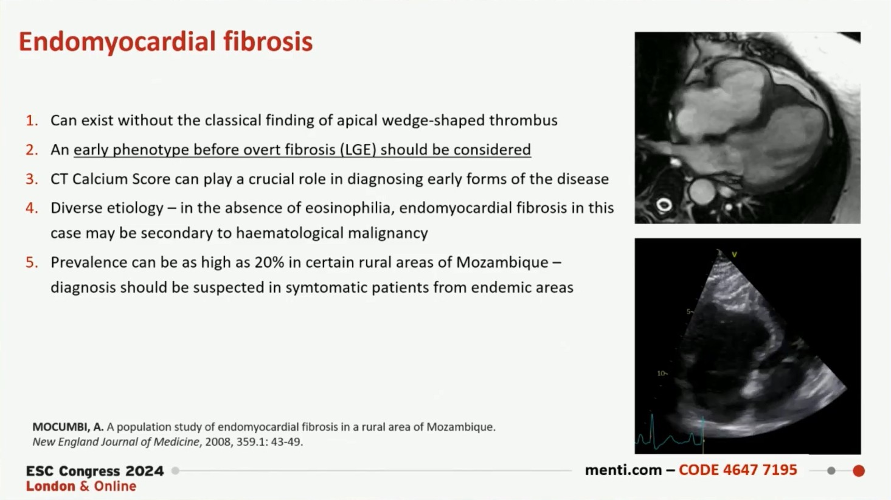

- EMF 可以**沒有**典型的心尖楔形血栓
- 要考慮明顯纖維化 (LGE) 出現前的**早期表現型**
- **CT 鈣化積分**在早期診斷扮演關鍵角色，本例顯示心內膜邊緣鈣化
- 無嗜酸性球增多時，可能續發於血液惡性疾病（本例有單株丙球蛋白病）
- 莫三比克鄉村盛行率可達 20%
- [Mocumbi A, et al. NEJM 2008;359:43-49](https://doi.org/10.1056/NEJMoa0708629)

---

<!-- _class: opts -->

# 第 8 題解答：E

1. New TAVR, then balloon dilatation of migrated valve
2. Snare or bail-out device removal
3. New TAVR, then surgical removal
4. Emergency surgery
5. **New TAVR to solve the AR, then cover the migrated valve with a stent**

現場答對率 **20%**（A 12%、B 10%、C 10%、**D 41%**）

---

# 第 8 題說明：先救 AR

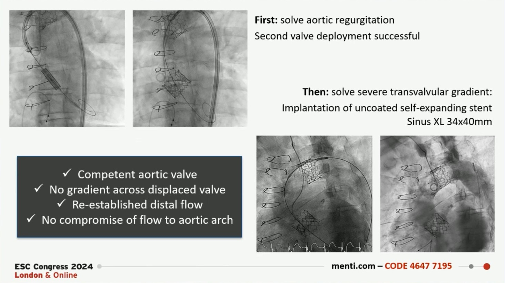

- **第一步**：處理急性 AR，放第二顆瓣膜
- **第二步**：以自膨式裸支架 Sinus XL 34 × 40 mm 把翻轉的瓣膜撐開，貼在主動脈壁
- 結果：主動脈瓣功能正常、脫出處無壓差、遠端血流恢復、弓分支未受影響
- 為什麼不開刀？血友病 C、CABG 後再開胸、血行動力已崩潰

> 翻轉的瓣膜不一定要拿出來，撐開讓血流過去，是本例的關鍵。

---

<!-- _class: opts -->

# 第 9 題解答：D

1. Dual chamber pacemaker
2. ICD
3. CRT-P
4. **Iatrogenic bradycardia with 1st degree heart block requiring CRT-D**
5. Stop bisoprolol

---

# 第 9 題說明：心臟類肉瘤病

- **心臟類肉瘤病**合併穿壁纖維化與多源性心搏過速
- 2023 年心搏過速誘發心肌病變，需高劑量 beta-blocker
- ECG：HR 55，PR 212 ms，QRS 112 ms，QTc 428
- 最佳藥物治療下運動耐受正常，LVEF 47%
- VPC 負荷 > 20%，仍需抗心律不整治療
- 未來高起搏需求 (> 20 到 40%)

---

# 第 9 題說明：指引怎麼說

- ESC 2021 起搏指引，類肉瘤病：
  - 合併 AVB，考慮可起搏裝置 (IIa C)
  - 有起搏適應症且 LVEF < 50%，考慮 **CRT-D** (IIa C)
- 停 bisoprolol 不可行：VPC 負荷高，本來就需要 beta-blocker

---

<!-- _class: opts -->

# 第 10 題解答：C

1. Insufficient LV unloading, increase LVAD speed
2. Volume overload, diuretics
3. **Severe aortic regurgitation, TAVR**
4. Cannula obstruction, surgical repair
5. Elevated MAP, vasodilators

現場答對率 **29%**（A 10%、B 11%、D 23%、E 6%）

---

# 第 10 題說明：LV 卸載不足

- LV 擴大、MR 加重、中隔向右偏，代表 **LV 卸載不足**
- 四個原因：轉速不足、**明顯 AR**、inflow 或 outflow graft 阻塞、MAP 過高
- 提高轉速後**反而惡化**，排除 A；outflow graft 壓差很低，排除 D
- CT 與主動脈攝影顯示嚴重 AR，以 TAVR 處理（本例原有生物瓣）

> LVAD 之後的 AR 常見又容易被忽略。轉速越高，AR 越重，形成惡性循環。

---

# 計分表

| 題 | 答案 | 現場答對率 | 題 | 答案 | 現場答對率 |
|---|---|---|---|---|---|
| 1 | C | 56% | 6 | D | 幾乎全數 |
| 2 | E | 58% | 7 | C | 42% |
| 3 | C | 54% | 8 | E | 20% |
| 4 | D | 31% | 9 | D | 未記錄 |
| 5 | C | 21% | 10 | C | 29% |

- 8 到 10 題：可以上台當評審了
- 5 到 7 題：與 ESC 現場聽眾相當
- 4 題以下：沒關係，第 4、5、8 題本來就是設計來騙人的

---

<!-- _class: small -->

# 來源與致謝

- **原始節目**：The ESC Grand Quiz Spectacular, ESC Congress 2024, London, 2024-08-30。主持 Mark Westwood (UK)、John-Paul Carpenter (IE)；評審團 George Thornton、Filip Zemrak、Holly Morgan、Robin Nijveldt、Sarah Moharem Elgamal、Abhishek Joshi、Omar Chehab、Jonathan Bennett；特別來賓 Rohin Francis。[ESC 365 Session 45707](https://esc365.escardio.org/session/45707)
- **病例投稿者**：M. Boussoussou (Semmelweis)、R. Morawiec 與 A. Misiewicz (Lodz)、M. F. Orsino (Pisa)、I. Miranda 與 F. Gerardo (Amadora)、A. Monastyrski、P. Jordán Marchite 與 E. Ródenas-Alesina (Vall d'Hebron)、S. Howell (Guy's and St Thomas')
- **影像**：截自 ESC TV 轉播畫面（僅取投影片區域），版權屬 ESC 與各投稿者，僅供院內教學使用
- **參考**：Mocumbi A, et al. N Engl J Med 2008;359:43-49；ESC 2021 起搏指引；ESC 2023 心肌病變指引
- 本測驗為教學整理，題目與選項依原節目，中文說明為整理者所加

---

<!-- _class: end -->
<!-- _paginate: false -->

# 謝謝參與
## 答案請勿外流給還沒玩的同事

謝慕揚 MD, PhD, FESC
