<!-- _class: cover -->
<!-- _paginate: false -->

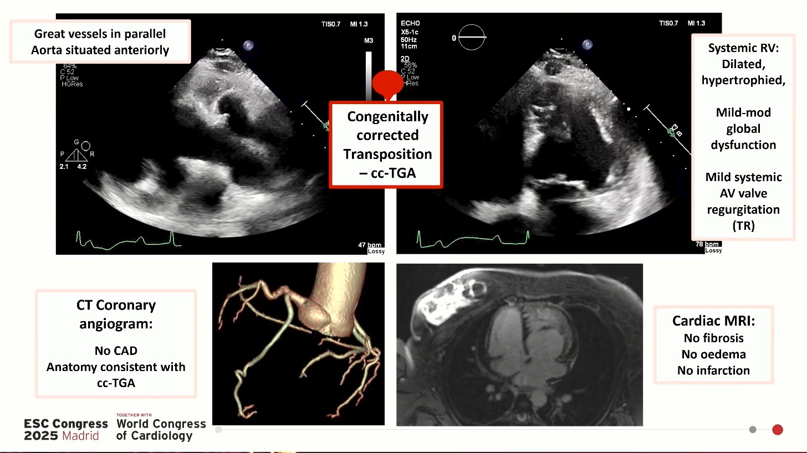

# ESC 2025 Grand Summer Quiz

## 九題心臟科臨床案例測驗（附解答）

**整理：謝慕揚 MD, PhD, FESC**
來源：ESC Congress 2025, Madrid, 2025-08-29
Session 50234「The ESC Grand Summer Quiz」
主持：Mark Westwood、John-Paul Carpenter
[ESC 365 原始影片](https://esc365.escardio.org/session/50234)

---

# 玩法說明

- 共 **9 題**，每題一個真實病例，由各國年輕醫師投稿
- 先看病史與影像，再從 A 到 E 選一個答案；先不要翻到後半部的解答
- 解答附當天現場（Mentimeter）的答對比例
- 影像截自 ESC TV 轉播畫面，只取投影片本身
- 題目橫跨心肌病變、先天性心臟病、瓣膜、肺栓塞、懷孕與急性冠心症

> 九題裡有三題，多數聽眾選了同一個錯的答案。看看你會不會也掉進去。

---

# 題目總覽

| 題 | 主題 | 投稿者 |
|---|---|---|
| 1 | 年輕人的心肌病變 | R. Gray（Barts，London） |
| 2 | Takotsubo 與轉位？ | K. Rausch（Toowoomba，AU） |
| 3 | 石頭裡的刀刃 | M. S. Ceballos（Vall d'Hebron） |
| 4 | 胃癌病人的肺栓塞 | L. Cotrim（Vila Franca de Xira） |
| 5 | MINOCA 沒做 MRI | J. Lushington（Barts，London） |
| 6 | 57 歲女性的間歇性房室阻斷 | S. Latrofa（Pisa） |
| 7 | 懷孕中反覆肺栓塞 | L. Perrard（Paris、Amiens） |
| 8 | 被圍攻的心臟 | F. González-Santórum（Vall d'Hebron） |
| 9 | 心尖之下：血栓、瘤，還是破裂？ | A. B. Carvalho（Vila Franca de Xira） |

---

<!-- _class: qhead -->

# 第 1 題
## More than just palpitations

---

# 第 1 題：病史

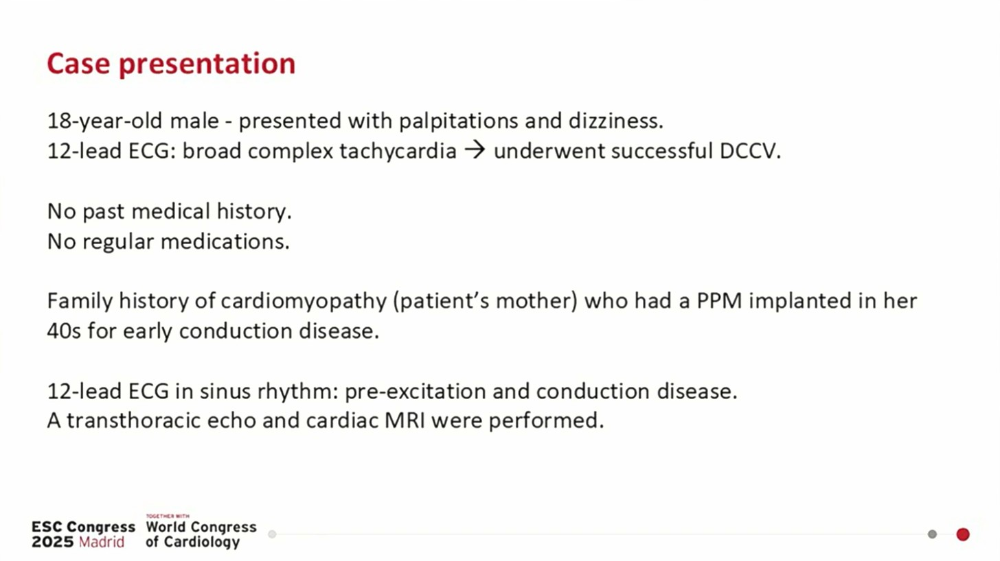

- 18 歲男性，心悸、頭暈
- ECG：**寬 QRS 心搏過速**，電擊整流成功
- 無過去病史，無用藥
- 家族史：**母親**有心肌病變，40 多歲就因早發傳導疾病裝節律器
- 竇性節律 ECG：**預激** (pre-excitation) 加傳導疾病

---

<!-- _class: fig -->

# 第 1 題：整流後 ECG

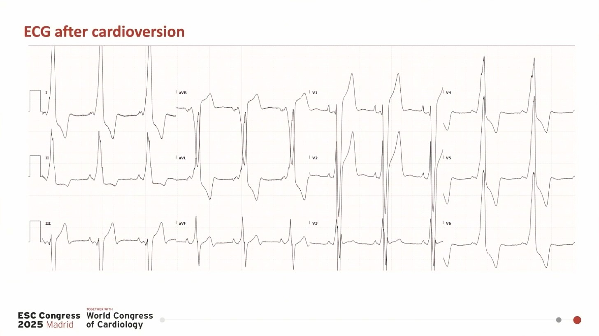

---

# 第 1 題：心臟超音波

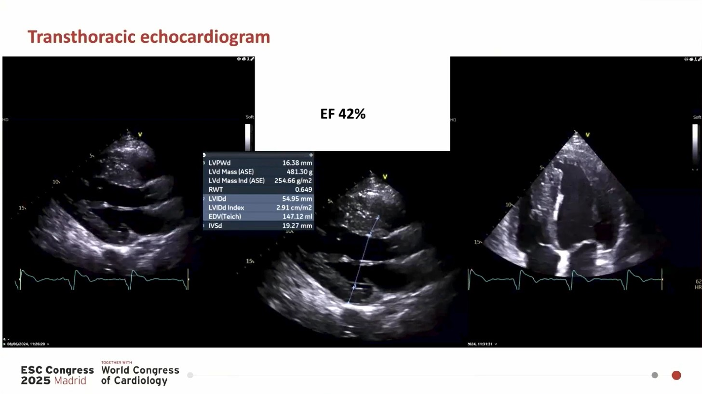

- LVEF 42%
- IVSd 19.3 mm
- LV mass index 255 g/m²
- 明顯左心室肥厚

---

<!-- _class: fig -->

# 第 1 題：Cardiac MRI

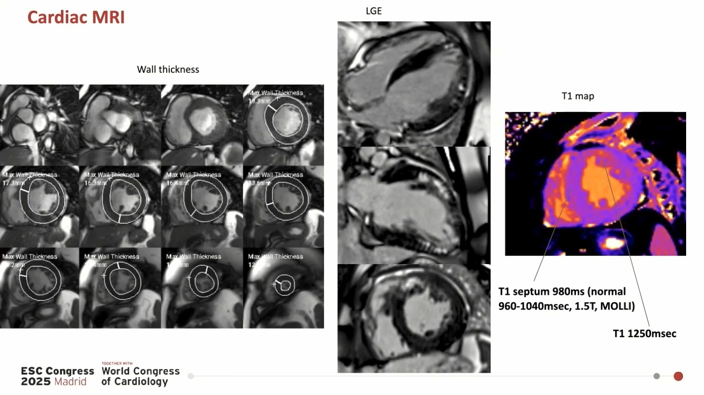

*中隔 T1 980 ms（正常 960 到 1040，1.5T MOLLI），另一處 T1 1250 ms。*

---

<!-- _class: opts -->

# 第 1 題：最可能的診斷是？

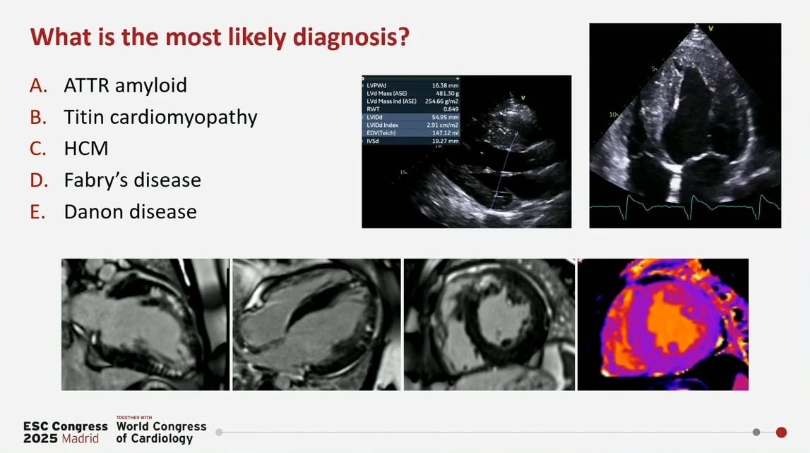

1. ATTR amyloid
2. Titin cardiomyopathy
3. HCM
4. Fabry's disease
5. Danon disease

---

<!-- _class: qhead -->

# 第 2 題
## Takotsubo and transposition: unlikely company?

---

# 第 2 題：病史

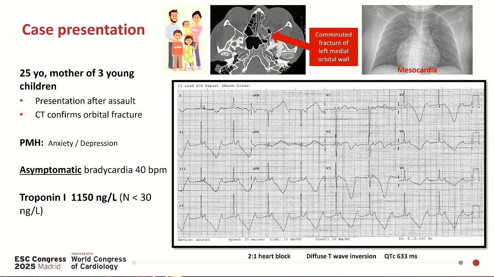

- 25 歲女性，三個孩子的母親
- 遭攻擊後就醫，CT 證實眼眶骨折
- 病史：焦慮、憂鬱
- **無症狀**心搏過緩 40 bpm
- **Troponin I 1150 ng/L** (正常 < 30)
- 胸部 X 光：mesocardia
- ECG：2:1 房室阻斷、瀰漫性 T 波倒置、QTc 633 ms

---

# 第 2 題：多模態影像

- Echo：大血管平行，主動脈在前
- **先天矯正型大動脈轉位** (cc-TGA)
- 體循環 RV：擴大、肥厚、輕到中度功能下降；輕度體循環房室瓣 (TR) 逆流
- CT 冠狀動脈：無 CAD，解剖符合 cc-TGA
- CMR：無纖維化、無水腫、無梗塞

---

# 第 2 題：植入節律器

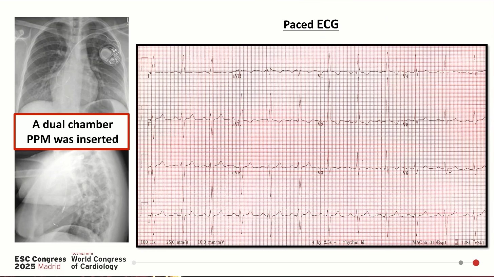

- 植入**雙腔節律器**
- 右圖為起搏後的 ECG

---

<!-- _class: opts -->

# 第 2 題：心室導線起搏到的是哪個結構？

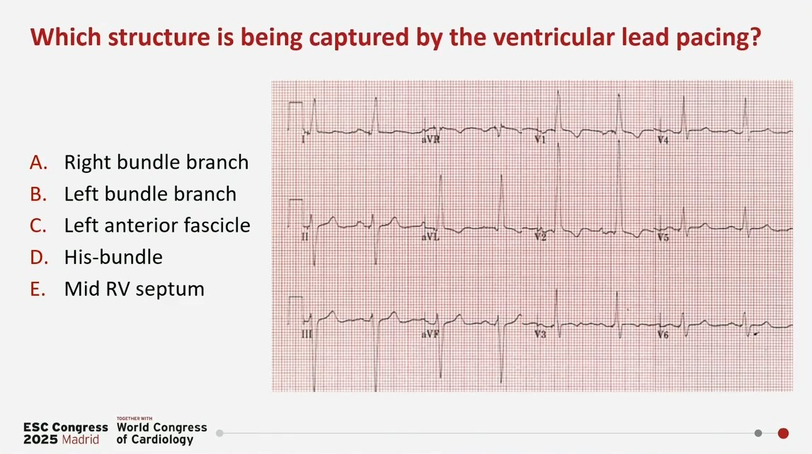

1. Right bundle branch
2. Left bundle branch
3. Left anterior fascicle
4. His-bundle
5. Mid RV septum

---

<!-- _class: qhead -->

# 第 3 題
## A blade through stone

---

# 第 3 題：病史與心臟超音波

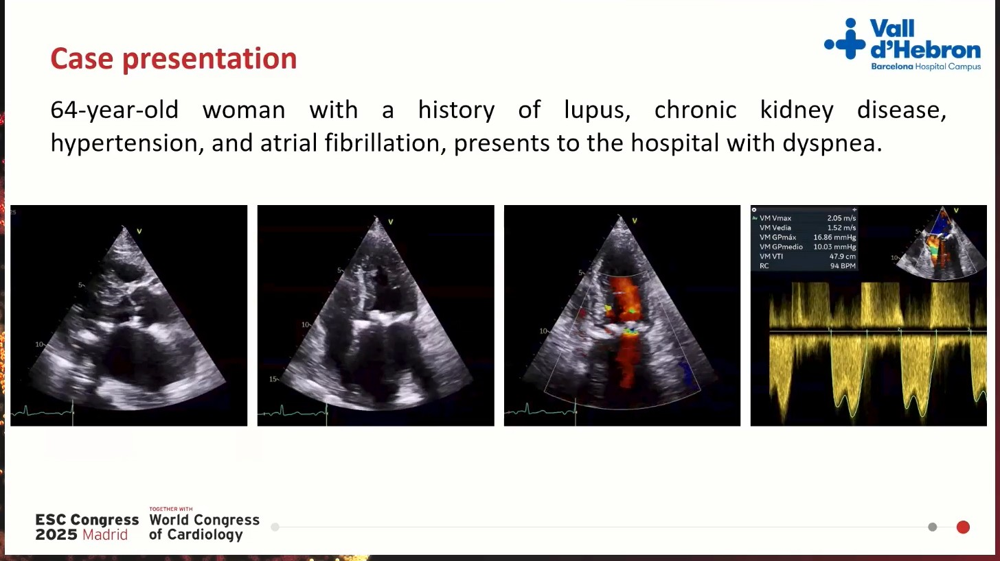

- 64 歲女性
- 紅斑性狼瘡、**慢性腎臟病**、高血壓、心房顫動
- 因呼吸困難住院
- TTE 如右圖：二尖瓣區域的大塊病灶，合併二尖瓣血流加速

---

<!-- _class: fig -->

# 第 3 題：影像

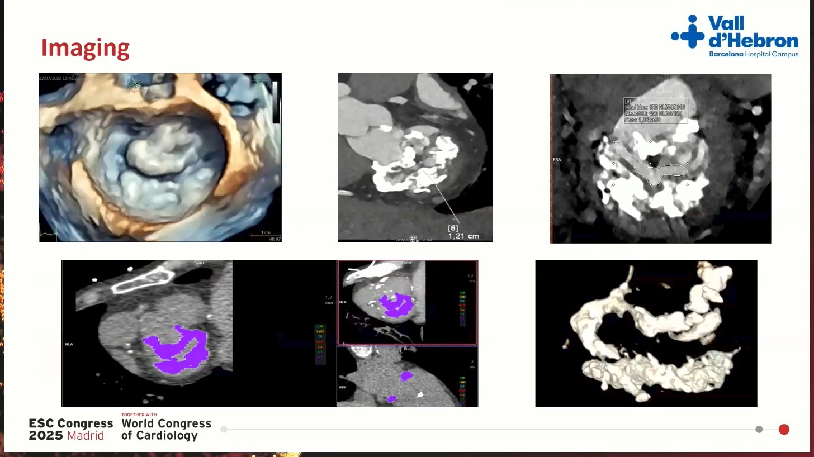

*3D TEE 與 cardiac CT。*

---

<!-- _class: fig -->

# 第 3 題：影像與治療

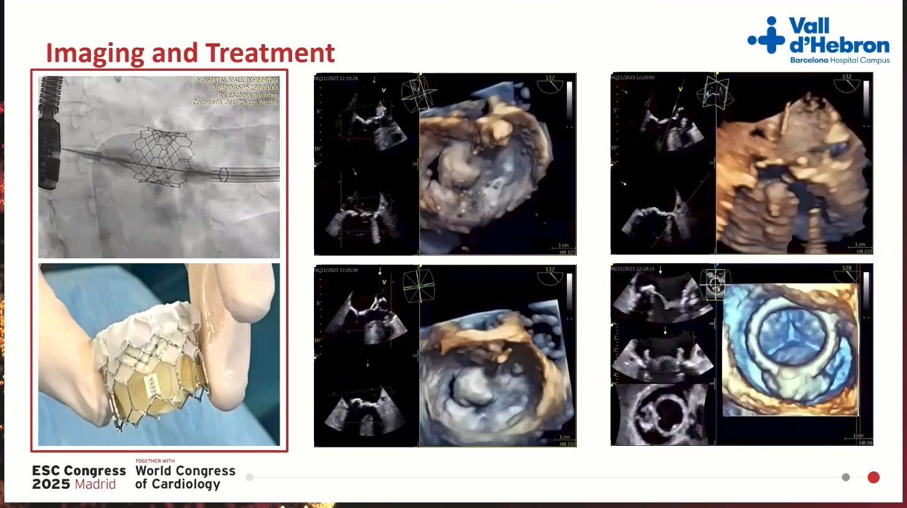

---

<!-- _class: opts -->

# 第 3 題：最可能的診斷是？

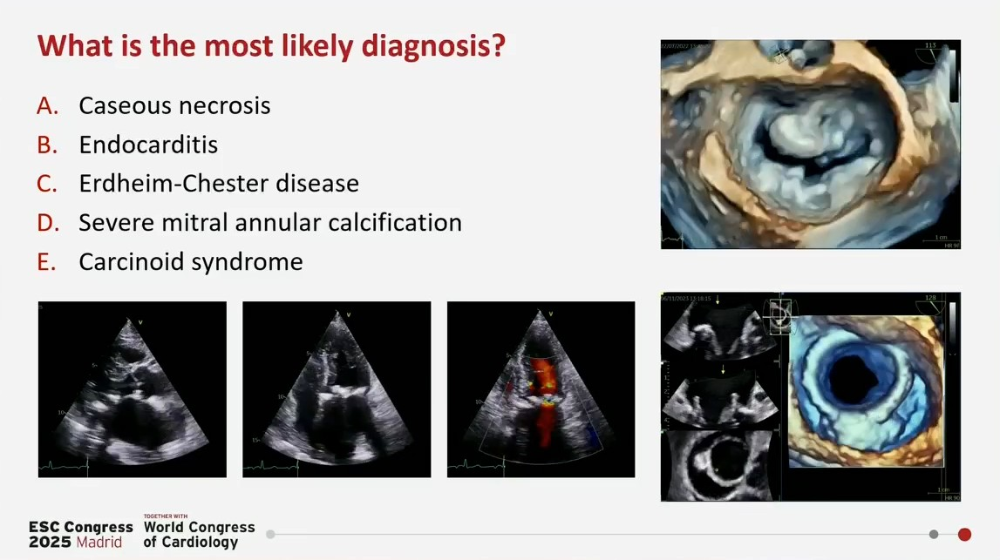

1. Caseous necrosis
2. Endocarditis
3. Erdheim-Chester disease
4. Severe mitral annular calcification
5. Carcinoid syndrome

---

<!-- _class: qhead -->

# 第 4 題
## Balancing thrombosis and bleeding risk

---

# 第 4 題：病史

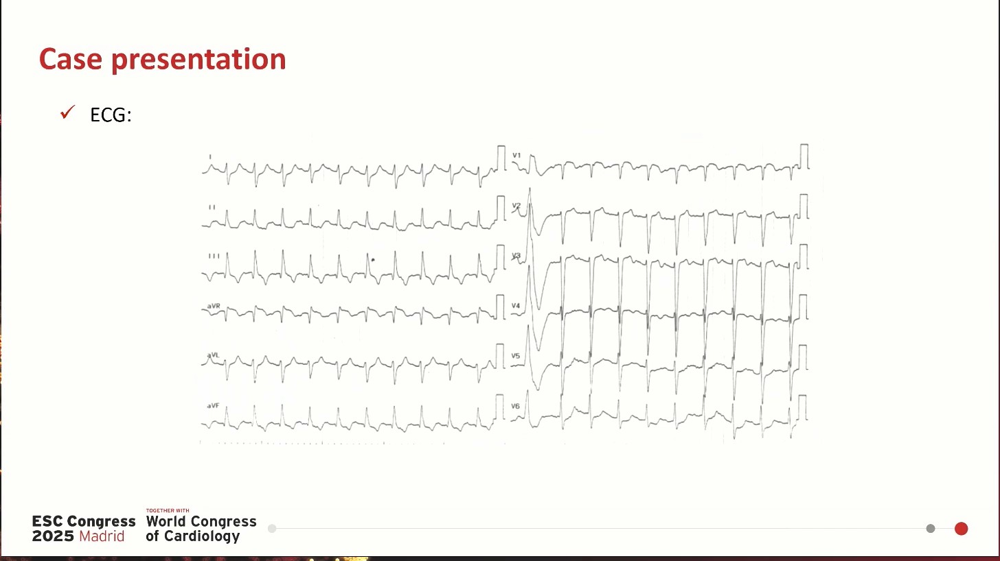

- 78 歲男性
- **胃癌**，正在接受腫瘤治療
- 急診：急性肋膜性胸痛與呼吸困難
- ECG 如右圖

---

# 第 4 題：檢查與處置

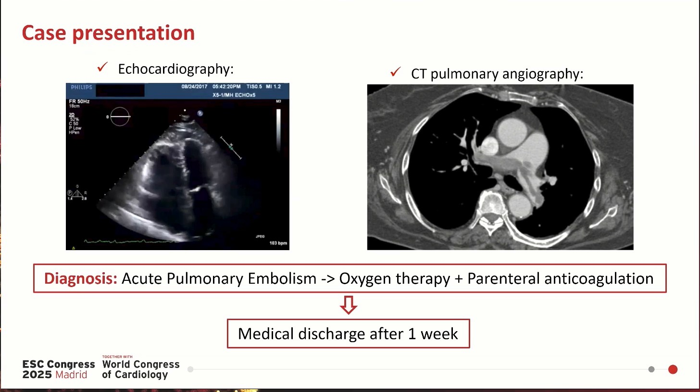

- Echo 與 CT 肺動脈攝影
- 診斷：**急性肺栓塞**
- 氧氣治療加注射型抗凝血
- 住院 1 週後出院

---

<!-- _class: opts -->

# 第 4 題：長期治療與預防復發，該用哪一種抗凝血？

1. Edoxaban
2. Low-molecular weight heparin
3. Rivaroxaban
4. Dabigatran
5. Vitamin K antagonist

---

<!-- _class: qhead -->

# 第 5 題
## MINOCA without MRI is like apple without pie!

---

# 第 5 題：病史

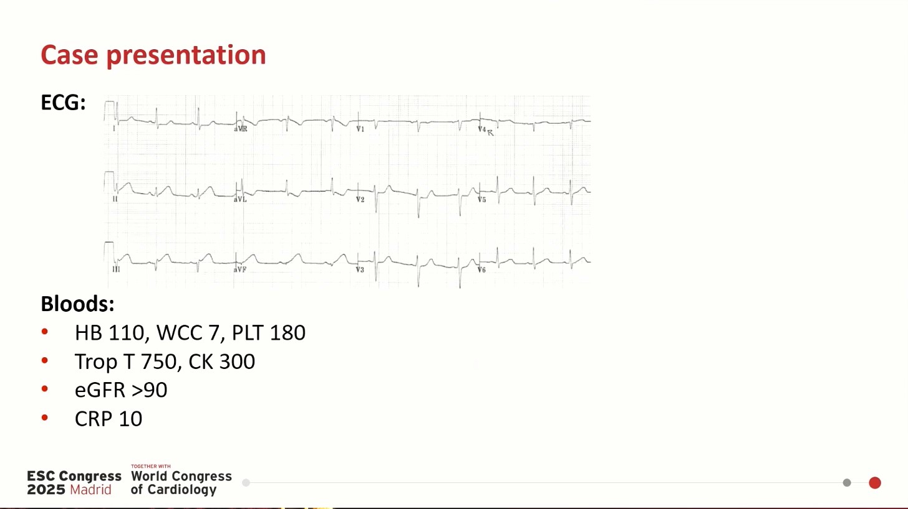

- 急性胸痛就醫，ECG 如右圖
- Hb 110、WBC 7、PLT 180
- **Trop T 750**、CK 300
- eGFR > 90、CRP 10

---

# 第 5 題：後續檢查

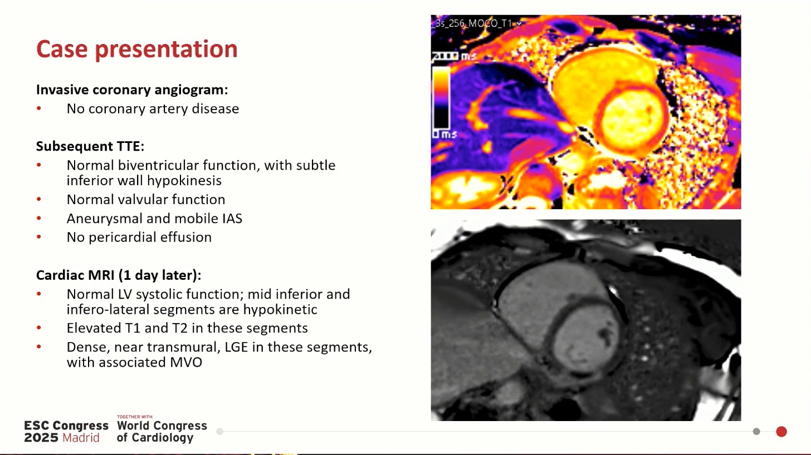

- 侵入性冠狀動脈攝影：**無冠狀動脈疾病**
- TTE：雙心室功能正常，下壁輕微運動低下；瓣膜正常；心房中隔**瘤樣、會晃動**；無心包積液
- CMR（隔天）：LV 收縮正常；中段下壁與下側壁運動低下
- 同區 T1、T2 上升
- 同區**緻密、近乎穿壁的 LGE，合併 MVO**

---

<!-- _class: opts -->

# 第 5 題：最可能的診斷是？

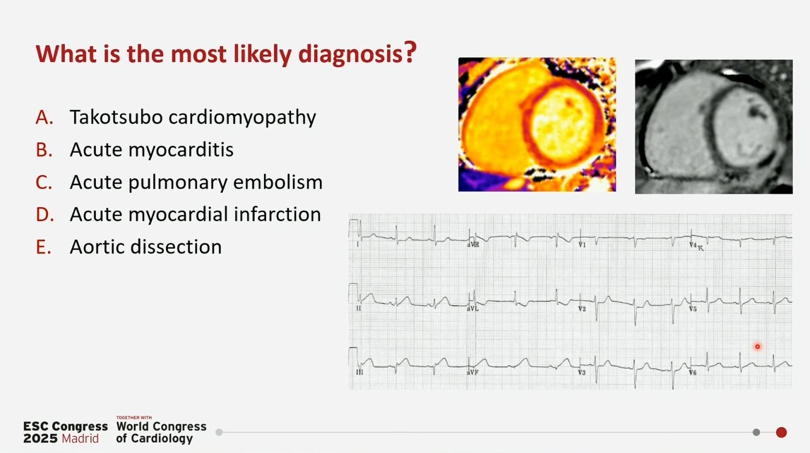

1. Takotsubo cardiomyopathy
2. Acute myocarditis
3. Acute pulmonary embolism
4. Acute myocardial infarction
5. Aortic dissection

---

<!-- _class: qhead -->

# 第 6 題
## Intermittent AV block in a 57-year-old woman

---

# 第 6 題：病史

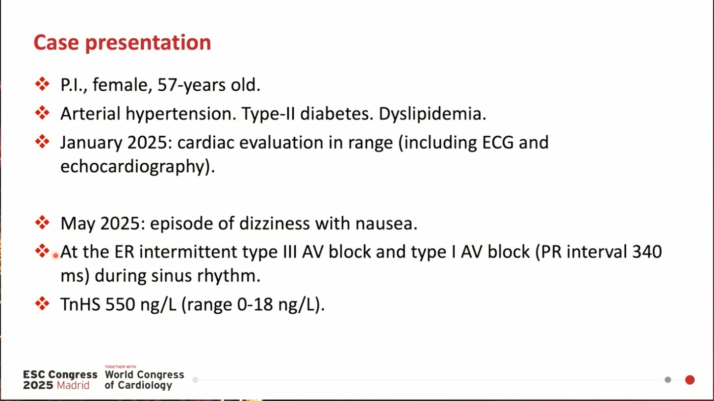

- 57 歲女性；高血壓、第 2 型糖尿病、高血脂
- 2025 年 1 月心臟評估（含 ECG、echo）正常
- 2025 年 5 月：頭暈合併噁心
- 急診：竇性節律下**間歇性三度**與一度房室阻斷 (PR 340 ms)
- **hs-Tn 550 ng/L**

---

# 第 6 題：心臟超音波與冠狀動脈

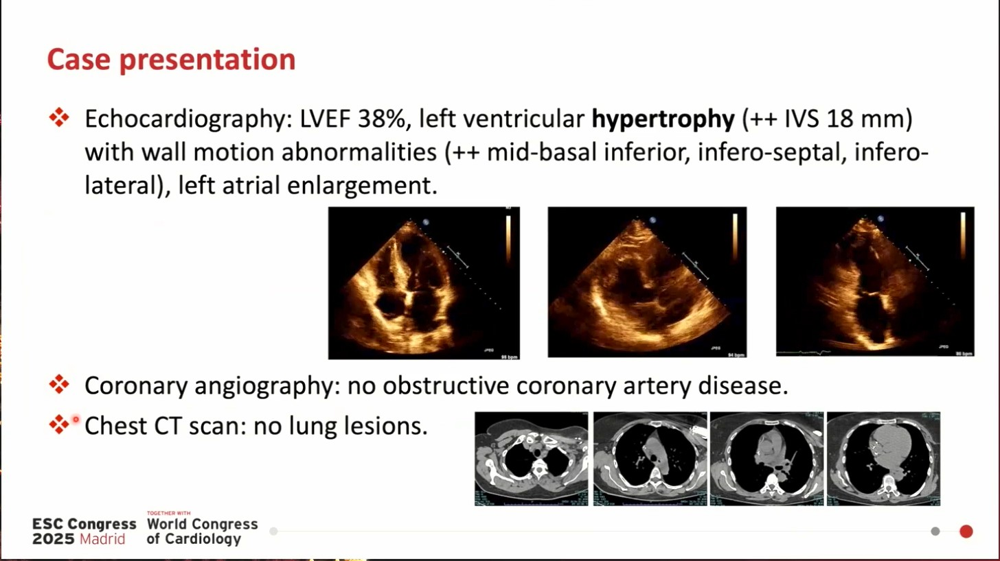

- LVEF 38%，**左心室肥厚** (IVS 18 mm)
- 室壁運動異常：中基底段下壁、下中隔、下側壁
- 左心房擴大
- 冠狀動脈攝影：無阻塞性病變
- 胸部 CT：無肺部病灶

---

# 第 6 題：CMR 與 PET-CT

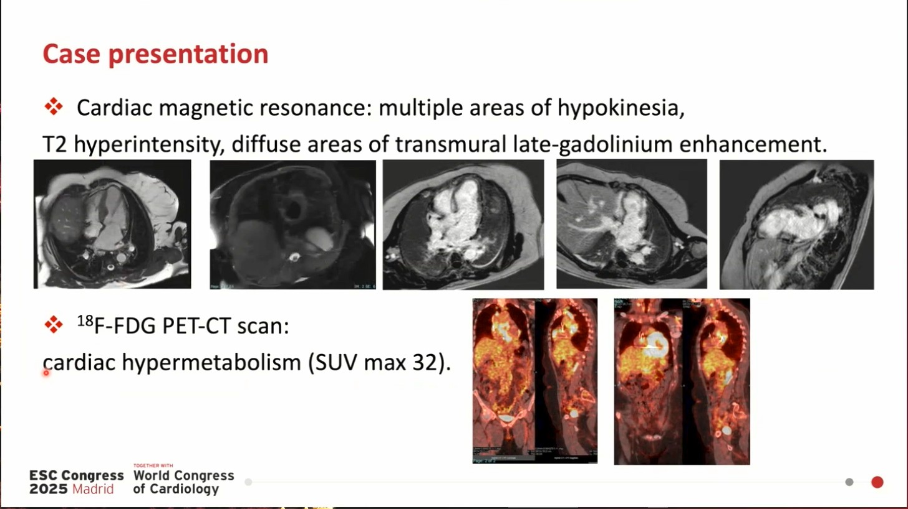

- CMR：多處運動低下
- T2 高訊號
- 瀰漫性**穿壁** LGE
- ¹⁸F-FDG PET-CT：心臟**高代謝** (SUVmax 32)

---

<!-- _class: opts -->

# 第 6 題：最可能的診斷是？

1. Amyloidosis
2. Anderson-Fabry disease
3. Hypertensive heart disease
4. Cardiac sarcoidosis
5. Dilated cardiomyopathy

---

<!-- _class: qhead -->

# 第 7 題
## Recurrent thromboembolism in pregnancy

---

# 第 7 題：病史

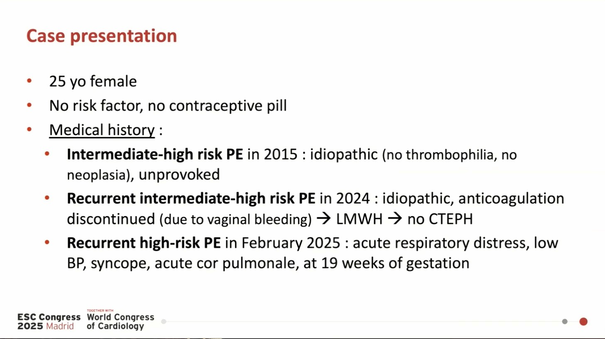

- 25 歲女性；無危險因子，未服避孕藥
- 2015 年：中高風險 PE，原發性，無誘因
- 2024 年：再發中高風險 PE；因陰道出血停抗凝血，改 LMWH；無 CTEPH
- **2025 年 2 月**：再發**高風險 PE**，呼吸窘迫、低血壓、暈厥、急性肺心症
- 當時**懷孕 19 週**

---

# 第 7 題：急性期處置

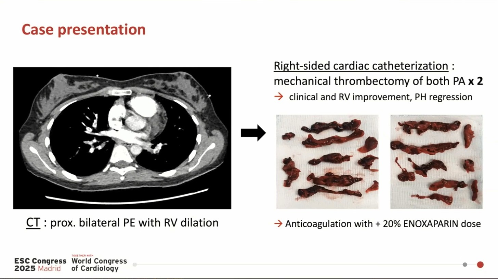

- CT：近端雙側 PE 合併 RV 擴大
- 右心導管：雙側肺動脈**機械取栓**各兩次
- 臨床與 RV 功能改善，肺高壓消退
- 抗凝血：enoxaparin 劑量增加 20%

---

# 第 7 題：懷孕 26 週追蹤

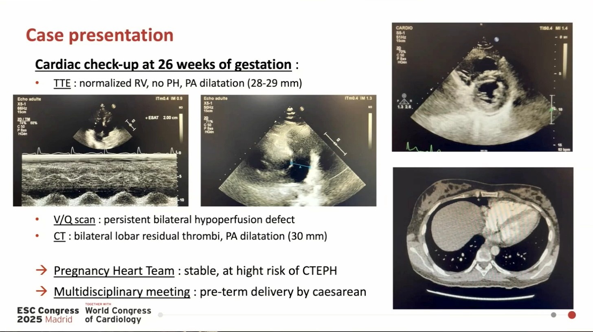

- TTE：RV 恢復正常，無肺高壓，PA 28 到 29 mm
- V/Q：雙側持續灌注缺損
- CT：雙側葉間殘餘血栓，PA 30 mm
- Pregnancy Heart Team：穩定，但 **CTEPH 高風險**
- 多專科會議：**提早剖腹產**

---

<!-- _class: opts small -->

# 第 7 題：你會建議哪一種抗凝血策略？

1. Continuing LMWH throughout without bridging or dose modification
2. Stopping LMWH 48 h before surgery without bridge, resuming 24 h after delivery
3. VKA bridging and stopping 48 h before surgery
4. IV UFH bridging 48 h before surgery, stopping 6 h prior, resuming 24 to 48 h after delivery
5. IV UFH bridging 48 h before surgery, stopping 6 h prior, resuming 4 to 6 h after delivery

---

<!-- _class: qhead -->

# 第 8 題
## A heart under siege

---

# 第 8 題：病史

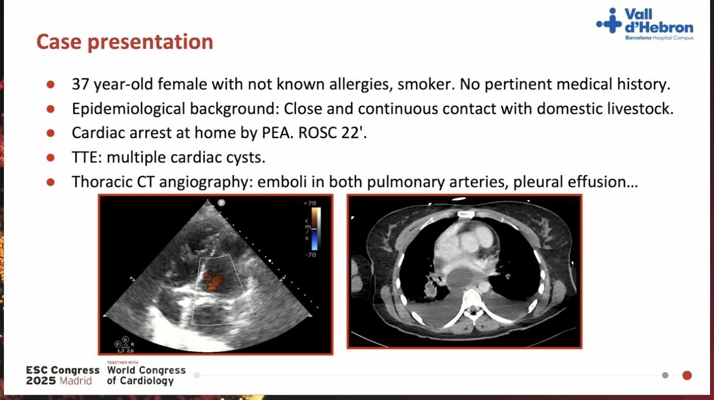

- 37 歲女性，吸菸，無過敏與特殊病史
- 流行病學：與**家畜**密切且長期接觸
- 在家**心跳停止** (PEA)，22 分鐘後恢復自發循環
- TTE：**多個心臟囊腫**
- CT 肺動脈攝影：雙側肺動脈栓塞、肋膜積液

---

# 第 8 題：TEE

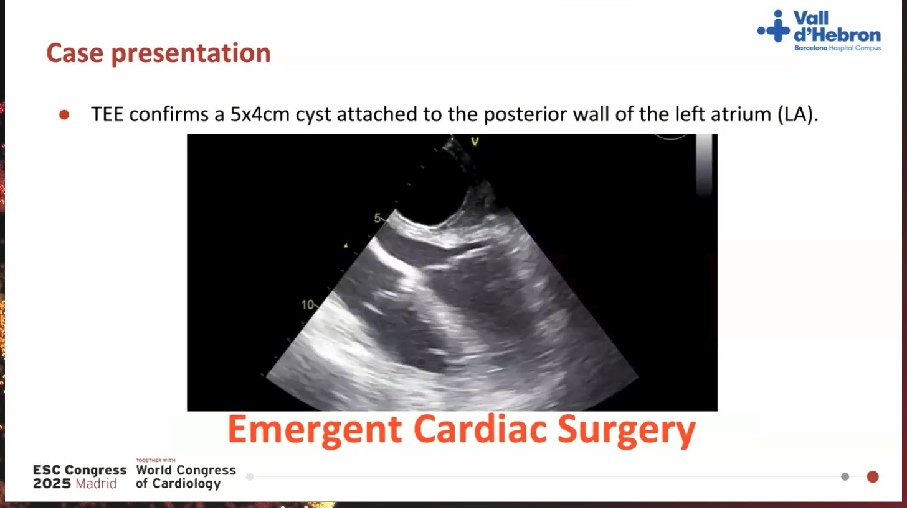

- TEE：5 × 4 cm 囊腫附著於**左心房後壁**
- 安排**緊急心臟手術**

---

<!-- _class: fig -->

# 第 8 題：影像與治療

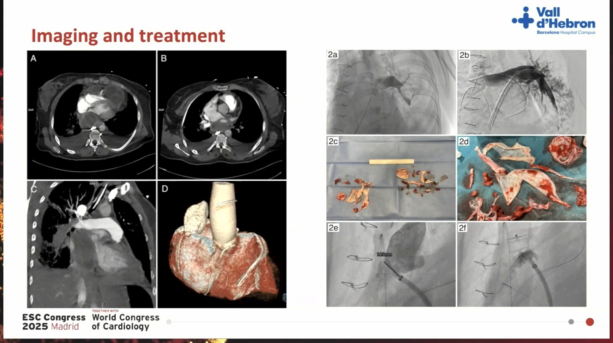

---

<!-- _class: opts -->

# 第 8 題：最可能的診斷是？

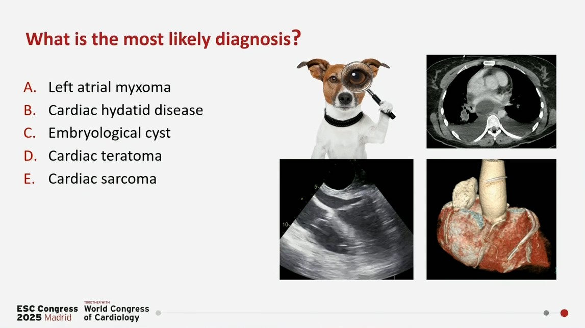

1. Left atrial myxoma
2. Cardiac hydatid disease
3. Embryological cyst
4. Cardiac teratoma
5. Cardiac sarcoma

---

<!-- _class: qhead -->

# 第 9 題
## LV apex under threat: thrombus, aneurysm, or rupture?

---

# 第 9 題：病史

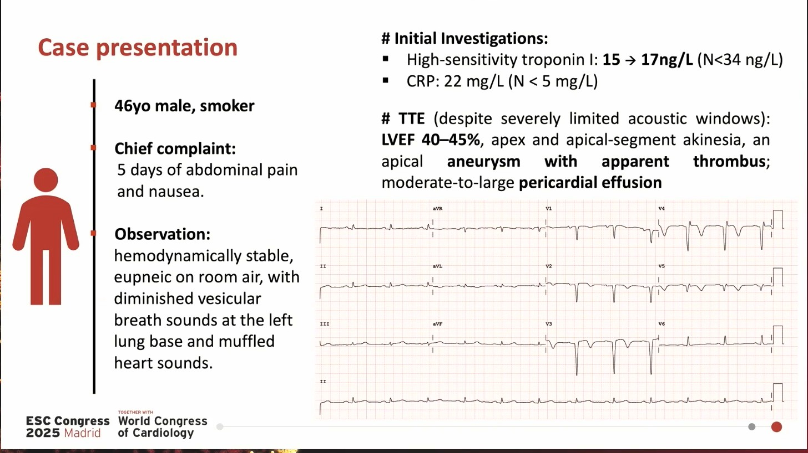

- 46 歲男性，吸菸
- **5 天腹痛與噁心**
- 血行動力穩定，左下肺呼吸音減弱，心音模糊
- hs-TnI 15 → 17 ng/L (正常 < 34)、CRP 22 mg/L
- TTE（聲窗極差）：LVEF 40 到 45%，心尖無動能，**心尖動脈瘤疑似血栓**，中到大量心包積液

---

# 第 9 題：Cardiac CT

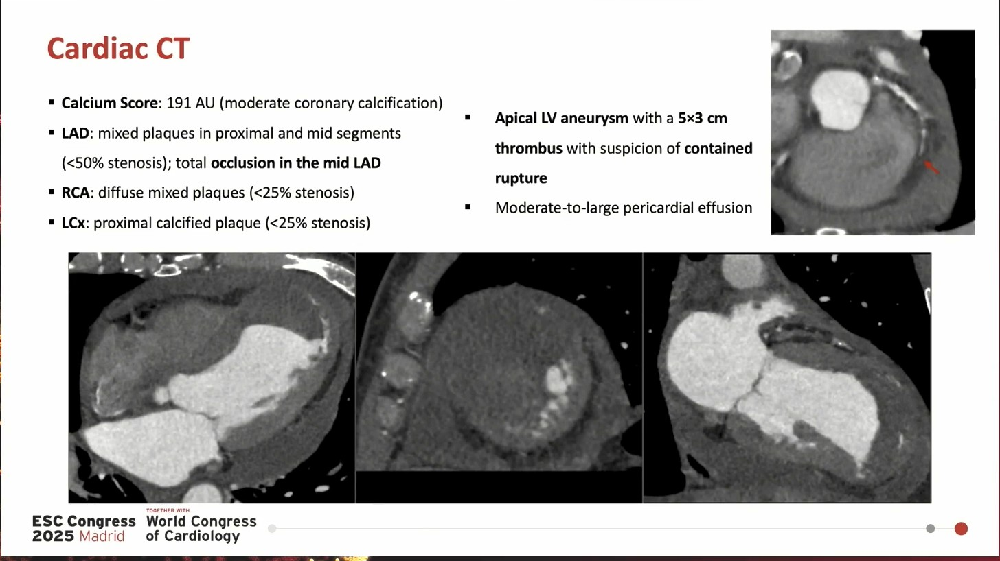

- 鈣化積分 191
- **LAD 中段完全阻塞**；其餘冠狀動脈輕度斑塊
- 心尖 LV 動脈瘤 5 × 3 cm，內有血栓
- **疑似侷限性破裂** (contained rupture)
- 中到大量心包積液

---

# 第 9 題：Cardiac MR

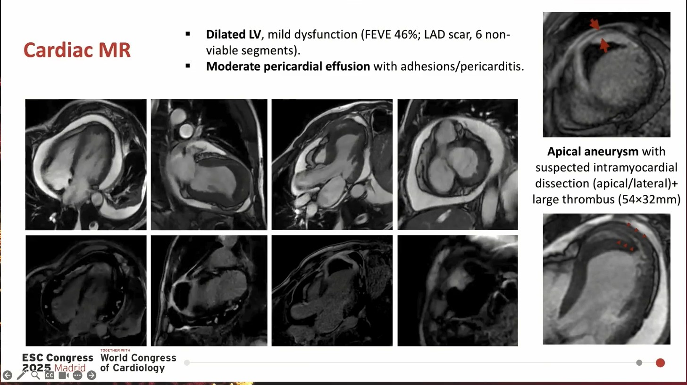

- LV 擴大，輕度功能下降 (EF 46%)
- LAD 區域疤痕，6 個無存活節段
- 中量心包積液，合併沾黏與心包炎
- 心尖動脈瘤，疑似**心肌內剝離**
- **大型血栓** 54 × 32 mm

---

<!-- _class: opts small -->

# 第 9 題：下一步最適當的處置是？

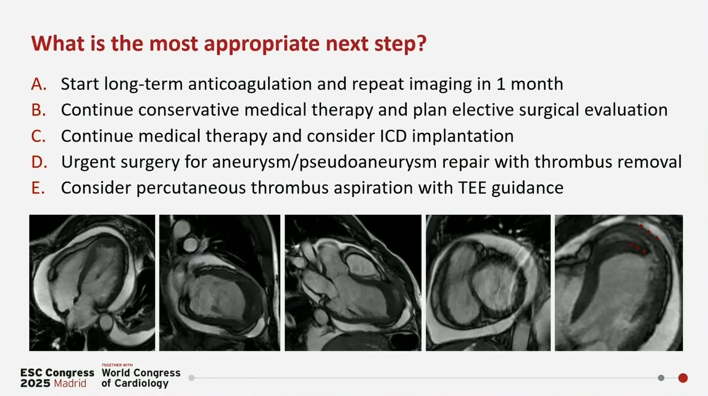

1. Start long-term anticoagulation and repeat imaging in 1 month
2. Continue conservative medical therapy and plan elective surgical evaluation
3. Continue medical therapy and consider ICD implantation
4. Urgent surgery for aneurysm/pseudoaneurysm repair with thrombus removal
5. Consider percutaneous thrombus aspiration with TEE guidance

---

<!-- _class: divider -->

# 解答與說明
## 先答完再翻頁

---

<!-- _class: opts -->

# 第 1 題解答：E

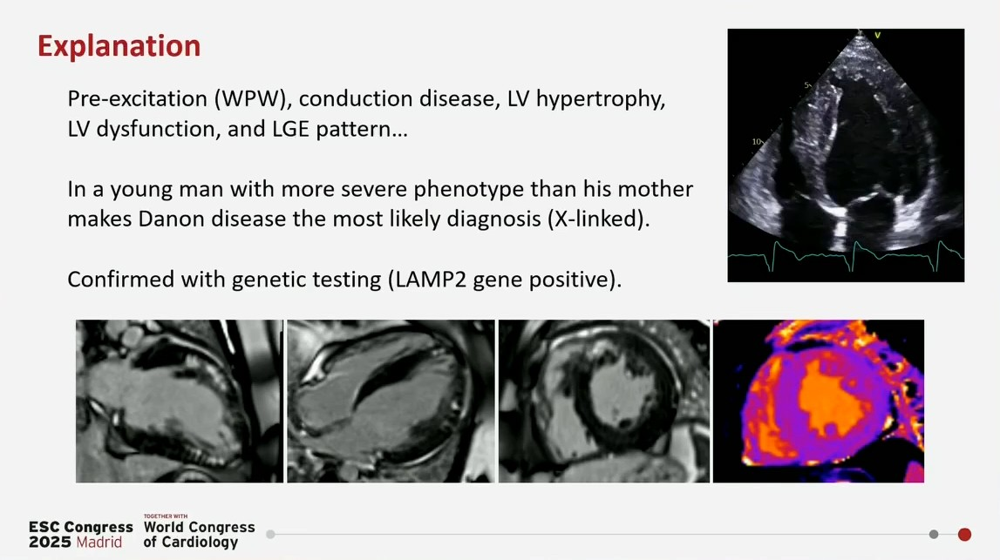

1. ATTR amyloid
2. Titin cardiomyopathy
3. HCM
4. Fabry's disease
5. **Danon disease**

現場答對率 **17%**（A 9%、B 6%、C 26%、**D 42%**）

---

# 第 1 題說明：Danon disease

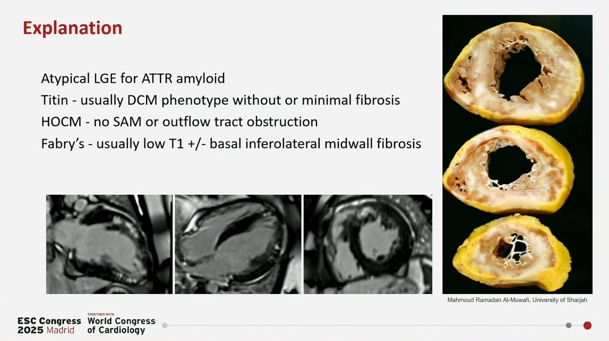

- 預激 (WPW)、傳導疾病、LVH、LV 功能下降，加上 LGE 型態
- 年輕男性的表現比母親更嚴重，符合 **X 性聯遺傳**
- 基因檢測證實：**LAMP2** 陽性
- 為什麼不是其他選項：
  - ATTR：LGE 型態不典型，年齡也不對
  - Titin：通常是 DCM，幾乎沒有纖維化
  - HCM：沒有 SAM 與流出道阻塞
  - Fabry：T1 通常**偏低**，纖維化在基底下側壁中層

---

<!-- _class: opts -->

# 第 2 題解答：A

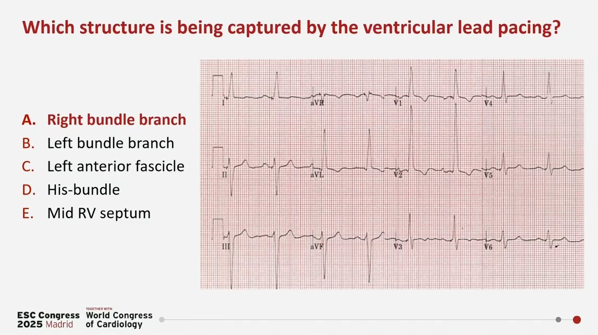

1. **Right bundle branch**
2. Left bundle branch
3. Left anterior fascicle
4. His-bundle
5. Mid RV septum

現場答對率：未公布

---

# 第 2 題說明：cc-TGA 的傳導系統

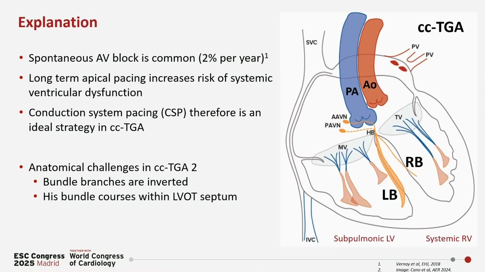

- cc-TGA 每年約 2% 自發性房室阻斷
- 長期心尖起搏會增加體循環心室功能惡化的風險
- 所以**傳導系統起搏** (CSP) 是理想策略
- 解剖挑戰：**左右束支相反**，His 束走在 LVOT 中隔內

---

# 第 2 題說明：為什麼是右束支

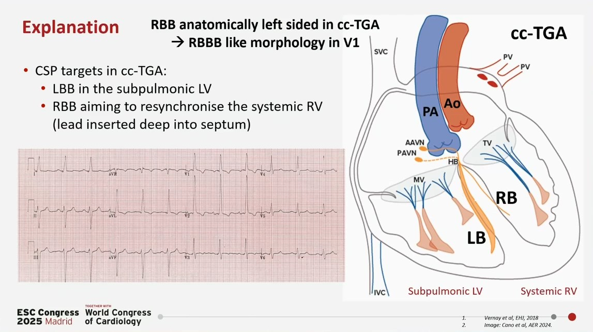

- cc-TGA 的 CSP 目標：
  - 左束支在**肺循環側的 LV**
  - **右束支**負責同步化**體循環 RV**，導線要深入中隔
- 右束支在 cc-TGA 位於解剖學左側
- 因此 V1 呈現 **RBBB 樣型態**

> 先想清楚「哪一個心室在打體循環」，再看起搏後的 V1。

---

<!-- _class: opts -->

# 第 3 題解答：D

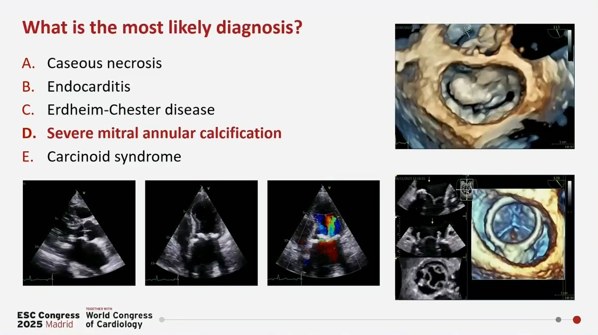

1. Caseous necrosis
2. Endocarditis
3. Erdheim-Chester disease
4. **Severe mitral annular calcification**
5. Carcinoid syndrome

現場答對率 **20%**（A 16%、B 11%、**C 41%**、E 11%）

---

# 第 3 題說明：嚴重 MAC

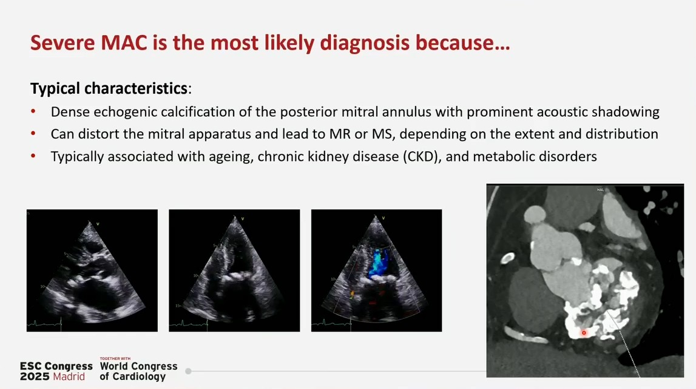

- 後側二尖瓣環緻密的回音性鈣化，合併明顯聲影
- 可扭曲二尖瓣結構，依範圍造成 MR 或 MS
- 典型族群：高齡、**慢性腎臟病**、代謝疾病
- 本例：狼瘡加 CKD，正是 MAC 的溫床

---

# 第 3 題說明：其他選項

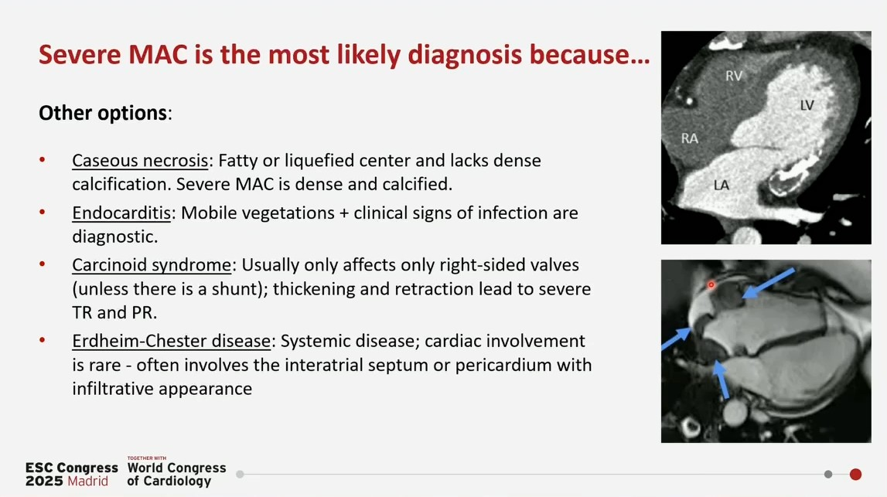

- **Caseous necrosis**：中心脂肪化或液化，鈣化較少；嚴重 MAC 是緻密鈣化
- **心內膜炎**：會動的贅生物，加上感染徵象
- **類癌症候群**：通常只侵犯右側瓣膜（除非有分流）
- **Erdheim-Chester**：全身性疾病；心臟侵犯罕見，常在房間隔或心包，呈浸潤狀

---

# 第 3 題說明：分級與經導管治療

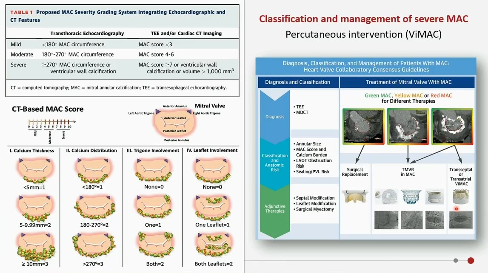

- 結合 echo 與 CT 的 MAC 嚴重度分級
- CT MAC score：鈣化厚度、分布、三角區侵犯、瓣葉侵犯
- 嚴重 MAC 的經導管選項：**ViMAC**（valve-in-MAC）

---

<!-- _class: opts -->

# 第 4 題解答：B

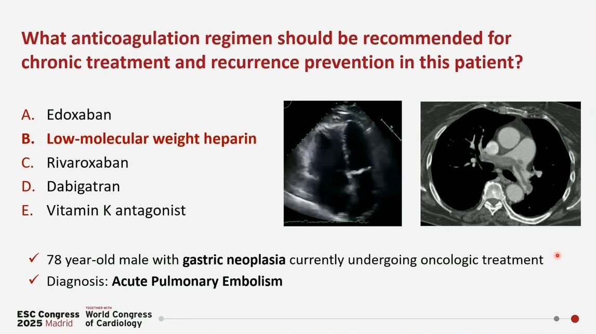

1. Edoxaban
2. **Low-molecular weight heparin**
3. Rivaroxaban
4. Dabigatran
5. Vitamin K antagonist

現場答對率 **41%**（A 14%、C 26%、D 9%、E 9%）

---

# 第 4 題說明：癌症病人的 PE

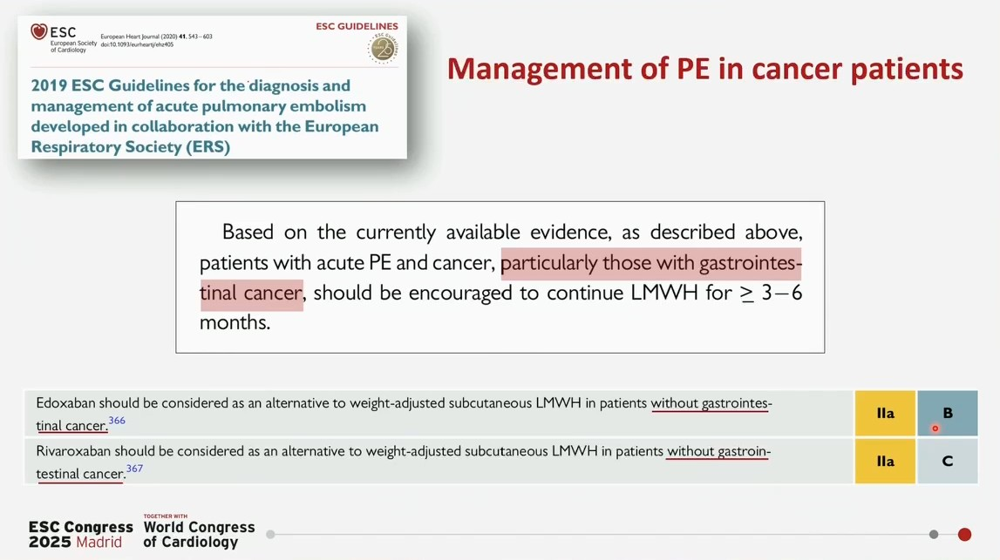

- 2019 ESC 肺栓塞指引：癌症合併急性 PE，**特別是腸胃道癌症**，建議持續 LMWH 至少 3 到 6 個月
- Edoxaban 或 rivaroxaban 可作為替代，但限於**沒有腸胃道癌症**的病人 (IIa)
- 原因：腸胃道癌症用 DOAC 的出血風險較高

> 「癌症 PE 用 DOAC」已是常態，但胃癌是例外。

---

<!-- _class: opts -->

# 第 5 題解答：D

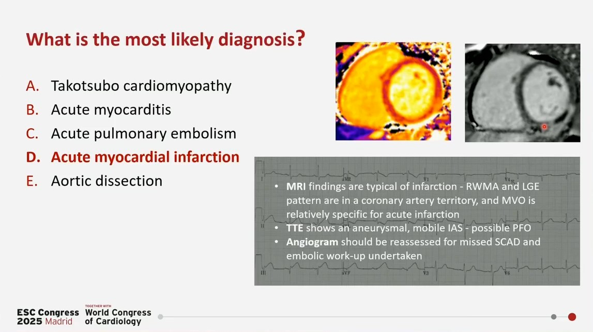

1. Takotsubo cardiomyopathy
2. Acute myocarditis
3. Acute pulmonary embolism
4. **Acute myocardial infarction**
5. Aortic dissection

現場答對率 **51%**（A 12%、**B 30%**、C 5%、E 1%）

---

# 第 5 題說明：冠狀動脈正常的 MI

- CMR 是典型梗塞：室壁運動異常與 LGE 落在**單一冠狀動脈分布區**
- 近乎穿壁的 LGE 加上 **MVO**，對急性梗塞相當特異
- Echo 看到瘤樣會晃動的房間隔：可能有 **PFO**
- 下一步：重看冠狀動脈攝影，找**漏看的 SCAD**；並做**栓塞來源**檢查

> MINOCA 是工作診斷，不是最終診斷。CMR 決定下一步往哪裡走。

---

<!-- _class: opts -->

# 第 6 題解答：D

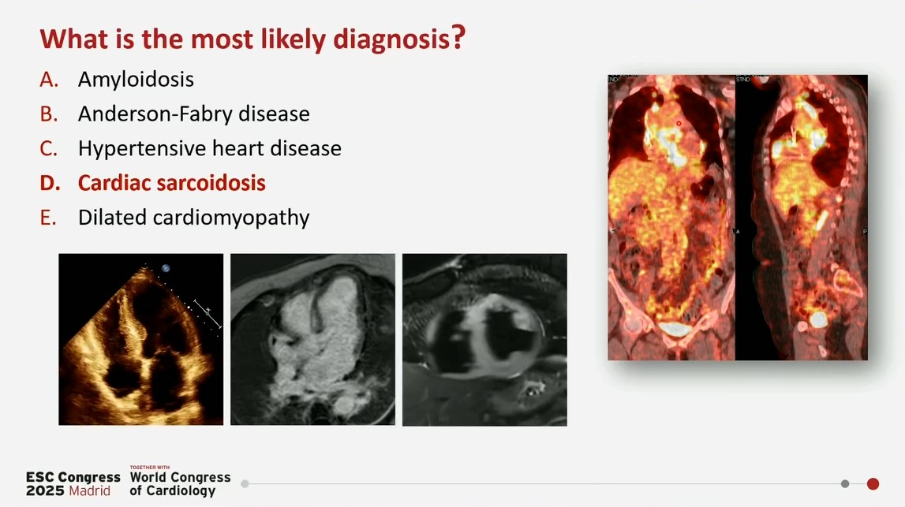

1. Amyloidosis
2. Anderson-Fabry disease
3. Hypertensive heart disease
4. **Cardiac sarcoidosis**
5. Dilated cardiomyopathy

現場答對率 **71%**（A 15%、B 14%、C 0%、E 0%）

---

# 第 6 題說明：活動期心臟類肉瘤病

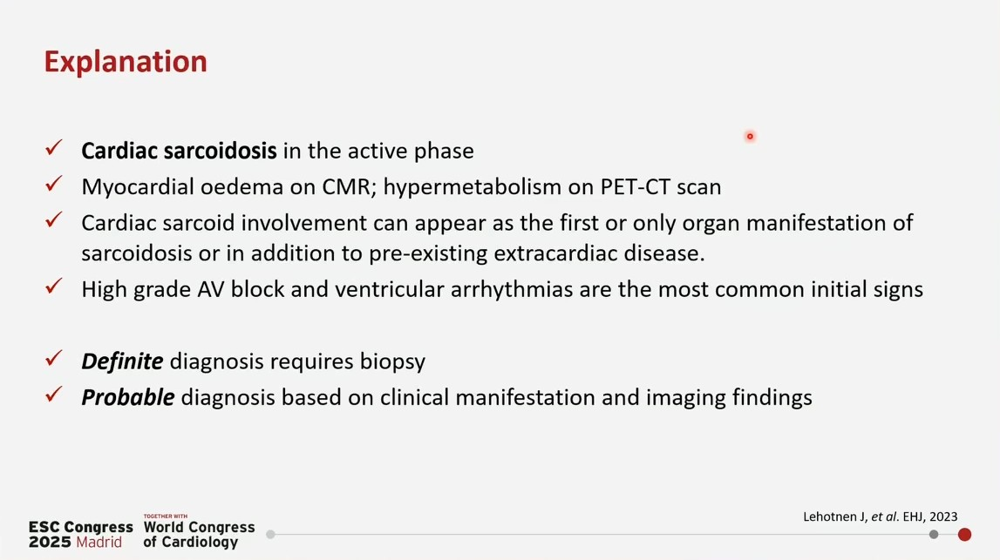

- CMR 心肌水腫，PET-CT 高代謝：**活動期**
- 心臟可以是**第一個或唯一**的侵犯器官
- 最常見的首發表現：**高度房室阻斷**與心室心律不整
- **確定**診斷需要切片；**可能**診斷靠臨床表現加影像
- 參考：Lehtonen J, et al. EHJ 2023

---

<!-- _class: opts small -->

# 第 7 題解答：D

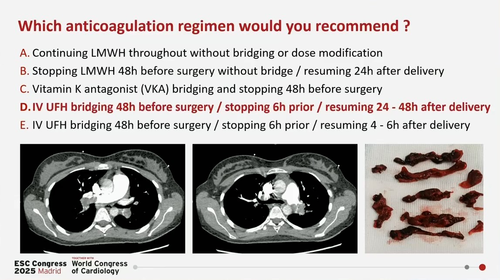

1. Continuing LMWH throughout
2. Stopping LMWH 48 h before, no bridge
3. VKA bridging
4. **IV UFH bridging 48 h before surgery, stopping 6 h prior, resuming 24 to 48 h after delivery**
5. IV UFH bridging, resuming 4 to 6 h after delivery

現場答對率 **25%**（A 14%、B 13%、C 8%、**E 39%**）

---

# 第 7 題說明：2025 ESC 懷孕指引

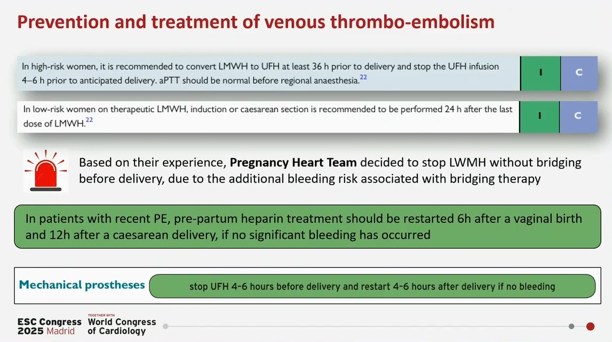

- **高風險**孕婦：分娩前至少 36 小時把 LMWH 換成 UFH，預定分娩前 4 到 6 小時停 UFH；區域麻醉前 aPTT 要正常 (I C)
- 低風險、治療劑量 LMWH：最後一劑後 24 小時再引產或剖腹 (I C)
- 近期 PE：產後若無明顯出血，陰道產 6 小時、剖腹產 12 小時後恢復肝素
- 實際上，Pregnancy Heart Team 考量橋接的出血風險，選擇**停 LMWH 不橋接**

---

# 第 7 題說明：產後

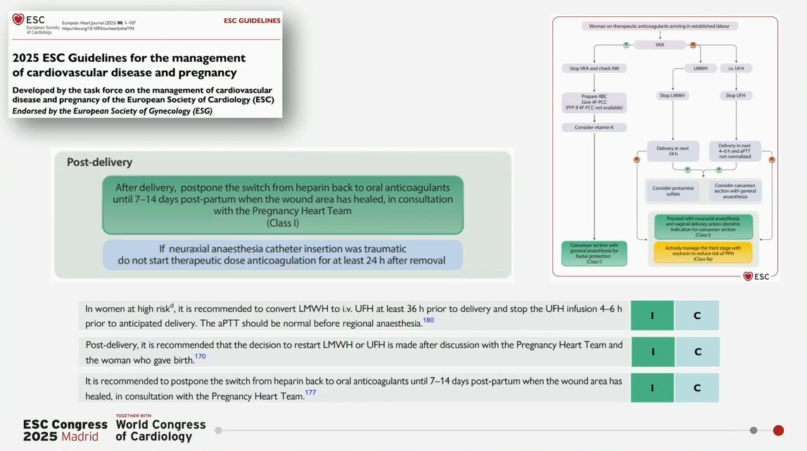

- 產後延後換成口服抗凝血，等傷口癒合後再換
- 時機與 Pregnancy Heart Team 討論
- 評審補充：指引寫的是分娩前 **36 小時**換 UFH，不是 48 小時，嚴格說五個選項都不完全對；依題目選項給 D
- 本例的教學點：指引是起點，出血與血栓風險要一起放上天平

---

<!-- _class: opts -->

# 第 8 題解答：B

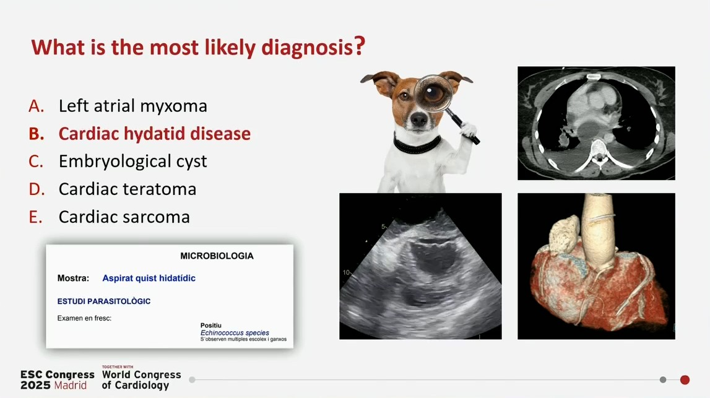

1. Left atrial myxoma
2. **Cardiac hydatid disease**
3. Embryological cyst
4. Cardiac teratoma
5. Cardiac sarcoma

現場答對率：未公布

---

# 第 8 題說明：心臟包蟲病

- 流行病學線索：與家畜**密切長期接觸**
- 罕見，但可在心內形成大型囊腫，典型在**左心房**
- 囊腫破裂可造成**栓塞**、過敏性休克或心包填塞
- 抽吸物的微生物檢查證實 *Echinococcus*
- 其他選項：myxoma 是實心且會動；胚胎性囊腫少見於 LA 且多無症狀；畸胎瘤多見於嬰兒

---

<!-- _class: opts small -->

# 第 9 題解答：D

1. Long-term anticoagulation, repeat imaging
2. Conservative therapy, elective surgery
3. Medical therapy, consider ICD
4. **Urgent surgery for aneurysm/pseudoaneurysm repair with thrombus removal**
5. Percutaneous thrombus aspiration

現場答對率 **71%**（A 11%、B 14%、C 5%、E 0%）

---

# 第 9 題說明：侷限性 LV 破裂

- **侷限性 LV 破裂或急性假性動脈瘤**是外科急症
- ESC 2023 ACS 與 2017 STEMI 指引：懷疑破裂時，即使影像未確定，也應**儘速手術** (I C)
- 大型會動的血栓：栓塞與破裂風險高，同一手術一併**取栓** (IIa)
- 經皮抽吸技術上可行，但組織脆弱、可能已破裂，**不是第一線**

> 腹痛五天、troponin 幾乎正常，仍可能是一顆快破的心臟。

---

# 計分表

| 題 | 答案 | 現場答對率 | 題 | 答案 | 現場答對率 |
|---|---|---|---|---|---|
| 1 | E | 17% | 6 | D | 71% |
| 2 | A | 未公布 | 7 | D | 25% |
| 3 | D | 20% | 8 | B | 未公布 |
| 4 | B | 41% | 9 | D | 71% |
| 5 | D | 51% | | | |

- 7 到 9 題：可以上台當評審了
- 4 到 6 題：與 Madrid 現場聽眾相當
- 3 題以下：沒關係，第 1、3、7 題多數人都選錯

---

<!-- _class: small -->

# 來源與致謝

- **原始節目**：The ESC Grand Summer Quiz, ESC Congress 2025, Madrid, 2025-08-29。主持 Mark Westwood (UK)、John-Paul Carpenter (IE)；評審團 Sarah Moharem Elgamal、Filip Zemrak、Omar Chehab、Holly Morgan。[ESC 365 Session 50234](https://esc365.escardio.org/session/50234)
- **病例投稿者**：R. Gray 與 J. Lushington (Barts Heart Centre)、K. Rausch (Toowoomba Hospital)、M. S. Ceballos 與 F. González-Santórum (Vall d'Hebron)、L. Cotrim 與 A. B. Carvalho (Vila Franca de Xira)、S. Latrofa (Pisa)、L. Perrard (Lariboisière & Amiens)
- **影像**：截自 ESC TV 轉播畫面（僅取投影片區域），版權屬 ESC 與各投稿者，僅供院內教學使用
- **參考**：2019 ESC 肺栓塞指引；2025 ESC 懷孕心血管疾病指引；2023 ESC ACS 指引；Lehtonen J, et al. EHJ 2023（心臟類肉瘤病）
- 本測驗為教學整理，題目與選項依原節目，中文說明為整理者所加

---

<!-- _class: end -->
<!-- _paginate: false -->

# 謝謝參與
## 答案請勿外流給還沒玩的同事

謝慕揚 MD, PhD, FESC
