<!-- _class: cover -->
<!-- _paginate: false -->

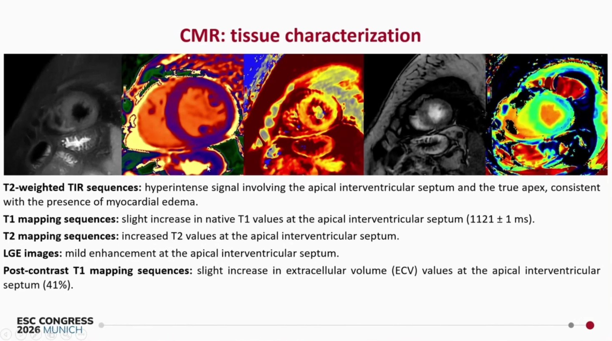

# ESC 2026 Grand Bavarian Quiz

## 六題心臟科臨床案例測驗（附解答）

**整理：謝慕揚 MD, PhD, FESC**
來源：ESC Congress 2026, Munich, 2026-08-28
Session 55619「The ESC Grand Bavarian Quiz」
主持：Mark Westwood、John-Paul Carpenter
[ESC 365 原始影片](https://esc365.escardio.org/session/55619)

---

# 玩法說明

- 共 **6 題**，每題一個真實病例，由 Young ESC Community 的年輕醫師投稿
- 先看病史與影像，再從 A 到 E 選一個答案；先不要翻到後半部的解答
- 解答附當天現場（Mentimeter）的答對比例
- 影像截自 ESC TV 轉播畫面，只取投影片本身
- 今年六題全是**影像判讀**：echo、CT、CMR、PET 輪番上陣

> 今年現場答對率最高也只有三成。題目不難，難在「看到了卻沒想到」。

---

# 題目總覽

| 題 | 主題 | 投稿者 |
|---|---|---|
| 1 | PCI 後胸痛 | A. Apostolos（Royal Brompton，London） |
| 2 | 主動脈根部手術後胸痛 | A. Boulmpou（Radboud，Nijmegen） |
| 3 | 異常增厚的心室 | F. Abadie（Lariboisière，Paris） |
| 4 | 不正常的 ECG | K. Bitos（Zurich） |
| 5 | 倦怠、發燒與胸痛 | A. van Rosendael（UMC Utrecht） |
| 6 | 胸痛與急性 LV 功能異常 | D. Junod、R. Maragna（Monzino，Milan） |

---

<!-- _class: qhead -->

# 第 1 題
## Chest pain post PCI

---

# 第 1 題：病史

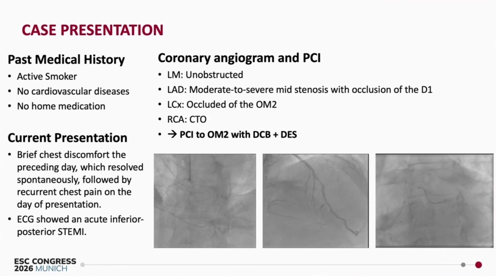

- 58 歲男性，吸菸，無其他病史
- 前一天短暫胸悶後自行緩解，當天再度胸痛
- ECG：急性**下後壁 STEMI**
- 冠狀動脈攝影：LAD 中段中重度狹窄合併 D1 阻塞、OM2 阻塞、**RCA CTO**
- 對 OM2 做 PCI（DCB + DES），過程順利

---

<!-- _class: fig -->

# 第 1 題：PCI 後的心臟超音波

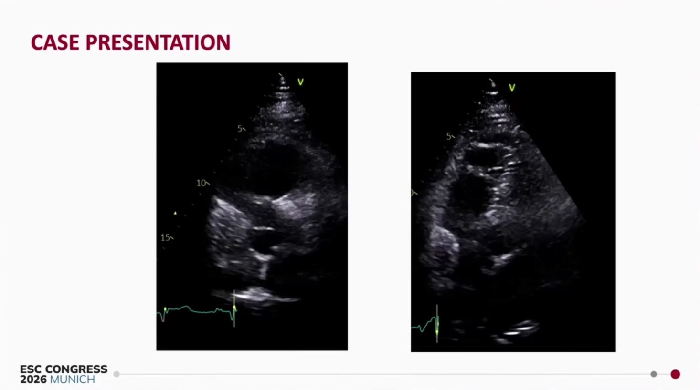

---

# 第 1 題：三尖瓣 Doppler

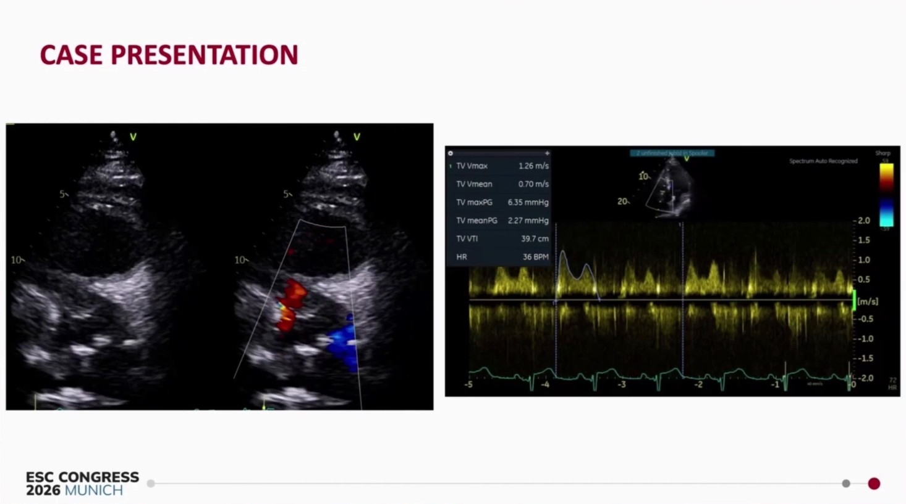

- 右心房層面看到一個團塊
- 三尖瓣血流加速：Vmax 1.26 m/s
- mean PG 2.27 mmHg

---

<!-- _class: opts -->

# 第 1 題：最可能的診斷是？

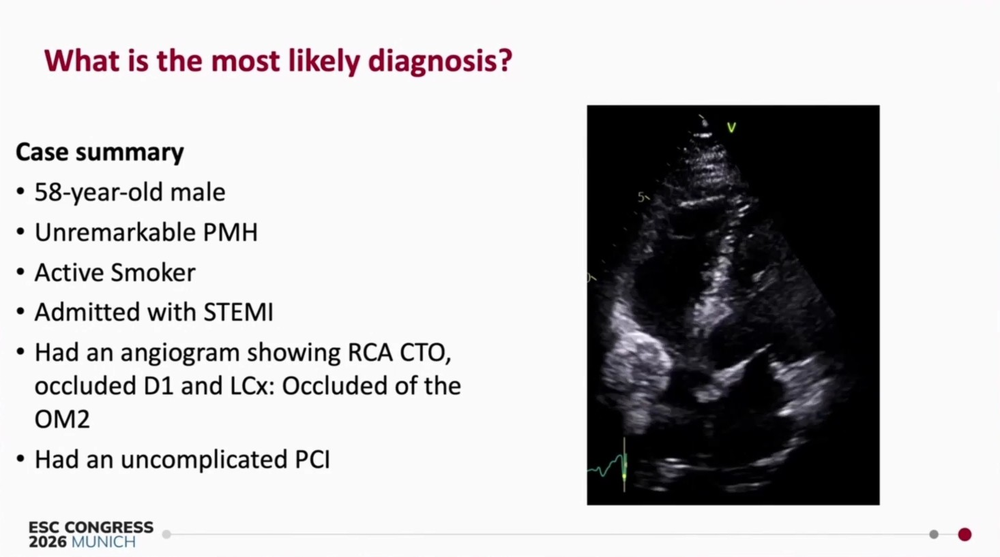

1. Isolated cardiac lymphoma
2. Tricuspid stenosis
3. Membranous VSD
4. Haematoma
5. Cor triatriatum dexter

---

<!-- _class: qhead -->

# 第 2 題
## Chest pain after surgery

---

# 第 2 題：病史

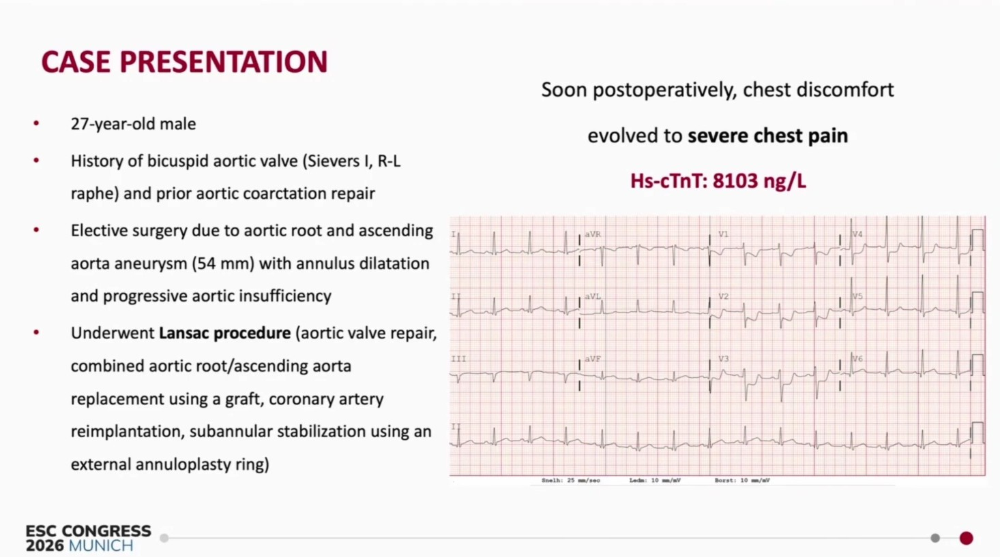

- 27 歲男性；二葉式主動脈瓣（Sievers I，R-L raphe），曾修補主動脈縮窄
- 主動脈根部與升主動脈瘤 54 mm，合併瓣環擴大與漸進性 AR
- 接受 **Lansac 手術**：主動脈瓣修補、人工血管置換根部與升主動脈、**冠狀動脈再植入**、外置瓣環成形環
- 術後不久胸悶，進展為劇烈胸痛
- **hs-cTnT 8103 ng/L**

---

# 第 2 題：初步檢查

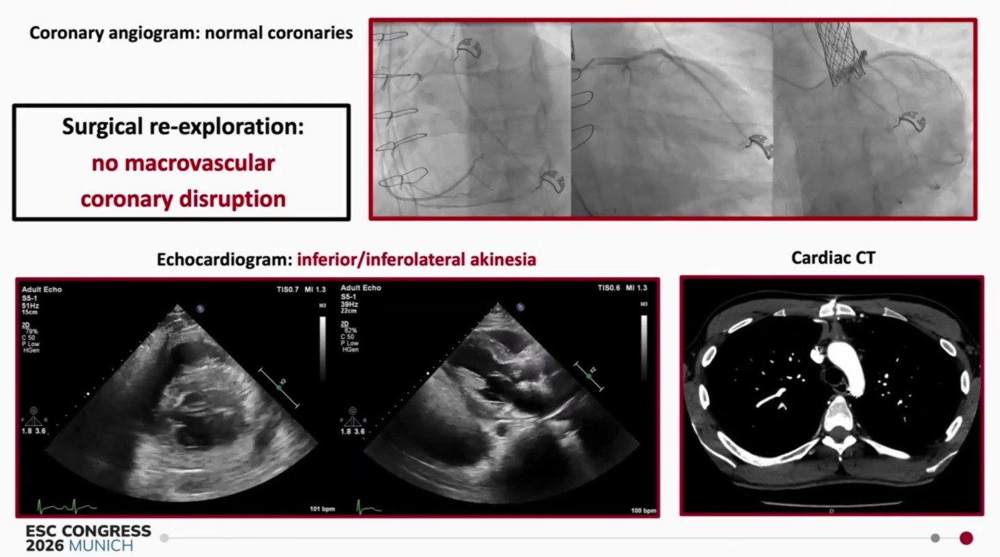

- 冠狀動脈攝影：**正常**
- 回開刀房探查：**無**巨觀的冠狀動脈中斷
- Echo：下壁與下側壁**無動能**
- Cardiac CT 如右圖

---

<!-- _class: fig -->

# 第 2 題：Cardiac MRI（一）

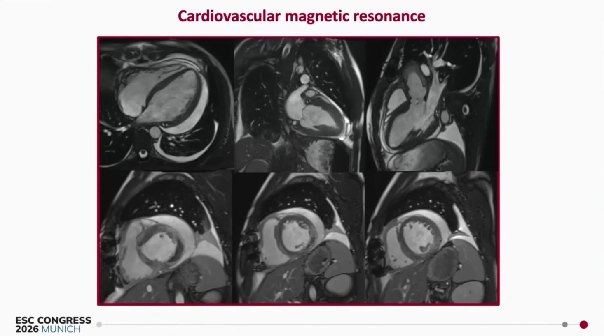

---

<!-- _class: fig -->

# 第 2 題：Cardiac MRI（二）

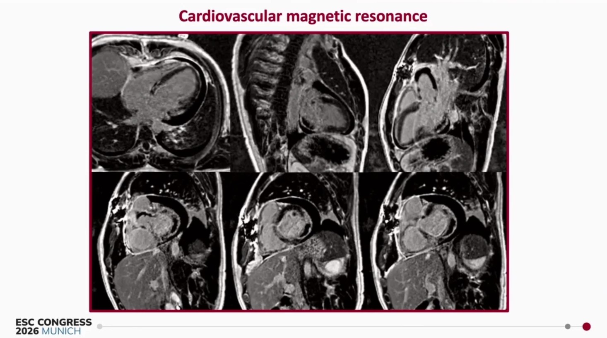

---

<!-- _class: opts -->

# 第 2 題：最可能的診斷是？

1. Acute myocardial rupture with contained pseudoaneurysm
2. Left ventricular mural thrombus
3. Acute myocardial infarction with microvascular obstruction
4. Acute post-operative myopericarditis
5. Artefact from the annuloplasty ring

---

<!-- _class: qhead -->

# 第 3 題
## An abnormally thickened ventricle

---

# 第 3 題：病史

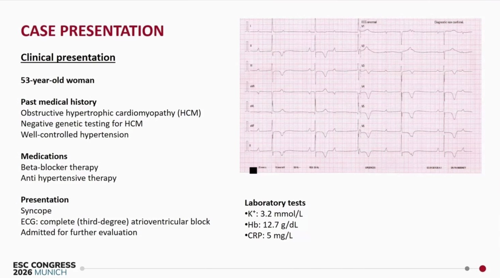

- 53 歲女性
- 已知**阻塞性 HCM**，但**基因檢測陰性**；高血壓控制良好
- 用藥：beta-blocker、降壓藥
- 這次因**暈厥**就醫，ECG：**完全房室阻斷**
- K 3.2 mmol/L、Hb 12.7 g/dL、CRP 5 mg/L

---

# 第 3 題：多模態影像

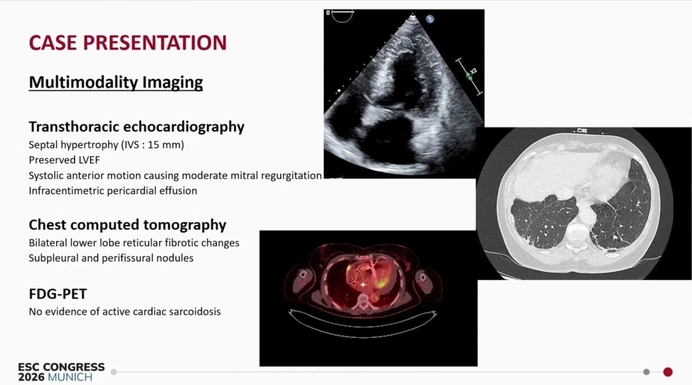

- TTE：中隔肥厚 (IVS 15 mm)，LVEF 保留；SAM 合併中度 MR；少量心包積液
- 胸部 CT：兩側下葉網狀纖維化；胸膜下與葉間裂旁結節
- FDG-PET：**沒有**活動性心臟類肉瘤病的證據

---

<!-- _class: opts -->

# 第 3 題：最可能的診斷是？

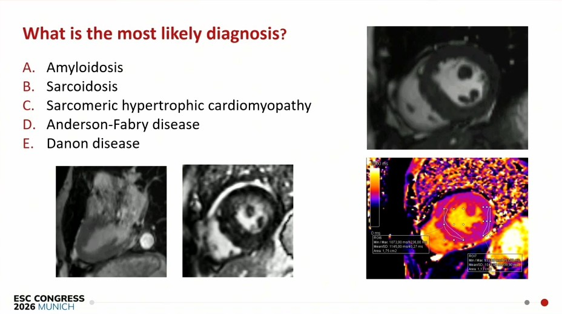

1. Amyloidosis
2. Sarcoidosis
3. Sarcomeric hypertrophic cardiomyopathy
4. Anderson-Fabry disease
5. Danon disease

---

<!-- _class: qhead -->

# 第 4 題
## An abnormal ECG

---

# 第 4 題：病史

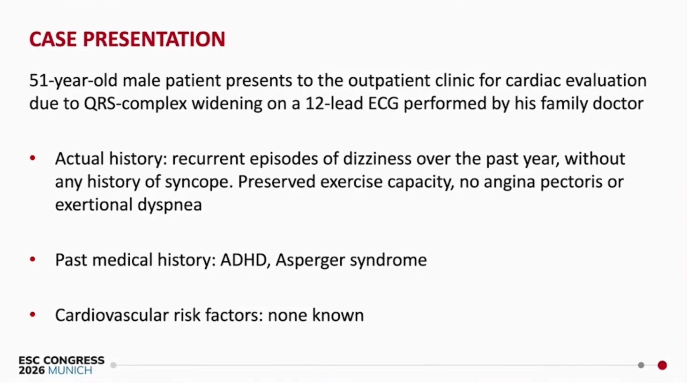

- 51 歲男性，家醫科 ECG 發現 **QRS 變寬**，轉介門診
- 過去一年反覆頭暈，**無暈厥**
- 運動耐受正常，無心絞痛、無活動喘
- 病史：ADHD、Asperger 症候群；無心血管危險因子
- 無家族史，無用藥

---

<!-- _class: fig -->

# 第 4 題：12 導程 ECG

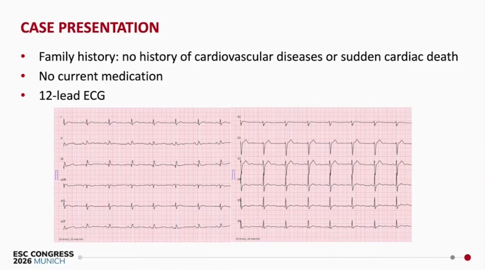

---

<!-- _class: fig -->

# 第 4 題：心臟超音波

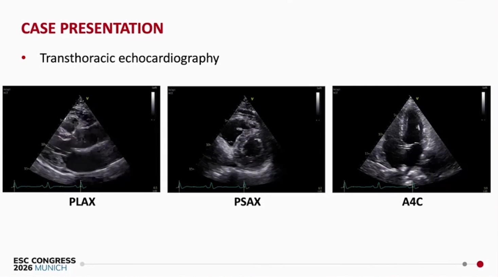

*PLAX、PSAX、A4C。仔細看房室溝。*

---

<!-- _class: opts -->

# 第 4 題：下一步最適當的檢查是？

1. Patient reassurance, no further work-up needed
2. Exercise ECG test
3. Coronary computed tomography angiography
4. FDG-PET/CT
5. PET/CT myocardial perfusion imaging using a vasodilator

---

<!-- _class: qhead -->

# 第 5 題
## Malaise, fever and chest pain

---

# 第 5 題：病史

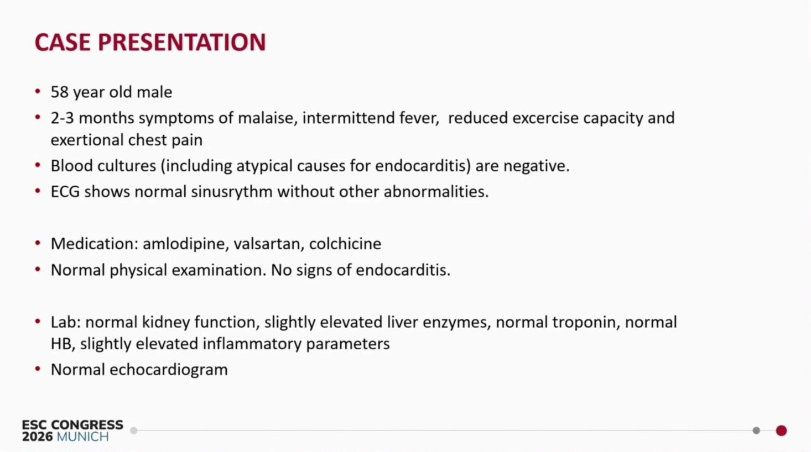

- 58 歲男性
- 2 到 3 個月的倦怠、間歇性發燒、運動耐受下降、**活動性胸痛**
- 血液培養（含非典型病原）**陰性**
- ECG 正常竇性節律；身體檢查無心內膜炎徵象
- 肝指數輕微上升，發炎指數輕微上升；troponin、腎功能正常
- 心臟超音波正常
- 用藥：amlodipine、valsartan、colchicine

---

<!-- _class: fig -->

# 第 5 題：CT 與 FDG PET-CT

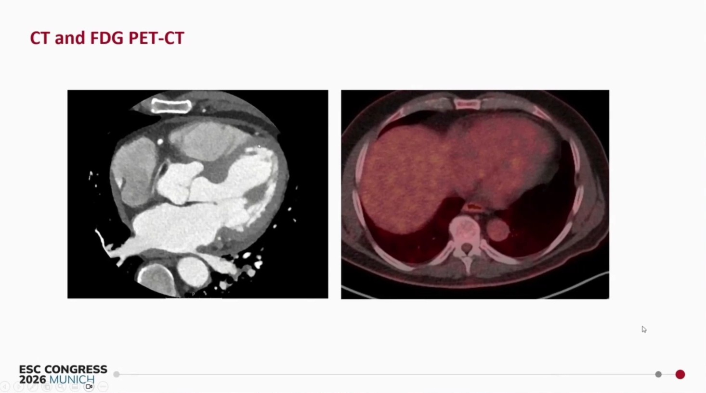

---

<!-- _class: fig -->

# 第 5 題：Cardiac CT

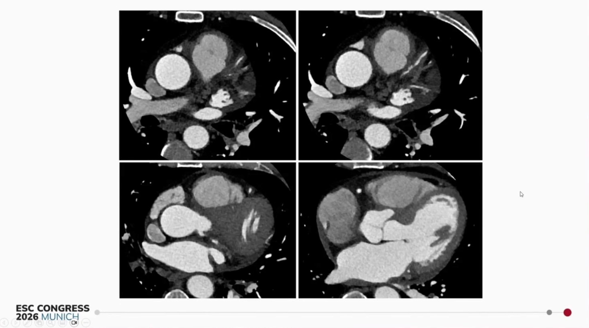

---

<!-- _class: opts -->

# 第 5 題：哪個結構最能幫助診斷？

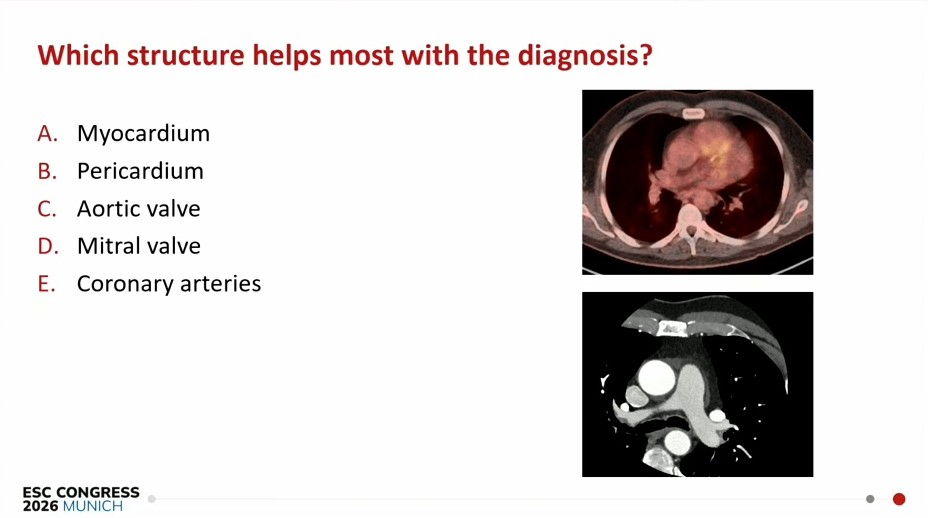

1. Myocardium
2. Pericardium
3. Aortic valve
4. Mitral valve
5. Coronary arteries

---

<!-- _class: qhead -->

# 第 6 題
## Chest pain and acute LV dysfunction

---

# 第 6 題：前兩次發作

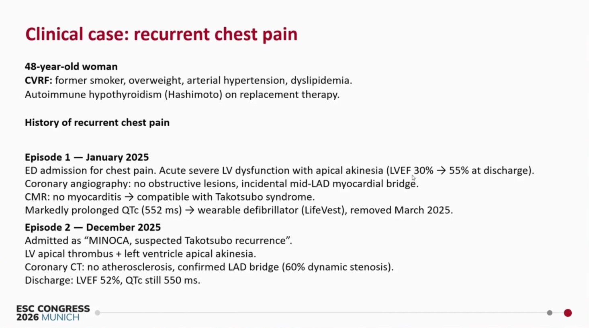

- 48 歲女性；曾吸菸、過重、高血壓、高血脂；橋本氏甲狀腺炎
- **2025 年 1 月**：急性嚴重 LV 功能異常、心尖無動能 (LVEF 30% → 55%)；冠狀動脈無阻塞，LAD 中段心肌橋；CMR 無心肌炎，判定 **Takotsubo**；QTc 552 ms，穿戴式去顫器
- **2025 年 12 月**：以「MINOCA，疑 Takotsubo 復發」住院；**LV 心尖血栓**；CT 無動脈硬化，LAD 心肌橋動態狹窄 60%

---

# 第 6 題：第三次發作

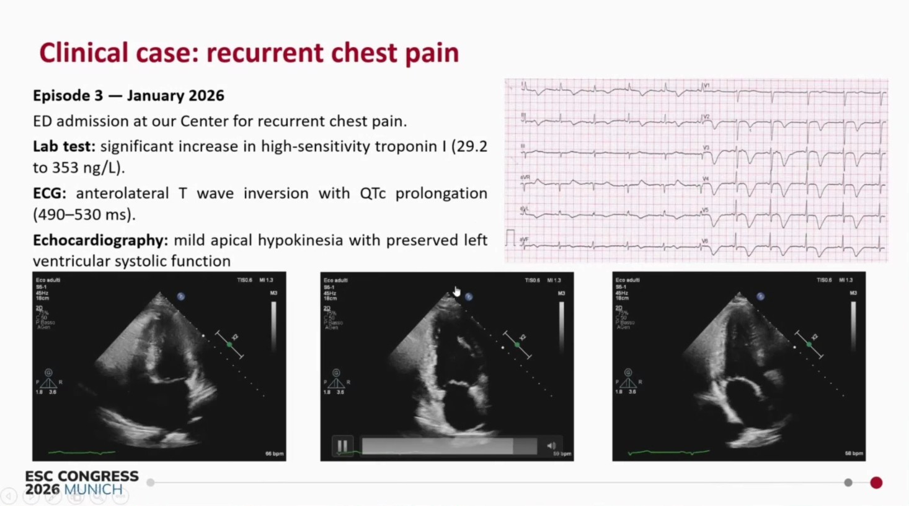

- **2026 年 1 月**：反覆胸痛到急診
- hs-TnI 29.2 → 353 ng/L
- ECG：前側壁 T 波倒置，QTc 490 到 530 ms
- Echo：輕度心尖運動低下，整體收縮功能保留

---

# 第 6 題：CMR 與 CCT

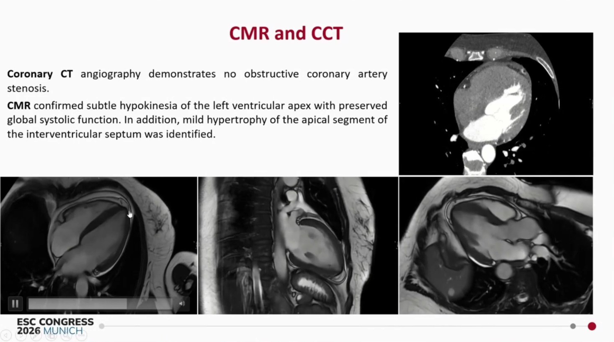

- Coronary CT：無阻塞性病變
- CMR：心尖輕度運動低下，整體收縮保留
- 中隔心尖段輕度肥厚

---

# 第 6 題：CMR 組織特性

- T2 TIR：中隔心尖段與真心尖**高訊號**，代表水腫
- Native T1 輕度上升 (1121 ms)；T2 mapping 上升
- LGE：中隔心尖段**輕微**顯影
- ECV 41%

---

<!-- _class: opts -->

# 第 6 題：最可能的診斷是？

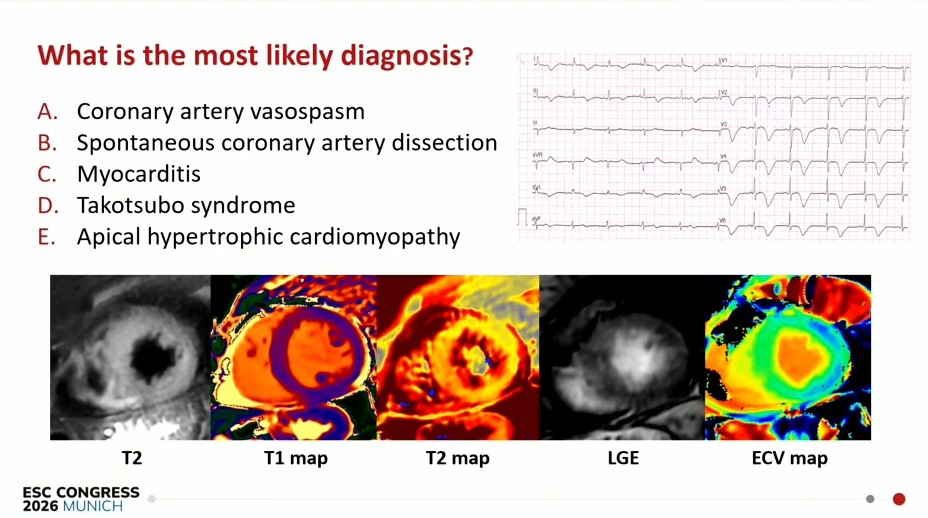

1. Coronary artery vasospasm
2. Spontaneous coronary artery dissection
3. Myocarditis
4. Takotsubo syndrome
5. Apical hypertrophic cardiomyopathy

---

<!-- _class: divider -->

# 解答與說明
## 先答完再翻頁

---

<!-- _class: opts -->

# 第 1 題解答：D

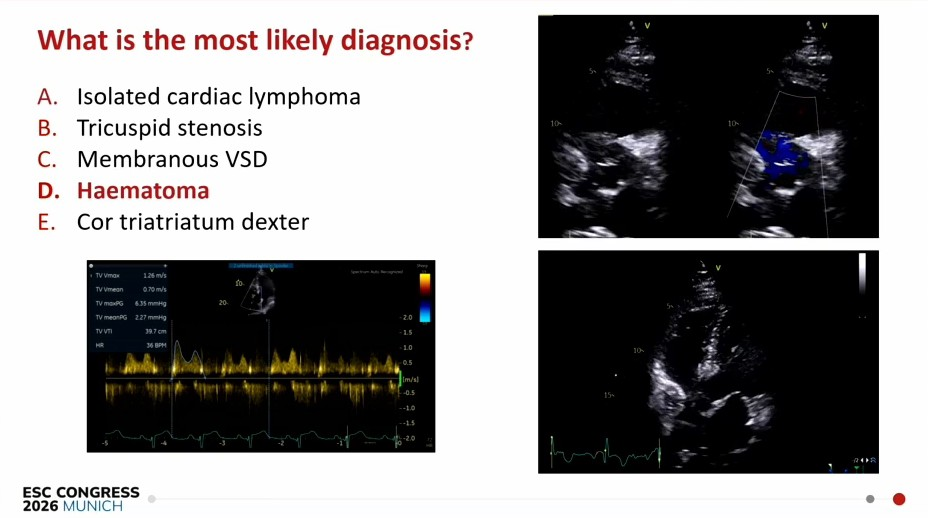

1. Isolated cardiac lymphoma
2. Tricuspid stenosis
3. Membranous VSD
4. **Haematoma**
5. Cor triatriatum dexter

現場答對率：未公布

---

# 第 1 題說明：PCI 後的冠狀動脈穿孔

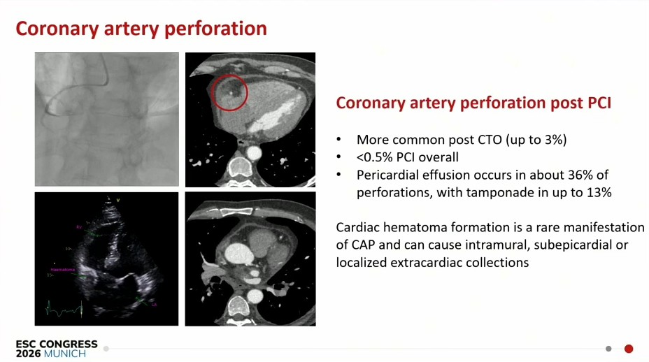

- 沒給你看的是 RCA 的 PCI 影像：**顯影劑外滲**，CT 也看到 RCA 旁的顯影劑暈染
- Echo 上的團塊是 RCA 周圍的**血腫**，壓迫造成三尖瓣流入受阻，RV 收縮變差
- 冠狀動脈穿孔：CTO 介入可達 3%，整體 PCI < 0.5%
- 約 36% 的穿孔出現心包積液，最多 13% 進展為填塞
- 心臟血腫是罕見表現：心肌內、心外膜下，或局部心外集聚

---

# 第 1 題說明：兩個月後

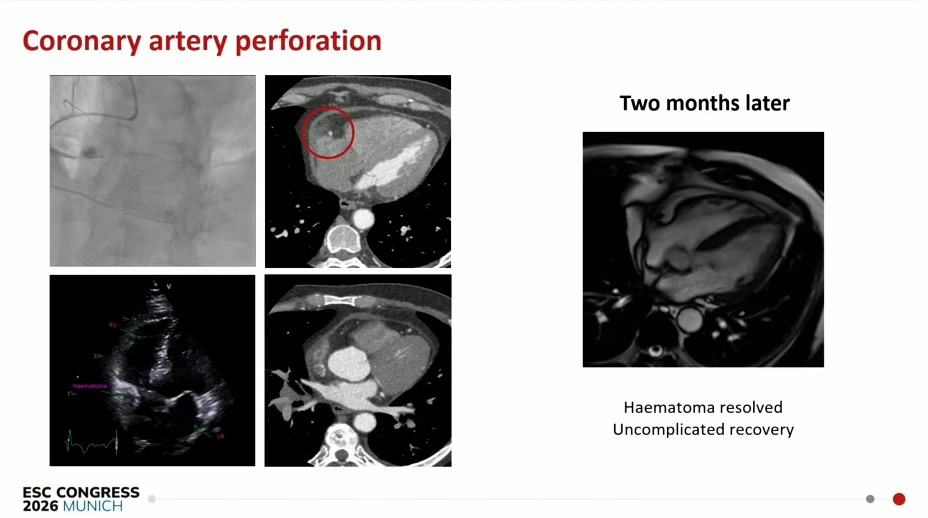

- 兩個月後 CMR：血腫已吸收
- 病人恢復順利

> 評審 Luna Gargani 的提醒：只要可以，血管再通後第一天就做一次 echo，早期抓到併發症。

---

<!-- _class: opts -->

# 第 2 題解答：C

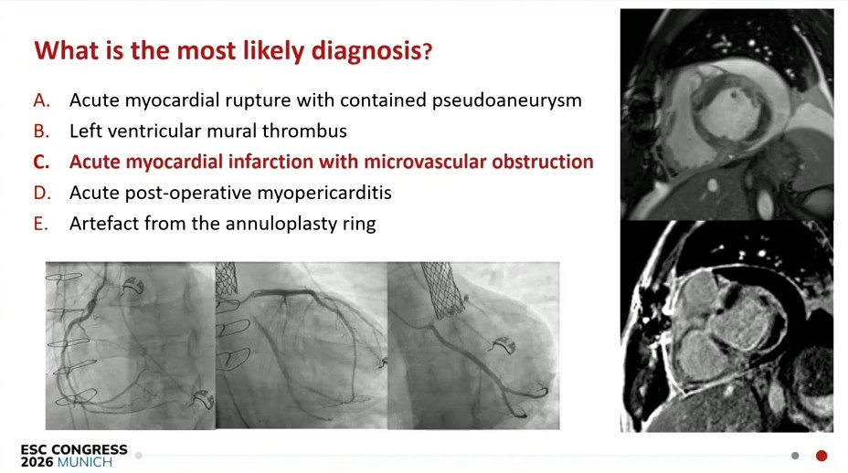

1. Acute myocardial rupture with contained pseudoaneurysm
2. Left ventricular mural thrombus
3. **Acute myocardial infarction with microvascular obstruction**
4. Acute post-operative myopericarditis
5. Artefact from the annuloplasty ring

現場答對率 **30%**（A 29%、B 7%、**D 33%**、E 1%）

---

# 第 2 題說明：根部手術後的 MI

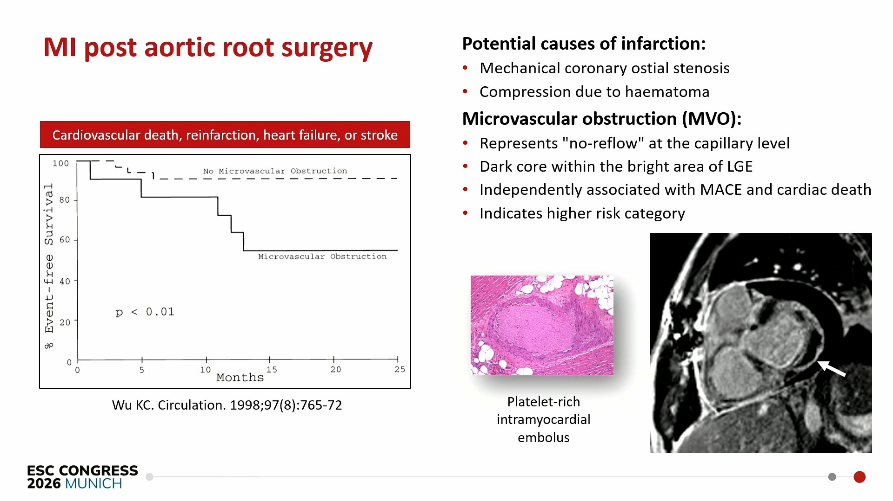

- 可能原因：冠狀動脈開口狹窄、血腫壓迫
- 本例探查無巨觀中斷；病理顯示**富含血小板的心肌內栓子**
- **微血管阻塞** (MVO)：LGE 亮區中央的**暗核**，即 no-reflow
- MVO 與 MACE 和心臟死亡獨立相關，是高風險指標（Wu KC, Circulation 1998）

> 冠狀動脈攝影正常，不代表心肌沒有梗塞。

---

<!-- _class: opts -->

# 第 3 題解答：B

1. Amyloidosis
2. **Sarcoidosis**
3. Sarcomeric hypertrophic cardiomyopathy
4. Anderson-Fabry disease
5. Danon disease

現場答對率 **25%**（A 12%、C 20%、**D 33%**、E 10%）

---

# 第 3 題說明：心臟類肉瘤病

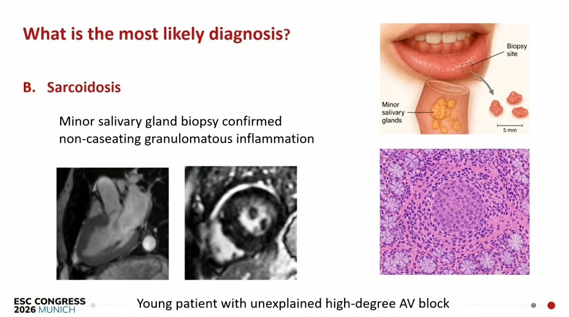

- **小唾液腺切片**證實非乾酪性肉芽腫發炎
- 線索：基因陰性的「HCM」、肺部纖維化與淋巴周邊結節、**不明原因的高度房室阻斷**
- FDG-PET 陰性不能排除：可能處於非活動期
- 多數聽眾選 Fabry：同樣有肥厚與傳導異常，但本例肺部表現指向類肉瘤

> 年輕病人出現不明原因的高度房室阻斷，先想類肉瘤病。

---

# 第 3 題說明：診斷流程與預後

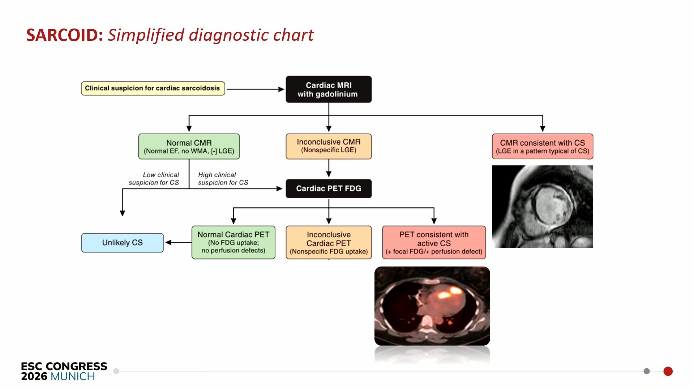

- 臨床懷疑 → 含 gadolinium 的 CMR
- CMR 不確定或陽性 → cardiac FDG-PET
- 必要時找心外切片
- 心肌肉芽腫 → 心搏過速、房室阻斷、心衰竭
- LGE 是風險分層與預後的重要依據

---

<!-- _class: opts -->

# 第 4 題解答：C

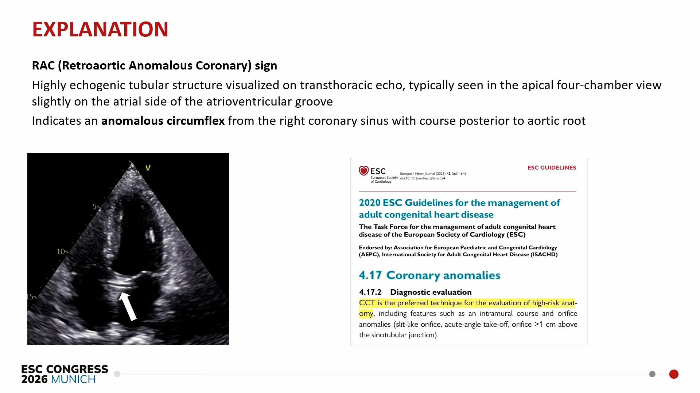

1. Patient reassurance
2. Exercise ECG test
3. **Coronary computed tomography angiography**
4. FDG-PET/CT
5. PET/CT myocardial perfusion

現場答對率 **31%**（A 6%、**B 33%**、D 13%、E 16%）

---

# 第 4 題說明：RAC sign

- **RAC** (Retroaortic Anomalous Coronary) sign
- TTE 心尖四腔切面：房室溝心房側一條**高回音的管狀結構**
- 代表**迴旋支異常起源於右冠狀竇**，走在主動脈根部後方
- ESC 2020 成人先天性心臟病指引：評估高風險冠狀動脈異常，**CCT 是首選**
- 本例 CCT 證實異常迴旋支

> 看 A4C 時，別只看心室，房室溝裡也可能藏著答案。

---

<!-- _class: opts -->

# 第 5 題解答：E

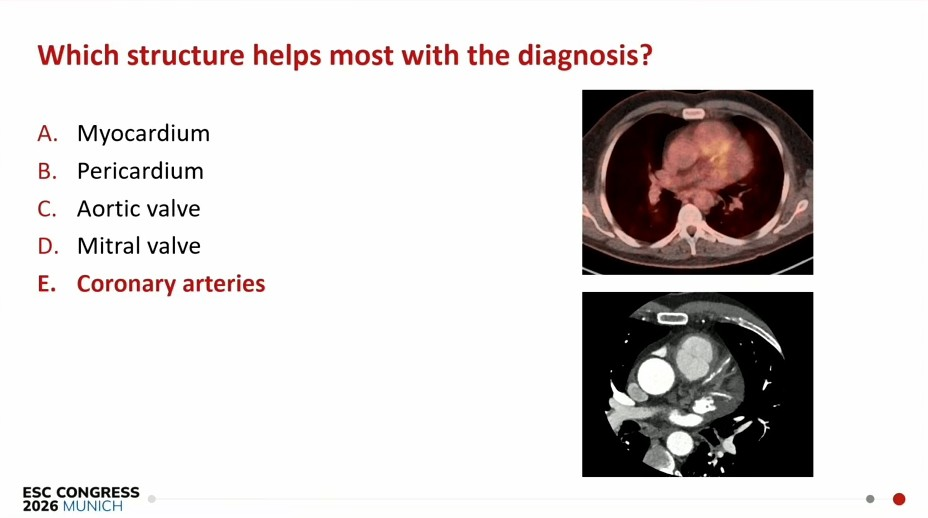

1. Myocardium
2. Pericardium
3. Aortic valve
4. Mitral valve
5. **Coronary arteries**

現場答對率 **27%**（**A 27%**、B 21%、C 17%、D 9%）

---

# 第 5 題說明：冠狀動脈血管炎

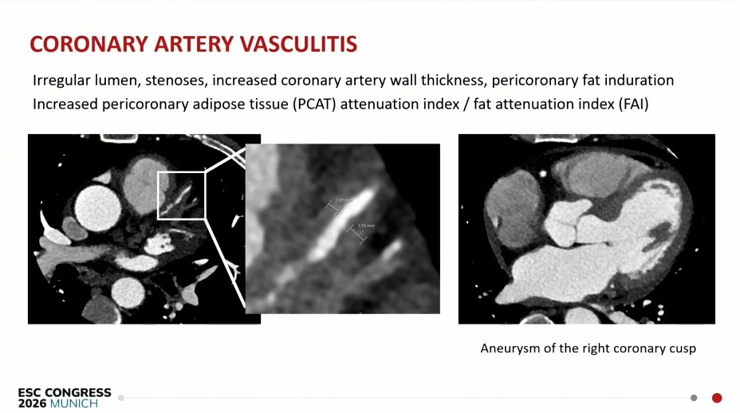

- 冠狀動脈管腔不規則、狹窄、**管壁增厚**、周邊脂肪浸潤
- 冠狀動脈周圍脂肪衰減 (PCAT / FAI) 上升
- 右冠狀竇有**動脈瘤**
- 診斷：**冠狀動脈結節性多發動脈炎** (polyarteritis nodosa, PAN)

---

# 第 5 題說明：PAN 與鑑別診斷

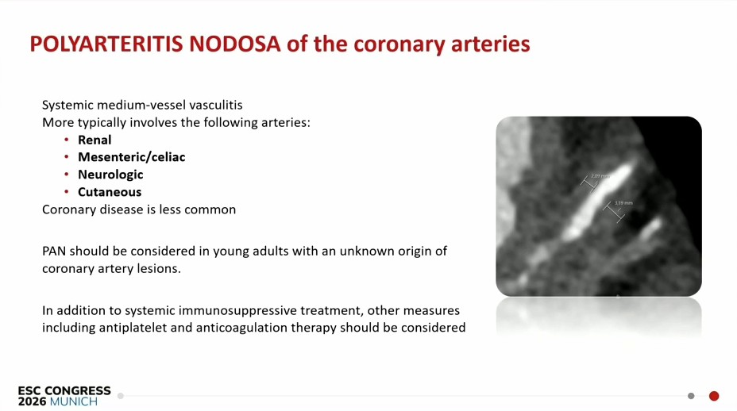

- 全身性**中型血管**炎；常侵犯腎、腸繫膜、神經、皮膚，冠狀動脈較少見
- 年輕人出現原因不明的冠狀動脈病灶，要考慮 PAN
- 治療：全身性免疫抑制，並考慮抗血小板與抗凝血
- 鑑別：Takayasu、Kawasaki、SLE、Behçet、ANCA 相關血管炎
- FAI 上升代表冠狀動脈發炎，與未來冠狀動脈事件相關（仍有爭議）

---

<!-- _class: opts -->

# 第 6 題解答：D

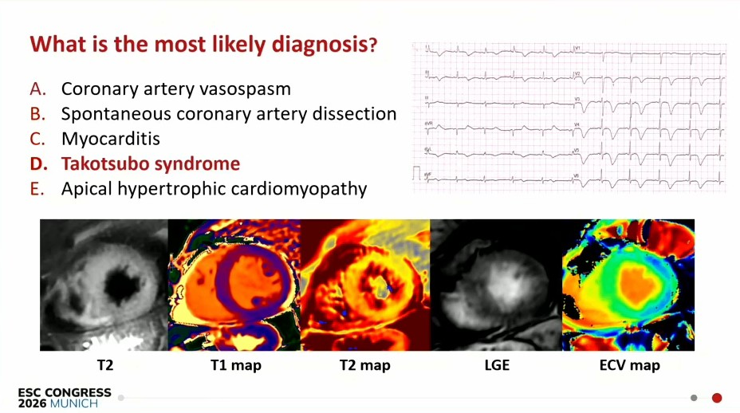

1. Coronary artery vasospasm
2. Spontaneous coronary artery dissection
3. Myocarditis
4. **Takotsubo syndrome**
5. Apical hypertrophic cardiomyopathy

現場答對率 **19%**（A 22%、B 9%、C 18%、**E 33%**）

---

# 第 6 題說明：痙攣也在場

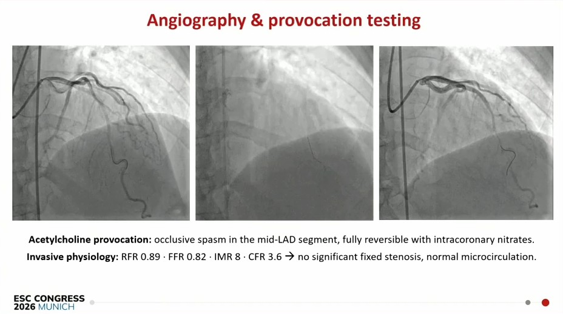

- **Acetylcholine 誘發**：LAD 中段閉塞性痙攣，nitrate 可逆轉
- RFR 0.89、FFR 0.82、IMR 8、CFR 3.6：無固定狹窄，微循環正常
- 若痙攣是主因，CMR 應留下大片梗塞**疤痕**
- 評審結論：仍是**反覆 Takotsubo**，合併痙攣傾向

> 本題考的是：哪一個答案能解釋全部的發現。

---

# 計分表

| 題 | 答案 | 現場答對率 |
|---|---|---|
| 1 | D | 未公布 |
| 2 | C | 30% |
| 3 | B | 25% |
| 4 | C | 31% |
| 5 | E | 27% |
| 6 | D | 19% |

- 5 到 6 題：比 Munich 現場所有人都強
- 3 到 4 題：已經贏過大半聽眾
- 2 題以下：沒關係，今年平均答對率不到三成

---

<!-- _class: small -->

# 來源與致謝

- **原始節目**：The ESC Grand Bavarian Quiz, ESC Congress 2026, Munich, 2026-08-28。主持 Mark Westwood (UK)、John-Paul Carpenter (IE)；評審團 Luna Gargani、Sarah Moharem Elgamal、Holly Morgan、Robin Nijveldt、Abhishek Joshi、Omar Chehab。[ESC 365 Session 55619](https://esc365.escardio.org/session/55619)
- **病例投稿者**：A. Apostolos (Royal Brompton & Imperial College London)、A. Boulmpou (Radboud UMC)、F. Abadie (Lariboisière, Paris)、K. Bitos (University Hospital Zurich)、A. van Rosendael (UMC Utrecht)、D. Junod 與 R. Maragna (Centro Cardiologico Monzino, Milan)
- **影像**：截自 ESC TV 轉播畫面（僅取投影片區域），版權屬 ESC 與各投稿者，僅供院內教學使用
- **參考**：[Wu KC, et al. Circulation 1998;97:765-772](https://pubmed.ncbi.nlm.nih.gov/9498540/)（MVO 預後）；2020 ESC 成人先天性心臟病指引
- 本測驗為教學整理，題目與選項依原節目，中文說明為整理者所加

---

<!-- _class: end -->
<!-- _paginate: false -->

# 謝謝參與
## 答案請勿外流給還沒玩的同事

謝慕揚 MD, PhD, FESC
